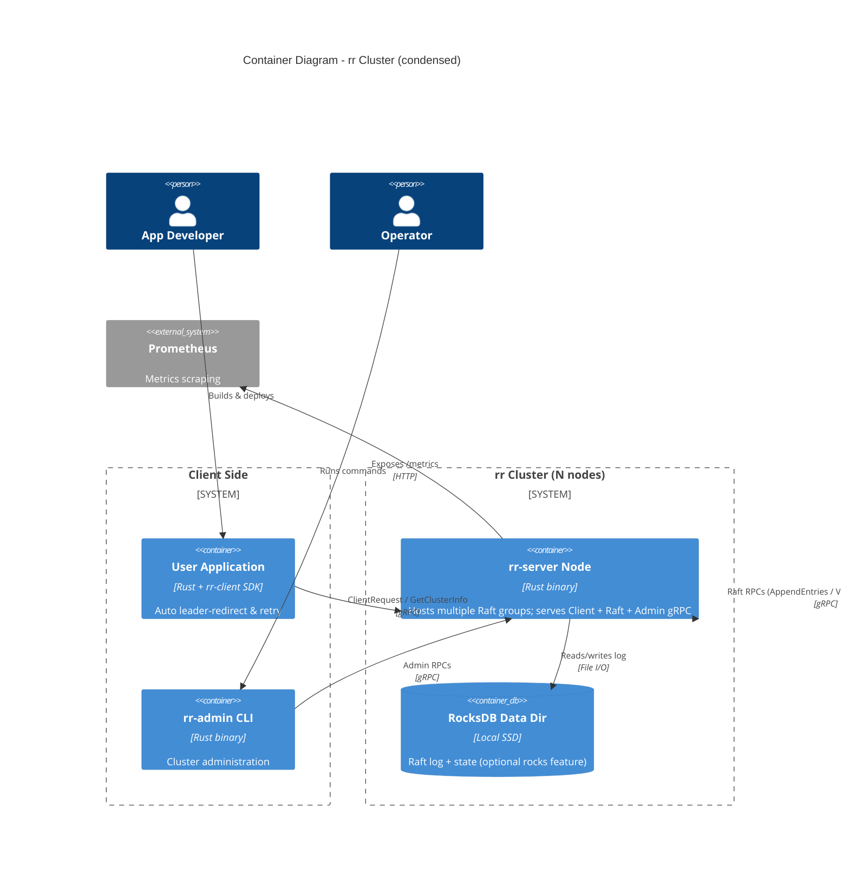

# rr — Distributed Multi-Raft Consensus Framework

[](https://codecov.io/gh/gardenias/rr)

## 简介 / Introduction

rr 是一个用 Rust 编写的分布式多 Raft 共识框架，专为构建高可用、强一致性的分布式系统而设计。它在单个节点上支持多个独立的 Raft 组，通过表格式的分片路由实现灵活的数据分布。核心特性包括可插拔的存储后端、基于 gRPC 的高效网络通信、动态的分布式配置管理和成熟的客户端 SDK，大大降低了开发分布式应用的复杂度。

---

rr is a distributed multi-Raft consensus framework written in Rust, designed for building highly available and strongly consistent distributed systems. It supports multiple independent Raft groups on a single node with flexible data distribution through table-based shard routing. Key features include pluggable storage backends, efficient gRPC-based networking, dynamic distributed configuration management, and a mature client SDK that significantly reduces the complexity of building distributed applications.

## 特性 / Features

- **Multi-Raft Consensus Groups** — 单节点支持多个独立的 Raft 共识组 / Single node supports multiple independent Raft consensus groups
- **Table-Based Shard Routing** — 使用路由表进行分片映射，无需哈希环 / Shard mapping via routing table without hash ring
- **Pluggable Storage Backends** — 支持内存存储和 RocksDB（通过 `rocks` feature 启用）/ Support for in-memory and RocksDB storage via `rocks` feature
- **gRPC Networking with Connection Pooling** — 高效的 gRPC 网络层和连接池管理 / Efficient gRPC networking with connection pooling
- **Dynamic Configuration Management** — 通过 ConfigProvider 动态管理分布式配置和分区 / Dynamic distributed configuration via ConfigProvider
- **Client SDK with Auto Leader-Redirect** — 智能客户端 SDK 自动处理领导者重定向和重试 / Smart client SDK with auto leader-redirect and retry
- **Snapshot Transfer Between Nodes** — 节点间的快照传输支持快速同步 / Snapshot transfer between nodes for fast synchronization

## Architecture

A C4 Container view of a deployed rr cluster — what processes run, what they talk, and over which protocols.



For the full C4 documentation — Context, Component, Deployment, and Dynamic flows (client PUT with leader redirect, leader election, snapshot transfer, shard routing, config updates) — see [`docs/docs/architecture/c4/`](./docs/docs/architecture/c4/README.md). For the crate dependency layering, see [`docs/docs/architecture/crate-map.md`](./docs/docs/architecture/crate-map.md).

## Quick Start

### Define Types

Create request and response types that implement `Serialize`/`Deserialize`:

```rust
use serde::{Deserialize, Serialize};

#[derive(Debug, Clone, Serialize, Deserialize)]
pub enum KvRequest {
    Put { key: String, value: Vec<u8> },
    Get { key: String },
    Delete { key: String },
}

#[derive(Debug, Clone, Serialize, Deserialize)]
pub struct KvResponse {
    pub value: Option<Vec<u8>>,
}
```

### Implement Service Trait

Create a service that handles client requests:

```rust
use async_trait::async_trait;
use rr_core::service::Service;
use std::collections::HashMap;
use std::sync::Arc;
use tokio::sync::RwLock;

#[derive(Clone)]
pub struct KvService {
    store: Arc<RwLock<HashMap<String, Vec<u8>>>>,
}

impl KvService {
    pub fn new() -> Self {
        Self {
            store: Arc::new(RwLock::new(HashMap::new())),
        }
    }
}

#[async_trait]
impl Service for KvService {
    async fn handle(&self, request: Vec<u8>) -> Result<Vec<u8>, RrError> {
        let (req, _): (KvRequest, _) = bincode::serde::decode_from_slice(&request, standard())?;
        
        let response = match req {
            KvRequest::Put { key, value } => {
                self.store.write().await.insert(key, value);
                KvResponse { value: None }
            }
            KvRequest::Get { key } => {
                let guard = self.store.read().await;
                KvResponse {
                    value: guard.get(&key).cloned(),
                }
            }
            KvRequest::Delete { key } => {
                self.store.write().await.remove(&key);
                KvResponse { value: None }
            }
        };
        
        let encoded = bincode::serde::encode_to_vec(&response, standard())?;
        Ok(encoded)
    }

    fn name(&self) -> &str {
        "kv-store"
    }

    async fn snapshot(&self) -> Result<Vec<u8>, RrError> {
        let guard = self.store.read().await;
        bincode::serde::encode_to_vec(&*guard, standard())
    }

    async fn restore(&mut self, data: &[u8]) -> Result<(), RrError> {
        let (restored, _) = bincode::serde::decode_from_slice(data, standard())?;
        *self.store.write().await = restored;
        Ok(())
    }
}
```

### Start a Node

Initialize an `RrNode` with configuration:

```rust
use rr_server::node::RrNode;
use rr_server::config::NodeConfig;
use rr_config::mem::MemConfigProvider;
use rr_storage::mem::MemStorage;
use rr_raft::service_adapter::ServiceStateMachineAdapter;

#[tokio::main]
async fn main() -> Result<()> {
    let service = KvService::new();
    let state_machine = ServiceStateMachineAdapter::new(1, service);
    
    let config = NodeConfig {
        node_id: 1,
        listen_addr: "127.0.0.1:51001".to_string(),
        // ... other config fields
    };
    
    let storage = MemStorage::new();
    let config_provider = MemConfigProvider::new();
    
    let node = RrNode::new(
        config,
        storage,
        state_machine,
        config_provider,
    ).await?;
    
    node.serve().await?;
    Ok(())
}
```

## Build Instructions

### Basic Build

```bash
# Build all crates
cargo build

# Run all tests
cargo test

# Build with RocksDB storage (rocks feature)
cargo build --features rocks

# Run the KV store example
cargo run -p kv-store
```

### Multi-Node Example

Start a cluster with multiple nodes:

```bash
# Terminal 1: Bootstrap the first node
cargo run -p kv-store -- --node-id 1 --port 51001 --bootstrap

# Terminal 2: Join second node
cargo run -p kv-store -- --node-id 2 --port 51002 --peers 127.0.0.1:51001

# Terminal 3: Join third node
cargo run -p kv-store -- --node-id 3 --port 51003 --peers 127.0.0.1:51001,127.0.0.1:51002
```

The cluster will form consensus automatically, and you can perform distributed KV operations across the cluster.

## Documentation

📖 For detailed API documentation, architectural deep-dives, and advanced configuration, see the [📖 Documentation](https://rr-framework.github.io)

## License

This project is licensed under the MIT License. See the LICENSE file for details.

## Contributing

We welcome contributions! Please feel free to open issues or submit pull requests on GitHub.
