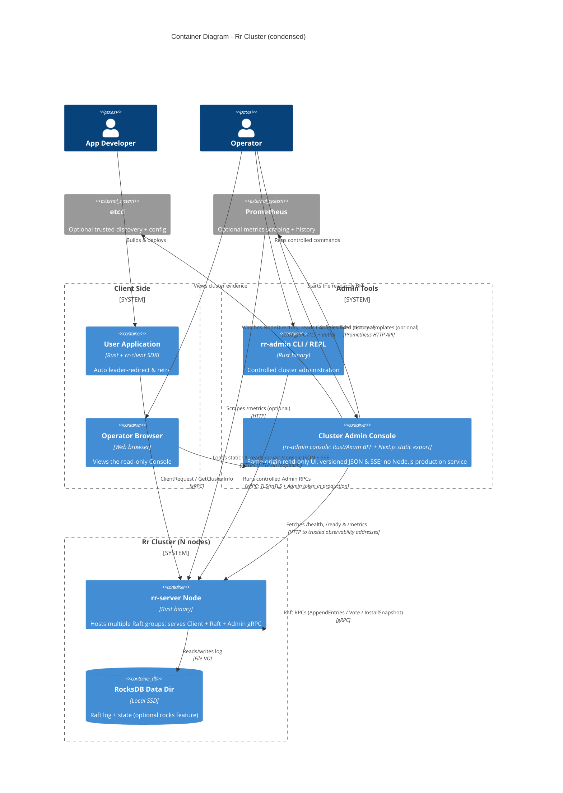

# Rr — Distributed Multi-Raft Consensus Framework

[](https://codecov.io/gh/gardenias/rr)

## 简介 / Introduction

Rr 是一个用 Rust 编写的分布式多 Raft 共识框架，专为构建高可用、强一致性的分布式系统而设计。它在单个节点上支持多个独立的 Raft 组，通过表格式的分片路由实现灵活的数据分布。核心特性包括可插拔的存储后端、基于 gRPC 的高效网络通信、动态的分布式配置管理和成熟的客户端 SDK，大大降低了开发分布式应用的复杂度。

---

Rr is a distributed multi-Raft consensus framework written in Rust, designed for building highly available and strongly consistent distributed systems. It supports multiple independent Raft groups on a single node with flexible data distribution through table-based shard routing. Key features include pluggable storage backends, efficient gRPC-based networking, dynamic distributed configuration management, and a mature client SDK that significantly reduces the complexity of building distributed applications.

## 特性 / Features

- **Multi-Raft Consensus Groups** — 单节点支持多个独立的 Raft 共识组 / Single node supports multiple independent Raft consensus groups
- **Table-Based Shard Routing** — 使用路由表进行分片映射，无需哈希环 / Shard mapping via routing table without hash ring
- **Pluggable Storage Backends** — 支持内存存储和 RocksDB（通过 `rocks` feature 启用）/ Support for in-memory and RocksDB storage via `rocks` feature
- **Durable Raft Log & Snapshots** — `--storage rocks` 持久化 Raft 日志与状态机快照（fail-closed）/ Durable raft log and state-machine snapshots with `--storage rocks` (fail-closed)
- **gRPC Networking with Connection Pooling** — 高效的 gRPC 网络层和连接池管理 / Efficient gRPC networking with connection pooling
- **TLS/mTLS + Bearer Auth + Rate Limiting** — 生产安全默认（G1–G7 启动安全门）/ Production-grade security by default (G1–G7 startup gates)
- **Dynamic Configuration Management** — 通过 ConfigProvider 动态管理分布式配置和分区（内存与 etcd 后端）/ Dynamic distributed configuration via ConfigProvider (in-memory and etcd backends)
- **Read-Only Cluster Admin Console** — `rr-admin console` 同源托管 Next.js 静态界面、版本化 JSON 与 SSE，
  展示集群、Raft 组、生命周期与性能；受控写操作仍由 Admin CLI 执行 / `rr-admin console` serves a same-origin
  Next.js static UI, versioned JSON, and SSE for cluster, Raft group, lifecycle, and performance visibility;
  controlled writes remain in the Admin CLI
- **Client SDK with Auto Leader-Redirect** — 智能客户端 SDK 自动处理领导者重定向和重试（Rust + Java）/ Smart client SDK with auto leader-redirect and retry (Rust + Java)
- **Snapshot Transfer Between Nodes** — 节点间的快照传输支持快速同步 / Snapshot transfer between nodes for fast synchronization
- **Linearizable Reads** — 协议层强一致读（ReadIndex + leader 重定向）/ Protocol-level linearizable reads (ReadIndex + leader redirect)
- **Framework Idempotency & Kafka Ingest** — exactly-once apply 语义与 Kafka 输入 / Exactly-once apply semantics and Kafka input
- **Backup / Restore** — 离线备份、在线快照流式备份与恢复 / Offline backup, online snapshot streaming backup, and restore

## Architecture

A C4 Container view of a deployed Rr cluster — what processes run, what they talk, and over which protocols.



For the full C4 documentation — Context, Component, Deployment, and Dynamic flows (client PUT with leader redirect, leader election, snapshot transfer, shard routing, config updates) — see [`docs/docs/architecture/c4/`](./docs/docs/architecture/c4/README.md). For the crate dependency layering, see [`docs/docs/architecture/crate-map.md`](./docs/docs/architecture/crate-map.md).

## Quick Start

### Define Types

Create request and response types that implement `Serialize`/`Deserialize`:

```rust
use serde::{Deserialize, Serialize};

#[derive(Debug, Clone, Serialize, Deserialize)]
pub enum KvRequest {
    Put { key: String, value: Vec<u8> },
    Get { key: String },
    Delete { key: String },
}

#[derive(Debug, Clone, Serialize, Deserialize)]
pub struct KvResponse {
    pub value: Option<Vec<u8>>,
}
```

### Implement Service Trait

Create a service that handles client requests:

```rust
use async_trait::async_trait;
use bincode::config::standard;
use rr_core::error::{CodecError, RrError};
use rr_core::service::Service;
use std::collections::HashMap;
use std::sync::Arc;
use tokio::sync::RwLock;

#[derive(Clone)]
pub struct KvService {
    store: Arc<RwLock<HashMap<String, Vec<u8>>>>,
}

impl KvService {
    pub fn new() -> Self {
        Self {
            store: Arc::new(RwLock::new(HashMap::new())),
        }
    }
}

#[async_trait]
impl Service for KvService {
    async fn handle(&self, request: Vec<u8>) -> Result<Vec<u8>, RrError> {
        let (req, _): (KvRequest, _) = bincode::serde::decode_from_slice(&request, standard())
            .map_err(|e| RrError::Codec(CodecError::DeserializeFailed(e.to_string())))?;
        
        let response = match req {
            KvRequest::Put { key, value } => {
                self.store.write().await.insert(key, value);
                KvResponse { value: None }
            }
            KvRequest::Get { key } => {
                let guard = self.store.read().await;
                KvResponse {
                    value: guard.get(&key).cloned(),
                }
            }
            KvRequest::Delete { key } => {
                self.store.write().await.remove(&key);
                KvResponse { value: None }
            }
        };
        
        let encoded = bincode::serde::encode_to_vec(&response, standard())
            .map_err(|e| RrError::Codec(CodecError::SerializeFailed(e.to_string())))?;
        Ok(encoded)
    }

    fn name(&self) -> &str {
        "kv-store"
    }

    async fn snapshot(&self) -> Result<Vec<u8>, RrError> {
        let guard = self.store.read().await;
        bincode::serde::encode_to_vec(&*guard, standard())
            .map_err(|e| RrError::Codec(CodecError::SerializeFailed(e.to_string())))
    }

    async fn restore(&mut self, data: &[u8]) -> Result<(), RrError> {
        let (restored, _): (HashMap<String, Vec<u8>>, _) =
            bincode::serde::decode_from_slice(data, standard())
                .map_err(|e| RrError::Codec(CodecError::DeserializeFailed(e.to_string())))?;
        *self.store.write().await = restored;
        Ok(())
    }
}
```

### Run It

零配置运行内置 KV Store 演示（进程内 Raft，自选主后执行一组读写并退出，约 0.2s）：

Run the built-in KV Store demo with zero config (in-process Raft, self-elects a leader, runs a few reads/writes, then exits in ~0.2s):

```bash
cargo run -p kv-store
```

预期输出（裁剪后）/ Expected output (trimmed):

```text
INFO === rr KV-Store demo (single-node, no gRPC) ===
INFO PUT hello = "world"
INFO GET hello = "world"
INFO PUT counter = "1"
INFO DEL hello
INFO GET hello = <not found>
INFO GET counter = "1"
INFO === rr KV-Store demo complete ===
```

再启动一个常驻的单节点 gRPC 服务，并用 `rr-admin` REPL 作为 KV 客户端连接：

Then bootstrap a long-running single-node gRPC server and connect with the `rr-admin` REPL as a KV client:

```bash
# Terminal 1: 引导节点（阻塞运行，Ctrl-C 停止）/ bootstrap node (blocks; Ctrl-C to stop)
cargo run -p kv-store -- --node-id 1 --port 51001 --bootstrap

# Terminal 2: REPL 必须连接 kv-store 的监听端口 51001（不是 rr-admin 默认的 52001）
# Terminal 2: the REPL must target kv-store's listen port 51001 (NOT rr-admin's default 52001)
cargo run -p rr-admin -- repl --addr 127.0.0.1:51001 --group 1
```

```text
> put alpha one
OK
> get alpha
one
> delete alpha
OK
> get alpha
(nil)
```

> **Note**: `kv-store` 会把 Admin API 挂在客户端端口 +1000（51001 → 52001）。REPL 的管理命令默认按 `--addr` 的主机 + 端口+1000 推导 admin 端点（`--admin-addr` 可显式覆盖），所以指向客户端端口 51001 时 `status`/`members` 也会自动打到 52001；一次性子命令用 `--addr 127.0.0.1:52001`（如 `cargo run -p rr-admin -- --addr 127.0.0.1:52001 node status`）。
> `kv-store` serves its Admin API on the client port +1000 (51001 → 52001). The REPL derives the admin endpoint as the `--addr` host with port +1000 by default (override with `--admin-addr`), so pointing it at the client port 51001 still reaches admin commands on 52001; for one-shot subcommands use `--addr 127.0.0.1:52001` (e.g. `cargo run -p rr-admin -- --addr 127.0.0.1:52001 node status`).

### 何时使用 `--bootstrap` / When to Use `--bootstrap`

无参数 demo 会自行初始化单副本组，不需要该旗标。常驻的手动单节点服务只在全新建组时引导一次；
手动多节点集群必须在所有节点使用同一份完整花名册，并且只在一个全新节点上使用 `--bootstrap`，
由它一次性初始化全部 voter。其他节点不使用该旗标。

The no-argument demo initializes its own single-replica group and needs no flag. A persistent manual
single-node service bootstraps once when its fresh group is created. For manual multi-node startup, every
node needs the same full roster and exactly one fresh node uses `--bootstrap` to initialize all voters at
once; the other nodes omit it.

Genesis 和 Adopt 不使用 `--bootstrap`。正常重启、已初始化节点以及 durable 节点恢复时也必须省略它。
重复初始化即使因组已存在而成为 no-op，也不能当作重启或成员变更策略。本次 gRPC Pre-Vote 故障并非
`--bootstrap` 导致；不要用重复引导处理选主、网络隔离或 Pre-Vote 问题。

Genesis and Adopt do not use `--bootstrap`. Omit it for normal restarts and when restarting or recovering
an already initialized node, including a durable node. A fresh durable node may still bootstrap its
initial group. Repeating initialization may be a no-op when the group exists, but that is not a restart or
membership-change strategy. The gRPC Pre-Vote failure addressed here was not caused by `--bootstrap`;
repeated bootstrapping is not a remedy for election, network-isolation, or Pre-Vote failures.

想以编程方式嵌入节点，请参考 [`examples/kv-store/src/main.rs`](./examples/kv-store/src/main.rs) 和[快速入门指南](https://rr-framework.github.io/guide/getting-started)。真实 API 为 `NodeConfig::new(node_id, listen_addr, storage, config_provider, sm_factory)` → `RrNode::new(config)?`（同步、单参数）→ `node.start().await?`。

To embed a node programmatically, see [`examples/kv-store/src/main.rs`](./examples/kv-store/src/main.rs) and the [Getting Started guide](https://rr-framework.github.io/guide/getting-started). The real API is `NodeConfig::new(node_id, listen_addr, storage, config_provider, sm_factory)` → `RrNode::new(config)?` (synchronous, single argument) → `node.start().await?`.

## Managed Cluster Formation

Fresh clusters can use homogeneous Genesis formation. Every node receives the same full advertised roster and
`[cluster.formation]` settings; no ordinal-specific bootstrap or peers list is derived. Genesis initializes the
full roster only through a linearizable lifecycle record and does not run the ordinary cluster-form job.

Existing initialized groups use `mode = "adopt"` instead. Adopt initialized nodes first, verify that ACK data
and membership are unchanged, then start pristine nodes and converge them through the existing formation job or
manual `add-learner` + `change-membership`. Adoption never initializes a group or expands membership by itself.

SeedSpec describes the initial routing/Genesis roster, not current Raft membership. P1 does not support dynamic
membership expansion, replica replacement, or resharding. During a lifecycle-store outage, initialized nodes can
continue Raft traffic with unchanged routes but remain unready/degraded; pristine nodes fail closed. See the
[getting-started guide](docs/docs/guide/getting-started.md) and [upgrade runbook](docs/docs/deployment/upgrading.md).

## Build Instructions

### Basic Build

```bash
# Build all crates
cargo build

# Run all tests
cargo test

# Build with RocksDB storage (rocks feature)
cargo build --features rocks

# Run the KV store example
cargo run -p kv-store
```

### 只读 Cluster Admin Console / Read-Only Cluster Admin Console

`rr-admin console` 在同一个 Rust/Axum BFF 中托管 Next.js 静态导出、版本化 `/api/v1/console` JSON 和 SSE，
无需独立 Node.js 生产服务。Console 只读；membership、强制选主、TriggerSnapshot、drain 和 offset reset 等受控写操作仍由
Admin CLI 执行，停止 Console 不影响 Raft 节点。

`rr-admin console` serves the Next.js static export, versioned `/api/v1/console` JSON, and SSE from one Rust/Axum
BFF, with no standalone Node.js production service. The Console is read-only; controlled writes such as membership
changes, forced leadership, snapshot triggering, drains, and offset resets remain in the Admin CLI. Stopping the
Console does not affect Raft nodes.

完整浏览器 UI 需要先构建静态导出。部署时随二进制携带 `crates/rr-admin/console/out`，或用 `--static-dir`
指向其部署位置。

Build the static export for the full browser UI. Ship `crates/rr-admin/console/out` with the binary, or point
`--static-dir` at its deployed location.

```bash
pnpm --dir crates/rr-admin/console install --frozen-lockfile
pnpm --dir crates/rr-admin/console run build
cargo build --release -p rr-admin
```

以下是使用显式 Admin seed 的本地启动示例；`--peers` 的每项是 `node_id@AdminService_host:port`，不是
client/bootstrap 地址。仅为不需要认证的明文本地 AdminService 省略 `--token-env`。

The following local example uses explicit Admin seeds. Each `--peers` entry is
`node_id@AdminService_host:port`, not a client/bootstrap address. Omit `--token-env` only for a plaintext local
AdminService that does not require authentication.

```bash
export RR_ADMIN_TOKEN='<admin-token-from-your-secret-store>'

./target/release/rr-admin \
  --token-env RR_ADMIN_TOKEN \
  console \
  --listen 127.0.0.1:8080 \
  --peers 1@127.0.0.1:52001,2@127.0.0.1:52002,3@127.0.0.1:52003
```

打开 `http://127.0.0.1:8080`。只有 Admin seed 时可查看 Admin-backed 数据；健康探测和实时指标还要求节点提供
带受信 `observability_addr` 的完整描述符，否则相应模块按能力降级。全局 `--token-env` 和 BFF→AdminService 的
`--tls-ca`/`--tls-cert`/`--tls-key`/`--tls-domain` 位于 `console` **之前**；`--listen`、`--peers`、
`--static-dir`，以及 Browser→Console 的 `--console-token-env`/`--tls-cert`/`--tls-key` 位于 `console`
**之后**。非 loopback 监听必须同时启用 Console HTTPS 和 viewer token。安全启动、可选 etcd 发现和可选
Prometheus 历史配置见 [Cluster Admin Console 运维手册](docs/docs/operations/cluster-admin-console.md)。

Open `http://127.0.0.1:8080`. Admin seeds alone provide Admin-backed data; health probes and live metrics additionally
require a complete node descriptor with a trusted `observability_addr`, otherwise those modules degrade by capability.
The global `--token-env` and BFF-to-AdminService
`--tls-ca`/`--tls-cert`/`--tls-key`/`--tls-domain` flags appear **before** `console`; `--listen`, `--peers`,
`--static-dir`, and the browser-to-Console `--console-token-env`/`--tls-cert`/`--tls-key` flags appear **after**
it. A non-loopback listener requires both Console HTTPS and a viewer token. See the
[Cluster Admin Console operations guide](docs/docs/operations/cluster-admin-console.md) for secure startup, optional
etcd discovery, and optional Prometheus history.

### Multi-Node Consensus Cluster

以下是本机实测通过的三节点真实共识集群（`kv-store` 示例，真实 KV 语义）：

The following three-node real-consensus cluster is verified on a single machine (the `kv-store` example, real KV semantics):

```bash
# Terminal 1 — node 1 (bootstrap)
# --peers 携带全量 id@addr 花名册（含自己），三个节点保持一致
cargo run -p kv-store -- --node-id 1 --port 51001 --bootstrap --peers 1@127.0.0.1:51001,2@127.0.0.1:51002,3@127.0.0.1:51003

# Terminal 2 — node 2
cargo run -p kv-store -- --node-id 2 --port 51002 --peers 1@127.0.0.1:51001,2@127.0.0.1:51002,3@127.0.0.1:51003

# Terminal 3 — node 3
cargo run -p kv-store -- --node-id 3 --port 51003 --peers 1@127.0.0.1:51001,2@127.0.0.1:51002,3@127.0.0.1:51003
```

#### 可选：前台监督与逐节点日志 / Optional Foreground Supervision and Logs

以下示例先构建 `kv-store` 和 `rr-admin`，再在默认基础端口 56101 上启动三节点集群。
客户端端口为 56101–56103，Admin 端口为 57101–57103；运行前确认六个端口均空闲。
若被占用，先执行 `BASE_PORT=58101`（或选择其他空闲基础端口），再粘贴同一段命令。

This example builds `kv-store` and `rr-admin`, then starts a three-node cluster at default base port 56101.
Client ports are 56101–56103 and Admin ports are 57101–57103; confirm all six are free first. If they are
busy, run `BASE_PORT=58101` (or choose another idle base) before pasting the same block.

脚本在前台等待，分别把各节点 stdout/stderr 写入 `target/kv-store-demo/logs/`，把精确子进程 PID 写入
`target/kv-store-demo/pids/`。按 Ctrl-C 只会向这三个已记录 PID 发信号并等待它们，保留日志且只删除
本次脚本的 PID 文件；不会使用 `pkill` 或按端口查杀进程。

The script waits in the foreground, writes each node's stdout/stderr under `target/kv-store-demo/logs/`,
and records exact child PIDs under `target/kv-store-demo/pids/`. Ctrl-C signals and waits for only those
three recorded PIDs, preserves logs, and removes only this script's PID files; it never uses `pkill` or
kills by port.

```bash
BASE_PORT="${BASE_PORT:-56101}" bash <<'RR_DEMO'
set -u

case "$BASE_PORT" in
  ''|*[!0-9]*) echo "BASE_PORT must be an integer" >&2; exit 2 ;;
esac
base_port=$((10#$BASE_PORT))
if [ "$base_port" -lt 1024 ] || [ "$base_port" -gt 64533 ]; then
  echo "BASE_PORT must be between 1024 and 64533" >&2
  exit 2
fi

cargo build -p kv-store -p rr-admin || exit $?

demo_dir="target/kv-store-demo"
mkdir -p "$demo_dir/logs" "$demo_dir/pids" || exit $?
roster="1@127.0.0.1:${base_port},2@127.0.0.1:$((base_port + 1)),3@127.0.0.1:$((base_port + 2))"
pids=""
pid_files=""
pending_signal=""

cleanup() {
  trap - INT TERM EXIT
  for pid in $pids; do
    kill -TERM "$pid" 2>/dev/null || true
  done
  for pid in $pids; do
    wait "$pid" 2>/dev/null || true
  done
  for pid_file in $pid_files; do
    rm -f "$pid_file"
  done
}
trap 'pending_signal=130' INT
trap 'pending_signal=143' TERM
trap cleanup EXIT

for node_id in 1 2 3; do
  port=$((base_port + node_id - 1))
  log_file="$demo_dir/logs/node-${node_id}.log"
  pid_file="$demo_dir/pids/node-${node_id}.pid"
  bootstrap=""
  if [ "$node_id" -eq 1 ]; then
    bootstrap="--bootstrap"
  fi

  target/debug/kv-store --node-id "$node_id" --port "$port" \
    --peers "$roster" $bootstrap >"$log_file" 2>&1 &
  pid=$!
  pids="$pids $pid"
  pid_files="$pid_files $pid_file"
  printf '%s\n' "$pid" >"$pid_file" || exit 1
  if [ -n "$pending_signal" ]; then
    exit "$pending_signal"
  fi
done

trap 'exit 130' INT
trap 'exit 143' TERM
if [ -n "$pending_signal" ]; then
  exit "$pending_signal"
fi

printf 'Three nodes started at base port %s; logs: %s/logs\n' "$base_port" "$demo_dir"
printf 'Press Ctrl-C to stop only these PIDs:%s\n' "$pids"
while :; do
  for pid in $pids; do
    if ! kill -0 "$pid" 2>/dev/null; then
      wait "$pid" 2>/dev/null
      status=$?
      if [ "$status" -eq 0 ]; then
        status=1
      fi
      printf 'Child PID %s exited; stopping this demo.\n' "$pid" >&2
      exit "$status"
    fi
  done
  sleep 1
done
RR_DEMO
```

另开终端跟踪日志，并检查三个节点的 leader、复制进度和成员关系。覆盖基础端口时，先在状态终端设置同一个 `BASE_PORT`：

In another terminal, tail the logs and check each node's leader, log progress, and membership. When
overriding the base port, set the same `BASE_PORT` in the status terminal first:

```bash
tail -f target/kv-store-demo/logs/node-1.log \
  target/kv-store-demo/logs/node-2.log target/kv-store-demo/logs/node-3.log
```

```bash
BASE_PORT="${BASE_PORT:-56101}"
base_port=$((10#$BASE_PORT))
for node_id in 1 2 3; do
  admin_port=$((base_port + 1000 + node_id - 1))
  target/debug/rr-admin --addr "127.0.0.1:${admin_port}" group status --group 1
  target/debug/rr-admin --addr "127.0.0.1:${admin_port}" group membership --group 1
done
```

每个节点在 `5100N` 提供 ClientService，在 `5200N`（port+1000）提供 AdminService。引导节点以全量成员初始化 Raft 组，其余节点通过日志复制自动跟上。验证：

Each node serves ClientService on `5100N` and AdminService on `5200N` (port+1000). The bootstrap node initializes the Raft group with the full membership; the others catch up via log replication. Verify:

```bash
# 三节点 group status 一致（leader_node_id 相同、last_log_index 同步推进）
cargo run -p rr-admin -- --addr 127.0.0.1:52001 group status --group 1

# 在 leader 的监听端口上做 KV 读写（真实 KV 语义）
cargo run -p rr-admin -- repl --addr 127.0.0.1:51001 --group 1
# rr> put k1 v1   → OK
# rr> get k1      → v1
```

故障转移（实测通过）：Ctrl-C 掉 leader 节点，几秒内其余节点选出新 leader，写入可继续且已提交数据保留。

Failover (verified): Ctrl-C the leader node — within seconds the survivors elect a new leader, writes continue, and committed data survives.

注意事项（均经实测）/ Caveats (all verified against live runs):

- **`--peers` 花名册格式为 `id@addr`**：三个节点使用相同的花名册且必须包含本节点；畸形条目会在启动时报错。/ **The `--peers` roster uses `id@addr` entries**: all nodes take the same roster, which must include the node itself; malformed entries fail fast at startup.
- **服务端不在节点间转发客户端写请求**：发往 follower 会返回 `success=false`；REPL 和客户端 SDK 负责自动寻找 leader。/ **The server does not forward client writes between nodes**: a follower returns `success=false`; the REPL and client SDK locate the leader automatically.
- **REPL 的 `OK` 以服务端 `success=true` 为准**：REPL 启动时读取组成员地址，跟随 `leader_info` 重定向，并在当前节点断连或没有 leader 提示时尝试其他成员；最终被拒绝的写打印 `Error: request rejected ...`（不再有假 OK）。复制进度仍请用每个节点 `group status` 的 `last_log_index` 验证。/ **The REPL's `OK` requires the server's `success=true`**: it discovers member addresses at startup, follows `leader_info` redirects, and tries other members when the current node disconnects or has no leader hint. Refused writes print `Error: request rejected ...` (no fake OKs) — still verify replication via `last_log_index` in `group status` on each node.
- **默认内存模式的恢复边界**：重启节点会丢失本地 Raft 日志和 vote，存活 leader 会重置其复制进度并从头追平，因此三节点失去多数派后可在两个空节点重启后恢复。全部节点重启仍会丢失数据；需要跨重启持久化时使用 `rocks` feature 和 `--data-dir`。/ **Recovery boundary of the default in-memory mode**: a restarted node loses its local Raft log and vote; the surviving leader resets its replication progress and catches it up from scratch, so a three-node cluster can recover after two empty nodes restart. Restarting every node still loses data; use the `rocks` feature and `--data-dir` for durable restart recovery.
- **生产式路径**：使用 stock `rr-server` + `rr-admin` 显式成员管理（`add-learner` + `change-membership`）的三节点集群同样实测可用，详见 [getting-started 指南](docs/docs/guide/getting-started.md)。注意 stock `rr-server` 内置的是 EchoStateMachine 冒烟服务（`get` 回显 key 本身，非 KV 语义）。/ **Production-style path**: a three-node cluster driven by stock `rr-server` + explicit `rr-admin` membership management (`add-learner` + `change-membership`) is also verified — see the [getting-started guide](docs/docs/guide/getting-started.md). Note the stock `rr-server` ships an EchoStateMachine smoke service (`get` echoes the key itself — not KV semantics).
- **`examples/config/3node-cluster-node{1,2,3}.toml` 是多机部署模板**（已含 `[tls]`/`[auth]` 段：需要 `rocks` feature 构建、scripts/gen-dev-certs.sh 生成的 TLS 证书、可解析主机名与 `RR_ADMIN_TOKEN`/`RR_CLIENT_TOKEN` 环境变量），不是本地快速启动；成员组建命令见 node1 模板头注释。/ **`examples/config/3node-cluster-node{1,2,3}.toml` are multi-machine deployment templates** (they ship `[tls]`/`[auth]` sections and need a `rocks`-feature build, TLS certs from scripts/gen-dev-certs.sh, resolvable hostnames, and the `RR_ADMIN_TOKEN`/`RR_CLIENT_TOKEN` env vars) — not a local quickstart; the membership commands are in the node1 template's header comment.

## Developer Workflow with just

日常命令已封装在根目录的 [justfile](./justfile)（需安装 [just](https://github.com/casey/just)）。深度操作手册
（集群探玩、Genesis/Adoption、故障转移、真实验收）见 [Operations Playbook](docs/docs/guide/playbook.md)；
只读 Web Console 的构建与安全运行见 [Cluster Admin Console](docs/docs/operations/cluster-admin-console.md)；
Java SDK 用法见 [sdks/java/README.md](sdks/java/README.md)。

Common commands are wrapped in the root [justfile](./justfile) (requires [just](https://github.com/casey/just)).
For the deep operations walkthrough — cluster exploration, Genesis/adoption, failover, real acceptance suites — see the
[Operations Playbook](docs/docs/guide/playbook.md); for building and securely running the read-only Web Console see
[Cluster Admin Console](docs/docs/operations/cluster-admin-console.md); for the Java SDK see
[sdks/java/README.md](sdks/java/README.md).

```bash
just --list          # 列出全部命令 / list every recipe
just doctor          # 环境自检（必需与可选工具分开报告）/ environment self-check
just test            # cargo test 全量测试 / full test suite
just kv-cluster-up   # 一键三节点内存 KV 集群（--bootstrap 路径）/ 3-node in-memory KV cluster
just genesis-up      # 一键三节点同构 Genesis 集群（需本地 etcd）/ homogeneous Genesis cluster
just test-etcd       # 真实 etcd 验收测试 / real-etcd acceptance tests
just helm-test       # Helm chart 渲染测试 / Helm render tests
just java-test       # Java SDK 单元测试 / Java SDK unit tests
just nightly         # 本地质量门禁（invariants+全量测试+crash+fuzz+TLA）/ local quality gates
```

后台进程的 PID 与日志统一放在 `target/just/`，用 `just kv-cluster-down` / `just genesis-down` / `just etcd-down` 清理。
Recipes track background processes via PID and log files under `target/just/`; tear them down with `just kv-cluster-down` / `just genesis-down` / `just etcd-down`.

## Documentation

📖 For detailed API documentation, architectural deep-dives, and advanced configuration, see the [📖 Documentation](https://rr-framework.github.io)

## License

This project is licensed under the MIT License. See the LICENSE file for details.

## Contributing

We welcome contributions! Please feel free to open issues or submit pull requests on GitHub.
