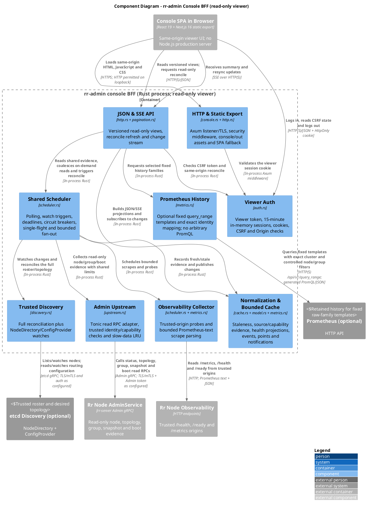

# 第 3 级：Cluster Admin Console 组件 / Level 3: Cluster Admin Console Components

本图展开 `rr-admin console` 的 Rust/Axum BFF。它与 Admin CLI/REPL 共用 `rr-admin` 二进制，并同源托管
Next.js 静态导出、版本化 JSON 和 SSE；生产环境不需要独立 Node.js 服务。

This diagram zooms into the Rust/Axum BFF started by `rr-admin console`. It shares the `rr-admin` binary with the
Admin CLI/REPL and serves the Next.js static export, versioned JSON, and SSE from one origin; no standalone Node.js
production server is required.

## 图示 / Diagram

## 请求与采集路径 / Request and Collection Paths

### 同源入口与访问边界 / Same-Origin Entry and Access Boundary

`console.rs` 组装监听器、可选 TLS、`AuthState`、`Scheduler` 和 `ConsoleCache`。`http.rs` 提供安全响应头、
静态导出与 SPA fallback；完整 UI 来自随二进制部署的 `console/out`，也可用 `--static-dir` 指定。JSON 位于
`/api/v1/console`，SSE 复用缓存的 change notification，不为每个浏览器创建上游采集循环。

`console.rs` assembles the listener, optional TLS, `AuthState`, `Scheduler`, and `ConsoleCache`. `http.rs` adds
security headers, static-export serving, and the SPA fallback. The full UI comes from `console/out`, deployed with the
binary or selected with `--static-dir`. JSON lives under `/api/v1/console`; SSE reuses cache change notifications
instead of creating an upstream collection loop per browser.

viewer token 登录只创建 15 分钟内存 session；节点 Admin token 仅留在 BFF。非 loopback 监听强制 Console
HTTPS 和 viewer token。本图没有 OIDC、RBAC 或多集群组件，因为当前实现不提供这些能力。

Viewer-token login creates only a 15-minute in-memory session, while node Admin tokens remain inside the BFF.
Non-loopback listeners require both Console HTTPS and a viewer token. OIDC, RBAC, and multi-cluster components are
absent because the current implementation does not provide them.

### 共享调度、受信来源与证据视图 / Shared Scheduling, Trusted Sources, and Evidence Views

`Scheduler` 是浏览器请求和后台轮询共享的协调点：它合并 reconcile 与按需读取，限制并发，设置超时和熔断，
并从显式 seed 或可选 `TrustedDiscovery` 建立受信 roster。discovery 通过同一 etcd namespace 的
`NodeDirectory` 和 `ConfigProvider` 全量对账并监听变化；它不是 Raft membership 控制通道。

`Scheduler` coordinates both browser requests and background polling. It coalesces reconciliation and on-demand
reads, bounds concurrency, applies deadlines and circuit breakers, and builds a trusted roster from explicit seeds or
optional `TrustedDiscovery`. Discovery fully reconciles and watches `NodeDirectory` plus `ConfigProvider` in the same
etcd namespace; it is not a Raft membership control channel.

`TonicUpstream` 只调用读取节点、拓扑、组、快照和 boot 证据的 Admin RPC。观测采集器仅从受信
`observability_addr` 抓取 `/metrics`、`/health` 和 `/ready`。`ConsoleCache` 与 metrics/model 逻辑负责身份和
能力降级、stale/partial 来源证据、组健康投影及有界事件/序列留存；实时趋势只存在内存中，重启即清空。

`TonicUpstream` invokes only Admin RPCs that read node, topology, group, snapshot, and boot evidence. The
observability collector fetches `/metrics`, `/health`, and `/ready` only from trusted `observability_addr` origins.
`ConsoleCache` and the metrics/model logic normalize identity and capability degradation, retain stale/partial source
evidence, project group health, and bound event/series retention. Live trends are memory-only and disappear on restart.

### 可选 Prometheus 历史 / Optional Prometheus History

配置成对的 `--prometheus-url` 与 `--prometheus-cluster` 后，性能 handler 才通过
`PrometheusHistoryClient` 查询 `/api/v1/query_range`。客户端生成固定 raw-family 模板并校验集群和节点映射；
它不是任意 PromQL 代理。未配置 Prometheus 不影响实时 `CONSOLE_MEMORY`、Admin 或 discovery 路径。

Only the paired `--prometheus-url` and `--prometheus-cluster` settings enable the performance handler to call
`PrometheusHistoryClient` at `/api/v1/query_range`. The client renders fixed raw-family templates and validates cluster
and node mappings; it is not an arbitrary PromQL proxy. Omitting Prometheus does not disable live `CONSOLE_MEMORY`,
Admin, or discovery paths.

## 只读与故障边界 / Read-Only and Failure Boundaries

`POST /api/v1/console/sources/reconcile` 仅触发同一共享调度器的只读刷新，并检查 CSRF 和同源 Origin。
Console 不修改 membership、不强制选主、不触发快照、不 drain 节点、不 reset offset、不重启进程；受控写操作仍由
Admin CLI/REPL 执行。Console 是观测进程而非 Raft 控制面，停止或故障不会停止 Raft 节点。

`POST /api/v1/console/sources/reconcile` only triggers a read-only refresh through the same shared scheduler, with
CSRF and same-origin Origin checks. The Console does not change membership, force leadership, trigger snapshots, drain
nodes, reset offsets, or restart processes; controlled writes remain with the Admin CLI/REPL. It is an observation
process, not a Raft control plane, so stopping or failing the Console does not stop Raft nodes.

这里的 C4 Container 指浏览器应用、BFF 进程和节点服务等逻辑运行单元，不表示 Docker 容器。完整启动、安全、
来源与指标语义见[集群管理控制台运维文档](../../operations/cluster-admin-console.md)。

Here, a C4 Container means a logical runtime unit such as the browser application, BFF process, or node service, not a
Docker container. See the [Cluster Admin Console operations guide](../../operations/cluster-admin-console.md) for
startup, security, source, and metric semantics.
