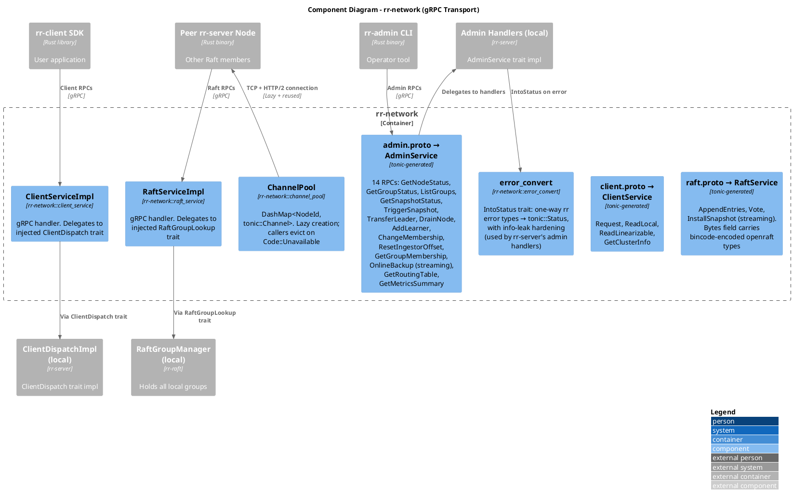

# Level 3 — rr-network 组件图 / rr-network Components

`rr-network` 是所有 RPC 的统一传输层：客户端请求、节点间 Raft 共识、管理员操作——都通过 tonic (gRPC) + 自定义连接池。本图展示 rr-network 提供的三个 gRPC 服务实现以及 ChannelPool。`RaftService` 与 `ClientService` 由 `RrNode::start()` 注册到同一个 `tonic::Server` (绑定 `listen_addr`)；`AdminService` 在配置 `admin_port` 时由 `RrNode::start()` 注册到独立的 `tonic::Server`（详见 [components-server.md](./components-server.md)）。

---

`rr-network` is the unified transport layer for all RPCs: client requests, inter-node Raft consensus, and admin operations — all via tonic (gRPC) + a custom connection pool. This diagram shows the three gRPC service implementations and the ChannelPool. `RaftService` and `ClientService` are registered together on a single `tonic::Server` bound to `listen_addr` by `RrNode::start()`; `AdminService` is registered on a separate `tonic::Server` bound to `admin_port` when configured (see [components-server.md](./components-server.md)).

## 图示 / Diagram



## Protobuf 服务定义 / Protobuf Service Definitions

`crates/rr-network/proto/` 下三个文件，通过 `tonic-build` 生成 Rust 代码：

Three files under `crates/rr-network/proto/`, compiled via `tonic-build`:

### `raft.proto` → RaftService
节点间的 Raft 共识 RPC。

Inter-node Raft consensus RPCs.

```proto
service RaftService {
  rpc AppendEntries(AppendEntriesRequest) returns (AppendEntriesResponse);
  rpc Vote(VoteRequest) returns (VoteResponse);
  rpc InstallSnapshot(stream SnapshotChunk) returns (SnapshotResponse);  // streaming!
}
```

**关键字段 / Key field pattern**：每个 request 都含 `uint64 group_id` 和 `bytes payload`。`payload` 是 **bincode 编码的 openraft 类型**——这样 proto 层不必随 openraft 版本演进而变化。

---

**Key field pattern**: every request contains `uint64 group_id` and `bytes payload`. The `payload` is **bincode-encoded openraft types** — this keeps the proto layer stable across openraft version bumps.

### `client.proto` → ClientService
客户端 SDK 的入口。

Entry point for the client SDK.

```proto
service ClientService {
  rpc Request(ClientRequest) returns (ClientResponse);
  rpc ReadLocal(ReadLocalRequest) returns (ReadLocalResponse);            // local stale read
  rpc ReadLinearizable(ReadLocalRequest) returns (ReadLocalResponse);     // ReadIndex-checked read
  rpc GetClusterInfo(Empty) returns (ClusterInfo);
}
```

`ClientResponse` 可能携带 `LeaderInfo { node_id, addr }`（`success=false` 的普通响应字段，而非 gRPC Status 错误）——这是 **ForwardToLeader 机制** 的协议层实现。注意：stock 实现的 `GetClusterInfo` 只返回真实的 group id 列表——`leader_node_id` 恒为占位值 `0`、`replica_node_ids` 为空；leader 发现依赖重定向，见 [dynamic-put-request.md](./dynamic-put-request.md)。

`ClientResponse` may carry `LeaderInfo { node_id, addr }` (a normal response field with `success=false`, not a gRPC Status error) — this is the protocol-level realization of the **ForwardToLeader mechanism**. Note: the stock `GetClusterInfo` implementation returns only real group ids — `leader_node_id` is always the placeholder `0` and `replica_node_ids` is empty; leader discovery relies on redirects, see [dynamic-put-request.md](./dynamic-put-request.md).

### `admin.proto` → AdminService
运维 CLI 的目标。

Target for operator CLI.

```proto
service AdminService {
  rpc GetNodeStatus(Empty) returns (NodeStatus);
  rpc GetGroupStatus(GroupId) returns (GroupStatus);
  rpc ListGroups(Empty) returns (GroupList);
  rpc GetSnapshotStatus(GroupId) returns (SnapshotStatus);
  rpc TriggerSnapshot(GroupId) returns (Empty);
  rpc TransferLeader(TransferLeaderRequest) returns (Empty);
  rpc DrainNode(DrainRequest) returns (DrainResult);
  rpc AddLearner(AddLearnerRequest) returns (Empty);
  rpc ChangeMembership(ChangeMembershipRequest) returns (Empty);
  rpc ResetIngestorOffset(ResetIngestorOffsetRequest) returns (Empty);
  rpc GetGroupMembership(GroupId) returns (GroupMembership);
  rpc OnlineBackup(OnlineBackupRequest) returns (stream OnlineBackupChunk);  // streaming!
  rpc GetRoutingTable(Empty) returns (RoutingTableSnapshot);
  rpc GetMetricsSummary(Empty) returns (MetricsSummary);
}
```

注意：按 group 操作的请求消息类型名为 `GroupId`（不是 `GroupIdRequest`）。

Note: the request message for per-group operations is named `GroupId` (not `GroupIdRequest`).

## 连接池 / ChannelPool

**为什么需要 / Why**：一个 3 节点集群中，每两个节点之间每秒可能发送数百条 Raft RPC（心跳、AppendEntries）。每次新建 TCP + TLS + HTTP/2 连接的成本不可接受。

**Why**: in a 3-node cluster, every pair of nodes may exchange hundreds of Raft RPCs per second (heartbeats, AppendEntries). Establishing TCP + TLS + HTTP/2 per call is untenable.

**如何工作 / How it works**：

```rust
struct ChannelPool {
    channels: Arc<DashMap<NodeId, tonic::transport::Channel>>,
    tls: Option<Arc<TlsConfig>>,  // with_tls(...) → https:// URIs
}

impl ChannelPool {
    // 地址由调用方传入（没有内置 resolver）
    async fn get_or_connect(&self, node_id: NodeId, addr: &str) -> Result<Channel, NetworkError> {
        if let Some(ch) = self.channels.get(&node_id) { return Ok(ch.clone()); }
        let channel = tonic::transport::Endpoint::from_shared(format!("http://{addr}"))?
            .connect().await?;
        self.channels.insert(node_id, channel.clone());
        Ok(channel)
    }

    fn remove(&self, node_id: NodeId) {
        self.channels.remove(&node_id);
    }
}
```

- **惰性创建 / Lazy**：第一次使用时建立连接。
- **失败驱逐 / Eviction on failure**：连接池本身不探测健康度，只提供 `remove()`；参考用法在 rr-raft 的 `GrpcRaftNetwork`——它在 AppendEntries / Vote / InstallSnapshot 三条路径上收到 `Code::Unavailable` 时驱逐（作用于 rr-raft 本地的同名 ChannelPool），下次 `get_or_connect` 重建。rr-client 侧只驱逐自己的 leader cache，不驱逐 channel。
- **无锁读 / Lock-free reads**：DashMap 在热点路径上不加锁。
- **tonic Channel 内置连接复用**：单个 `Channel` 内部可跨多个 RPC 共享 HTTP/2 stream。

---

- **Lazy**: channels are established on first use.
- **Eviction on failure**: the pool itself does no health probing and only offers `remove()`; the reference usage is rr-raft's `GrpcRaftNetwork`, which evicts on `Code::Unavailable` across the AppendEntries / Vote / InstallSnapshot paths (acting on rr-raft's local same-named ChannelPool), so the next `get_or_connect` reconnects. On the rr-client side, only the leader cache is evicted — channels are not.
- **Lock-free reads**: DashMap avoids locking on the hot path.
- **tonic's `Channel` has built-in connection reuse**: a single `Channel` multiplexes HTTP/2 streams across RPCs.

## rr-raft ↔ rr-network 的解耦 / Decoupling rr-raft ↔ rr-network

**事实 / Facts**：
- `rr-network` 只依赖 `rr-core`——它**不依赖** `rr-raft`，因此 crate 层面并不存在循环。
- 实际依赖方向是 `rr-raft → rr-client → rr-network`。
- 即使如此，`rr-raft` 也没有直接使用 `rr-network` 的客户端代码——两个方向各有一个解耦点。

**Facts**:
- `rr-network` depends only on `rr-core` — it does **not** depend on `rr-raft`, so there is no crate-level cycle.
- The actual dependency direction is `rr-raft → rr-client → rr-network`.
- Even so, `rr-raft` does not reuse `rr-network`'s client code — each direction has its own decoupling seam.

1. **入站方向：trait 倒置 / Inbound: trait inversion**
   `rr-network` 定义 `trait RaftGroupLookup`（`rr-network::raft_service`），`rr-server` 用 `RaftGroupLookupImpl` 实现它（因为 `rr-server` 依赖两个 crate 是合法的）。`RaftServiceImpl` 通过 trait 对象调用，因此 `rr-network` 不需要 import `rr-raft`。

   `rr-network` defines `trait RaftGroupLookup` (`rr-network::raft_service`); `rr-server` implements it as `RaftGroupLookupImpl` (it legally depends on both crates). `RaftServiceImpl` calls via the trait object, so `rr-network` never imports `rr-raft`.

2. **出站方向：本地 proto 复制 / Outbound: local proto duplication**
   `rr-raft` 在 `network_factory.rs` 本地重新定义了带**相同 prost 注解**的消息结构（与 `rr.raft.*` 在线上字节级兼容——bincode 只出现在 `payload` 字节字段内部，承载 openraft 类型），并内联构建 tonic 客户端。连接池同样是 rr-raft 本地定义的 `ChannelPool`（功能与 `rr_network::ChannelPool` 相同）。详见 `crates/rr-raft/src/network_factory.rs`。

   `rr-raft` locally redefines message structs in `network_factory.rs` with **matching prost annotations** (byte-compatible on the wire with `rr.raft.*` — bincode appears only inside the `payload` bytes field, carrying openraft types), and builds the tonic client inline. The connection pool is likewise rr-raft's own local `ChannelPool` (functionally identical to `rr_network::ChannelPool`). See `crates/rr-raft/src/network_factory.rs`.

**权衡 / Tradeoff**：proto 字段需要在两处保持同步；测试覆盖这一点非常重要。

Proto fields must stay in sync across two locations — tests covering this are critical.

## 错误转换 / Error Conversion

`error_convert.rs` 提供 `IntoStatus` trait，把 rr 的错误类型**单向**转换为 `tonic::Status`（因为孤儿规则无法写 `From` impl），并做信息泄露加固（peer 地址、文件路径、库内部细节只进服务端日志，不回给客户端）：

`error_convert.rs` provides the `IntoStatus` trait, converting rr error types **one-way** into `tonic::Status` (the orphan rule prevents `From` impls), with information-leak hardening (peer addresses, file paths, library internals go to server logs only, never to the client):

```
RrError / RaftError / StorageError / ConfigError / RouterError / NetworkError / CodecError
        │  IntoStatus::into_status()
        ▼
tonic::Status (gRPC wire)
```

**关键点**：客户端的 leader 重定向**不经过 Status**——openraft 的 `ForwardToLeader` 在 `ClientDispatchImpl` 里被翻译成 `ClientResponse.leader_info` 普通响应字段。`error_convert` 只处理真正的错误路径（如 `RaftError::NotLeader → Status::unavailable`）。该模块在 rr-network 内定义，但实际使用方是 rr-server 的 admin handlers。

**Key point**: client leader redirects **bypass Status entirely** — openraft's `ForwardToLeader` is translated by `ClientDispatchImpl` into the plain `ClientResponse.leader_info` response field. `error_convert` only handles genuine error paths (e.g. `RaftError::NotLeader → Status::unavailable`). The module is defined in rr-network, but its actual consumer is rr-server's admin handlers.

## 相关 / Related

- 客户端连接和重定向流：[dynamic-put-request.md](./dynamic-put-request.md)
- 快照流式传输：[dynamic-snapshot-transfer.md](./dynamic-snapshot-transfer.md)
- 现有网络文档：[../networking.md](../networking.md)
