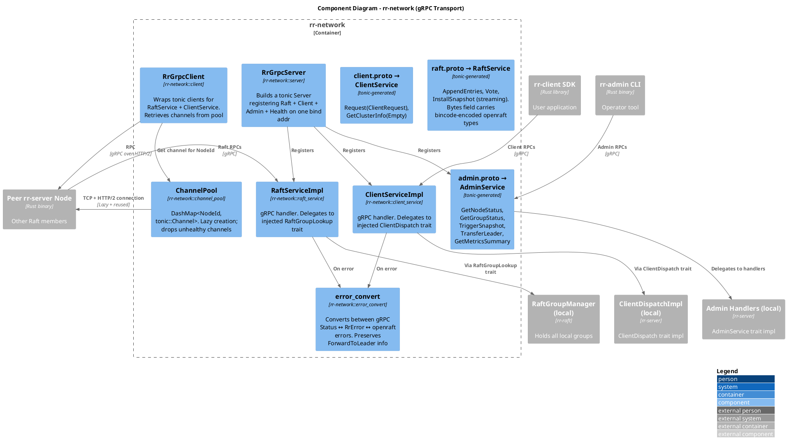

# Level 3 — rr-network 组件图 / rr-network Components

`rr-network` 是所有 RPC 的统一传输层：客户端请求、节点间 Raft 共识、管理员操作——都通过 tonic (gRPC) + 自定义连接池。本图展示三个独立的 gRPC 服务如何共享一个端口，以及客户端如何复用连接。

---

`rr-network` is the unified transport layer for all RPCs: client requests, inter-node Raft consensus, and admin operations — all via tonic (gRPC) + a custom connection pool. This diagram shows how three independent gRPC services share one port, and how clients reuse connections.

## 图示 / Diagram



## Protobuf 服务定义 / Protobuf Service Definitions

`crates/rr-network/proto/` 下三个文件，通过 `tonic-build` 生成 Rust 代码：

Three files under `crates/rr-network/proto/`, compiled via `tonic-build`:

### `raft.proto` → RaftService
节点间的 Raft 共识 RPC。

Inter-node Raft consensus RPCs.

```proto
service RaftService {
  rpc AppendEntries(AppendEntriesRequest) returns (AppendEntriesResponse);
  rpc Vote(VoteRequest) returns (VoteResponse);
  rpc InstallSnapshot(stream SnapshotChunk) returns (SnapshotResponse);  // streaming!
}
```

**关键字段 / Key field pattern**：每个 request 都含 `uint64 group_id` 和 `bytes payload`。`payload` 是 **bincode 编码的 openraft 类型**——这样 proto 层不必随 openraft 版本演进而变化。

---

**Key field pattern**: every request contains `uint64 group_id` and `bytes payload`. The `payload` is **bincode-encoded openraft types** — this keeps the proto layer stable across openraft version bumps.

### `client.proto` → ClientService
客户端 SDK 的入口。

Entry point for the client SDK.

```proto
service ClientService {
  rpc Request(ClientRequest) returns (ClientResponse);
  rpc GetClusterInfo(Empty) returns (ClusterInfo);
}
```

`ClientResponse` 可能携带 `LeaderRedirect { node_id, addr }`——这是 **ForwardToLeader 机制** 的协议层实现。

`ClientResponse` may carry `LeaderRedirect { node_id, addr }` — this is the protocol-level realization of the **ForwardToLeader mechanism**.

### `admin.proto` → AdminService
运维 CLI 的目标。

Target for operator CLI.

```proto
service AdminService {
  rpc GetNodeStatus(Empty) returns (NodeStatus);
  rpc GetGroupStatus(GroupIdRequest) returns (GroupStatus);
  rpc TriggerSnapshot(GroupIdRequest) returns (TriggerSnapshotResponse);
  rpc TransferLeader(TransferLeaderRequest) returns (TransferLeaderResponse);
  rpc GetMetricsSummary(Empty) returns (MetricsSummary);
}
```

## 连接池 / ChannelPool

**为什么需要 / Why**：一个 3 节点集群中，每两个节点之间每秒可能发送数百条 Raft RPC（心跳、AppendEntries）。每次新建 TCP + TLS + HTTP/2 连接的成本不可接受。

**Why**: in a 3-node cluster, every pair of nodes may exchange hundreds of Raft RPCs per second (heartbeats, AppendEntries). Establishing TCP + TLS + HTTP/2 per call is untenable.

**如何工作 / How it works**：

```rust
struct ChannelPool {
    pool: DashMap<NodeId, tonic::transport::Channel>,
    resolver: Arc<dyn Fn(NodeId) -> String + Send + Sync>,  // NodeId → "host:port"
}

impl ChannelPool {
    async fn get(&self, node_id: NodeId) -> Result<Channel, RrError> {
        if let Some(ch) = self.pool.get(&node_id) { return Ok(ch.clone()); }
        let addr = (self.resolver)(node_id);
        let channel = tonic::transport::Endpoint::from_shared(addr)?
            .connect().await?;
        self.pool.insert(node_id, channel.clone());
        Ok(channel)
    }

    fn invalidate(&self, node_id: NodeId) {
        self.pool.remove(&node_id);
    }
}
```

- **惰性创建 / Lazy**：第一次使用时建立连接。
- **失败驱逐 / Eviction on failure**：连接失败时调用 `invalidate`；下次使用会重建。
- **无锁读 / Lock-free reads**：DashMap 在热点路径上不加锁。
- **tonic Channel 内置连接复用**：单个 `Channel` 内部可跨多个 RPC 共享 HTTP/2 stream。

---

- **Lazy**: channels are established on first use.
- **Eviction on failure**: on connection failure, `invalidate` drops it; next use reconnects.
- **Lock-free reads**: DashMap avoids locking on the hot path.
- **tonic's `Channel` has built-in connection reuse**: a single `Channel` multiplexes HTTP/2 streams across RPCs.

## 打破 rr-raft ↔ rr-network 的循环依赖 / Breaking the rr-raft ↔ rr-network Cycle

**问题 / Problem**：
- `rr-network` 需要调用 `RaftGroupManager`（`rr-raft`）处理入站 Raft RPC。
- `rr-raft` 需要 `ChannelPool`（`rr-network`）发送出站 Raft RPC。
- 直接依赖会形成循环。

**Problem**:
- `rr-network` needs to call `RaftGroupManager` (`rr-raft`) to handle inbound Raft RPCs.
- `rr-raft` needs `ChannelPool` (`rr-network`) to send outbound Raft RPCs.
- Direct dependencies would create a cycle.

**解决方案 / Solution**：两个解耦点。

**Solution**: two decoupling seams.

1. **入站方向：trait 倒置 / Inbound: trait inversion**
   `rr-network` 定义 `trait RaftGroupLookup`，`rr-server` 实现它（因为 `rr-server` 依赖两个 crate 是合法的）。`RaftServiceImpl` 通过 trait 对象调用，不直接依赖 `rr-raft`。

   `rr-network` defines `trait RaftGroupLookup`; `rr-server` implements it (it legally depends on both crates). `RaftServiceImpl` calls via trait object, with no direct `rr-raft` dep.

2. **出站方向：本地 proto 复制 / Outbound: local proto duplication**
   `rr-raft` 本地重新定义了兼容的 proto 消息（相同 bincode 布局），通过 `rr-network::ChannelPool` 发送原始字节。详见 `crates/rr-raft/src/network_factory.rs`。

   `rr-raft` locally redefines compatible proto messages (bincode-identical layout) and sends raw bytes via `rr-network::ChannelPool`. See `crates/rr-raft/src/network_factory.rs`.

**权衡 / Tradeoff**：proto 字段需要在两处保持同步；测试覆盖这一点非常重要。

Proto fields must stay in sync across two locations — tests covering this are critical.

## 错误转换 / Error Conversion

`error_convert.rs` 维护三种错误域的双向映射：

Maintains two-way mappings between three error domains:

```
openraft errors  ↔  RrError (rr-core)  ↔  tonic::Status (gRPC wire)
```

**关键点**：`ForwardToLeader` 在所有三个域中都必须携带完整的 `LeaderInfo { node_id, addr }`——这是客户端自动重定向的基础。

**Key point**: `ForwardToLeader` must carry the full `LeaderInfo { node_id, addr }` through all three domains — it's the basis for client auto-redirect.

## 相关 / Related

- 客户端连接和重定向流：[dynamic-put-request.md](./dynamic-put-request.md)
- 快照流式传输：[dynamic-snapshot-transfer.md](./dynamic-snapshot-transfer.md)
- 现有网络文档：[../networking.md](../networking.md)
