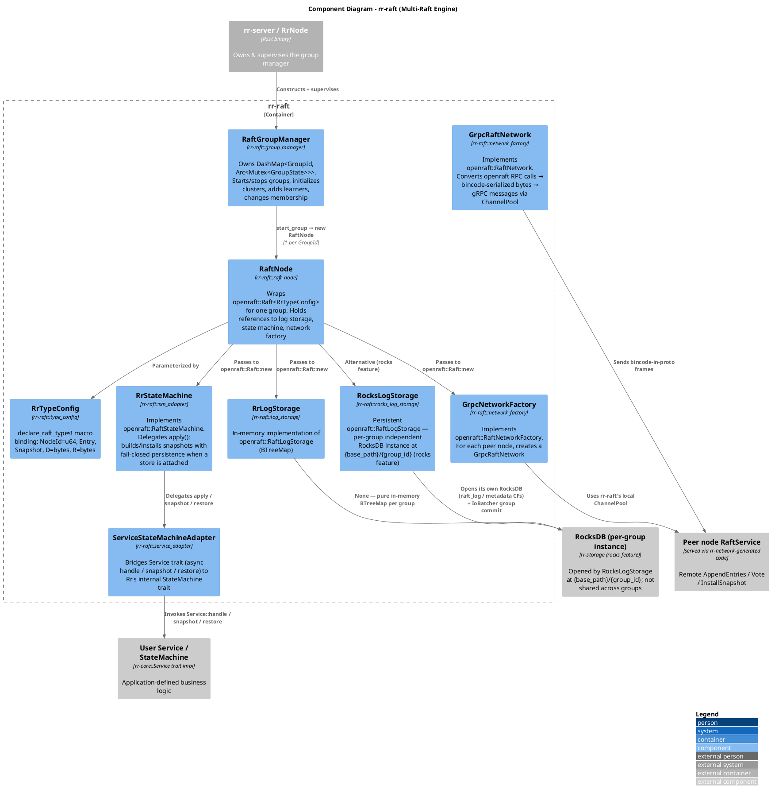

# 第 3 级：rr-raft 组件 / Level 3: rr-raft Components

`rr-raft` 在单节点上运行多个独立 Raft group，并把应用 `Service` 适配到 openraft 状态机。

`rr-raft` runs multiple independent Raft groups on one node and adapts the application `Service` to openraft's
state machine.

## 图示 / Diagram



## 适配分层 / Adapter Layering

```text
openraft::RaftStateMachine           ← openraft consensus-engine contract
        │ implemented by
        ▼
RrStateMachine                       ← internal Rr wrapper
        │ delegates to
        ▼
rr_core::state_machine::StateMachine ← Rr abstraction
        │ implemented by
        ▼
ServiceStateMachineAdapter           ← adapter
        │ wraps
        ▼
rr_core::service::Service            ← application business logic
```

- `Service` 面向应用，只处理字节请求、快照和恢复，不暴露 Raft 日志。
  `Service` is application-facing: byte requests, snapshots, and restore, without exposing Raft logs.
- `StateMachine` 是 Rr 内部契约；`ServiceStateMachineAdapter` 将 `Service` 接到该契约。
  `StateMachine` is Rr's internal contract; `ServiceStateMachineAdapter` bridges `Service` to it.
- `RrStateMachine` 实现 openraft 接口，维护 applied/snapshot 元数据；`rocks` 只替换日志存储并附加快照持久化。
  `RrStateMachine` implements openraft, tracking applied/snapshot metadata; `rocks` replaces log storage and adds
  snapshot persistence.

## 多组管理 / Multi-group Management

### RaftGroupManager：组管理 / RaftGroupManager: Group Management

- 内部使用 `DashMap<GroupId, Arc<Mutex<GroupState>>>`；每个状态包含 `RaftNode`、后台任务句柄和在途写计数。
  It stores `DashMap<GroupId, Arc<Mutex<GroupState>>>`; each state holds a `RaftNode`, background task handles,
  and an in-flight write counter.
- `start_group(group_id)` 创建并注册独立 openraft 任务。
  `start_group(group_id)` creates and registers an independent openraft task.
- `stop_group(group_id)` 停止后台任务，最多等待 5 秒排空在途写，关闭 Raft，并 flush/关闭 Rocks
  IoBatcher；不会删除日志。
  `stop_group(group_id)` stops background tasks, drains in-flight writes for up to 5 seconds, shuts down Raft,
  and flushes/closes the Rocks IoBatcher; it does not delete logs.
- 初始化和成员操作转发到对应 openraft API。
  Initialization and membership operations forward to the corresponding openraft APIs.

### 并发与存储边界 / Concurrency and Storage Boundaries

- 每个 group 有独立 openraft 任务，一个 group 的选举不会阻塞另一个 group。
  Each group has its own openraft task, so one group's election does not block another's.
- mem 模式每 group 使用独立 `RrLogStorage`；rocks 模式每 group 在 `{base_path}/{group_id}` 打开独立 RocksDB。`NodeConfig.storage_engine` 不承载 Raft 日志，但 managed formation 会将它传给 `FormationSupervisor`。<br />In mem mode each group has its own `RrLogStorage`; in rocks mode each opens its own RocksDB at `{base_path}/{group_id}`. `NodeConfig.storage_engine` does not carry Raft logs, but managed formation passes it to `FormationSupervisor`.
- 所有 group 复用网络和 gRPC 端口，RPC 用 `group_id` 解复用。
  Groups share the network and gRPC port; RPCs are demultiplexed by `group_id`.

### 本地 Proto 重定义 / Local Proto Redefinition

依赖方向是 `rr-raft → rr-client → rr-network`，而 `rr-network` 只依赖 `rr-core`。`rr-raft` 在
`network_factory.rs` 本地定义与 `rr.raft.*` prost 注解一致的消息和 `ChannelPool`，并直接构建 tonic
客户端；openraft 类型仅在 `payload` 字节字段内做 bincode 编码。两处 proto 字段必须保持 wire-compatible。

The dependency direction is `rr-raft → rr-client → rr-network`, while `rr-network` depends only on `rr-core`.
`rr-raft` defines locally prost-compatible `rr.raft.*` messages and its own `ChannelPool` in
`network_factory.rs`, then builds tonic clients directly. Openraft types are bincode-encoded only inside the
`payload` bytes. The two proto definitions must remain wire-compatible.

## 相关 / Related

- [gRPC 解耦与连接池 / gRPC decoupling and channel pools](./components-network.md)
- [领导者选举 / Leader election](./dynamic-leader-election.md)
- [快照传输 / Snapshot transfer](./dynamic-snapshot-transfer.md)
- [存储 / Storage](../storage.md)
- [多 Raft 概念 / Multi-Raft concepts](../multi-raft.md)
