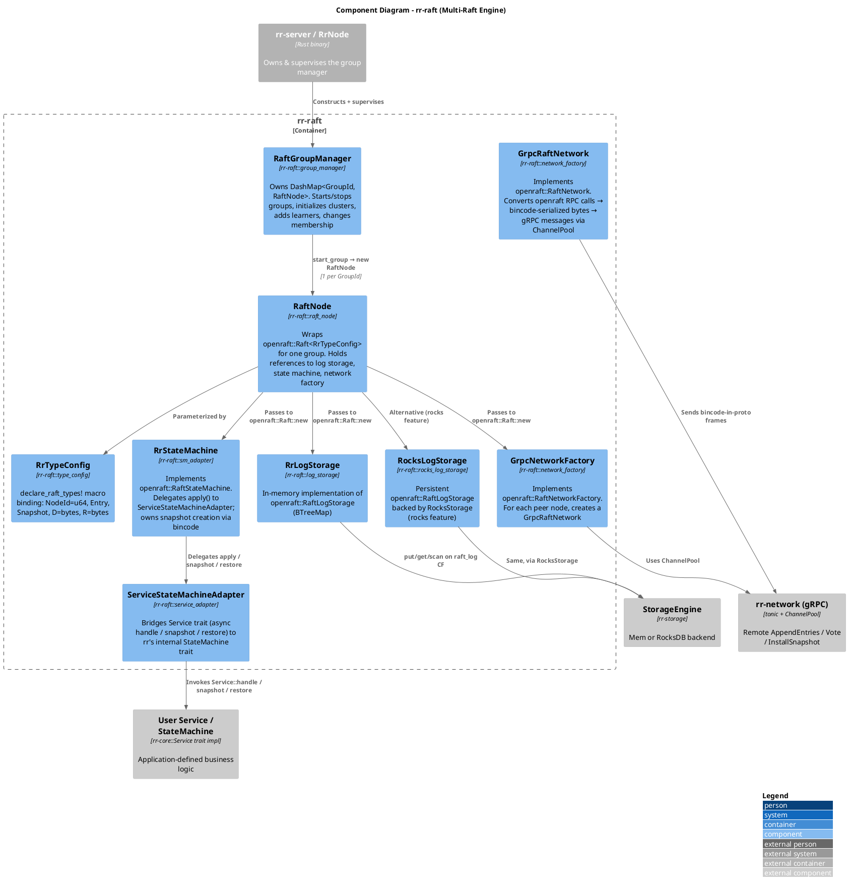

# Level 3 — rr-raft 组件图 / rr-raft Components

`rr-raft` 是 rr 的共识引擎。本图展示其如何在单个节点上同时运行多个独立的 Raft 组，并通过适配器把用户的 `Service` trait 挂到 openraft 的状态机接口上。

---

`rr-raft` is rr's consensus engine. This diagram shows how it runs multiple independent Raft groups on a single node, and how adapters bridge the user's `Service` trait to openraft's state machine interface.

## 图示 / Diagram



## 分层适配 / Adapter Layering

rr-raft 通过三层适配把**业务 `Service` trait**（用户写的）对接到 **openraft 的 `RaftStateMachine` trait**（共识引擎要求的）：

rr-raft uses three adapter layers to bridge the **business `Service` trait** (user-written) to openraft's **`RaftStateMachine` trait** (required by the consensus engine):

```
openraft::RaftStateMachine           ← 共识引擎接口 / what openraft needs
        │
        │ implemented by
        ▼
RrStateMachine                       ← rr 内部类型 / rr's internal wrapper
        │
        │ delegates to
        ▼
rr_core::state_machine::StateMachine ← rr 抽象 trait / rr's abstract contract
        │
        │ implemented by
        ▼
ServiceStateMachineAdapter           ← 桥 / the bridge
        │
        │ wraps
        ▼
rr_core::service::Service            ← 用户写的业务逻辑 / user's business logic
```

**为什么这么多层？/ Why all these layers?**

1. `Service` trait 面向应用开发者（`async handle(bytes) → bytes`），**与共识/日志无关**。
2. `StateMachine` trait 是 rr 内部中间层，支持未来添加更低层次的用户（例如用户绕过 Service 直接写日志）。
3. `RrStateMachine` 实现 openraft 要求的 `RaftStateMachine`（带快照元数据、last_applied 追踪等）。
4. 每层职责单一，允许**测试替身**与**特性切换**（`rocks` feature 只改变 LogStorage 层，不影响上层）。

---

1. The `Service` trait is for application developers (`async handle(bytes) → bytes`) — **consensus-agnostic**.
2. The `StateMachine` trait is rr's internal midlayer, allowing future lower-level users (e.g. bypass `Service` and write directly to the log).
3. `RrStateMachine` implements openraft's `RaftStateMachine` (snapshot metadata, last_applied tracking, etc.).
4. Single-responsibility layers enable **test doubles** and **feature toggles** (the `rocks` feature only replaces the LogStorage layer; nothing above changes).

## 多组的实现细节 / Multi-Group Implementation Details

### RaftGroupManager
- 内部：`DashMap<GroupId, Arc<RaftNode>>` —— 无锁并发读，写用 shard 锁。
- `start_group(group_id)`：创建 `RaftNode`（启动一个新的 openraft 任务），注册到 DashMap。
- `stop_group(group_id)`：通过 `shutdown()` 优雅停机，从 DashMap 移除，清理 Storage 中该 group 的日志数据（若配置）。
- `init_cluster(group_id, members)` / `add_learner` / `change_membership`：转发到 `openraft::Raft` 的对应方法。

---

- Internal: `DashMap<GroupId, Arc<RaftNode>>` — lock-free reads, sharded-lock writes.
- `start_group(group_id)`: creates a `RaftNode` (starts a new openraft task), registers in the DashMap.
- `stop_group(group_id)`: `shutdown()` gracefully, remove from DashMap, optionally clean per-group log from storage.
- `init_cluster` / `add_learner` / `change_membership`: forwards to the corresponding `openraft::Raft` methods.

### 并发行为 / Concurrency Behavior
- **每个 group 有独立的 openraft 任务** —— 一个组的选举超时不会阻塞另一个组。
- **共享存储** —— 所有 group 的日志写入同一个 `StorageEngine`，但使用 `group_id` 作为 key 前缀或单独的 column family 隔离。
- **共享网络** —— 所有 group 的 Raft RPC 通过同一个 `ChannelPool` 和相同的 gRPC 端口；`group_id` 字段在 RPC level 做 demux。

---

- **Each group has an independent openraft task** — an election timeout in one group does not block another.
- **Shared storage** — all groups write to the same `StorageEngine`, keyed by `group_id` prefix or isolated via column families.
- **Shared network** — all groups' Raft RPCs go through one `ChannelPool` and the same gRPC port; `group_id` field does RPC-level demux.

### 打破循环依赖 / Breaking the Cycle

rr-raft 需要发送 Raft RPC，但 rr-network 是另一个 crate；直接依赖会导致 `rr-raft → rr-network → rr-raft` 循环。解决方案：`rr-raft` 在本地重新定义了**兼容的 proto 消息结构**（bincode 编码相同），通过 `rr-network::ChannelPool` 发送原始字节。详见 [components-network.md](./components-network.md)。

---

rr-raft needs to send Raft RPCs, but rr-network is a separate crate — a direct dependency would create a `rr-raft → rr-network → rr-raft` cycle. Solution: `rr-raft` locally redefines **compatible proto message structures** (bincode-identical) and sends raw bytes via `rr-network::ChannelPool`. See [components-network.md](./components-network.md).

## 相关 / Related

- 执行流：[dynamic-leader-election.md](./dynamic-leader-election.md), [dynamic-snapshot-transfer.md](./dynamic-snapshot-transfer.md)
- 存储细节：[../storage.md](../storage.md)
- 多 Raft 概念：[../multi-raft.md](../multi-raft.md)
