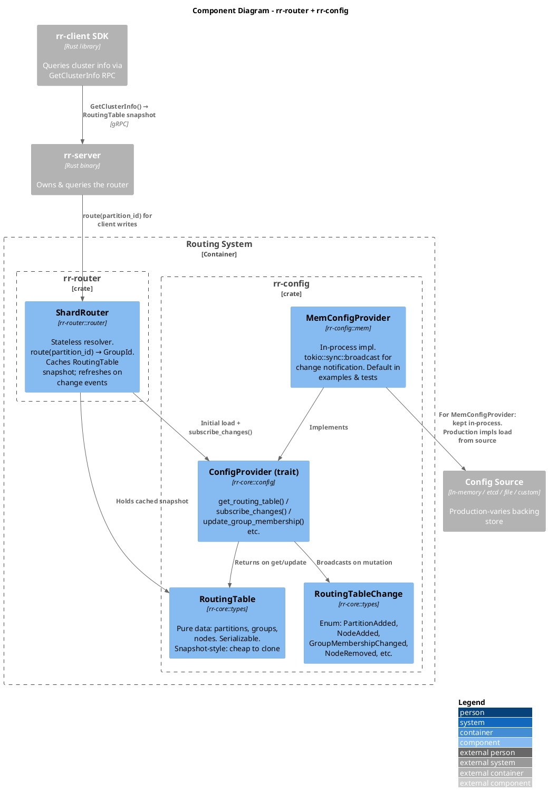

# Level 3 — rr-router + rr-config 组件图 / Routing & Configuration

rr 采用 **表格式路由（Table-based routing）** 而非哈希环。本图展示 `ShardRouter`、`ConfigProvider` 以及路由表如何协作，把一个 `partition_id` 解析到正确的 `group_id`。

---

rr uses **table-based routing** rather than hash rings. This diagram shows how `ShardRouter`, `ConfigProvider`, and the routing table cooperate to resolve a `partition_id` to the correct `group_id`.

## 图示 / Diagram



## 核心数据结构 / Core Data Structures

### RoutingTable
定义在 `rr-core::types`。**纯数据结构**，可自由序列化传输。核心字段：

Defined in `rr-core::types`. A **pure data structure** that serializes freely. Core fields:

| Field | Type | Purpose |
| :--- | :--- | :--- |
| `partitions` | `HashMap<PartitionId, PartitionConfig>` | 每个分片的所属 group + 元数据 / each partition's owning group + metadata |
| `groups` | `HashMap<GroupId, GroupMeta>` | group 的成员列表 / group's member replicas |
| `nodes` | `HashMap<NodeId, NodeAddr>` | node_id → "host:port" |

### ShardRouter
`crates/rr-router/src/router.rs`

**职责 / Responsibilities**:
1. 启动时：从 `ConfigProvider::get_routing_table()` 加载初始快照。
2. 订阅 `RoutingTableChange` 事件，按需更新本地缓存（`ArcSwap<RoutingTable>` 或类似）。
3. 提供查询 API：
   - `route(partition_id) → group_id` — 热路径，无锁
   - `group_members(group_id) → Vec<NodeAddr>` — 用于 RaftGroupManager 启动 group
4. 记录 routing metrics（cache hit/miss、lookup latency）。

---

**Responsibilities**:
1. At startup: load initial snapshot from `ConfigProvider::get_routing_table()`.
2. Subscribe to `RoutingTableChange` events; update local cache on demand (`ArcSwap<RoutingTable>` or similar).
3. Expose query APIs:
   - `route(partition_id) → group_id` — hot path, lock-free
   - `group_members(group_id) → Vec<NodeAddr>` — used by RaftGroupManager to start groups
4. Records routing metrics (cache hit/miss, lookup latency).

### ConfigProvider trait
定义在 `rr-core::config`。抽象了 **路由表的来源和变更通知**：

Defined in `rr-core::config`. Abstracts **where the routing table comes from and how changes are delivered**:

```rust
#[async_trait]
pub trait ConfigProvider: Send + Sync + 'static {
    async fn get_routing_table(&self) -> Result<RoutingTable, RrError>;
    async fn subscribe_changes(&self) -> BoxStream<'static, RoutingTableChange>;

    // Mutations (usually only called by control plane / admin):
    async fn add_node(&self, node_id: NodeId, addr: NodeAddr) -> Result<(), RrError>;
    async fn update_group_membership(&self, group_id: GroupId, members: Vec<NodeId>) -> Result<(), RrError>;
    // ...
}
```

### MemConfigProvider
`crates/rr-config/src/mem.rs`

默认实现。内部持有 `Arc<RwLock<RoutingTable>>` 和 `tokio::sync::broadcast::Sender<RoutingTableChange>`。所有变更：

1. 加写锁修改 `RoutingTable`
2. 广播变更事件
3. 释放写锁

**注意 / Caveat**：`MemConfigProvider` 是**单节点内存状态**。集群中 N 个节点各有一份独立拷贝——它们不会通过 `MemConfigProvider` 自动同步！启动集群时要么：
- 每个节点各自配置完全相同的初始 `RoutingTable`，或
- 使用真正的分布式 `ConfigProvider` 实现（例如 etcd-backed）。

---

Default implementation. Internally holds `Arc<RwLock<RoutingTable>>` + `tokio::sync::broadcast::Sender<RoutingTableChange>`. All mutations:

1. Acquire write lock, mutate `RoutingTable`
2. Broadcast the change event
3. Release write lock

**Caveat**: `MemConfigProvider` is **single-node in-process state**. N nodes in a cluster each have an independent copy — they do NOT auto-sync via `MemConfigProvider`! When bringing up a cluster, either:
- Configure every node with the exact same initial `RoutingTable`, or
- Use a real distributed `ConfigProvider` (e.g., etcd-backed).

## 为什么使用表而不是哈希环 / Why Table-Based Instead of Hash Ring

| 方案 / Approach | 优点 / Pros | 缺点 / Cons |
| :--- | :--- | :--- |
| 哈希环 / Hash ring | 无需中心化状态；分片均匀 | 重平衡成本高；难以精细控制分片归属 |
| **表格式（rr 采用）/ Table (rr)** | **完全可编程的分片策略；支持热点分片迁移；逻辑清晰** | 需要维护 / 分发路由表（由 ConfigProvider 解决） |

rr 选择表格式是因为：
- 分布式数据库场景常常需要**按租户 / 时间范围 / 业务域**分片——哈希环难以表达。
- 路由表的变更频率低（相对于请求速率），维护成本可控。
- 调试友好：问题出现时可以直接 dump 路由表。

---

rr chose the table approach because:
- Distributed database workloads often need sharding **by tenant / time range / business domain** — hard to express with a hash ring.
- Routing table changes are rare relative to request rate, so maintenance cost is manageable.
- Debugging-friendly: when things go wrong, just dump the routing table.

## 相关 / Related

- 动态路由决策流：[dynamic-shard-routing.md](./dynamic-shard-routing.md)
- 路由表变更传播：[dynamic-config-update.md](./dynamic-config-update.md)
