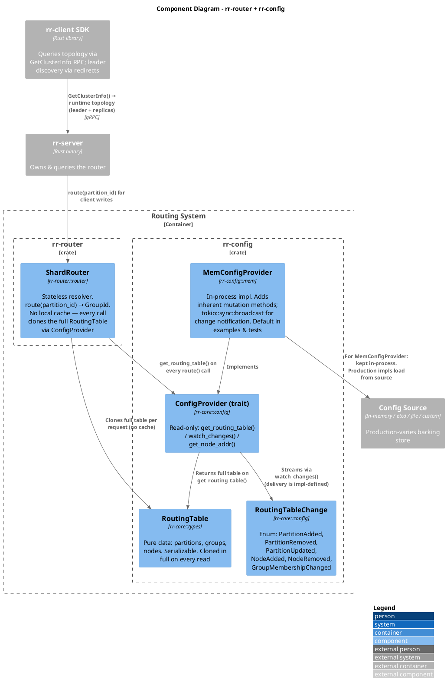

# Level 3 — rr-router + rr-config 组件图 / Routing & Configuration

rr 采用 **表格式路由（Table-based routing）** 而非哈希环。本图展示 `ShardRouter`、`ConfigProvider` 以及路由表如何协作，把一个 `partition_id` 解析到正确的 `group_id`。

---

rr uses **table-based routing** rather than hash rings. This diagram shows how `ShardRouter`, `ConfigProvider`, and the routing table cooperate to resolve a `partition_id` to the correct `group_id`.

## 图示 / Diagram



## 核心数据结构 / Core Data Structures

### RoutingTable
定义在 `rr-core::types`。**纯数据结构**，可自由序列化传输。核心字段：

Defined in `rr-core::types`. A **pure data structure** that serializes freely. Core fields:

| Field | Type | Purpose |
| :--- | :--- | :--- |
| `partitions` | `HashMap<PartitionId, (PartitionConfig, GroupId)>` | 每个分片的配置 + 所属 group / each partition's config + owning group |
| `groups` | `HashMap<GroupId, GroupMeta>` | group 的成员列表（`group_id` + `replicas`，不含 leader——leader 是 raft 运行时状态）/ group's member replicas (`group_id` + `replicas`; no leader — leader is raft runtime state) |
| `nodes` | `HashMap<NodeId, NodeAddr>` | node_id → `NodeAddr { addr: "host:port" }` |

### ShardRouter
`crates/rr-router/src/router.rs`

**职责 / Responsibilities**:
1. 无启动加载、无本地缓存：每次 `route()` 都通过 `ConfigProvider::routing_table_snapshot()` 取 provider 的**当前**表快照，然后做一次 HashMap 查询。内存后端下快照是 `Arc` clone（零表拷贝）；provider 仍是单一事实源（INV-6）。
2. 不订阅变更事件——监听 `watch_changes()` 并按事件启停 group 的循环在 `RrNode`（`rr-server::node`）里，不在 router 里。
3. 查询 API 仅两个：
   - `route(partition_id) → Result<GroupId>` — 热路径；未命中返回 `PartitionNotFound`
   - `routing_table() → Result<RoutingTable>` — 返回完整表（`RrNode::start()` 启动 group 时使用）
4. 路由指标只有一个计数器：`router.route.not_found`（未命中时 +1）。

---

**Responsibilities**:
1. No startup load, no local cache: every `route()` call takes the provider's **current** table snapshot via `ConfigProvider::routing_table_snapshot()`, then does a single HashMap lookup. With the in-memory backend the snapshot is an `Arc` clone (no table copy); the provider remains the single source of truth (INV-6).
2. No change subscription — the loop that watches `watch_changes()` and starts/stops groups lives in `RrNode` (`rr-server::node`), not in the router.
3. Exactly two query APIs:
   - `route(partition_id) → Result<GroupId>` — hot path; a miss returns `PartitionNotFound`
   - `routing_table() → Result<RoutingTable>` — returns the full table (used by `RrNode::start()` to start groups)
4. A single routing metric: the `router.route.not_found` counter (incremented on miss).

### ConfigProvider trait
定义在 `rr-core::config`。抽象了 **路由表的来源和变更通知**。trait 是**只读的**——三个必需方法，外加一个带默认实现的快照方法：

Defined in `rr-core::config`. Abstracts **where the routing table comes from and how changes are delivered**. The trait is **read-only** — three required methods plus one defaulted snapshot method:

```rust
#[async_trait]
pub trait ConfigProvider: Send + Sync {
    /// Get the current full routing table.
    async fn get_routing_table(&self) -> Result<RoutingTable, ConfigError>;
    /// Current table as a shared snapshot; backends holding the table in
    /// memory override this to return a cheap Arc clone. Default: wraps
    /// get_routing_table(). Fresh fetch on every call (INV-6).
    async fn routing_table_snapshot(&self) -> Result<Arc<RoutingTable>, ConfigError> { /* default */ }
    /// Subscribe to routing table change events as a stream.
    async fn watch_changes(
        &self,
    ) -> Result<Pin<Box<dyn Stream<Item = RoutingTableChange> + Send>>, ConfigError>;
    /// Get the gRPC address for a specific node.
    async fn get_node_addr(&self, node_id: NodeId) -> Result<NodeAddr, ConfigError>;
}
```

**trait 上没有写方法。** `add_partition` / `add_node` / `update_group_membership` 等变更方法只存在于具体实现 `MemConfigProvider` 的 inherent impl 上，供嵌入方或测试直接调用。

**There are no write methods on the trait.** Mutation methods like `add_partition` / `add_node` / `update_group_membership` exist only as inherent methods on the concrete `MemConfigProvider`, called directly by the embedding application or tests.

### MemConfigProvider
`crates/rr-config/src/mem.rs`

默认实现。内部持有 `Arc<RwLock<RoutingTable>>` 和 `tokio::sync::broadcast::Sender<RoutingTableChange>`。变更方法（`add_partition` / `remove_partition` / `add_node` / `remove_node` / `update_group_membership`）是该类型的 **inherent 方法**（不属于 trait），每个都：

1. 加写锁修改 `RoutingTable`
2. 广播变更事件
3. 释放写锁

**注意 / Caveat**：`MemConfigProvider` 是**单节点内存状态**。集群中 N 个节点各有一份独立拷贝——它们不会通过 `MemConfigProvider` 自动同步！启动集群时要么：
- 每个节点各自配置完全相同的初始 `RoutingTable`，或
- 使用真正的分布式 `ConfigProvider` 实现（例如 etcd-backed）。

---

Default implementation. Internally holds `Arc<RwLock<RoutingTable>>` + `tokio::sync::broadcast::Sender<RoutingTableChange>`. The mutation methods (`add_partition` / `remove_partition` / `add_node` / `remove_node` / `update_group_membership`) are **inherent methods** of this type (not part of the trait); each one:

1. Acquire write lock, mutate `RoutingTable`
2. Broadcast the change event
3. Release write lock

**Caveat**: `MemConfigProvider` is **single-node in-process state**. N nodes in a cluster each have an independent copy — they do NOT auto-sync via `MemConfigProvider`! When bringing up a cluster, either:
- Configure every node with the exact same initial `RoutingTable`, or
- Use a real distributed `ConfigProvider` (e.g., etcd-backed).

## 为什么使用表而不是哈希环 / Why Table-Based Instead of Hash Ring

| 方案 / Approach | 优点 / Pros | 缺点 / Cons |
| :--- | :--- | :--- |
| 哈希环 / Hash ring | 无需中心化状态；分片均匀 | 重平衡成本高；难以精细控制分片归属 |
| **表格式（rr 采用）/ Table (rr)** | **完全可编程的分片策略；支持热点分片迁移；逻辑清晰** | 需要维护 / 分发路由表（由 ConfigProvider 解决） |

rr 选择表格式是因为：
- 分布式数据库场景常常需要**按租户 / 时间范围 / 业务域**分片——哈希环难以表达。
- 路由表的变更频率低（相对于请求速率），维护成本可控。
- 调试友好：问题出现时可以直接 dump 路由表。

---

rr chose the table approach because:
- Distributed database workloads often need sharding **by tenant / time range / business domain** — hard to express with a hash ring.
- Routing table changes are rare relative to request rate, so maintenance cost is manageable.
- Debugging-friendly: when things go wrong, just dump the routing table.

## 相关 / Related

- 动态路由决策流：[dynamic-shard-routing.md](./dynamic-shard-routing.md)
- 路由表变更传播：[dynamic-config-update.md](./dynamic-config-update.md)
