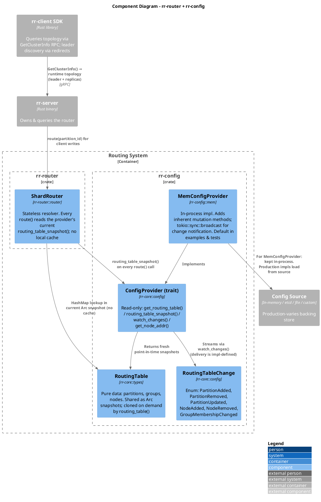

# 第 3 级：路由与配置组件 / Level 3: Routing and Configuration Components

rr 使用路由表把 `partition_id` 映射到 `group_id`；leader 是 Raft 运行时状态，不在表内。

rr uses a routing table to map `partition_id` to `group_id`; the leader is Raft runtime state and is not stored
in the table.

## 图示 / Diagram



## 核心数据结构 / Core Data Structures

### RoutingTable：路由表 / RoutingTable: Routing Table

`rr-core::types` 中的可序列化数据结构。

A serializable data structure in `rr-core::types`.

| 字段 / Field | 类型 / Type | 用途 / Purpose |
| :--- | :--- | :--- |
| `partitions` | `HashMap<PartitionId, (PartitionConfig, GroupId)>` | 分片配置与所属 group / Partition config and owning group |
| `groups` | `HashMap<GroupId, GroupMeta>` | group 副本；不含 leader / Group replicas; no leader |
| `nodes` | `HashMap<NodeId, NodeAddr>` | 节点到 `host:port` 的映射 / Node-to-`host:port` mapping |

### ShardRouter：分片路由 / ShardRouter: Shard Routing

代码位于 `crates/rr-router/src/router.rs`。

The implementation is in `crates/rr-router/src/router.rs`.

1. 每次 `route()` 都读取 provider 当前的 `routing_table_snapshot()`，然后做一次 HashMap 查询；
   不保留本地缓存。内存后端返回廉价 `Arc` 快照，不复制整表。
   Every `route()` reads the provider's current `routing_table_snapshot()` and performs one HashMap lookup; no
   local cache is retained. The in-memory backend returns a cheap `Arc` snapshot without copying the table.
2. 未命中返回 `PartitionNotFound` 并增加 `router.route.not_found`。
   A miss returns `PartitionNotFound` and increments `router.route.not_found`.
3. `routing_table()` 通过同一快照路径返回按需拥有的完整副本，供 `RrNode::start()` 使用。
   `routing_table()` uses the same snapshot path and returns an owned full copy on demand for `RrNode::start()`.
4. router 不订阅事件；`RrNode` 的 watch loop 消费 `watch_changes()` 并启停 group。
   The router does not subscribe; `RrNode`'s watch loop consumes `watch_changes()` and starts or stops groups.

### ConfigProvider：配置接口 / ConfigProvider: Configuration Trait

`rr-core::config` 定义只读接口：三个必需方法和一个默认快照方法。写方法不属于 trait。

`rr-core::config` defines a read-only interface: three required methods and one defaulted snapshot method. The
trait has no write methods.

```rust
#[async_trait]
pub trait ConfigProvider: Send + Sync {
    async fn get_routing_table(&self) -> Result<RoutingTable, ConfigError>;
    async fn routing_table_snapshot(&self) -> Result<Arc<RoutingTable>, ConfigError> { /* default */ }
    async fn watch_changes(
        &self,
    ) -> Result<Pin<Box<dyn Stream<Item = RoutingTableChange> + Send>>, ConfigError>;
    async fn get_node_addr(&self, node_id: NodeId) -> Result<NodeAddr, ConfigError>;
}
```

### MemConfigProvider：内存实现 / MemConfigProvider: In-memory Implementation

`crates/rr-config/src/mem.rs` 持有 `Arc<RwLock<RoutingTable>>` 和
`tokio::sync::broadcast::Sender<RoutingTableChange>`。`add_partition`、`add_node`、
`update_group_membership` 等 inherent 方法更新表并广播事件。

`crates/rr-config/src/mem.rs` holds `Arc<RwLock<RoutingTable>>` and
`tokio::sync::broadcast::Sender<RoutingTableChange>`. Inherent methods such as `add_partition`, `add_node`, and
`update_group_membership` mutate the table and broadcast events.

每个节点的 `MemConfigProvider` 都是独立副本，不会自动同步。集群启动时必须为各节点配置相同初始表，
或使用分布式 provider。

Each node's `MemConfigProvider` is an independent copy with no automatic synchronization. Cluster nodes must
start with identical tables or use a distributed provider.

## 为什么使用路由表 / Why Table-based Routing

路由表允许按租户、时间范围或业务域明确控制分片归属，也便于直接检查。代价是必须维护并分发表；
这由 `ConfigProvider` 抽象承担。

A routing table gives explicit control over shard ownership by tenant, time range, or business domain and is easy
to inspect. The tradeoff is maintaining and distributing the table, which is abstracted by `ConfigProvider`.

## 相关 / Related

- [动态路由 / Dynamic routing](./dynamic-shard-routing.md)
- [配置传播 / Config propagation](./dynamic-config-update.md)
