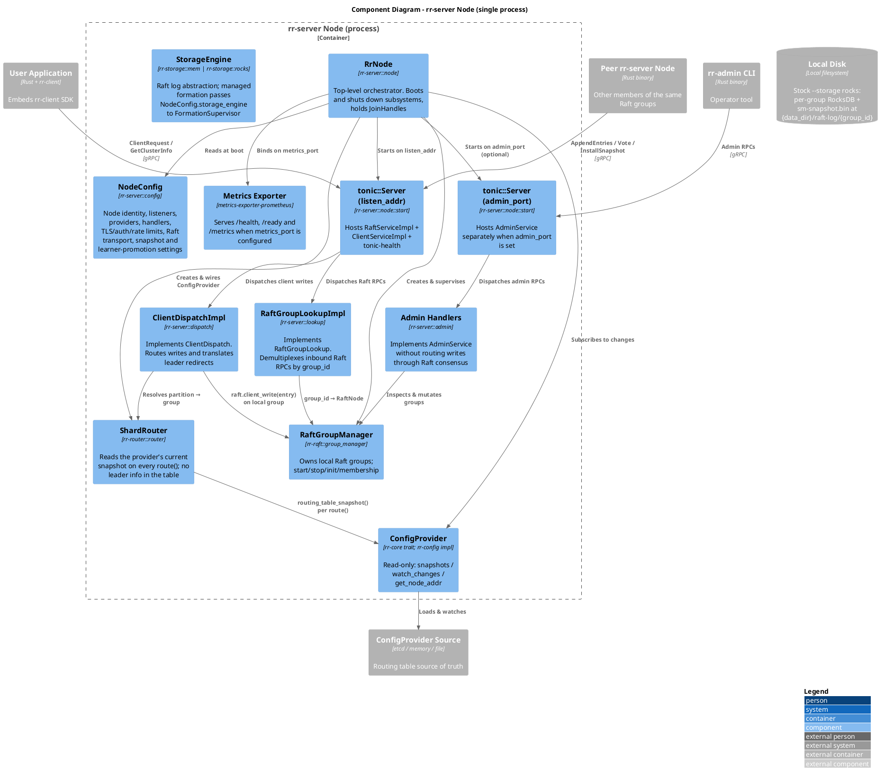

# 第 3 级：rr-server 组件 / Level 3: rr-server Components

本图展示单个 rr-server 进程如何组装共识、路由、网络、存储和配置组件。

This diagram shows how one rr-server process assembles consensus, routing, networking, storage, and configuration.

## 图示 / Diagram

## 核心组件 / Core Components

### RrNode：运行时编排 / RrNode: Runtime Orchestrator

代码位于 `crates/rr-server/src/node.rs`，生命周期为 `new(config)` → `start()` → `shutdown()`。

The implementation is in `crates/rr-server/src/node.rs`; its lifecycle is `new(config)` → `start()` →
`shutdown()`.

**`RrNode::new(config)` 只组装组件，不启动服务：**

**`RrNode::new(config)` assembles components without starting services:**

1. 校验配置和生产安全门禁；无 TLS、无 `admin_token` 等违规会拒绝启动，除非显式设置 `allow_insecure`。 It validates configuration and production safety gates; missing TLS or `admin_token`, among other violations, rejects startup unless `allow_insecure` is explicit.
2. 安装可选 Prometheus recorder，创建或复用 `RaftGroupManager`，并保存路由、handler、TLS、auth
   和限流组件。
   It installs the optional Prometheus recorder, creates or reuses `RaftGroupManager`, and stores routing,
   handlers, TLS, auth, and rate-limit components.

**`start().await` 启动后台任务后返回：**

**`start().await` starts background tasks and returns:**

1. 读取完整路由表，启动本节点所属 group、metrics ticker 和已启用的 learner promoter。
   It reads the full routing table and starts local groups, metrics tickers, and learner promoters when enabled.
2. 启动配置 watch loop，按事件启停 group 或调整 Raft 成员。
   It starts the config watch loop, which starts or stops groups and adjusts Raft membership from events.
3. 在 `listen_addr` 上合并注册 Raft、Client 和 tonic-health；在可选 `admin_port` 上单独注册 Admin。
   It registers Raft, Client, and tonic-health together on `listen_addr`, and Admin separately on the optional
   `admin_port`.
4. 配置 `metrics_port` 时启动 `/health`、`/ready`、`/metrics`，最后设置 readiness。
   With `metrics_port`, it starts `/health`, `/ready`, and `/metrics`, then marks the node ready.

没有 `serve()`；调用方负责等待关闭信号。`shutdown().await` 先停止 gRPC server（5 秒超时），再停止
watch loop 和各 group。

There is no `serve()`; the caller waits for a shutdown signal. `shutdown().await` stops the gRPC servers
(5-second timeout), then the watch loop and groups.

### ClientDispatchImpl：路由与提交 / ClientDispatchImpl: Route and Submit

代码位于 `crates/rr-server/src/dispatch.rs`。

The implementation is in `crates/rr-server/src/dispatch.rs`.

1. 用 `ShardRouter` 将 `partition_id` 解析为 `group_id`；路由表不含 leader。
   `ShardRouter` resolves `partition_id` to `group_id`; the routing table contains no leader.
2. 调用本地 group 的 `raft.client_write(...)`。非 leader 的 `ForwardToLeader` 转成
   `ClientResponse.leader_info` 普通响应字段，而不是 gRPC `Status`。
   It calls `raft.client_write(...)` on the local group. A non-leader `ForwardToLeader` becomes the normal
   `ClientResponse.leader_info` field, not a gRPC `Status`.
3. 将状态机结果序列化为 `ClientWriteResponse`。
   It serializes the state-machine result as `ClientWriteResponse`.

### RaftGroupLookupImpl：多组解复用 / RaftGroupLookupImpl: Multi-group Demux

入站 Raft RPC 按 `group_id` 找到本地 `RaftNode`；本地不存在该 group 时返回 `GroupNotFound`。

Inbound Raft RPCs are dispatched to a local `RaftNode` by `group_id`; an unknown local group returns
`GroupNotFound`.

### Admin Handlers：管理接口 / Admin Handlers: Administration

`crates/rr-server/src/admin.rs` 实现 `AdminService`，直接访问 `RaftGroupManager` 和 metrics；
管理查询不经过 Raft 共识。

`crates/rr-server/src/admin.rs` implements `AdminService` by directly accessing `RaftGroupManager` and metrics;
administrative queries do not go through Raft consensus.

## 相邻组件 / Adjacent Components

- [`RaftGroupManager` 内部 / `RaftGroupManager` internals](./components-raft.md)
- [`ShardRouter` 与 `ConfigProvider` / `ShardRouter` and `ConfigProvider`](./components-router.md)
- [gRPC 服务与连接池 / gRPC services and channel pool](./components-network.md)
