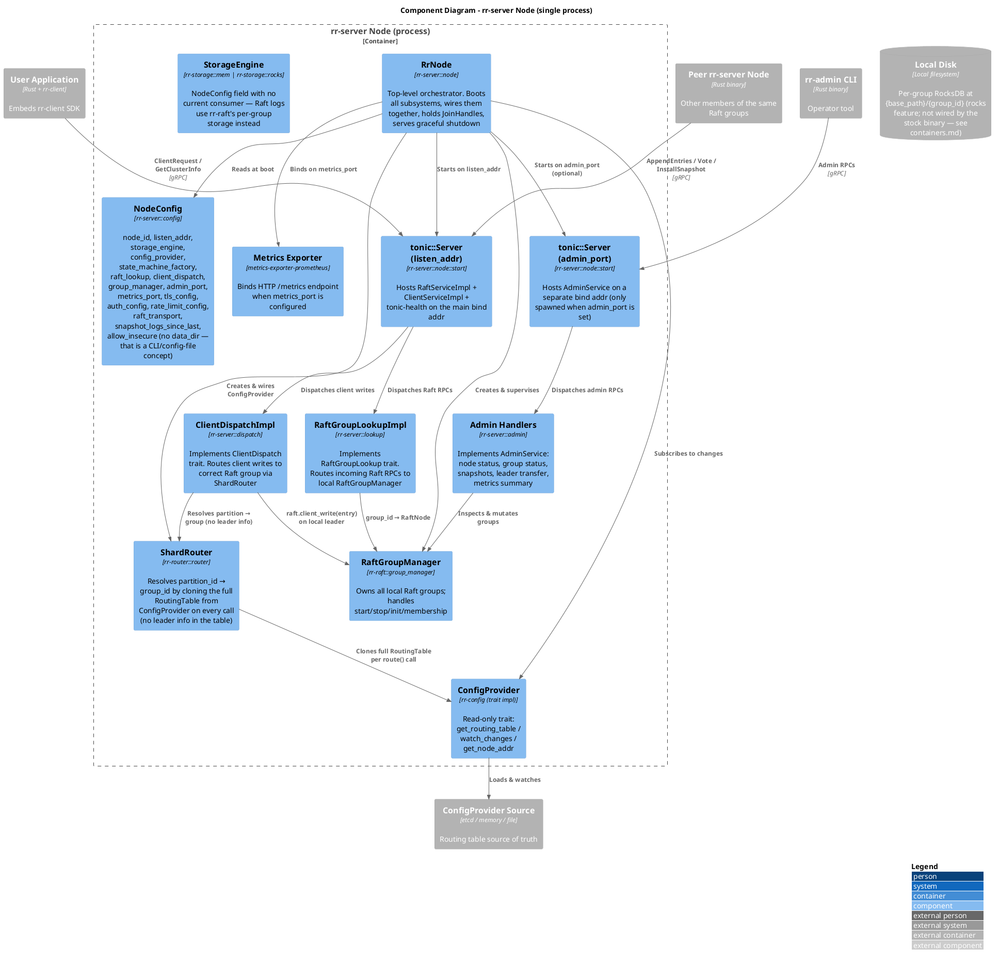

# Level 3 — rr-server 组件图 / rr-server Components

本图放大单个 **rr-server 节点进程** 的内部结构，展示它如何把多个底层 crate（rr-raft、rr-router、rr-network、rr-storage、rr-config）组装成一个完整的运行时。

---

This diagram zooms into a single **rr-server node process**, showing how it assembles multiple underlying crates (rr-raft, rr-router, rr-network, rr-storage, rr-config) into a complete runtime.

## 图示 / Diagram

## 核心组件 / Core Components

### RrNode — The Orchestrator
`crates/rr-server/src/node.rs`

生命周期分三段：`RrNode::new(config: NodeConfig)` → `start()` → `shutdown()`。

**`RrNode::new(config)`**（单参数、同步）只做组装，不启动任何东西：
1. `config.validate()` + 生产安全门禁（无 TLS / 无 admin_token 等违规时拒绝启动，除非 `allow_insecure`）。
2. 若配置 `metrics_port`，安装 Prometheus recorder。
3. 使用 `config.group_manager`（若提供）或新建 `RaftGroupManager`；用 `config.config_provider` 创建 `ShardRouter`。
4. 从 config 取出预构建的 `raft_lookup` / `client_dispatch` / TLS / auth / 限流等，存入字段。

**`start().await`** 完成全部启动并**随即返回**（各服务器在独立 tokio 任务中运行）：
1. `router.routing_table()` 加载路由表；对本节点所属的每个 group 调用 `start_group()` + `start_metrics_ticker()`。
2. 启动 config watch loop（`config_provider.watch_changes()`）：`PartitionAdded` / `GroupMembershipChanged` → 按需 `start_group()` / `stop_group()`；`NodeAdded` → 对所有本地 group 尝试 `add_learner`；`NodeRemoved` → `change_membership` 移除该节点。
3. 若 `raft_lookup` 与 `client_dispatch` 均存在：在同一 `tonic::Server`（绑定 `listen_addr`）上注册 `RaftServiceImpl` + `ClientServiceImpl` + tonic-health（可选 TLS、auth、限流拦截器）。
4. 若配置 `admin_port`，启动**独立**的 `tonic::Server` 仅承载 `AdminService`（不与 Raft / Client 共享端口，避免管理流量挤占共识带宽）；若配置 `metrics_port`，启动 HTTP observability server（`/health` `/ready` `/metrics`）。
5. 设置 readiness，`start()` 返回。

**没有 `serve()` 方法**——阻塞等待关闭信号是调用方的职责（stock 二进制在 `main.rs` 里 `wait_for_shutdown_signal()`）。**`shutdown().await`** 负责优雅停机：通知 gRPC server 停止（5 秒超时）→ abort watch loop → 逐个 `stop_group()`。

`RrNode` 持有所有子系统的句柄，负责优雅关闭时按依赖顺序停机。

---

The lifecycle has three phases: `RrNode::new(config: NodeConfig)` → `start()` → `shutdown()`.

**`RrNode::new(config)`** (single argument, synchronous) only assembles — it starts nothing:
1. `config.validate()` + production safety gates (refuses to start on violations such as missing TLS / missing `admin_token`, unless `allow_insecure`).
2. If `metrics_port` is configured, installs the Prometheus recorder.
3. Uses `config.group_manager` if provided, otherwise creates a `RaftGroupManager`; creates the `ShardRouter` from `config.config_provider`.
4. Stores the pre-built `raft_lookup` / `client_dispatch` / TLS / auth / rate-limit pieces from the config.

**`start().await`** performs all startup and **returns immediately** (each server runs in its own tokio task):
1. Loads the routing table via `router.routing_table()`; calls `start_group()` + `start_metrics_ticker()` for every group this node belongs to.
2. Starts the config watch loop (`config_provider.watch_changes()`): `PartitionAdded` / `GroupMembershipChanged` → `start_group()` / `stop_group()` as needed; `NodeAdded` → tries `add_learner` on all local groups; `NodeRemoved` → `change_membership` to remove the node.
3. If both `raft_lookup` and `client_dispatch` are present: registers `RaftServiceImpl` + `ClientServiceImpl` + tonic-health on a single `tonic::Server` bound to `listen_addr` (with optional TLS, auth, and rate-limit interceptors).
4. If `admin_port` is configured, starts a **separate** `tonic::Server` hosting only `AdminService` (kept off the main port so admin traffic cannot starve consensus bandwidth); if `metrics_port` is configured, starts the HTTP observability server (`/health` `/ready` `/metrics`).
5. Sets readiness and returns.

**There is no `serve()` method** — blocking until a shutdown signal is the caller's job (the stock binary does `wait_for_shutdown_signal()` in `main.rs`). **`shutdown().await`** performs graceful stop: signal the gRPC servers (5 s timeout) → abort the watch loop → `stop_group()` each group.

`RrNode` holds handles to all subsystems and is responsible for dependency-ordered graceful shutdown.

### ClientDispatchImpl — Route & Submit
`crates/rr-server/src/dispatch.rs`

对每个收到的 `ClientRequest`：
1. 从 `ShardRouter` 拿到目标 `group_id`（`route()` 只返回 group——路由表不含 leader 信息）。
2. 对本 group 调用 `raft.client_write(...)`；若本节点不是 leader，openraft 返回的 `ForwardToLeader` 错误被翻译成 `ClientWriteResult{success: false, leader_node_id, leader_addr}`，最终成为 `ClientResponse.leader_info` 重定向字段（不是 gRPC Status 错误）。
3. 序列化 `ClientWriteResponse` 返回给 gRPC handler。

---

For each incoming `ClientRequest`:
1. Ask `ShardRouter` for the target `group_id` (`route()` returns only the group — the routing table carries no leader information).
2. Call `raft.client_write(...)` on that group; if this node is not the leader, the `ForwardToLeader` error from openraft is translated into `ClientWriteResult{success: false, leader_node_id, leader_addr}`, which becomes the `ClientResponse.leader_info` redirect field (not a gRPC Status error).
3. Serialize the `ClientWriteResponse` and hand back to the gRPC handler.

### RaftGroupLookupImpl — Multi-group Demux
`crates/rr-server/src/lookup.rs`

入站 Raft RPC 的第一站。每个 RPC 携带 `group_id`；本组件查表拿到正确的 `RaftNode` 句柄并转发给 `openraft`。如果 `group_id` 在本节点上不存在（例如刚刚被迁移走），返回 `GroupNotFound` 错误。

---

First stop for inbound Raft RPCs. Each RPC carries a `group_id`; this component looks up the correct `RaftNode` handle and forwards to `openraft`. If the `group_id` doesn't exist locally (e.g. just migrated away), returns `GroupNotFound`.

### Admin Handlers
`crates/rr-server/src/admin.rs`

实现 `rr-network` 生成的 `AdminService` gRPC trait。直接查询 `RaftGroupManager` 和 metrics 注册表，不经过 Raft 共识。

---

Implements the `AdminService` gRPC trait generated by `rr-network`. Queries `RaftGroupManager` and the metrics registry directly — admin operations do not go through Raft consensus.

## 相邻组件 / Adjacent Components

这些组件由 rr-server 构造但定义在其他 crate 中——它们的内部结构请参考：

These components are *constructed by* rr-server but *defined in* other crates. For their internals, see:

- [`RaftGroupManager` 内部 / internals](./components-raft.md)
- [`ShardRouter` + `ConfigProvider` 内部 / internals](./components-router.md)
- [`RaftService` + `ClientService` + `AdminService` + `ChannelPool` / gRPC 层](./components-network.md)
