# Level 3 — rr-server 组件图 / rr-server Components

本图放大单个 **rr-server 节点进程** 的内部结构，展示它如何把多个底层 crate（rr-raft、rr-router、rr-network、rr-storage、rr-config）组装成一个完整的运行时。

---

This diagram zooms into a single **rr-server node process**, showing how it assembles multiple underlying crates (rr-raft, rr-router, rr-network, rr-storage, rr-config) into a complete runtime.

## 图示 / Diagram

```mermaid
C4Component
  title Component Diagram - rr-server Node (single process)

  Container_Ext(user_app, "User Application", "Rust + rr-client", "Embeds rr-client SDK")
  Container_Ext(peer_node, "Peer rr-server Node", "Rust binary", "Other members of the same Raft groups")
  Container_Ext(admin_cli, "rr-admin CLI", "Rust binary", "Operator tool")
  ContainerDb_Ext(disk, "Local Disk", "Local filesystem", "RocksDB data dir (rocks feature)")
  Container_Ext(config_store, "ConfigProvider Source", "etcd / memory / file", "Routing table source of truth")

  Container_Boundary(node, "rr-server Node (process)") {
    Component(rr_node, "RrNode", "rr-server::node", "Top-level orchestrator. Boots all subsystems, wires them together, holds JoinHandles, serves graceful shutdown")
    Component(node_config, "NodeConfig", "rr-server::config", "listen_addr, admin_port, metrics_port, node_id, data_dir, feature flags")

    Component(client_dispatch, "ClientDispatchImpl", "rr-server::dispatch", "Implements ClientDispatch trait. Routes client writes to correct Raft group via ShardRouter")
    Component(raft_lookup, "RaftGroupLookupImpl", "rr-server::lookup", "Implements RaftGroupLookup trait. Routes incoming Raft RPCs to local RaftGroupManager")
    Component(admin_impl, "Admin Handlers", "rr-server::admin", "Implements AdminService: node status, group status, snapshots, leader transfer, metrics summary")

    Component(metrics_exp, "Metrics Exporter", "metrics-exporter-prometheus", "Binds HTTP /metrics endpoint when metrics_port is configured")

    Component(grpc_server, "RrGrpcServer", "rr-network::server", "Hosts RaftService + ClientService + AdminService + tonic-health on the same tonic Server")
    Component(raft_mgr, "RaftGroupManager", "rr-raft::group_manager", "Owns all local Raft groups; handles start/stop/init/membership")
    Component(router, "ShardRouter", "rr-router::router", "Resolves partition_id → group_id → leader address via ConfigProvider")
    Component(cfg_provider, "ConfigProvider", "rr-config (trait impl)", "Watches routing table; broadcasts RoutingTableChange events")
    Component(storage, "StorageEngine", "rr-storage::mem | rr-storage::rocks", "CF-scoped KV store. Used by Raft log & state machine")
  }

  Rel(user_app, grpc_server, "ClientRequest / GetClusterInfo", "gRPC")
  Rel(peer_node, grpc_server, "AppendEntries / Vote / InstallSnapshot", "gRPC")
  Rel(admin_cli, grpc_server, "Admin RPCs", "gRPC")

  Rel(grpc_server, client_dispatch, "Dispatches client writes")
  Rel(grpc_server, raft_lookup, "Dispatches Raft RPCs")
  Rel(grpc_server, admin_impl, "Dispatches admin RPCs")

  Rel(rr_node, grpc_server, "Starts on listen_addr")
  Rel(rr_node, raft_mgr, "Creates & supervises")
  Rel(rr_node, router, "Creates & wires ConfigProvider")
  Rel(rr_node, cfg_provider, "Subscribes to changes")
  Rel(rr_node, metrics_exp, "Binds on metrics_port")
  Rel(rr_node, node_config, "Reads at boot")

  Rel(client_dispatch, router, "Resolves partition → group & leader")
  Rel(client_dispatch, raft_mgr, "raft.client_write(entry) on local leader")
  Rel(raft_lookup, raft_mgr, "group_id → RaftNode")
  Rel(admin_impl, raft_mgr, "Inspects & mutates groups")

  Rel(raft_mgr, storage, "Log + state machine persistence")
  Rel(router, cfg_provider, "Reads RoutingTable snapshot")
  Rel(storage, disk, "File I/O", "RocksDB (rocks feature)")
  Rel(cfg_provider, config_store, "Loads & watches")

  UpdateLayoutConfig($c4ShapeInRow="3", $c4BoundaryInRow="2")
```

## 核心组件 / Core Components

### RrNode — The Orchestrator
`crates/rr-server/src/node.rs`

启动时 `RrNode::new(config, storage, state_machine_builder, config_provider)` 执行以下序列：

1. 创建 `ShardRouter`，绑定到 `ConfigProvider` 并订阅变更。
2. 创建 `RaftGroupManager`，注入 `StorageEngine` 和 Raft 网络工厂（`GrpcNetworkFactory`）。
3. 构造 `ClientDispatchImpl` 与 `RaftGroupLookupImpl`（trait 适配器）。
4. 构造 `RrGrpcServer`，把三个服务注册到同一个 tonic `Server`。
5. 在 `listen_addr` 启动 gRPC 服务；若配置则在 `admin_port` 启动独立 admin server、在 `metrics_port` 启动 Prometheus HTTP。
6. 启动 config watch loop：监听 `RoutingTableChange::GroupMembershipChanged` 等事件，并调用 `raft_mgr.start_group() / stop_group()`。
7. `serve().await` 阻塞直到收到关闭信号。

`RrNode` 持有所有子系统的句柄，负责优雅关闭时按依赖顺序停机。

---

On startup, `RrNode::new(config, storage, state_machine_builder, config_provider)` executes this sequence:

1. Create `ShardRouter`, bind to `ConfigProvider`, subscribe to changes.
2. Create `RaftGroupManager`, injecting the `StorageEngine` and Raft network factory (`GrpcNetworkFactory`).
3. Build `ClientDispatchImpl` and `RaftGroupLookupImpl` (trait adapters).
4. Build `RrGrpcServer`, registering all three services on one tonic `Server`.
5. Start the gRPC server on `listen_addr`; if configured, start a separate admin server on `admin_port` and the Prometheus HTTP endpoint on `metrics_port`.
6. Start the config watch loop: react to `RoutingTableChange::GroupMembershipChanged` etc. by calling `raft_mgr.start_group() / stop_group()`.
7. `serve().await` blocks until a shutdown signal arrives.

`RrNode` holds handles to all subsystems and is responsible for dependency-ordered graceful shutdown.

### ClientDispatchImpl — Route & Submit
`crates/rr-server/src/dispatch.rs`

对每个收到的 `ClientRequest`：
1. 从 `ShardRouter` 拿到目标 `group_id` + leader 地址。
2. 若本节点是 leader，`raft.client_write(...)` 提交到 openraft；否则返回 `ForwardToLeader` 携带 leader 信息。
3. 序列化 `ClientWriteResponse` 返回给 gRPC handler。

---

For each incoming `ClientRequest`:
1. Ask `ShardRouter` for the target `group_id` and leader address.
2. If this node is the leader, submit via `raft.client_write(...)` to openraft; otherwise return `ForwardToLeader` with leader info.
3. Serialize the `ClientWriteResponse` and hand back to the gRPC handler.

### RaftGroupLookupImpl — Multi-group Demux
`crates/rr-server/src/lookup.rs`

入站 Raft RPC 的第一站。每个 RPC 携带 `group_id`；本组件查表拿到正确的 `RaftNode` 句柄并转发给 `openraft`。如果 `group_id` 在本节点上不存在（例如刚刚被迁移走），返回 `GroupNotFound` 错误。

---

First stop for inbound Raft RPCs. Each RPC carries a `group_id`; this component looks up the correct `RaftNode` handle and forwards to `openraft`. If the `group_id` doesn't exist locally (e.g. just migrated away), returns `GroupNotFound`.

### Admin Handlers
`crates/rr-server/src/admin.rs`

实现 `rr-network` 生成的 `AdminService` gRPC trait。直接查询 `RaftGroupManager` 和 metrics 注册表，不经过 Raft 共识。

---

Implements the `AdminService` gRPC trait generated by `rr-network`. Queries `RaftGroupManager` and the metrics registry directly — admin operations do not go through Raft consensus.

## 相邻组件 / Adjacent Components

这些组件由 rr-server 构造但定义在其他 crate 中——它们的内部结构请参考：

These components are *constructed by* rr-server but *defined in* other crates. For their internals, see:

- [`RaftGroupManager` 内部 / internals](./components-raft.md)
- [`ShardRouter` + `ConfigProvider` 内部 / internals](./components-router.md)
- [`RrGrpcServer` + `RaftService` + `ClientService` + `AdminService` / gRPC 层](./components-network.md)
