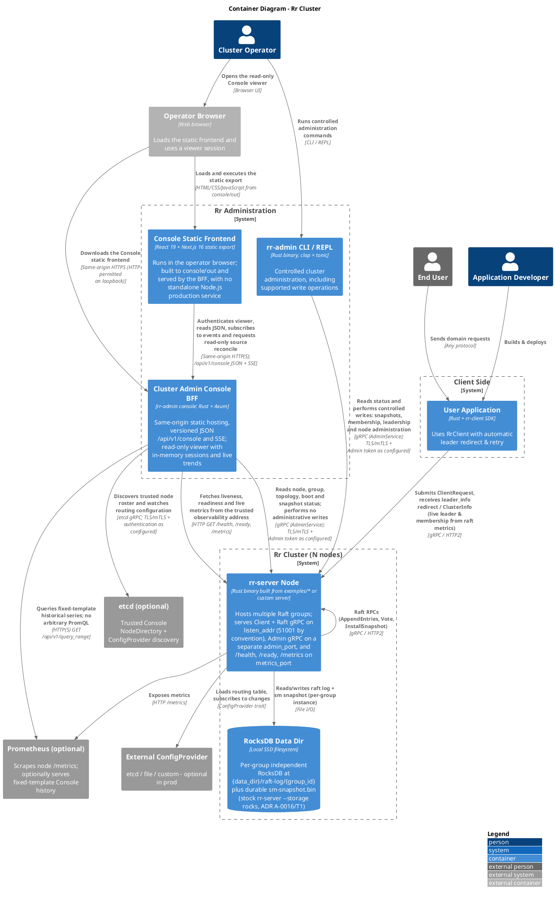

# 第 2 级：容器图 / Level 2: Container Diagram

本图展示 Rr 的可部署单元、外部依赖和通信协议。这里的“容器”是 C4 概念，不限于 Docker。

This diagram shows Rr's deployable units, external dependencies, and communication protocols. Here “container”
is a C4 concept, not necessarily Docker.

## 图示 / Diagram

## 容器清单 / Container Inventory

### 部署单元 / Deployable Units

| 容器 / Container | 技术 / Technology | 部署形态 / Deployable Form | 运行位置 / Runs Where |
| :--- | :--- | :--- | :--- |
| **rr-server Node** | Rust binary | Linux binary, Docker image, systemd unit | 每节点一个进程 / One process per node |
| **rr-admin CLI / REPL** | `crates/rr-admin` | CLI tool | 运维主机或 bastion / Operator workstation or bastion |
| **Cluster Admin Console BFF** | `rr-admin console`，Rust + Axum | 与 CLI/REPL 同属 `rr-admin` 二进制的可选进程 / Optional process in the same `rr-admin` binary as CLI/REPL | 运维主机或 bastion / Operator workstation or bastion |
| **Console Static Frontend** | React 19 + Next.js 16 静态导出 / static export | `console/out` 随 BFF 携带或由 `--static-dir` 指向；无独立 Node.js 生产服务 / Shipped with the BFF or selected by `--static-dir`; no standalone Node.js production service | 由 BFF 同源托管，在 Operator Browser 中运行 / Served same-origin by the BFF and run in the Operator Browser |
| **User Application** | Rust + rr-client | 应用自定义 / Application-defined | 可通过 gRPC 访问集群的进程 / Any process with gRPC access |

### 外部依赖 / External Dependencies

| 依赖 / Dependency | 作用 / Role |
| :--- | :--- |
| **RocksDB Data Dir** | rocks 模式下按 group 持久化日志、vote 和 `sm-snapshot.bin`；不是独立进程。 Per-group log, vote, and `sm-snapshot.bin` persistence in rocks mode; not a separate process. |
| **Prometheus** | 可选节点指标抓取，以及可选的 Console 固定模板历史来源；Console 实时趋势不依赖它，也不开放任意 PromQL。 Optional node metrics scraper and optional fixed-template Console history source; Console live trends do not require it and arbitrary PromQL is not exposed. |
| **External ConfigProvider** | 可选的外部路由表来源；开发默认使用进程内 `MemConfigProvider`。 / Optional external routing-table source; development defaults to in-process `MemConfigProvider`. |
| **etcd NodeDirectory + ConfigProvider** | 可选的 Console 受信节点发现与路由配置来源；不使用 discovery 时可通过显式 Admin seed 运行。 Optional trusted Console node discovery and routing configuration; explicit Admin seeds work without discovery. |

## 库 Crate 不是容器 / Library Crates Are Not Containers

以下库链接进 rr-server 或应用进程，不是独立部署单元。

The following libraries are linked into rr-server or application processes; they are not independently deployed.

| Crate | 链接进 / Linked Into |
| :--- | :--- |
| `rr-core` | rr-server, rr-client, rr-admin, other crates |
| `rr-storage` | rr-server (`MemStorage` / `RocksStorage`) |
| `rr-config` | rr-server (`MemConfigProvider`) |
| `rr-raft` | rr-server (`RaftGroupManager`, `RaftNode`) |
| `rr-router` | rr-server (`ShardRouter`) |
| `rr-network` | rr-server, rr-client, rr-admin |
| `rr-client` | User Application |

内部结构见[组件图](./components-server.md)。

See the [component diagrams](./components-server.md) for internal structure.

## 通信矩阵 / Communication Matrix

| 来源 → 目标 / From → To | 协议 / Protocol | 服务与端口 / Service / Port | 用途 / Purpose |
| :--- | :--- | :--- | :--- |
| User App → rr-server | gRPC | `ClientService` @ 51001 | `Request`, `ReadLocal`, `ReadLinearizable`, `GetClusterInfo` |
| rr-admin CLI/REPL → rr-server | gRPC (+ TLS/mTLS) | `AdminService` @ `admin_port` | 状态读取与受控写操作：快照、成员、选主和节点管理；按配置使用 Admin token / Status reads and controlled writes: snapshots, membership, leadership and node administration; uses Admin token as configured |
| Console Static Frontend → Console BFF | 同源 HTTP(S) / Same-origin HTTP(S) | `/api/v1/console` JSON + SSE | viewer 登录、只读数据与事件订阅、只读 sources reconcile；非 loopback 必须 HTTPS / Viewer login, read-only data/events and read-only source reconcile; HTTPS required for non-loopback |
| Console BFF → rr-server | gRPC (+ TLS/mTLS) | `AdminService` @ `admin_port` | 只读节点、组、拓扑、boot 和快照状态；Console 的 Admin token 仅留在 BFF / Read-only node, group, topology, boot and snapshot status; the Console's Admin token stays in the BFF |
| Console BFF → rr-server | HTTP | `/health`, `/ready`, `/metrics` @ trusted `observability_addr` (`metrics_port`) | 读取 liveness、readiness 和实时指标 / Reads liveness, readiness and live metrics |
| Console BFF → etcd（可选 / optional） | etcd gRPC + TLS/mTLS as configured | `NodeDirectory` + `ConfigProvider` | 受信节点发现、路由配置读取与 watch / Trusted node discovery, routing configuration reads and watches |
| Console BFF → Prometheus（可选 / optional） | HTTP(S) | `/api/v1/query_range` | 固定模板历史查询，非任意 PromQL / Fixed-template history queries, not arbitrary PromQL |
| rr-server ↔ rr-server | gRPC | `RaftService` @ 51001 | `AppendEntries`, `Vote`, `InstallSnapshot` |
| Prometheus → rr-server | HTTP | `/metrics` @ `metrics_port` | 可选指标抓取 / Optional metrics scraping |
| rr-server → Disk | File I/O | Local path | rocks 模式日志与快照 / Rocks-mode log and snapshot |
| rr-server → ConfigProvider | Trait call | 实现定义 / Implementation-defined | 读取路由表并监听变更 / Read table and watch changes |

## 边界与客户端行为 / Boundaries and Client Behavior

1. `RaftService` 与 `ClientService` 共享 `listen_addr`；Admin 使用可选的独立端口，observability 在 `metrics_port`
   提供 `/health`、`/ready` 和 `/metrics`。
   `RaftService` and `ClientService` share `listen_addr`; Admin uses an optional separate port, and observability serves
   `/health`, `/ready`, and `/metrics` on `metrics_port`.
2. `RrClient` 缓存 group leader；收到带 `leader_info` 的普通响应后更新缓存、退避并重试。
   `RrClient` caches group leaders; a normal response carrying `leader_info` updates the cache and triggers a
   backoff and retry.
3. 没有独立网关；任何节点都可接收请求，非 leader 通过响应重定向客户端。
   There is no dedicated gateway; any node can receive a request, and a non-leader redirects the client.
4. Console 静态前端与 BFF 是两个逻辑 C4 容器，但不是两个生产服务：CLI/REPL 与 Axum BFF 同属 `rr-admin`
   二进制，Next.js 产物由 BFF 同源托管。部署需携带 `console/out` 或用 `--static-dir` 指向它，不需要独立
   Node.js 服务。
   The Console static frontend and BFF are separate logical C4 containers, not separate production services: the
   CLI/REPL and Axum BFF share the `rr-admin` binary, and the BFF serves the Next.js export same-origin. Deploy
   `console/out` with the binary or select it with `--static-dir`; no standalone Node.js service is needed.
5. Admin CLI/REPL 负责受控写操作；Console 只有 viewer 能力，`POST /sources/reconcile` 也只是只读刷新，不执行
   membership、强制选主、TriggerSnapshot、DrainNode、offset reset 或进程重启。Console 不在 Raft/Client 数据
   路径上，其故障不影响节点服务。
   The Admin CLI/REPL owns controlled writes; the Console is viewer-only. `POST /sources/reconcile` only refreshes
   read-only evidence and does not change membership, force leadership, trigger snapshots, drain nodes, reset offsets,
   or restart processes. The Console is outside the Raft/Client data path, and its failure does not affect node service.
6. 非 loopback Console 必须同时使用 HTTPS 和 viewer token；viewer session 仅保存在内存且 15 分钟过期，Console
   使用的节点 Admin token 只留在 BFF。当前 Console 面向单集群只读 viewer，不提供 OIDC/RBAC 或多集群管理。
   A non-loopback Console requires both HTTPS and a viewer token; viewer sessions are memory-only and expire after
   15 minutes, while node Admin tokens used by the Console remain only in the BFF. The Console is currently scoped to
   one cluster with read-only viewers and provides neither OIDC/RBAC nor multi-cluster management.
7. etcd discovery 与 Prometheus 历史均为可选；实时趋势来自 BFF 逐节点抓取并保存在有界内存中，重启即清空。
   Both etcd discovery and Prometheus history are optional. Live trends come from per-node BFF scrapes retained in
   bounded memory and are cleared on restart.

## 下钻 / Drill-down

- [节点内部 / Node internals](./components-server.md)
- [Console 内部 / Console internals](./components-console.md)
- [多 Raft 组 / Multi-Raft groups](./components-raft.md)
- [分片路由 / Shard routing](./components-router.md)
- [gRPC 层 / gRPC transport](./components-network.md)
- [物理部署 / Physical deployment](./deployment.md)
