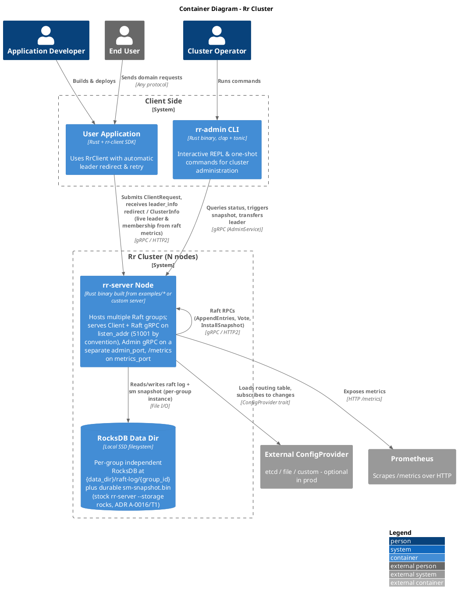

# 第 2 级：容器图 / Level 2: Container Diagram

本图展示 Rr 的可部署单元、外部依赖和通信协议。这里的“容器”是 C4 概念，不限于 Docker。

This diagram shows Rr's deployable units, external dependencies, and communication protocols. Here “container”
is a C4 concept, not necessarily Docker.

## 图示 / Diagram

## 容器清单 / Container Inventory

### 部署单元 / Deployable Units

| 容器 / Container | 技术 / Technology | 部署形态 / Deployable Form | 运行位置 / Runs Where |
| :--- | :--- | :--- | :--- |
| **rr-server Node** | Rust binary | Linux binary, Docker image, systemd unit | 每节点一个进程 / One process per node |
| **rr-admin CLI** | `crates/rr-admin` | CLI tool | 运维主机或 bastion / Operator workstation or bastion |
| **User Application** | Rust + rr-client | 应用自定义 / Application-defined | 可通过 gRPC 访问集群的进程 / Any process with gRPC access |

### 外部依赖 / External Dependencies

| 依赖 / Dependency | 作用 / Role |
| :--- | :--- |
| **RocksDB Data Dir** | rocks 模式下按 group 持久化日志、vote 和 `sm-snapshot.bin`；不是独立进程。 Per-group log, vote, and `sm-snapshot.bin` persistence in rocks mode; not a separate process. |
| **Prometheus** | 可选指标抓取。 / Optional metrics scraper. |
| **External ConfigProvider** | 可选的外部路由表来源；开发默认使用进程内 `MemConfigProvider`。 / Optional external routing-table source; development defaults to in-process `MemConfigProvider`. |

## 库 Crate 不是容器 / Library Crates Are Not Containers

以下库链接进 rr-server 或应用进程，不是独立部署单元。

The following libraries are linked into rr-server or application processes; they are not independently deployed.

| Crate | 链接进 / Linked Into |
| :--- | :--- |
| `rr-core` | rr-server, rr-client, rr-admin, other crates |
| `rr-storage` | rr-server (`MemStorage` / `RocksStorage`) |
| `rr-config` | rr-server (`MemConfigProvider`) |
| `rr-raft` | rr-server (`RaftGroupManager`, `RaftNode`) |
| `rr-router` | rr-server (`ShardRouter`) |
| `rr-network` | rr-server, rr-client, rr-admin |
| `rr-client` | User Application |

内部结构见[组件图](./components-server.md)。

See the [component diagrams](./components-server.md) for internal structure.

## 通信矩阵 / Communication Matrix

| 来源 → 目标 / From → To | 协议 / Protocol | 服务与端口 / Service / Port | 用途 / Purpose |
| :--- | :--- | :--- | :--- |
| User App → rr-server | gRPC | `ClientService` @ 51001 | `Request`, `ReadLocal`, `ReadLinearizable`, `GetClusterInfo` |
| rr-admin → rr-server | gRPC | `AdminService` @ `admin_port` | 状态、快照、成员与管理 / Status, snapshots, membership, administration |
| rr-server ↔ rr-server | gRPC | `RaftService` @ 51001 | `AppendEntries`, `Vote`, `InstallSnapshot` |
| Prometheus → rr-server | HTTP | `/metrics` @ `metrics_port` | 指标抓取 / Metrics scraping |
| rr-server → Disk | File I/O | Local path | rocks 模式日志与快照 / Rocks-mode log and snapshot |
| rr-server → ConfigProvider | Trait call | 实现定义 / Implementation-defined | 读取路由表并监听变更 / Read table and watch changes |

## 边界与客户端行为 / Boundaries and Client Behavior

1. `RaftService` 与 `ClientService` 共享 `listen_addr`；Admin 和 metrics 分别使用可选的独立端口。
   `RaftService` and `ClientService` share `listen_addr`; Admin and metrics use optional separate ports.
2. `RrClient` 缓存 group leader；收到带 `leader_info` 的普通响应后更新缓存、退避并重试。
   `RrClient` caches group leaders; a normal response carrying `leader_info` updates the cache and triggers a
   backoff and retry.
3. 没有独立网关；任何节点都可接收请求，非 leader 通过响应重定向客户端。
   There is no dedicated gateway; any node can receive a request, and a non-leader redirects the client.

## 下钻 / Drill-down

- [节点内部 / Node internals](./components-server.md)
- [多 Raft 组 / Multi-Raft groups](./components-raft.md)
- [分片路由 / Shard routing](./components-router.md)
- [gRPC 层 / gRPC transport](./components-network.md)
- [物理部署 / Physical deployment](./deployment.md)
