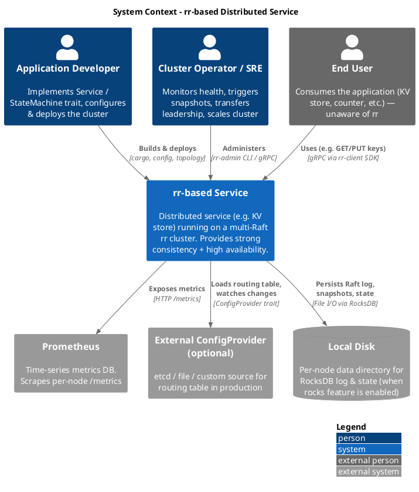

# Level 1 — 系统上下文 / System Context

系统上下文图回答一个简单问题：**rr 到底是什么，谁用它，它与哪些外部系统交互？** 本图面向所有读者——开发者、运维、产品经理——建立对 rr 所处位置的共识。

---

The System Context diagram answers one simple question: **what is rr, who uses it, and what external systems does it talk to?** This diagram is for all audiences — developers, operators, product managers — to establish a shared mental model of where rr sits.

## 图示 / Diagram

## 外部行为者 / External Actors

### Application Developer
构建基于 rr 的服务的工程师。他们通过实现 `rr-core` 的 `Service` 或 `StateMachine` trait 嵌入业务逻辑，并通过 `NodeConfig` 配置部署。关注点：编程模型、失败模式、一致性语义。

---

Engineers building services on top of rr. They embed business logic by implementing the `Service` or `StateMachine` traits from `rr-core`, and configure deployment via `NodeConfig`. Concerns: programming model, failure modes, consistency semantics.

### Cluster Operator / SRE
运行 rr 集群的人。他们使用 `rr-admin` CLI 检查状态、触发快照、转移领导权，并通过 Prometheus 监控集群健康度。关注点：可观测性、故障恢复、滚动升级。

---

People running rr clusters in production. They use the `rr-admin` CLI to inspect status, trigger snapshots, transfer leadership, and monitor cluster health via Prometheus. Concerns: observability, failure recovery, rolling upgrades.

### End User
应用的最终用户，例如通过用户应用调用 KV 操作的业务服务。他们完全不感知 rr 的存在——只看到应用提供的 API。

---

The final users of the application, e.g. business services calling KV operations via the user's app. They are completely unaware of rr — they only see the API the application exposes.

## 外部系统 / External Systems

### Prometheus (optional)
rr 节点通过内置的 `metrics-exporter-prometheus` 在 HTTP `/metrics` 端点暴露指标（请求延迟、Raft 任期、日志追加速率等）。Prometheus 定期抓取。

---

rr nodes expose metrics at HTTP `/metrics` via the built-in `metrics-exporter-prometheus` (request latencies, Raft terms, log append rates, etc.). Prometheus scrapes them periodically.

### External ConfigProvider (optional)
默认 `MemConfigProvider` 将路由表存储在进程内存中，仅适合开发。生产环境通常需要自定义 `ConfigProvider`，从 etcd、配置文件或其他外部源加载并监听变化。

---

The default `MemConfigProvider` keeps the routing table in process memory — suitable only for development. Production typically requires a custom `ConfigProvider` that loads from and watches etcd, config files, or another external source.

### Local Disk
启用 `rocks` feature 后，每个节点将 Raft 日志、元数据、状态机数据持久化到本地文件系统（通常是 SSD）。数据目录路径由 `NodeConfig` 指定。

---

When the `rocks` feature is enabled, each node persists Raft log, metadata, and state machine data to the local filesystem (typically an SSD). The data directory path is specified in `NodeConfig`.

## 未显式建模的内容 / What's Intentionally Out of Scope

- **单个 rr 节点内部结构** → 见 [containers.md](./containers.md) 与 components-*.md
- **节点间 Raft 消息的具体协议** → 见 [components-network.md](./components-network.md)
- **物理部署布局（可用区、网络分区）** → 见 [deployment.md](./deployment.md)

---

- **Inside a single rr node** → see [containers.md](./containers.md) and components-*.md
- **Concrete Raft RPC protocol between nodes** → see [components-network.md](./components-network.md)
- **Physical deployment layout (availability zones, network partitions)** → see [deployment.md](./deployment.md)
