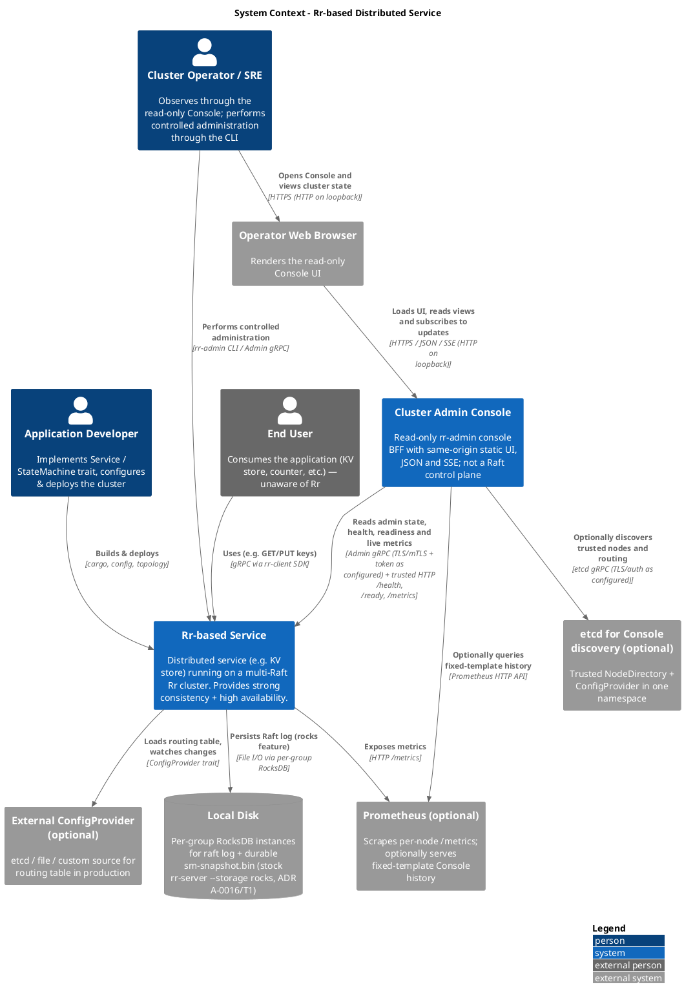

# 第 1 级：系统上下文 / Level 1: System Context

本图界定 Rr 的系统边界、使用者和外部依赖。

This diagram defines Rr's system boundary, users, and external dependencies.

## 图示 / Diagram

## 外部行为者 / External Actors

### 应用开发者 / Application Developer

开发者实现 `rr-core` 的 `Service` 或 `StateMachine` trait 以嵌入业务逻辑，并用 `NodeConfig` 配置节点。
他们需要了解编程模型、失败模式和一致性语义。

Developers implement `rr-core`'s `Service` or `StateMachine` trait to embed business logic and configure nodes
with `NodeConfig`. Their concerns are the programming model, failure modes, and consistency semantics.

### 集群运维 / Cluster Operator / SRE

运维通过只读 Web Console 观察集群状态、健康和性能，通过 `rr-admin` CLI 执行触发快照、转移领导权和
membership 变更等受控管理。Console 不提供写操作，也不是 Raft 控制面；停止 Console 不影响 Raft 节点。

Operators observe cluster state, health, and performance through the read-only Web Console, and use the `rr-admin`
CLI for controlled administration such as triggering snapshots, transferring leadership, and changing membership. The
Console exposes no write operations and is not a Raft control plane; stopping it does not affect Raft nodes.

### 最终用户 / End User

最终用户只接触应用 API，不需要感知 Rr。

End users interact with the application API and need not be aware of Rr.

## 外部系统 / External Systems

### Prometheus（可选）/ Prometheus (Optional)

节点通过 `metrics-exporter-prometheus` 暴露 HTTP `/metrics`，Prometheus 定期抓取。Console 还可通过 Prometheus
HTTP API 查询固定模板历史，但 Prometheus 不是 Console 的必需依赖。

Nodes expose HTTP `/metrics` through `metrics-exporter-prometheus`; Prometheus scrapes the endpoint periodically. The
Console can also query fixed-template history through the Prometheus HTTP API, but Prometheus is not required by the
Console.

### 外部 ConfigProvider（可选）/ External ConfigProvider (Optional)

默认 `MemConfigProvider` 只保存进程内路由表。生产环境可使用只读的 `rr-config-etcd`
（`EtcdConfigProvider`），或自行实现 `ConfigProvider`；Rr 不写回 etcd。

The default `MemConfigProvider` keeps the routing table in process memory. Production deployments can use the
read-only `rr-config-etcd` (`EtcdConfigProvider`) or a custom `ConfigProvider`; Rr never writes back to etcd.

Console 的 etcd discovery 是另一条可选路径，只读取同一 namespace 的 `NodeDirectory` 和 `ConfigProvider`；
file/custom provider 并不因此成为 Console discovery 后端。

Console etcd discovery is a separate optional path that reads only the `NodeDirectory` and `ConfigProvider` in one
namespace; file/custom providers do not thereby become Console discovery backends.

### 本地磁盘 / Local Disk

stock `rr-server` 在启用 `rocks` feature 且使用 `--storage rocks` 时，为每个 group 在
`{data_dir}/raft-log/{group_id}` 打开独立 RocksDB。Raft 日志和 `sm-snapshot.bin` 均持久化；快照原子写入，
损坏或未知版本会 fail-closed。重启时先恢复快照，再重放未 purge 的日志尾部。默认 `--storage mem`
仍为全内存。

With the `rocks` feature and `--storage rocks`, stock `rr-server` opens an independent RocksDB per group at
`{data_dir}/raft-log/{group_id}`. It persists both the Raft log and `sm-snapshot.bin`; snapshot writes are atomic,
and corrupt or unknown-version files fail closed. Restart restores the snapshot before replaying the un-purged
log tail. The default `--storage mem` remains in-memory.

## 不在本图范围内 / Out of Scope

- 节点内部结构见 [containers.md](./containers.md) 和组件图。 /
  See [containers.md](./containers.md) and the component diagrams for node internals.
- Raft RPC 协议见 [components-network.md](./components-network.md)。 /
  See [components-network.md](./components-network.md) for Raft RPCs.
- 物理部署见 [deployment.md](./deployment.md)。 /
  See [deployment.md](./deployment.md) for physical deployment.
