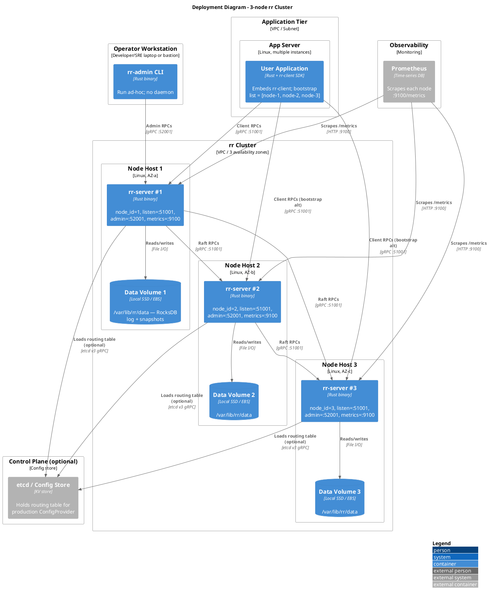

# Deployment — 部署拓扑 / Production Deployment Topology

本图展示一个典型的**三节点生产部署**：rr-server 运行在独立主机上，带持久化 RocksDB 存储，监听分离的 Raft/Client 与 Admin 端口，由 Prometheus 抓取指标，由运维通过 rr-admin CLI 管理。

---

This diagram shows a typical **three-node production deployment**: rr-server running on separate hosts with persistent RocksDB storage, listening on separated Raft/Client and Admin ports, scraped by Prometheus, administered via rr-admin CLI.

## 图示 / Diagram



## 端口方案 / Port Scheme

| Port | Protocol | Service | Exposed To | Firewall Rule |
| :--- | :--- | :--- | :--- | :--- |
| **51001** | gRPC / HTTP2 | `ClientService` + `RaftService` | App tier + peer rr nodes | Open to app subnet + intra-cluster |
| **52001** | gRPC / HTTP2 | `AdminService` | Operator workstation / bastion only | Restrict to ops VPN |
| **9100** | HTTP | Prometheus `/metrics` | Prometheus scrape target | Open to monitoring network only |

**为什么 Raft 和 Client 共享端口？/ Why share Raft and Client port?**
简化防火墙规则——只需开放一个 gRPC 端口就能同时处理集群内部和外部流量。tonic 可以在同一个 `Server` 上注册多个服务。**如果你需要严格的流量隔离**，可以修改 `RrNode` 将 `RaftService` 绑定到独立端口。

Simpler firewall rules — a single gRPC port handles both intra-cluster and external traffic. tonic can register multiple services on one `Server`. **If you need strict traffic isolation**, modify `RrNode` to bind `RaftService` on a separate port.

## 硬件推荐 / Hardware Recommendations

| Resource | Dev / Test | Small Prod | Medium Prod |
| :--- | :--- | :--- | :--- |
| Nodes | 1 (bootstrap) | 3 | 5 |
| vCPU / node | 2 | 4–8 | 16+ |
| RAM / node | 4 GB | 8–16 GB | 32+ GB |
| Disk / node | SSD 20 GB | NVMe SSD 200 GB | NVMe SSD 1 TB+ |
| Network | Localhost | 1 Gbps, same AZ optional | 10 Gbps, multi-AZ |

**关键考量 / Key considerations**:

- **节点数量必须是奇数**（3, 5, 7）以形成 quorum。4 个节点和 3 个节点的容错能力相同。
- **低延迟磁盘**：Raft 需要 fsync 日志；机械硬盘不可行。
- **跨可用区部署**：为了防止单 AZ 故障导致集群不可用，将节点分布到至少 3 个 AZ。
- **同一可用区内部署 5 节点并不会显著提升可用性**——AZ 故障仍然会同时下线所有节点。

---

- **Node count must be odd** (3, 5, 7) to form a quorum. 4 nodes tolerate the same failures as 3.
- **Low-latency disk**: Raft requires fsync on log writes; spinning disks are unworkable.
- **Spread across AZs**: to prevent single-AZ failure from taking down the cluster, distribute nodes across at least 3 AZs.
- **5 nodes in one AZ does not improve availability** — the AZ failure still kills all of them simultaneously.

## 启动顺序 / Bootstrap Sequence

```bash
# Node 1 — bootstrap (first and only time)
rr-server \
  --node-id 1 --listen 0.0.0.0:51001 \
  --admin-port 52001 --metrics-port 9100 \
  --data-dir /var/lib/rr/data \
  --bootstrap

# Nodes 2 and 3 — join existing cluster
rr-server \
  --node-id 2 --listen 0.0.0.0:51001 \
  --admin-port 52001 --metrics-port 9100 \
  --data-dir /var/lib/rr/data \
  --peers host-1:51001

rr-server \
  --node-id 3 --listen 0.0.0.0:51001 \
  --admin-port 52001 --metrics-port 9100 \
  --data-dir /var/lib/rr/data \
  --peers host-1:51001,host-2:51001
```

> **注意**：`--bootstrap` 标志**只应使用一次**——集群的首次初始化。重启已有节点时不要使用此标志。
>
> **Note**: `--bootstrap` should be used **exactly once** — at cluster initialization. Do NOT use when restarting an existing node.

## 失败模式 / Failure Modes

| Failure | Cluster Impact | Recovery |
| :--- | :--- | :--- |
| 1/3 nodes down | ✅ Still operational (quorum = 2) | Replace node, sync via snapshot |
| 2/3 nodes down | ❌ Writes blocked (no quorum) | Restore any 2 nodes |
| Disk full on leader | ❌ Leader stalls; group unavailable until disk freed | Rotate logs, retain snapshots only |
| Network partition (leader side) | Leader → minority → steps down; majority elects new leader | Heal partition, stale leader rejoins as follower |
| Split-brain across 2/1 | Only majority side proceeds; minority rejects writes | No data loss; minority catches up when partition heals |

详细故障处理 → [dynamic-leader-election.md](./dynamic-leader-election.md) + [dynamic-snapshot-transfer.md](./dynamic-snapshot-transfer.md)

Detailed failure handling → [dynamic-leader-election.md](./dynamic-leader-election.md) + [dynamic-snapshot-transfer.md](./dynamic-snapshot-transfer.md)

## 推荐的 SLI/SLO 监控 / Recommended SLIs/SLOs

从 Prometheus 抓取以下指标建立基线：

Scrape these from Prometheus to establish a baseline:

| Metric | Meaning | Alert Threshold (example) |
| :--- | :--- | :--- |
| `rr_raft_term` | Current Raft term per group | Term increasing > 3× / hour = unstable leadership |
| `rr_client_request_duration_seconds` | p99 client request latency | > 200 ms for 5 min |
| `rr_raft_log_append_rate` | Entries appended per second | Sudden drop = replication stall |
| `rr_raft_snapshot_in_progress` | Snapshot transfers underway | > 0 for extended time = slow catch-up |
| `rr_raft_leader_elections_total` | Cumulative elections | Rate > 1/min = flapping |
| `up{job="rr"}` | Node liveness | Any node down > 1 min |

## 相关 / Related

- 容器级别结构：[containers.md](./containers.md)
- 现有部署指南：[../../deployment/deployment.md](../../deployment/deployment.md)
