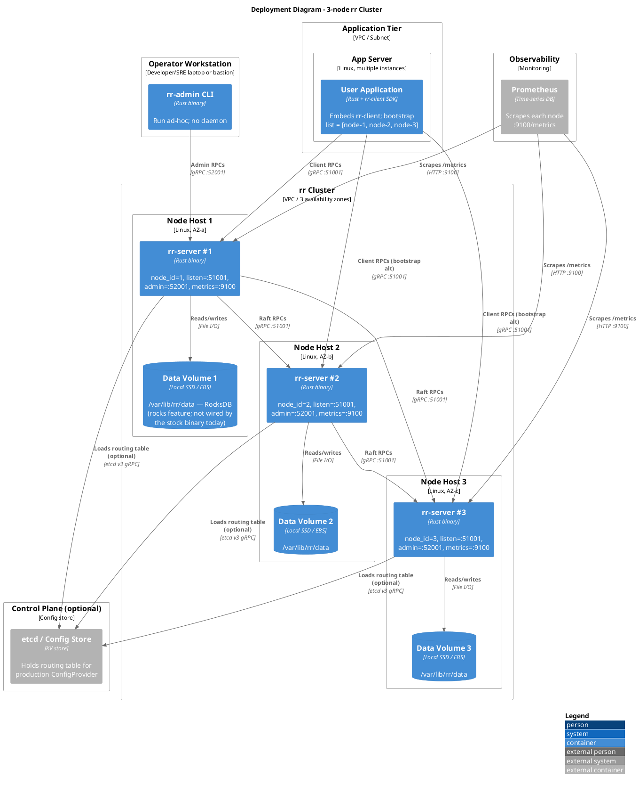

# Deployment — 部署拓扑 / Production Deployment Topology

本图展示一个典型的**三节点生产部署**：rr-server 运行在独立主机上，监听分离的 Raft/Client 与 Admin 端口，由 Prometheus 抓取指标，由运维通过 rr-admin CLI 管理。存储注意：stock 二进制目前始终使用**内存** raft 日志（`RaftGroupManager::new_with_network`）；RocksDB raft 日志持久化（每 group 独立实例，`{base_path}/{group_id}`）仅在集成测试中接线，尚未由二进制启用。

---

This diagram shows a typical **three-node production deployment**: rr-server running on separate hosts, listening on separated Raft/Client and Admin ports, scraped by Prometheus, administered via rr-admin CLI. Storage note: the stock binary currently always uses **in-memory** raft logs (`RaftGroupManager::new_with_network`); RocksDB raft-log persistence (one independent instance per group at `{base_path}/{group_id}`) is only wired in integration tests, not yet enabled by the binary.

## 图示 / Diagram



## 端口方案 / Port Scheme

| Port | Protocol | Service | Exposed To | Firewall Rule |
| :--- | :--- | :--- | :--- | :--- |
| **51001** | gRPC / HTTP2 | `ClientService` + `RaftService` | App tier + peer rr nodes | Open to app subnet + intra-cluster |
| **52001** | gRPC / HTTP2 | `AdminService` | Operator workstation / bastion only | Restrict to ops VPN |
| **9100** | HTTP | Prometheus `/metrics` | Prometheus scrape target | Open to monitoring network only |

**为什么 Raft 和 Client 共享端口？/ Why share Raft and Client port?**
简化防火墙规则——只需开放一个 gRPC 端口就能同时处理集群内部和外部流量。tonic 可以在同一个 `Server` 上注册多个服务。**如果你需要严格的流量隔离**，可以修改 `RrNode` 将 `RaftService` 绑定到独立端口。

Simpler firewall rules — a single gRPC port handles both intra-cluster and external traffic. tonic can register multiple services on one `Server`. **If you need strict traffic isolation**, modify `RrNode` to bind `RaftService` on a separate port.

## 硬件推荐 / Hardware Recommendations

| Resource | Dev / Test | Small Prod | Medium Prod |
| :--- | :--- | :--- | :--- |
| Nodes | 1 (bootstrap) | 3 | 5 |
| vCPU / node | 2 | 4–8 | 16+ |
| RAM / node | 4 GB | 8–16 GB | 32+ GB |
| Disk / node | SSD 20 GB | NVMe SSD 200 GB | NVMe SSD 1 TB+ |
| Network | Localhost | 1 Gbps, same AZ optional | 10 Gbps, multi-AZ |

**关键考量 / Key considerations**:

- **节点数量必须是奇数**（3, 5, 7）以形成 quorum。4 个节点和 3 个节点的容错能力相同。
- **低延迟磁盘**：Raft 需要 fsync 日志；机械硬盘不可行。
- **跨可用区部署**：为了防止单 AZ 故障导致集群不可用，将节点分布到至少 3 个 AZ。
- **同一可用区内部署 5 节点并不会显著提升可用性**——AZ 故障仍然会同时下线所有节点。

---

- **Node count must be odd** (3, 5, 7) to form a quorum. 4 nodes tolerate the same failures as 3.
- **Low-latency disk**: Raft requires fsync on log writes; spinning disks are unworkable.
- **Spread across AZs**: to prevent single-AZ failure from taking down the cluster, distribute nodes across at least 3 AZs.
- **5 nodes in one AZ does not improve availability** — the AZ failure still kills all of them simultaneously.

## 启动顺序 / Bootstrap Sequence

```bash
# Node 1 — bootstrap (first and only time)
rr-server serve \
  --node-id 1 --listen-addr 0.0.0.0:51001 \
  --admin-port 52001 --metrics-port 9100 \
  --data-dir /var/lib/rr/data \
  --bootstrap \
  --allow-insecure   # DEV ONLY — see note below; in production configure TLS instead

# Nodes 2 and 3 — start with a peer list
rr-server serve \
  --node-id 2 --listen-addr 0.0.0.0:51001 \
  --admin-port 52001 --metrics-port 9100 \
  --data-dir /var/lib/rr/data \
  --peers host-1:51001 \
  --allow-insecure

rr-server serve \
  --node-id 3 --listen-addr 0.0.0.0:51001 \
  --admin-port 52001 --metrics-port 9100 \
  --data-dir /var/lib/rr/data \
  --peers host-1:51001,host-2:51001 \
  --allow-insecure
```

> **注意 / Notes**：
>
> - `--bootstrap` 标志**只应使用一次**——集群的首次初始化（把 group 1 初始化为单成员集群）。重启已有节点时不要使用此标志。
> - **未配置 TLS 时生产安全门禁会拒绝启动**：RaftService / AdminService 无 TLS、AdminService 无 `admin_token` 等都会触发拒绝（`RrNode::new` 的 `validate_security_invariants`）。开发/CI 环境必须显式传 `--allow-insecure`（或 `RR_ALLOW_INSECURE=1`）；生产环境应配置 `--tls-cert/--tls-key/--tls-ca`（RaftService 还需 `--tls-require-client-cert` 做 mTLS）并设置 admin token。
> - **`--peers` 不会把新节点自动加入 raft group**。它只做一件事：把 peer 地址列表**按位置猜测 node id**（第 i 个 peer → id `i+1`）并写入本节点的内存路由表（group 1 的 replicas），使 `start()` 在本地启动该 group。raft 成员关系仍需手动变更——在已有 leader 上执行：
>
>   ```bash
>   # 先把新节点加为 learner，等它追赶上日志
>   rr-admin --addr host-1:52001 group add-learner --group 1 --node-id 2 --addr host-2:51001
>   # 再提升为 voter（joint consensus）
>   rr-admin --addr host-1:52001 group change-membership --group 1 --voters 1,2
>   ```
>
> - `--bootstrap` should be used **exactly once** — at cluster initialization (initializes group 1 as a single-member cluster). Do NOT use when restarting an existing node.
> - **Without TLS, the production safety gates refuse startup**: RaftService / AdminService without TLS, AdminService without `admin_token`, etc. all trigger rejection (`validate_security_invariants` in `RrNode::new`). Dev/CI must explicitly pass `--allow-insecure` (or `RR_ALLOW_INSECURE=1`); production should configure `--tls-cert/--tls-key/--tls-ca` (RaftService additionally requires `--tls-require-client-cert` for mTLS) and set an admin token.
> - **`--peers` does NOT auto-join the node into any raft group.** It only writes the peer list into this node's in-memory routing table with node ids **guessed by list position** (i-th peer → id `i+1`), so that `start()` starts the group locally. The raft membership change is still a manual step — run against the existing leader:
>
>   ```bash
>   # Add the new node as a learner first, let it catch up
>   rr-admin --addr host-1:52001 group add-learner --group 1 --node-id 2 --addr host-2:51001
>   # Then promote it to voter (joint consensus)
>   rr-admin --addr host-1:52001 group change-membership --group 1 --voters 1,2
>   ```

## 失败模式 / Failure Modes

| Failure | Cluster Impact | Recovery |
| :--- | :--- | :--- |
| 1/3 nodes down | ✅ Still operational (quorum = 2) | Replace node, sync via snapshot |
| 2/3 nodes down | ❌ Writes blocked (no quorum) | Restore any 2 nodes |
| Disk full on leader | ❌ Leader stalls; group unavailable until disk freed | Rotate logs, retain snapshots only |
| Network partition (leader side) | Leader → minority → steps down; majority elects new leader | Heal partition, stale leader rejoins as follower |
| Split-brain across 2/1 | Only majority side proceeds; minority rejects writes | No data loss; minority catches up when partition heals |

详细故障处理 → [dynamic-leader-election.md](./dynamic-leader-election.md) + [dynamic-snapshot-transfer.md](./dynamic-snapshot-transfer.md)

Detailed failure handling → [dynamic-leader-election.md](./dynamic-leader-election.md) + [dynamic-snapshot-transfer.md](./dynamic-snapshot-transfer.md)

## 推荐的 SLI/SLO 监控 / Recommended SLIs/SLOs

从 Prometheus 抓取以下指标建立基线：

Scrape these from Prometheus to establish a baseline:

| Metric | Meaning | Alert Threshold (example) |
| :--- | :--- | :--- |
| `rr_raft_current_term{group_id}` | Current Raft term per group | Term increasing > 3× / hour = unstable leadership |
| `rr_raft_is_leader{group_id}` | 1 on the node's leading groups, 0 otherwise | Sum per group ≠ 1 = no leader / split brain symptom |
| `rr_proposal_duration_seconds{group_id}` | Proposal latency histogram (client_write → committed) | p99 > 200 ms for 5 min |
| `rr_raft_replication_lag{group_id, follower_node_id}` | Leader-side per-follower log lag (emitted only on leaders) | Sustained > 0 = slow follower catching up |
| `rr_snapshot_installs_total` | Cumulative snapshot installs | Rate spike = followers repeatedly falling behind compaction |
| `rr_client_retries_total{group_id}` | Client-side retry counter (emitted by the app process using rr-client) | Rate > 1/min = leader flapping / network issues |
| `up{job="rr"}` | Node liveness | Any node down > 1 min |

> 客户端指标（`rr_client_*`，如 `rr_client_request_duration_seconds`、`rr_client_retries_total`）由使用 rr-client 的**应用进程**暴露，而非 rr-server。完整指标清单见 [metrics-reference.md](../../reference/metrics-reference.md)。
>
> Client metrics (`rr_client_*`, e.g. `rr_client_request_duration_seconds`, `rr_client_retries_total`) are exposed by the **application process** using rr-client, not by rr-server. See [metrics-reference.md](../../reference/metrics-reference.md) for the full catalog.

## 相关 / Related

- 容器级别结构：[containers.md](./containers.md)
- 现有部署指南：[../../deployment/deployment.md](../../deployment/deployment.md)
