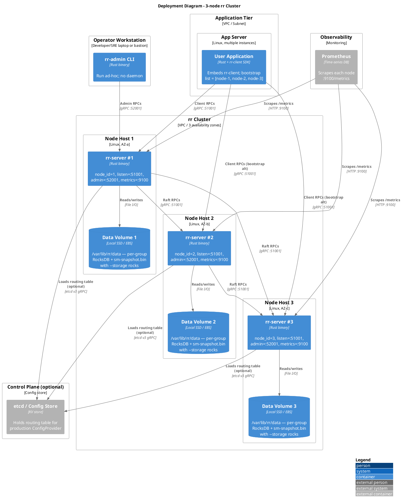

# 部署：生产拓扑 / Deployment: Production Topology

示例使用三个跨可用区节点，分离 Client/Raft、Admin 和 metrics 端口。`--storage rocks` 按 group 持久化
Raft 日志、vote 和 `sm-snapshot.bin`；`--storage mem` 不跨重启保留状态。

The example uses three nodes across availability zones, with separate Client/Raft, Admin, and metrics ports.
`--storage rocks` persists each group's Raft log, vote, and `sm-snapshot.bin`; `--storage mem` does not preserve
state across restart.

## 图示 / Diagram



## 端口 / Ports

| 端口 / Port | 协议 / Protocol | 服务 / Service | 暴露范围 / Exposed To |
| :--- | :--- | :--- | :--- |
| **51001** | gRPC / HTTP2 | `ClientService` + `RaftService` | 应用子网与集群节点 / App subnet and peer nodes |
| **52001** | gRPC / HTTP2 | `AdminService` | 仅运维主机或 bastion / Operator workstation or bastion only |
| **9100** | HTTP | `/health`, `/ready`, `/metrics` | 监控与探针网络 / Monitoring and probe networks |

Client 与 Raft 共享端口减少防火墙规则；Admin 使用独立端口并应限制访问。Admin 和 metrics 默认只绑定
`127.0.0.1`；跨主机访问必须显式设置 `--admin-bind-host` 和 `--metrics-bind-host`，并配合网络策略。
需要进一步隔离 Raft 与 Client 时，需要自定义传输装配。

Sharing the Client/Raft port reduces firewall rules; Admin uses a separate port and must be access-restricted.
Admin and metrics bind to `127.0.0.1` by default; cross-host access requires explicit `--admin-bind-host` and
`--metrics-bind-host` settings plus network policy. Further Raft/Client isolation requires custom transport wiring.

## 硬件示例 / Hardware Examples

这些是容量规划起点，不是基准测试结果。

These are capacity-planning starting points, not benchmark results.

| 资源 / Resource | 开发/测试 / Dev/Test | 小型生产 / Small Prod | 中型生产 / Medium Prod |
| :--- | :--- | :--- | :--- |
| Nodes | 1 | 3 | 5 |
| vCPU / node | 2 | 4–8 | 16+ |
| RAM / node | 4 GB | 8–16 GB | 32+ GB |
| Disk / node | SSD 20 GB | NVMe SSD 200 GB | NVMe SSD 1 TB+ |
| Network | Localhost | 1 Gbps | 10 Gbps, multi-AZ |

- 通常选择奇数节点数；4 节点与 3 节点都只能容忍 1 个节点故障，但 4 节点 quorum 要求更高。
  Odd node counts are typical: four nodes tolerate the same single failure as three, while requiring a larger
  quorum.
- Raft 日志需要低延迟持久化磁盘；rocks 模式应使用 SSD/NVMe。
  Raft logs need low-latency durable storage; use SSD/NVMe for rocks mode.
- 节点应跨至少 3 个 AZ，避免单 AZ 故障失去 quorum。
  Spread nodes across at least three AZs so one AZ failure cannot remove the quorum.

## 启动顺序 / Bootstrap Sequence

```bash
# Node 1 — initialize hosted groups once per cluster life
rr-server serve \
  --node-id 1 --listen-addr 0.0.0.0:51001 \
  --admin-port 52001 --metrics-port 9100 \
  --admin-bind-host 0.0.0.0 --metrics-bind-host 0.0.0.0 \
  --data-dir /var/lib/rr/data --storage rocks \
  --bootstrap \
  --allow-insecure   # DEV ONLY; configure TLS and tokens in production

# Nodes 2 and 3 — populate the local bootstrap routing table
rr-server serve \
  --node-id 2 --listen-addr 0.0.0.0:51001 \
  --admin-port 52001 --metrics-port 9100 \
  --admin-bind-host 0.0.0.0 --metrics-bind-host 0.0.0.0 \
  --data-dir /var/lib/rr/data --storage rocks \
  --peers host-1:51001 \
  --allow-insecure

rr-server serve \
  --node-id 3 --listen-addr 0.0.0.0:51001 \
  --admin-port 52001 --metrics-port 9100 \
  --admin-bind-host 0.0.0.0 --metrics-bind-host 0.0.0.0 \
  --data-dir /var/lib/rr/data --storage rocks \
  --peers host-1:51001,host-2:51001 \
  --allow-insecure
```

- `--bootstrap` 只用于集群初始化，不应作为常规重启参数；已初始化 group 会跳过重复初始化。
  Use `--bootstrap` for cluster initialization, not routine restarts; already initialized groups skip repeated
  initialization.
- 默认安全门禁会拒绝缺少 TLS/mTLS 或 `admin_token` 的生产配置。`--allow-insecure` 和
  `RR_ALLOW_INSECURE=1` 仅用于开发/CI；生产应配置 `--tls-cert`、`--tls-key`、`--tls-ca`，并在需要
  mTLS 时设置 `--tls-require-client-cert` 和 admin token。
  Default safety gates reject production configurations missing TLS/mTLS or `admin_token`.
  `--allow-insecure` and `RR_ALLOW_INSECURE=1` are for development/CI only. Production should configure
  `--tls-cert`, `--tls-key`, `--tls-ca`, plus `--tls-require-client-cert` for mTLS and an admin token.
- `--peers` 只按列表位置推测 node id 并填充本节点内存路由表，不会自动变更 Raft 成员。
  `--peers` only infers node ids by list position and populates the local in-memory routing table; it does not
  change Raft membership.

默认 `auto_promote_learners = true`，追平且满足 quorum guard 的 learner 会自动提升。禁用自动提升时，
在现有 leader 上手动执行：

With `auto_promote_learners = true` by default, caught-up learners that satisfy the quorum guard are promoted
automatically. If auto-promotion is disabled, run these commands against the existing leader:

```bash
rr-admin --addr host-1:52001 group add-learner --group 1 --node-id 2 --addr host-2:51001
# Wait for catch-up before promotion.
rr-admin --addr host-1:52001 group change-membership --group 1 --voters 1,2
```

## 失败模式 / Failure Modes

| 失败 / Failure | 集群影响 / Cluster Impact | 恢复 / Recovery |
| :--- | :--- | :--- |
| 3 节点中 1 个宕机 / 1 of 3 down | 仍有 quorum / Quorum remains | 替换或恢复节点，按需同步快照 / Replace or restore; sync snapshot as needed |
| 3 节点中 2 个宕机 / 2 of 3 down | 写入阻塞 / Writes blocked | 恢复至少 2 个成员 / Restore at least two members |
| leader 磁盘满 / Leader disk full | 写入或快照失败 / Writes or snapshots fail | 释放或扩容磁盘并检查错误 / Free or expand disk and inspect errors |
| leader 位于少数分区 / Leader in minority | 多数侧选出新 leader / Majority elects a leader | 修复分区，旧 leader 作为 follower 追赶 / Heal partition; old leader catches up |

故障流程见 [leader 选举](./dynamic-leader-election.md) 和 [快照传输](./dynamic-snapshot-transfer.md)。

See [leader election](./dynamic-leader-election.md) and [snapshot transfer](./dynamic-snapshot-transfer.md) for the
failure flows.

## 监控示例 / Monitoring Examples

阈值是告警起点，应按工作负载校准。

Thresholds are starting points and should be calibrated to the workload.

| Metric | 含义 / Meaning | 告警示例 / Example Alert |
| :--- | :--- | :--- |
| `rr_raft_current_term{group_id}` | 每 group 当前 term / Current term per group | 频繁增长 / Frequent increases |
| `rr_raft_is_leader{group_id}` | 本节点是否为 leader / Whether this node is leader | 每 group 聚合后没有 leader / No leader after per-group aggregation |
| `rr_proposal_duration_seconds{group_id}` | 写提案延迟 / Proposal latency | p99 持续超标 / Sustained p99 regression |
| `rr_raft_replication_lag{group_id, follower_node_id}` | leader 侧 follower 日志延迟 / Leader-side follower lag | 持续增长 / Sustained growth |
| `rr_snapshot_installs_total` | 累计快照安装 / Cumulative snapshot installs | 速率突增 / Rate spike |
| `rr_client_retries_total{group_id}` | 客户端重试 / Client retries | 持续增长 / Sustained increase |
| `up{job="rr"}` | 节点存活 / Node liveness | 节点掉线 / Node down |

`rr_client_*` 指标由使用 rr-client 的应用进程暴露，不是 rr-server。<br />`rr_client_*` metrics are exposed by the application process using rr-client, not rr-server.<br />[完整指标清单 / Full metrics catalog](../../reference/metrics-reference.md)

## 相关 / Related

- [容器结构 / Containers](./containers.md)
- [部署指南 / Deployment guide](../../deployment/deployment.md)
