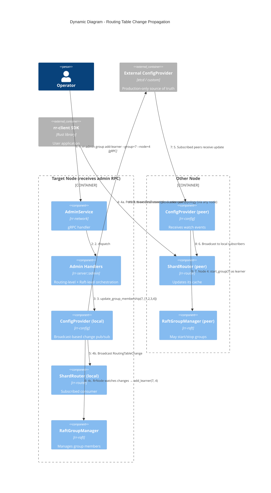
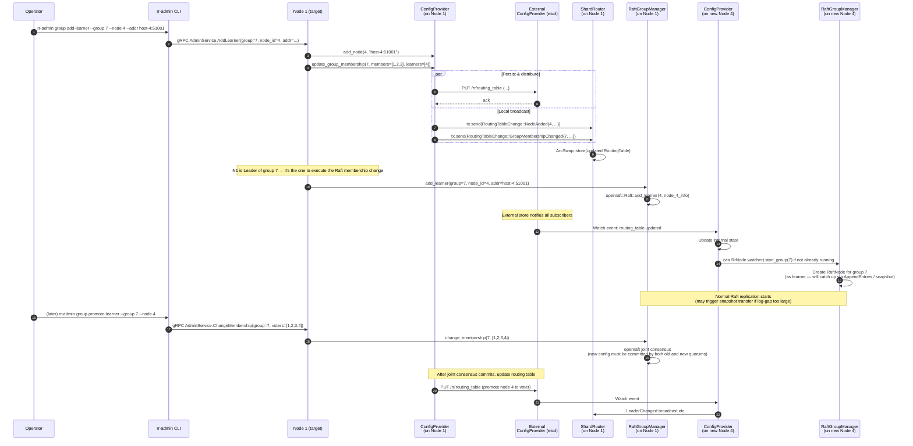

# Dynamic — Dynamic Config Update Propagation

rr 的一大特性是**运行时动态配置**：添加分片、迁移 group 成员、调整路由，都不需要重启集群。本图展示从运维触发变更到所有节点收敛的完整流程。

---

A key rr feature is **runtime dynamic configuration**: adding partitions, migrating group members, adjusting routing — all without cluster restart. This diagram shows the complete flow from operator trigger to cluster-wide convergence.

## 高层流程（C4 Dynamic）/ High-Level Flow (C4 Dynamic)



## 详细时序图 / Detailed Sequence



## ConfigProvider 的两种形态 / Two Shapes of ConfigProvider

### 形态 1: MemConfigProvider（开发）/ Shape 1: MemConfigProvider (development)

```
┌─────────────┐  ┌─────────────┐  ┌─────────────┐
│   Node 1    │  │   Node 2    │  │   Node 3    │
│             │  │             │  │             │
│ MemCfgProv  │  │ MemCfgProv  │  │ MemCfgProv  │
│  (isolated) │  │  (isolated) │  │  (isolated) │
└─────────────┘  └─────────────┘  └─────────────┘
```

- 每个节点独立的内存状态
- **变更不会自动传播到其他节点**
- 使用场景：单节点开发、单元测试、integration test（测试 harness 主动调用所有节点）
- **不要在生产中使用**

Each node has isolated in-memory state. **Changes do NOT auto-propagate to other nodes.** Use cases: single-node development, unit tests, integration tests (test harness calls every node manually). **Do not use in production.**

### 形态 2: 外部存储 ConfigProvider（生产）/ Shape 2: External Store ConfigProvider (production)

```
┌──────────────────────────────────────────────┐
│             External Store (etcd)            │
│   ┌──────────────────────────────────────┐   │
│   │  Routing Table + Watch Channel       │   │
│   └──────────────────────────────────────┘   │
└──────────────────────────────────────────────┘
         ▲              ▲              ▲
         │              │              │
    ┌────┴────┐    ┌────┴────┐    ┌────┴────┐
    │ Node 1  │    │ Node 2  │    │ Node 3  │
    │  EtcdCP │    │  EtcdCP │    │  EtcdCP │
    └─────────┘    └─────────┘    └─────────┘
```

- 单一事实源在外部存储
- 每个节点本地 `ConfigProvider` 订阅 watch 事件
- **变更一次，全集群收敛**
- 使用场景：生产部署

Single source of truth lives in external store. Each node's local `ConfigProvider` subscribes to watch events. **Change once, whole cluster converges.** Use case: production deployment.

> **rr 本身没有内置 etcd 实现** — 用户需要实现 `ConfigProvider` trait。这是一个有意的设计选择，避免 rr 绑定到某个特定外部依赖。社区将来可能提供 `rr-config-etcd` 作为独立 crate。
>
> **rr does NOT ship an etcd implementation** — users implement `ConfigProvider` themselves. This is an intentional design choice to avoid binding rr to a specific external dependency. A community `rr-config-etcd` may appear as a separate crate.

## 两类变更：Raft-level vs Routing-level / Two Classes of Change

rr 的配置变更实际上分两层：

rr's configuration changes span two layers:

### Raft-level（共识层）
- `add_learner(group_id, node_id, addr)` — 新 learner 开始从日志追赶
- `change_membership(group_id, voters)` — joint consensus 切换 voter 集合

**这些变更通过 Raft 自身持久化** —— 写入每个成员的日志、提交后应用。不能"丢失"。

**These changes are persisted by Raft itself** — written to every member's log, applied after commit. Cannot be "lost".

### Routing-level（路由层）
- `add_partition(partition_id, group_id)` — 新分片映射
- `migrate_partition(partition_id, from_group, to_group)` — 迁移分片

**这些变更通过 `ConfigProvider` 持久化** —— 如果使用 MemConfigProvider 且只更新了单个节点，其他节点不会看到！

**These changes are persisted by `ConfigProvider`** — if using MemConfigProvider and only one node is updated, other nodes don't see it!

### 协调两者 / Coordinating Both

典型的"添加成员"操作需要：

A typical "add member" operation requires:

```
1. Routing level:  ConfigProvider.add_node(4, addr)         → nodes[4] = addr
2. Routing level:  ConfigProvider.update_group(7, ...)       → mark node 4 as learner in group 7
3. Raft level:     RaftGroupManager.add_learner(7, 4, addr)  → openraft knows about the new member
4. Wait for catchup via AppendEntries + snapshot
5. Raft level:     RaftGroupManager.change_membership(7, [1,2,3,4])  → promote to voter (joint consensus)
6. Routing level:  ConfigProvider.update_group(7, ..., leader_unchanged)  → reflect voter status
```

**顺序很重要 / Order matters**:

- **Step 3 必须在 step 1 和 2 之后**：Raft 需要路由表里已经有 node 4 的地址才能发送 AppendEntries
- **Step 5 必须在 step 4 catchup 完成后**：否则把一个远远落后的 learner 提升为 voter，会立刻影响 quorum
- Admin handlers 负责维护这个顺序 — 运维不需要手动协调

---

**Order matters**:

- **Step 3 must come after steps 1–2**: Raft needs node 4's address in the routing table before it can send AppendEntries.
- **Step 5 must come after step 4 catchup**: otherwise promoting a far-behind learner to voter immediately affects quorum.
- Admin handlers enforce this order — operators don't coordinate manually.

## 观察配置变更 / Observing Config Changes

```bash
# Dump current routing table on a node
rr-admin --addr host-1:52001 node status

# Watch for changes (if your ConfigProvider supports watch)
rr-admin --addr host-1:52001 config watch

# Verify all nodes have converged
for host in host-1 host-2 host-3; do
  rr-admin --addr $host:52001 node status --output json | jq '.routing_table.version'
done
# All should output the same version; if not, propagation is lagging
```

## 相关 / Related

- 分片路由的静态视图：[components-router.md](./components-router.md)
- 分片路由的动态解析：[dynamic-shard-routing.md](./dynamic-shard-routing.md)
- 多 Raft 架构概念：[../multi-raft.md](../multi-raft.md)
