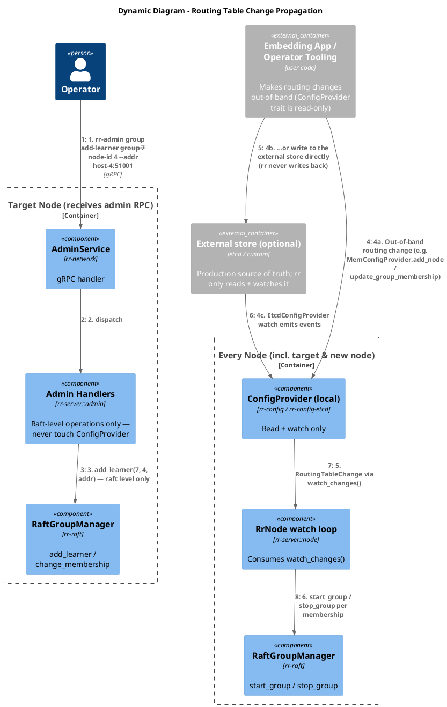
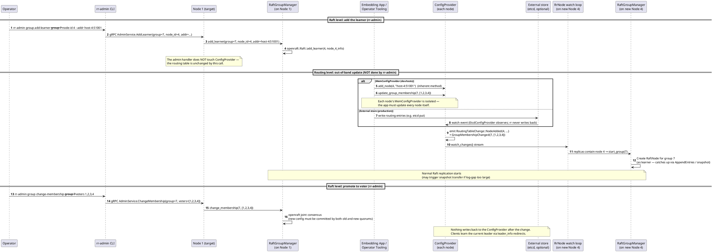

# Dynamic — Dynamic Config Update Propagation

rr 的一大特性是**运行时动态配置**：添加分片、迁移 group 成员、调整路由，都不需要重启集群。本图展示从运维触发变更到所有节点收敛的完整流程。

---

A key rr feature is **runtime dynamic configuration**: adding partitions, migrating group members, adjusting routing — all without cluster restart. This diagram shows the complete flow from operator trigger to cluster-wide convergence.

## 高层流程（C4 Dynamic）/ High-Level Flow (C4 Dynamic)



> **关键事实 / Key facts**：
> - `ConfigProvider` trait 是**只读的**（`get_routing_table` / `watch_changes` / `get_node_addr`）。rr 自身从不写路由表——变更由嵌入应用直接调用 `MemConfigProvider` 的 inherent 方法，或由运维/工具直接写外部存储完成。
> - admin RPC（`AddLearner` / `ChangeMembership`）是**纯 raft 层**操作——handler 不会编排任何路由层步骤。
> - leader 选举不会产生路由表事件；客户端通过重定向响应发现新 leader。
>
> - The `ConfigProvider` trait is **read-only** (`get_routing_table` / `watch_changes` / `get_node_addr`). rr itself never writes the routing table — changes are made by the embedding application calling `MemConfigProvider`'s inherent methods, or by operator tooling writing the external store directly.
> - Admin RPCs (`AddLearner` / `ChangeMembership`) are **purely raft-level** — the handlers do not orchestrate any routing-level steps.
> - Leader elections never produce routing-table events; clients discover the new leader via redirect responses.

## 详细时序图 / Detailed Sequence



## ConfigProvider 的两种形态 / Two Shapes of ConfigProvider

### 形态 1: MemConfigProvider（开发）/ Shape 1: MemConfigProvider (development)

```
┌─────────────┐  ┌─────────────┐  ┌─────────────┐
│   Node 1    │  │   Node 2    │  │   Node 3    │
│             │  │             │  │             │
│ MemCfgProv  │  │ MemCfgProv  │  │ MemCfgProv  │
│  (isolated) │  │  (isolated) │  │  (isolated) │
└─────────────┘  └─────────────┘  └─────────────┘
```

- 每个节点独立的内存状态
- **变更不会自动传播到其他节点**
- 使用场景：单节点开发、单元测试、integration test（测试 harness 主动调用所有节点）
- **不要在生产中使用**

Each node has isolated in-memory state. **Changes do NOT auto-propagate to other nodes.** Use cases: single-node development, unit tests, integration tests (test harness calls every node manually). **Do not use in production.**

### 形态 2: 外部存储 ConfigProvider（生产）/ Shape 2: External Store ConfigProvider (production)

```
┌──────────────────────────────────────────────┐
│             External Store (etcd)            │
│   ┌──────────────────────────────────────┐   │
│   │  Routing Table + Watch Channel       │   │
│   └──────────────────────────────────────┘   │
└──────────────────────────────────────────────┘
         ▲              ▲              ▲
         │              │              │
    ┌────┴────┐    ┌────┴────┐    ┌────┴────┐
    │ Node 1  │    │ Node 2  │    │ Node 3  │
    │  EtcdCP │    │  EtcdCP │    │  EtcdCP │
    └─────────┘    └─────────┘    └─────────┘
```

- 单一事实源在外部存储
- 每个节点本地 `ConfigProvider` 订阅 watch 事件
- **变更一次，全集群收敛**
- 使用场景：生产部署

Single source of truth lives in external store. Each node's local `ConfigProvider` subscribes to watch events. **Change once, whole cluster converges.** Use case: production deployment.

> **rr 自带 etcd 实现** —— `rr-config-etcd` 是 workspace 成员 crate，提供 `EtcdConfigProvider`（`crates/rr-config-etcd`）。它实现 `ConfigProvider` 的读与 watch：**rr 从不把路由写回 etcd**（read-only at the trait surface）——路由变更须由运维/工具直接写 etcd。stock `rr-server` 二进制仍使用 `MemConfigProvider`；使用 etcd 需要自行组装（见 `examples/etcd-config-quickstart`）。
>
> **rr ships an etcd implementation** — `rr-config-etcd` is a workspace member crate providing `EtcdConfigProvider` (`crates/rr-config-etcd`). It implements the `ConfigProvider` reads and watches: **rr never writes routing back to etcd** (read-only at the trait surface) — routing changes must be written to etcd by operator tooling. The stock `rr-server` binary still uses `MemConfigProvider`; using etcd requires wiring it yourself (see `examples/etcd-config-quickstart`).

## 两类变更：Raft-level vs Routing-level / Two Classes of Change

rr 的配置变更实际上分两层：

rr's configuration changes span two layers:

### Raft-level（共识层）
- `add_learner(group_id, node_id, addr)` — 新 learner 开始从日志追赶
- `change_membership(group_id, voters)` — joint consensus 切换 voter 集合

**这些变更通过 Raft 自身持久化** —— 写入每个成员的日志、提交后应用。不能"丢失"。

**These changes are persisted by Raft itself** — written to every member's log, applied after commit. Cannot be "lost".

### Routing-level（路由层）
- `add_partition(partition_id, config, group_id, replicas)` — 新分片映射
- `remove_partition(partition_id)` / `add_node(node_id, addr)` / `remove_node(node_id)` / `update_group_membership(group_id, replicas)`

**这些都是 `MemConfigProvider` 的 inherent 方法（或对外部存储的直接写入）**——`ConfigProvider` trait 本身没有写接口。持久性取决于后端：`MemConfigProvider` 只存在进程内存（且各节点互不同步）；`EtcdConfigProvider` 读 etcd，由写入 etcd 的一方保证持久。如果只更新了单个节点的 MemConfigProvider，其他节点不会看到！

**These are inherent methods of `MemConfigProvider` (or direct writes to an external store)** — the `ConfigProvider` trait itself has no write API. Persistence depends on the backend: `MemConfigProvider` lives in process memory (and nodes never sync with each other); `EtcdConfigProvider` reads from etcd, where durability is guaranteed by whoever writes to etcd. If you update only one node's MemConfigProvider, the other nodes won't see it!

### 协调两者 / Coordinating Both

典型的"添加成员"操作需要（**路由层步骤由嵌入应用或运维工具完成，rr-admin 只做 raft 层**）：

A typical "add member" operation requires (**the routing-level steps are done by the embedding application or operator tooling — rr-admin only performs the raft-level ones**):

```
1. Routing level:  MemConfigProvider.add_node(4, addr)          → nodes[4] = addr   (by the app/tooling)
2. Routing level:  MemConfigProvider.update_group_membership(7, [1,2,3,4])            (by the app/tooling)
3. Raft level:     rr-admin group add-learner --group 7 --node-id 4 --addr host-4:51001
                   → RaftGroupManager.add_learner(7, 4, addr) — openraft knows the new member
4. Wait for catchup via AppendEntries + snapshot
5. Raft level:     rr-admin group change-membership --group 7 --voters 1,2,3,4
                   → promote to voter (joint consensus)
6. Routing level:  (optional) update_group_membership(7, ...) to reflect final voter set (by the app/tooling)
```

**顺序很重要 / Order matters**:

- **Step 3 必须在 step 1 和 2 之后**：Raft 需要路由表里已经有 node 4 的地址才能发送 AppendEntries
- **Step 5 必须在 step 4 catchup 完成后**：否则把一个远远落后的 learner 提升为 voter，会立刻影响 quorum
- **这个顺序由运维 / 嵌入应用负责维护**——admin handlers 只执行 raft 层操作，不会替你编排路由层步骤

---

**Order matters**:

- **Step 3 must come after steps 1–2**: Raft needs node 4's address in the routing table before it can send AppendEntries.
- **Step 5 must come after step 4 catchup**: otherwise promoting a far-behind learner to voter immediately affects quorum.
- **This ordering is the operator's / embedding application's responsibility** — admin handlers only perform the raft-level operations and will not orchestrate routing-level steps for you.

## 观察配置变更 / Observing Config Changes

```bash
# Dump the current routing table snapshot on a node (AdminService.GetRoutingTable)
rr-admin --addr host-1:52001 config show

# Node-level status: node_id, listen_addr, group_ids, uptime_secs
# (NodeStatus carries NO routing table — use `config show` for that)
rr-admin --addr host-1:52001 node status

# Raft-level membership of a group (voters + learners)
rr-admin --addr host-1:52001 group membership --group 7

# Verify all nodes have converged on the same routing table
for host in host-1 host-2 host-3; do
  rr-admin --addr $host:52001 config show --output json | jq -S '.partitions'
done
# All should output the same partition list; if not, propagation is lagging
# (with MemConfigProvider they will NEVER converge unless the app updates every node)
```

## 相关 / Related

- 分片路由的静态视图：[components-router.md](./components-router.md)
- 分片路由的动态解析：[dynamic-shard-routing.md](./dynamic-shard-routing.md)
- 多 Raft 架构概念：[../multi-raft.md](../multi-raft.md)
