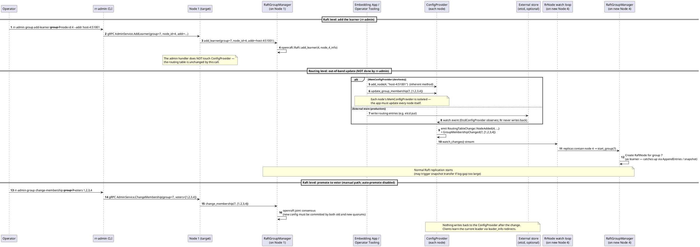

# 动态：配置变更传播 / Dynamic: Config Update Propagation

路由变更在运行时通过 `ConfigProvider` 传播。Raft 成员操作与路由表更新是两个独立层面，不由同一事务编排。

Routing changes propagate at runtime through `ConfigProvider`. Raft membership operations and routing-table updates
are separate layers, not one transaction.

## 高层流程 / High-level Flow


- `ConfigProvider` trait 只读；嵌入应用调用 `MemConfigProvider` inherent 方法，或运维工具直接写外部存储。
  The `ConfigProvider` trait is read-only; the embedding app calls `MemConfigProvider` inherent methods, or
  operator tooling writes the external store.
- `AddLearner` 和 `ChangeMembership` 只操作 Raft，admin handler 不修改 ConfigProvider。
  `AddLearner` and `ChangeMembership` operate only on Raft; admin handlers do not modify ConfigProvider.
- leader 选举不产生路由表事件，客户端通过重定向发现新 leader。
  Leader elections produce no routing-table events; clients discover leaders through redirects.

## 详细时序 / Detailed Sequence



## Provider 形态 / Provider Shapes

### MemConfigProvider：开发与测试 / MemConfigProvider: Development and Tests

```text
┌─────────────┐  ┌─────────────┐  ┌─────────────┐
│   Node 1    │  │   Node 2    │  │   Node 3    │
│ MemCfgProv  │  │ MemCfgProv  │  │ MemCfgProv  │
│  (isolated) │  │  (isolated) │  │  (isolated) │
└─────────────┘  └─────────────┘  └─────────────┘
```

每个节点持有独立内存副本，变更不会自动传播；调用方必须更新所有节点。它不适合作为生产集群的共享事实源。

Each node has an isolated in-memory copy and changes do not propagate automatically; the caller must update every
node. It is not a shared source of truth for a production cluster.

### 外部存储：生产 / External Store: Production

```text
┌──────────────────────────────────────────────┐
│             External Store (etcd)            │
│   ┌──────────────────────────────────────┐   │
│   │  Routing Table + Watch Channel       │   │
│   └──────────────────────────────────────┘   │
└──────────────────────────────────────────────┘
         ▲              ▲              ▲
         │              │              │
    ┌────┴────┐    ┌────┴────┐    ┌────┴────┐
    │ Node 1  │    │ Node 2  │    │ Node 3  │
    │  EtcdCP │    │  EtcdCP │    │  EtcdCP │
    └─────────┘    └─────────┘    └─────────┘
```

`rr-config-etcd` 提供只读 `EtcdConfigProvider`；外部工具写 etcd，各节点读取并 watch。stock
`rr-server` 仍使用 `MemConfigProvider`；etcd 装配示例见 `examples/etcd-config-quickstart`。

`rr-config-etcd` provides the read-only `EtcdConfigProvider`; external tools write etcd and each node reads and
watches it. Stock `rr-server` still uses `MemConfigProvider`; see `examples/etcd-config-quickstart` for etcd
wiring.

watch stream 不发送初始快照；启动路径先读取完整表再订阅。内存后端在消费者落后时丢弃事件并记录
warning/metric，etcd 后端施加背压并在断线后重连；需要严格对账的消费者应定期重新读取完整表。

The watch stream has no initial snapshot; startup reads the full table before subscribing. The in-memory backend
drops lagged events with a warning/metric, while etcd applies backpressure and reconnects after disconnects.
Consumers requiring strict reconciliation should periodically re-read the full table.

## 两层变更 / Two Classes of Change

### Raft 层 / Raft Level

`add_learner(group_id, node_id, addr)` 添加学习者，`change_membership(group_id, voters)` 通过 joint
consensus 修改 voter 集合。已提交成员记录进入 Raft 日志，其重启持久性仍取决于所选日志存储。

`add_learner(group_id, node_id, addr)` adds a learner, and `change_membership(group_id, voters)` changes voters
through joint consensus. Committed membership records enter the Raft log; restart durability still depends on the
selected log storage.

### 路由层 / Routing Level

`add_partition`、`remove_partition`、`add_node`、`remove_node` 和 `update_group_membership` 是
`MemConfigProvider` inherent 方法，或对外部存储的直接写入；trait 没有写 API。持久性和传播范围由后端决定。

`add_partition`, `remove_partition`, `add_node`, `remove_node`, and `update_group_membership` are inherent
`MemConfigProvider` methods or direct external-store writes; the trait has no write API. Durability and propagation
depend on the backend.

### 协调顺序 / Coordination

一个手动添加成员的顺序如下；这些步骤不是一个事务，`rr-admin` 只执行 Raft 层命令。

One manual add-member sequence follows. These steps are not transactional, and `rr-admin` performs only the Raft
commands.

```text
1. Raft:    rr-admin group add-learner --group 7 --node-id 4 --addr host-4:51001
2. Routing: add_node(4, addr) and update_group_membership(7, [1,2,3,4])
            on every MemConfigProvider, or in the external store
3. Wait for the learner to catch up through AppendEntries or snapshot transfer
4. Raft:    rr-admin group change-membership --group 7 --voters 1,2,3,4
```

必须在 learner 追平后再提升为 voter。默认 `auto_promote_learners = true`，本地 promoter 会在复制延迟和
稳定性条件满足后自动提升，因此第 4 步是禁用自动提升时的手动路径。路由更新仍需应用或运维工具完成。

A learner must catch up before promotion. `auto_promote_learners = true` by default, so the local promoter handles
step 4 once replication-lag and stability conditions are met; the command is the manual path when auto-promotion is
disabled. Routing updates still belong to the application or operator tooling.

## 观察配置 / Observing Configuration

```bash
# Routing table snapshot (AdminService.GetRoutingTable)
rr-admin --addr host-1:52001 config show

# Node status; NodeStatus does not contain the routing table
rr-admin --addr host-1:52001 node status

# Raft voters and learners
rr-admin --addr host-1:52001 group membership --group 7

# Compare partition mappings across nodes
for host in host-1 host-2 host-3; do
  rr-admin --addr $host:52001 config show --output json | jq -S '.partitions'
done
```

若输出不同，说明传播或更新尚未完成；使用 `MemConfigProvider` 时，只有逐节点更新才会一致。

Different outputs indicate incomplete propagation or updates. With `MemConfigProvider`, convergence requires
updating every node.

## 相关 / Related

- [路由组件 / Router components](./components-router.md)
- [动态路由 / Dynamic routing](./dynamic-shard-routing.md)
- [多 Raft / Multi-Raft](../multi-raft.md)
