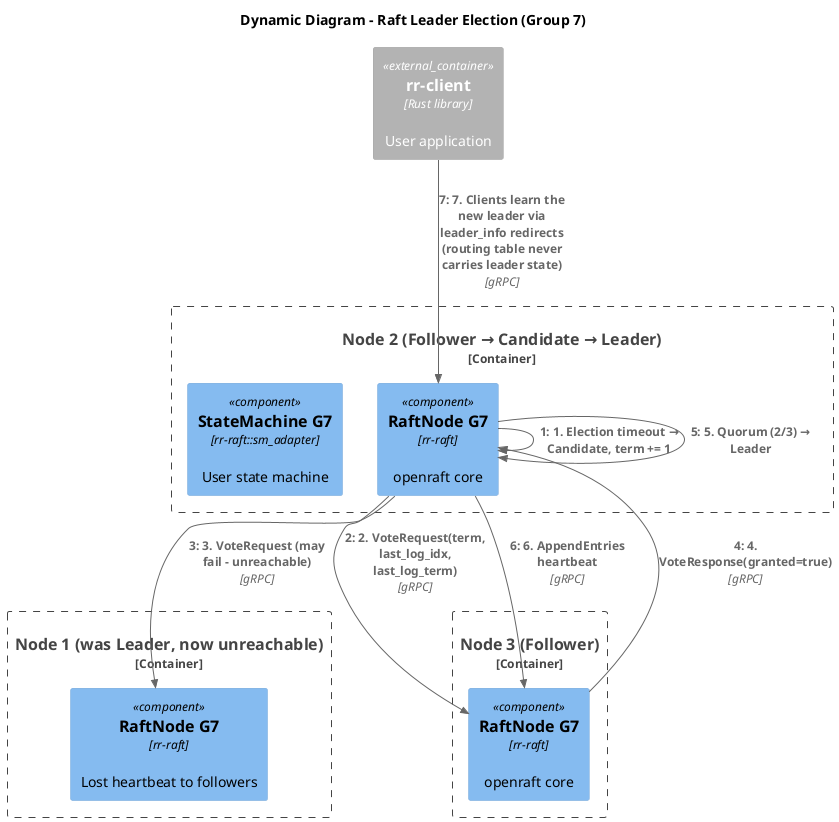
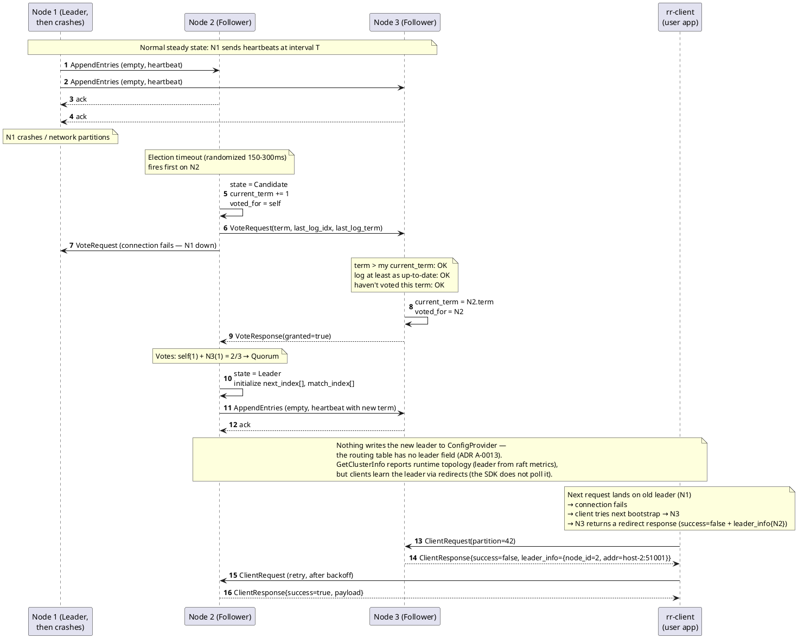
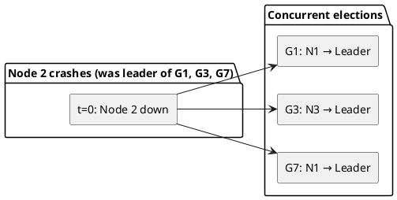

# 动态：Raft 领导者选举 / Dynamic: Raft Leader Election

每个 Raft group 独立选举。leader 失联后，其他成员的随机选举定时器超时并发起投票。

Each Raft group elects independently. When its leader becomes unreachable, followers' randomized election timers
expire and start an election.

## 高层流程 / High-level Flow

## 详细时序 / Detailed Sequence

## 安全性保证 / Safety Guarantees

openraft 实现 Raft 不变量：同一 term 最多一个 leader；新 leader 必须包含此前已提交日志；相同 index 和
term 的日志条目具有相同前缀。Rr 只增加多组管理和网络层。

Openraft implements Raft's invariants: at most one leader per term, a new leader contains all previously committed
entries, and matching index/term entries imply matching prefixes. Rr adds multi-group management and networking
without changing those rules.

## 时间参数 / Timing Parameters

| 参数 / Parameter | 默认值 / Default | 说明 / Meaning |
| :--- | :--- | :--- |
| `heartbeat_interval` | 50 ms | leader 心跳间隔 / Leader heartbeat interval |
| `election_timeout_min` | 150 ms | 随机选举超时下限 / Lower election-timeout bound |
| `election_timeout_max` | 300 ms | 随机选举超时上限 / Upper election-timeout bound |
| `snapshot_policy` | `SnapshotPolicy::LogsSinceLast(50_000)` | 距上次快照的日志阈值 / Entries since last snapshot |

选举超时应为心跳和网络延迟留出余量；客户端超时应覆盖可预期的选举窗口。过小的选举超时会造成无必要
的换主，过短的客户端超时会在选举完成前返回错误。

Election timeouts need headroom over heartbeats and network latency; client timeouts should cover the expected
election window. Too-small election timeouts cause unnecessary leadership changes, while too-short client timeouts
return errors before election completes.

## Split Vote 与多组选举 / Split Votes and Multi-group Elections

多个 candidate 同时参选可能都没有多数票。`[min, max]` 区间内的随机超时会错开下一轮。group 之间任务和
定时器独立，但 VoteRequest 仍共享连接池、CPU 和网络资源。

Simultaneous candidates can each fail to win a majority. Randomized timeouts in `[min, max]` stagger the next
round. Groups have independent tasks and timers, but VoteRequests still share channel pools, CPU, and network
resources.

## 相关 / Related

- [客户端发现 leader / Client leader discovery](./dynamic-put-request.md)
- [路由表不含 leader / Leaders stay out of routing tables](./dynamic-config-update.md)
