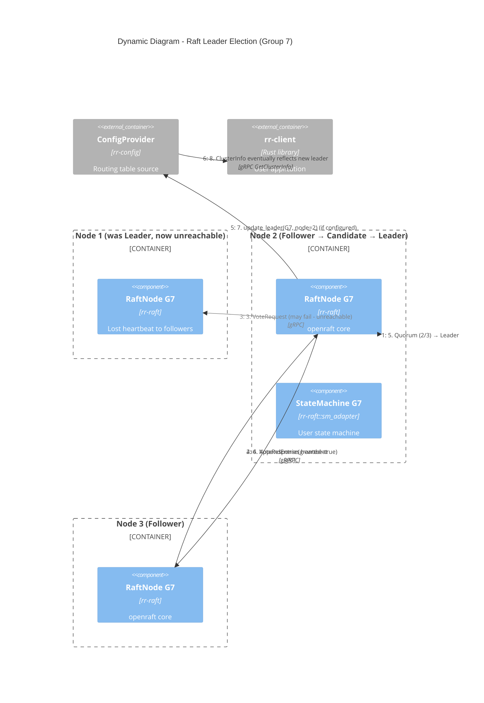
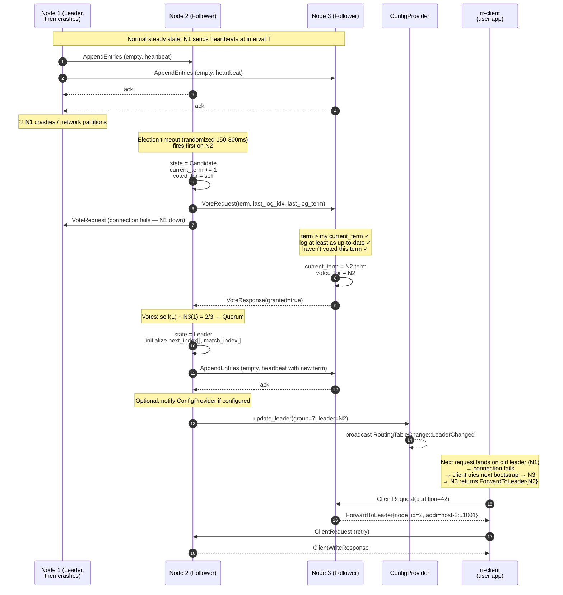
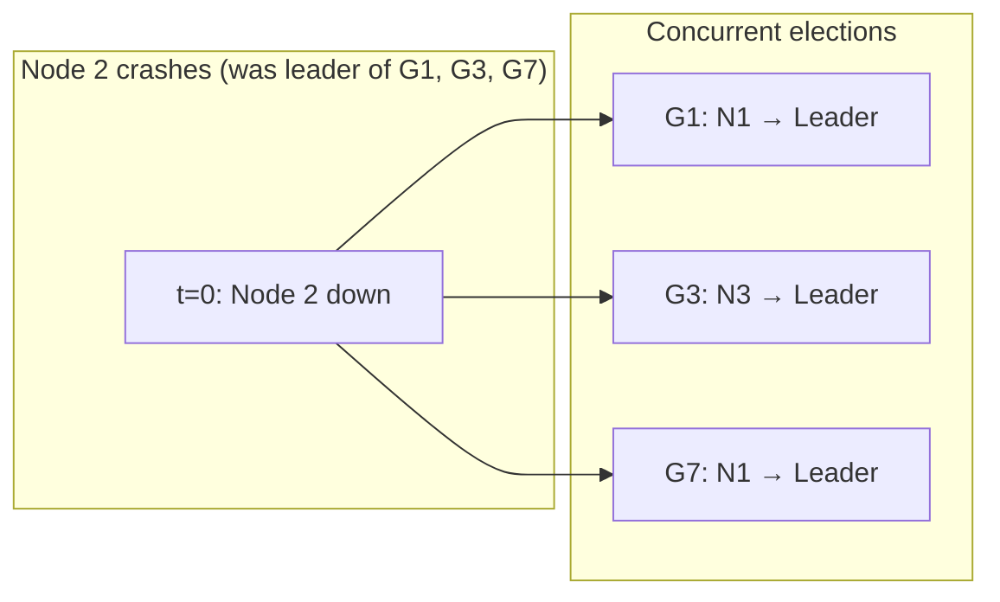

# Dynamic — Raft Leader Election

领导者选举发生在**每个 Raft 组内部独立**进行。当一个 group 的 leader 失联（进程崩溃、网络分区、GC 暂停），其他成员的选举定时器会超时并发起选举。本图展示标准的 Raft 选举流程在 rr 中的具体实现。

---

Leader election happens **independently inside each Raft group**. When a group's leader becomes unreachable (process crash, network partition, GC pause), other members' election timers fire and trigger a vote. This diagram shows how the standard Raft election flow is realized in rr.

## 高层流程（C4 Dynamic）/ High-Level Flow (C4 Dynamic)

## 详细时序图 / Detailed Sequence

## 选举安全性保证 / Election Safety Guarantees

Raft 协议（由 openraft 实现）保证以下不变量：

The Raft protocol (implemented by openraft) guarantees the following invariants:

1. **At most one leader per term** — 一个 term 内最多一个 leader；通过 "majority vote required" 保证。
2. **Leader Completeness** — 新 leader 拥有所有之前 term 已 commit 的日志条目；通过 "log comparison in VoteRequest" 保证。
3. **Log Matching** — 如果两个日志在某个 index 上条目相同，那么之前的条目也相同。

rr **不会** 削弱这些保证——它原封不动地使用 openraft，仅在此之上加多组管理与网络层。

---

rr **does not** weaken these guarantees — it uses openraft as-is, adding multi-group management and networking on top.

## 时间参数 / Timing Parameters

| Parameter | Typical Value | Tradeoff |
| :--- | :--- | :--- |
| `heartbeat_interval` | 50–100 ms | Lower = faster failure detection, higher = less network chatter |
| `election_timeout_min` | 150 ms | Must be > 2× heartbeat_interval |
| `election_timeout_max` | 300 ms | Randomized per-node to prevent split votes |
| `max_in_memory_logs` | 1000 | Triggers snapshot creation |

**错误配置的后果 / Consequences of misconfiguration**:
- `election_timeout < heartbeat_interval` → 不必要的选举，集群颠簸
- `election_timeout ≥ client_timeout` → 客户端在选举完成前就返回错误
- `heartbeat_interval > RTT * 2` → 正常运行中也会触发选举

---

- `election_timeout < heartbeat_interval` → spurious elections, cluster flapping
- `election_timeout ≥ client_timeout` → clients error out before election completes
- `heartbeat_interval > RTT * 2` → elections triggered even during normal operation

## 选举风暴 / Election Storms

如果多个 follower 同时超时并发起选举，可能会出现**split vote**（没有候选者获得多数）。Raft 通过**随机化超时时间**（在 [min, max] 区间内均匀随机）来降低这种情况的概率。出现 split vote 时，下一轮会自然错开重试。

If multiple followers time out simultaneously and start elections, a **split vote** can occur (no candidate gets a majority). Raft mitigates this by **randomizing election timeouts** (uniform random within `[min, max]`). When a split vote happens, the next round naturally staggers.

rr 的实现中，每个 group 独立选举——**一个 group 的选举风暴不会影响另一个 group 的 leader 稳定性**。

In rr's implementation, each group elects independently — **an election storm in one group does not destabilize another group's leader**.

## 多组场景下的并发选举 / Concurrent Elections in Multi-Group

当整个节点崩溃时，**N 个 Raft 组同时失去一个成员**——如果这个节点是多个组的 leader，多个组会并发发起选举：

When an entire node crashes, **N Raft groups simultaneously lose a member** — if that node was the leader of multiple groups, multiple elections start concurrently:

rr 通过 **独立的 openraft 任务和独立的随机超时**，让每个 group 的选举互不干扰。但要注意：
- **网络资源竞争**：选举风暴期间，所有 group 的 VoteRequest 共享同一个 ChannelPool。
- **CPU**：每个 group 的日志比较、签名验证并行执行——多核 CPU 能平滑此负载。

---

rr, via **independent openraft tasks and independent randomized timeouts**, keeps each group's election independent. Note however:
- **Network resource contention**: during election storm, all groups' VoteRequests share one ChannelPool.
- **CPU**: log comparison, signature verification run in parallel per group — multi-core CPUs absorb this.

## 相关 / Related

- 客户端如何感知 leader 变化：[dynamic-put-request.md](./dynamic-put-request.md)
- ConfigProvider 如何传播 leader 变更：[dynamic-config-update.md](./dynamic-config-update.md)
