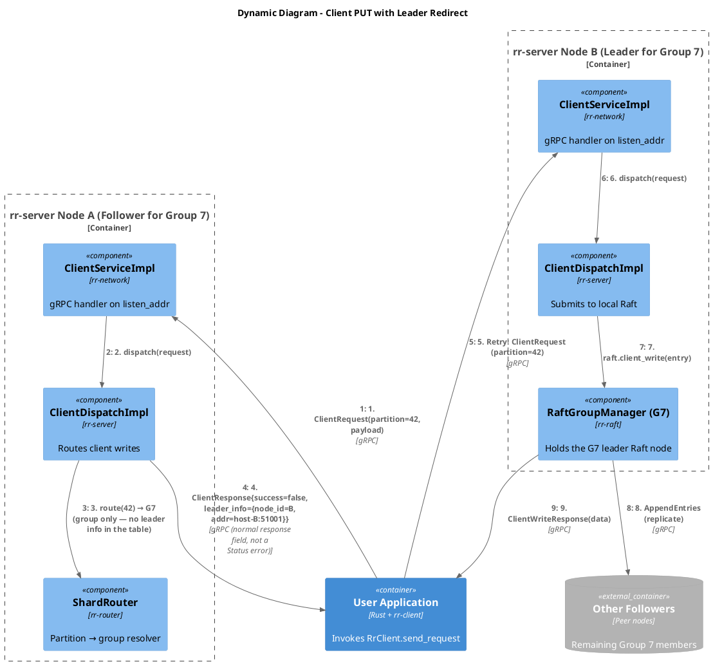
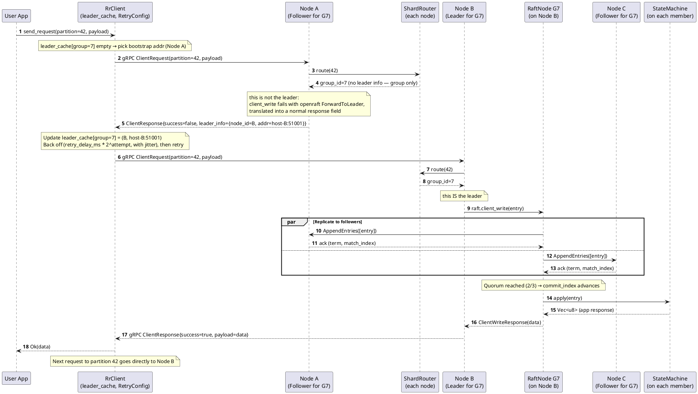

# 动态：客户端写入与 Leader 重定向 / Dynamic: Client PUT with Leader Redirect

写请求先到达 follower 时，server 返回 leader 地址，`rr-client` 更新缓存、退避并重试。

When a write reaches a follower, the server returns the leader address; `rr-client` updates its cache, backs off,
and retries.

## 高层流程 / High-level Flow



## 详细时序 / Detailed Sequence



## 客户端行为 / Client Behavior

### Leader 缓存 / Leader Cache

`RrClient` 为每个 group 缓存 `(NodeId, String)`；没有 TTL，连接失败或新 `leader_info` 会删除或覆盖旧值。

`RrClient` caches `(NodeId, String)` per group. Entries have no TTL; connection failures or new `leader_info`
remove or replace them.

```rust
leader_cache: Arc<RwLock<HashMap<GroupId, (NodeId, String)>>>
```

- 命中时直接发送给缓存 leader；未命中时轮询 bootstrap 地址。
  A hit goes directly to the cached leader; a miss round-robins bootstrap addresses.
- 重定向响应更新缓存；连接失败删除缓存项并回退到 bootstrap 列表。
  Redirects update the cache; connection failures evict the entry and fall back to bootstrap addresses.

### 重试 / Retry

`RetryConfig` 默认 `max_retries = 3`、`retry_delay_ms = 100`。退避基数为
`retry_delay_ms * 2^attempt`，并带 ±20% jitter；重定向也使用退避。

`RetryConfig` defaults to `max_retries = 3` and `retry_delay_ms = 100`. Backoff starts from
`retry_delay_ms * 2^attempt` with ±20% jitter; redirects also back off.

- 网络错误和带 `leader_info` 的响应会重试，总尝试次数为 `max_retries + 1`。
  Network errors and responses with `leader_info` are retried, with at most `max_retries + 1` total attempts.
- `idem_error`、业务错误和序列化错误立即返回，不做普通重试。
  `idem_error`, application errors, and serialization errors return immediately without normal retries.

### 不由 Follower 代理 / No Follower Proxying

Rr 不在 follower 上代理写入，避免额外一跳、follower 持有等待状态以及被代理流量掩盖真实 leader 变化。
代价由 `rr-client` 的重定向逻辑承担；无幂等键时，应用仍需处理重试造成的重复写风险。

Rr does not proxy writes through followers, avoiding an extra hop, pending response state on followers, and hidden
leader changes. `rr-client` owns the redirect logic instead; without idempotency keys, applications must still
handle duplicate-write risk from retries.

## 幂等性 / Idempotency

框架提供可选的幂等层（ADR A-0003）；不带 key 的请求不去重。

The framework provides an optional idempotency layer (ADR A-0003); requests without keys are not deduplicated.

- 客户端调用 `send_request_idempotent(group_id, payload, IdempotencyKey::new(request_type, request_id))`。
  去重身份是 `(request_type, request_id)`；可选 `client_id` 仅用于诊断。
  The client calls `send_request_idempotent(group_id, payload, IdempotencyKey::new(request_type, request_id))`.
  Deduplication uses `(request_type, request_id)`; optional `client_id` is diagnostic only.
- `ClientRequest.idem_key` 是 proto3 optional；`ClientResponse.idem_error` 携带
  `{request_type, request_id, watermark}`。无 key 请求保持旧路径。
  `ClientRequest.idem_key` is proto3 optional; `ClientResponse.idem_error` carries
  `{request_type, request_id, watermark}`. Unkeyed requests keep the legacy path.
- `ClientDispatchImpl` 把带 key 的 payload 包成 `FramedEntry{version, offset, idem_key, payload}` 后提交。
  `ClientDispatchImpl` wraps keyed payloads as `FramedEntry{version, offset, idem_key, payload}` before submit.
- 每个 group 的 `IdempotencyLayer` 维护 LRU 响应缓存和每 `request_type` 的 watermark。缓存命中返回首次
  响应；`request_id ≤ watermark` 且缓存已逐出则返回 Expired。状态随快照 capture/restore。
  Each group's `IdempotencyLayer` keeps an LRU response cache and a watermark per `request_type`. A cache hit
  replays the first response; an evicted `request_id ≤ watermark` returns Expired. State is captured and restored
  with snapshots.
- 收到 `idem_error` 后，客户端返回 `RrError::IdempotencyExpired`；调用方应选择大于 watermark 的新 `request_id`。<br />On `idem_error`, the client returns `RrError::IdempotencyExpired`; the caller should choose a new `request_id` above the watermark.

## 失败路径 / Failure Paths

| 步骤 / Step | 失败 / Failure | 客户端行为 / Client Behavior |
| :--- | :--- | :--- |
| 首次 RPC / First RPC | 连接拒绝 / Connection refused | 尝试下一 bootstrap 地址 / Try the next bootstrap address |
| 重定向 / Redirect | leader 地址不可达 / Leader unreachable | 删除缓存并回退 bootstrap / Evict cache and use bootstrap |
| 重试 / Retry | 再次收到 `ForwardToLeader`。<br />Another `ForwardToLeader` redirect. | 更新缓存并在限额内重试 / Update cache and retry within the limit |
| `client_write` | 复制超时 / Replication timeout | 按配置退避重试 / Back off and retry as configured |
| 复制 / Replication | 不足 quorum / No quorum | 写入不提交；客户端超时后重试 / No commit; client retries after timeout |

## 相关 / Related

- [分片路由 / Shard routing](./dynamic-shard-routing.md)
- [Leader 故障 / Leader failure](./dynamic-leader-election.md)
- [数据流 / Data flow](../data-flow.md)
