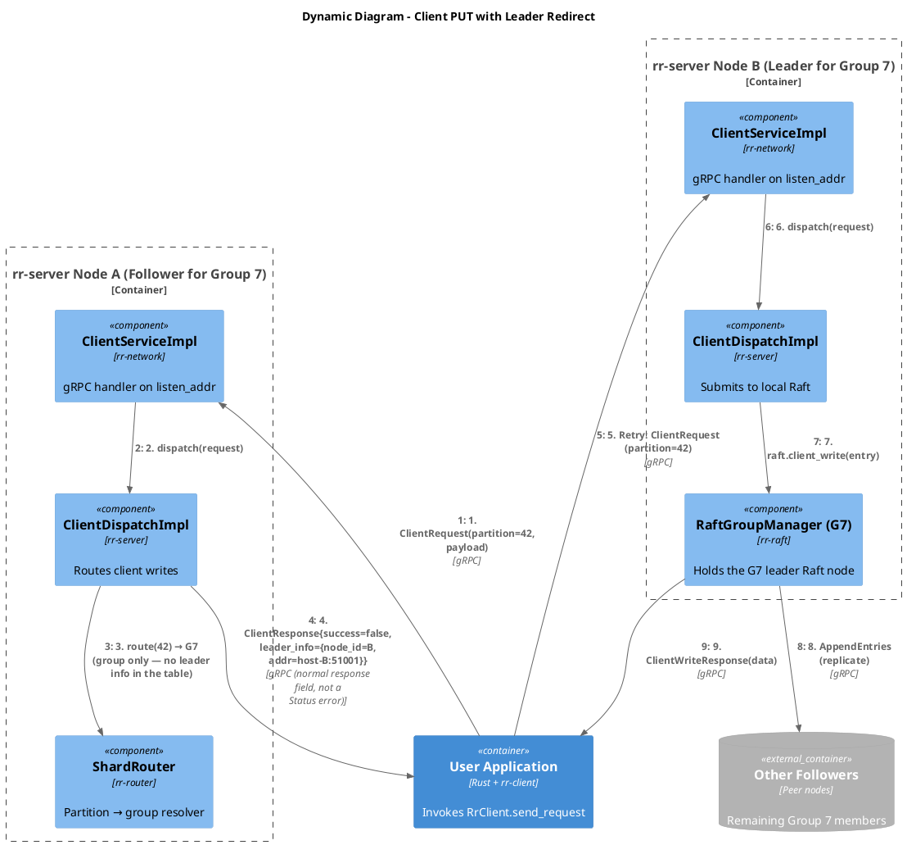
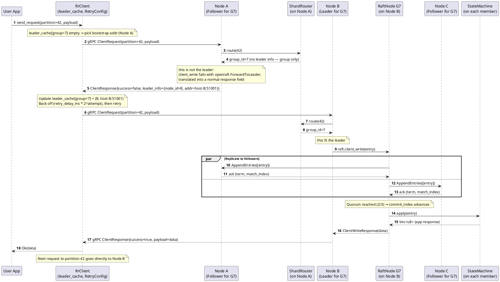

# Dynamic — Client PUT with Leader Redirect

这是 rr 最常见的执行流：用户应用调用 `rr-client` 发起一个写请求，请求被路由到错误的节点，客户端自动重定向到 leader 并完成写入。**这个流程演示了 rr "智能客户端（smart client）" 的核心价值**。

---

The most common execution flow in rr: a user application calls `rr-client` to issue a write request, the request lands on the wrong node, the client auto-redirects to the leader, and the write completes. **This flow demonstrates the core value of rr's "smart client" approach.**

## 高层流程（C4 Dynamic）/ High-Level Flow (C4 Dynamic)



## 详细时序图 / Detailed Sequence



## 关键设计点 / Key Design Points

### 1. 客户端侧领导者缓存 / Client-side Leader Cache
`RrClient` 内部维护 `leader_cache: Arc<RwLock<HashMap<GroupId, (NodeId, String)>>>`：

`RrClient` internally maintains `leader_cache: Arc<RwLock<HashMap<GroupId, (NodeId, String)>>>`:

```rust
// rr-client/src/lib.rs — 就是 (NodeId, addr) 二元组：
// 没有 cached_at 时间戳，没有 TTL —— 缓存项只在
// 连接失败或收到新的 leader_info 重定向时被驱逐/覆盖。
leader_cache: Arc<RwLock<HashMap<GroupId, (NodeId, String)>>>
```

- 命中缓存：直接发到 leader（快路径）
- 未命中：从 bootstrap 地址列表轮询
- 收到携带 `leader_info` 的响应：更新缓存，退避后重试
- 连接失败：**驱逐缓存项**，避免反复连接已死节点

---

- Hit: send directly to leader (fast path)
- Miss: round-robin through bootstrap addresses
- Response carrying `leader_info` received: update cache, back off, retry
- Connection failed: **evict cache entry**, avoid repeatedly dialing a dead node

### 2. 指数退避重试 / Exponential Backoff Retry

`RetryConfig`:
- `max_retries`: 默认 3 / default 3
- `retry_delay_ms`: 基础延迟 / base delay, default 100 ms
- 第 n 次重试延迟：`retry_delay_ms * 2^attempt` → 100ms, 200ms, 400ms...

**什么情况下重试 / When to retry**:
- 携带 `leader_info` 的重定向响应 — 更新 leader 缓存后**同样按指数退避**重试（rr-client 对 redirect 也 sleep，没有 no-sleep 快路径），最多 `max_retries` 次
- 网络错误（连接失败、超时）— 驱逐缓存项，指数退避后重试

**什么情况下不重试 / When NOT to retry**:
- 幂等键过期（`idem_error`）— 立即返回 `RrError::IdempotencyExpired`（见下）
- 业务逻辑错误（`StateMachine::apply` 返回的错误）— 直接冒泡给应用
- 序列化失败 — 立即失败

---

**When to retry**:
- Redirect responses carrying `leader_info` — update the leader cache, then retry **with the same exponential backoff** (rr-client sleeps on redirects too; there is no no-sleep fast path), up to `max_retries` times
- Network errors (connect fail, timeout) — evict cache entry, retry with exponential backoff

**When NOT to retry**:
- Expired idempotency key (`idem_error`) — returns `RrError::IdempotencyExpired` immediately (see below)
- Business logic errors (from `StateMachine::apply`) — bubble to application immediately
- Serialization errors — fail fast

### 3. 为什么不在 Node A 上代理转发？/ Why Doesn't Node A Proxy Forward?

一种替代设计：follower 直接把请求转发给 leader，对客户端透明。rr 明确**不这么做**，因为：

An alternative design: the follower could proxy the request to the leader transparently. rr explicitly **does not** do this because:

1. **性能**：多一跳（client → follower → leader → follower → client）增加尾延迟。
2. **状态**：follower 需要等待响应；leader 故障会导致 follower 超时；客户端重试会触发重复写入风险。
3. **可观测性**：客户端直接看到 leader 变化，便于诊断。
4. **公平性**：follower 不会因为"帮忙转发"而积压请求；集群流量直接体现真实路由。

代价：客户端必须实现重定向逻辑——这正是 `rr-client` SDK 的核心职责。

---

1. **Performance**: extra hop (client → follower → leader → follower → client) increases tail latency.
2. **State**: the follower must hold the response; leader failure causes follower timeouts; client retries risk duplicate writes.
3. **Observability**: clients see leader changes directly, easier to diagnose.
4. **Fairness**: followers don't accumulate "helping" backlog; cluster traffic reflects true routing.

Tradeoff: the client must implement redirect logic — this is exactly what the `rr-client` SDK is for.

### 4. 幂等性 / Idempotency

客户端重试**不是天然幂等**——但 rr **提供框架级幂等层**（ADR A-0003），应用可选择启用：

- **客户端**：`send_request_idempotent(group_id, payload, IdempotencyKey::new(request_type, request_id))`（`rr-client`）。去重身份是 `(request_type, request_id)`；可选的 `client_id` 仅用于诊断。
- **协议**：`ClientRequest.idem_key`（proto3 optional，v0.2.x 兼容——不带 key 的请求完全走旧路径）；`ClientResponse.idem_error` 携带 `{request_type, request_id, watermark}`。
- **写路径**：`ClientDispatchImpl` 把带 key 的 payload 包成 `FramedEntry{version, offset, idem_key, payload}` 再提交 `client_write`（不带 key 则原样透传）。
- **状态机侧**：`ServiceStateMachineAdapter` 内的 `IdempotencyLayer`（`rr-raft`）对每个 group 维护 **LRU 响应缓存 + 每 request_type 的 watermark**：缓存命中 → 直接返回首次 apply 的响应（Replay）；`request_id ≤ watermark` 且已被逐出缓存 → Expired；否则正常 apply 并记录。该层状态随快照一起 capture/restore，leader 切换后仍然有效。
- **过期处理**：客户端收到 `idem_error` 后得到 `RrError::IdempotencyExpired{request_type, request_id, watermark}`——应选用大于 watermark 的新 request_id 重试。

不带 key 的请求不做任何框架级去重——此时仍需应用层保证幂等（如 Put 的覆盖语义）。

---

Client retries are **not naturally idempotent** — but rr **ships a framework-level idempotency layer** (ADR A-0003) that applications can opt into:

- **Client**: `send_request_idempotent(group_id, payload, IdempotencyKey::new(request_type, request_id))` (`rr-client`). The dedup identity is `(request_type, request_id)`; the optional `client_id` is diagnostic-only.
- **Protocol**: `ClientRequest.idem_key` (proto3 optional, v0.2.x compatible — unkeyed requests take the legacy path unchanged); `ClientResponse.idem_error` carries `{request_type, request_id, watermark}`.
- **Write path**: `ClientDispatchImpl` wraps a keyed payload as `FramedEntry{version, offset, idem_key, payload}` before `client_write` (unkeyed payloads pass through verbatim).
- **State machine side**: the `IdempotencyLayer` inside `ServiceStateMachineAdapter` (`rr-raft`) keeps a per-group **LRU response cache + per-request_type watermark**: cache hit → return the first apply's response (Replay); `request_id ≤ watermark` and already evicted → Expired; otherwise apply normally and record. The layer's state is captured/restored with snapshots, so it survives leader changes.
- **Expiry**: on `idem_error` the client gets `RrError::IdempotencyExpired{request_type, request_id, watermark}` — it should retry with a fresh request_id above the watermark.

Unkeyed requests get no framework dedup — the application must then ensure idempotency itself (e.g. Put's overwrite semantics).

## 错误路径 / Failure Paths

| At Step | Failure | Client Behavior |
| :--- | :--- | :--- |
| 1 (first RPC) | Connection refused | Try next bootstrap address |
| 4 (redirect) | Leader address unreachable | Evict cache, fall back to bootstrap list |
| 5 (retry to leader) | `ForwardToLeader` again (stale leader) | Update cache with new leader, retry (up to `max_retries`) |
| 7 (client_write) | `RaftError::Timeout` on replication | Increment retry counter; may land on same leader again |
| 8 (replication) | Only 1/3 nodes reply → no quorum → timeout | Leader eventually steps down; client sees timeout → retries trigger leader re-election cycle |

## 相关 / Related

- 分片路由细节：[dynamic-shard-routing.md](./dynamic-shard-routing.md)
- Leader 故障处理：[dynamic-leader-election.md](./dynamic-leader-election.md)
- 原有文档的叙述版本：[../data-flow.md#write-request-lifecycle](../data-flow.md)
