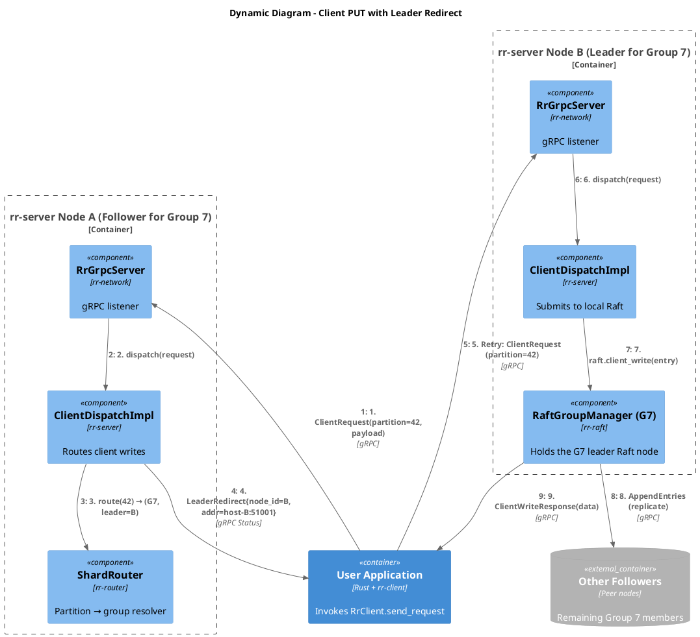
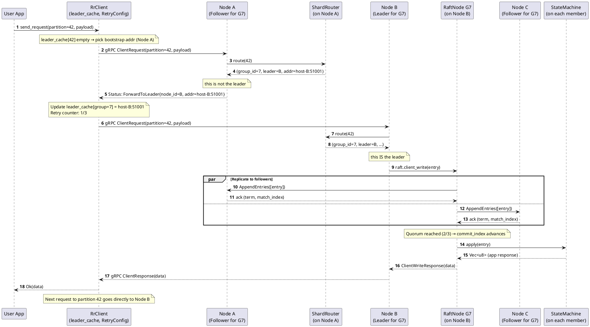

# Dynamic — Client PUT with Leader Redirect

这是 rr 最常见的执行流：用户应用调用 `rr-client` 发起一个写请求，请求被路由到错误的节点，客户端自动重定向到 leader 并完成写入。**这个流程演示了 rr "智能客户端（smart client）" 的核心价值**。

---

The most common execution flow in rr: a user application calls `rr-client` to issue a write request, the request lands on the wrong node, the client auto-redirects to the leader, and the write completes. **This flow demonstrates the core value of rr's "smart client" approach.**

## 高层流程（C4 Dynamic）/ High-Level Flow (C4 Dynamic)



## 详细时序图 / Detailed Sequence



## 关键设计点 / Key Design Points

### 1. 客户端侧领导者缓存 / Client-side Leader Cache
`RrClient` 内部维护 `HashMap<GroupId, CachedLeader>`：

`RrClient` internally maintains `HashMap<GroupId, CachedLeader>`:

```rust
struct CachedLeader {
    addr: String,
    cached_at: Instant,
    // Optional: TTL-based invalidation
}
```

- 命中缓存：直接发到 leader（快路径）
- 未命中：从 bootstrap 地址列表轮询
- 收到 `ForwardToLeader`：更新缓存，重试
- 连接失败：**驱逐缓存项**，避免反复连接已死节点

---

- Hit: send directly to leader (fast path)
- Miss: round-robin through bootstrap addresses
- `ForwardToLeader` received: update cache, retry
- Connection failed: **evict cache entry**, avoid repeatedly dialing a dead node

### 2. 指数退避重试 / Exponential Backoff Retry

`RetryConfig`:
- `max_retries`: 默认 3 / default 3
- `retry_delay_ms`: 基础延迟 / base delay, e.g. 100 ms
- 第 n 次重试延迟：`retry_delay_ms * 2^(n-1)` → 100ms, 200ms, 400ms...

**什么情况下重试 / When to retry**:
- `ForwardToLeader` — 立即重试（no sleep），最多 `max_retries` 次
- 网络错误（连接失败、超时）— 指数退避后重试
- `RaftError::NotLeader`（偶发竞态）— 立即重试

**什么情况下不重试 / When NOT to retry**:
- 业务逻辑错误（`StateMachine::apply` 返回的错误）— 直接冒泡给应用
- 序列化失败 — 立即失败

---

**When to retry**:
- `ForwardToLeader` — retry immediately (no sleep), up to `max_retries` times
- Network errors (connect fail, timeout) — retry with exponential backoff
- `RaftError::NotLeader` (transient races) — retry immediately

**When NOT to retry**:
- Business logic errors (from `StateMachine::apply`) — bubble to application immediately
- Serialization errors — fail fast

### 3. 为什么不在 Node A 上代理转发？/ Why Doesn't Node A Proxy Forward?

一种替代设计：follower 直接把请求转发给 leader，对客户端透明。rr 明确**不这么做**，因为：

An alternative design: the follower could proxy the request to the leader transparently. rr explicitly **does not** do this because:

1. **性能**：多一跳（client → follower → leader → follower → client）增加尾延迟。
2. **状态**：follower 需要等待响应；leader 故障会导致 follower 超时；客户端重试会触发重复写入风险。
3. **可观测性**：客户端直接看到 leader 变化，便于诊断。
4. **公平性**：follower 不会因为"帮忙转发"而积压请求；集群流量直接体现真实路由。

代价：客户端必须实现重定向逻辑——这正是 `rr-client` SDK 的核心职责。

---

1. **Performance**: extra hop (client → follower → leader → follower → client) increases tail latency.
2. **State**: the follower must hold the response; leader failure causes follower timeouts; client retries risk duplicate writes.
3. **Observability**: clients see leader changes directly, easier to diagnose.
4. **Fairness**: followers don't accumulate "helping" backlog; cluster traffic reflects true routing.

Tradeoff: the client must implement redirect logic — this is exactly what the `rr-client` SDK is for.

### 4. 幂等性 / Idempotency

客户端重试**不是天然幂等**。应用层必须确保：
- Put 是幂等的（`key → value` 覆盖语义）
- 其他操作（incr、delete-if-exists）应携带**请求 ID / 幂等键**，由 `StateMachine::apply` 去重

rr 框架本身不提供请求去重——它留给 `StateMachine` 实现者决定，因为去重策略（TTL、bloom filter、持久化表）取决于业务语义。

---

Client retries are **not naturally idempotent**. The application layer must ensure:
- Put is idempotent (key → value overwrite semantics)
- Other operations (incr, delete-if-exists) should carry a **request ID / idempotency key**, deduplicated in `StateMachine::apply`

The rr framework itself does not provide request deduplication — it's left to the `StateMachine` implementer because the dedup strategy (TTL, bloom filter, persistent table) depends on business semantics.

## 错误路径 / Failure Paths

| At Step | Failure | Client Behavior |
| :--- | :--- | :--- |
| 1 (first RPC) | Connection refused | Try next bootstrap address |
| 4 (redirect) | Leader address unreachable | Evict cache, fall back to bootstrap list |
| 5 (retry to leader) | `ForwardToLeader` again (stale leader) | Update cache with new leader, retry (up to `max_retries`) |
| 7 (client_write) | `RaftError::Timeout` on replication | Increment retry counter; may land on same leader again |
| 8 (replication) | Only 1/3 nodes reply → no quorum → timeout | Leader eventually steps down; client sees timeout → retries trigger leader re-election cycle |

## 相关 / Related

- 分片路由细节：[dynamic-shard-routing.md](./dynamic-shard-routing.md)
- Leader 故障处理：[dynamic-leader-election.md](./dynamic-leader-election.md)
- 原有文档的叙述版本：[../data-flow.md#write-request-lifecycle](../data-flow.md)
