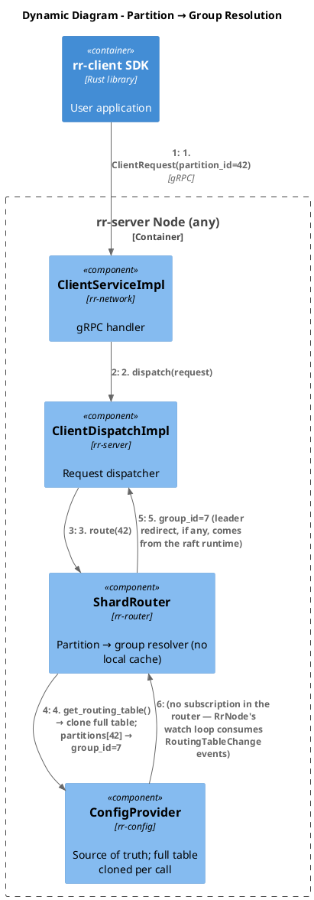
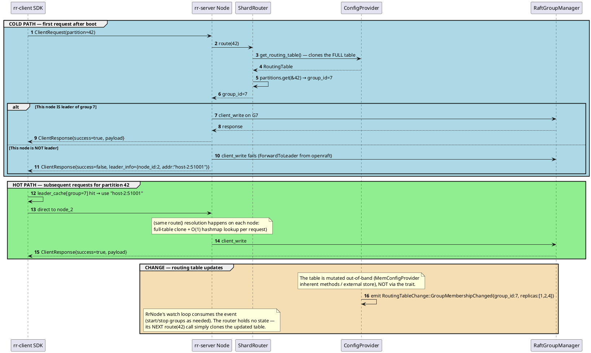

# Dynamic — Shard Routing (Partition → Group)

每个请求都携带一个 `partition_id`。rr 需要把它解析成**"该发给哪个节点的哪个 Raft group"**。本图展示完整的解析链路和缓存策略。

---

Every request carries a `partition_id`. rr must resolve it into **"which Raft group on which node should handle this"**. This diagram shows the full resolution path and caching strategy.

## 高层流程（C4 Dynamic）/ High-Level Flow (C4 Dynamic)



## 详细时序图 / Detailed Sequence



## 查询的两层 / The Two Layers

### 层 1: 服务端路由（ShardRouter）/ Layer 1: Server-side routing
每个 rr-server 都有 `ShardRouter`。它拿到一个 `partition_id`，返回所属的 `group_id`。路由表不携带 leader 信息——leader 发现全部交给客户端 redirect（见层 2）。

Every rr-server has a `ShardRouter`. Given a `partition_id`, it returns the owning `group_id`. The routing table carries no leader information — leader discovery is entirely client-side via redirects (see Layer 2).

**特性 / Characteristics**:
- **无本地缓存**：每次 `route()` 都通过 `get_routing_table()` 克隆整张表，再做一次 HashMap 查询
- **读到即最新**：因为没有缓存，router 永远看到 provider 当前的表；"最终一致"只存在于**跨节点**传播层面（各节点 provider 各自更新）
- **变更通知**：`ConfigProvider::watch_changes()` 的事件流由 `RrNode` 的 watch loop 消费（用于启停 group），router 本身不订阅
- **per-node**：每个节点独立持有 provider；热路径不跨节点通信

---

- **No local cache**: every `route()` clones the whole table via `get_routing_table()`, then does a single HashMap lookup
- **Reads are always current**: with no cache, the router always sees the provider's current table; "eventual consistency" exists only at the **cross-node** propagation level (each node's provider updates independently)
- **Change notification**: the `ConfigProvider::watch_changes()` event stream is consumed by `RrNode`'s watch loop (to start/stop groups); the router itself does not subscribe
- **Per-node**: each node holds its own provider; the hot path has zero inter-node traffic

### 层 2: 客户端 leader 缓存 / Layer 2: Client-side leader cache
`RrClient` 额外维护自己的 `HashMap<GroupId, (NodeId, String)>`（无时间戳、无 TTL）——避免每次请求都先打到 follower 再被重定向。

`RrClient` additionally maintains its own `HashMap<GroupId, (NodeId, String)>` (no timestamp, no TTL) — avoiding the follower-then-redirect roundtrip on every request.

**注意**：路由表从不携带 leader 信息——客户端的 leader cache 是系统里唯一的 leader 视图，由 `leader_info` 重定向刷新：

**Note**: the routing table never carries leader information — the client-side leader cache is the only leader view in the system, refreshed by `leader_info` redirects:

| 场景 / Scenario | Client-side cache | 结果 / Outcome |
| :--- | :--- | :--- |
| Leader changed | Stale | Client sends to old leader → gets a `leader_info` redirect (or a connection failure) → updates cache → retries |
| Partition / group added | Missing entry | Client round-robins the bootstrap list; the first response (success or `leader_info` redirect) fills the cache. `GetClusterInfo` is not usable for discovery — the stock implementation returns placeholder leader/replica fields |

**设计原则 / Design principle**：
*宁可让客户端缓存短暂 stale，也不要把易变的 leader 运行时状态放进配置面路由表。*

*Allow the client cache to go briefly stale rather than putting volatile leader runtime state into the configuration-plane routing table.*

## 为什么 partition_id 来自客户端？/ Why Does partition_id Come From Client?

rr 把**分区键计算**的责任留给应用：

rr leaves **partition key computation** to the application:

```rust
// Application code:
let partition_id = my_hash(key) % NUM_PARTITIONS;
let resp = client.send_request(partition_id, payload).await?;
```

**为什么不让 rr 内部做？/ Why not have rr compute it internally?**

1. **语义 / Semantics**：分区策略是业务决策——按 user_id？按地理位置？按时间范围？框架无法猜测。
2. **稳定性 / Stability**：哈希函数变化会导致所有数据重新分片；应用控制比框架内置更灵活。
3. **调试 / Debugging**：应用层能打印 `partition_id`，方便故障排查。

**代价 / Tradeoff**：应用必须保持分区键计算的一致性——否则会出现"相同的 key 映射到不同 partition"的分裂数据。

---

1. **Semantics**: partition strategy is a business decision — by user_id? geography? time range? The framework can't guess.
2. **Stability**: hash function changes reshard all data; app control is more flexible than framework-baked.
3. **Debugging**: app layer can log `partition_id` for troubleshooting.

**Cost**: the app must keep partition key computation consistent — otherwise "same key maps to different partitions" split-data scenarios occur.

## 路由表失效场景 / Routing Table Invalidation Scenarios

`RoutingTableChange` 共 6 个变体（`rr-core::config`）。ShardRouter 不订阅事件——它的**下一次** `route()` 调用会克隆到已更新的表。事件的实际消费者是 `RrNode` 的 watch loop（据此启停 group）：

`RoutingTableChange` has 6 variants (`rr-core::config`). The ShardRouter does not subscribe — its **next** `route()` call simply clones the updated table. The actual consumer of the events is `RrNode`'s watch loop (which starts/stops groups accordingly):

| 事件 / Event | Variant | RrNode watch loop reaction |
| :--- | :--- | :--- |
| New partition created | `PartitionAdded { partition_id, config, group_id }` | Start the group locally if this node is in its replicas |
| Partition removed | `PartitionRemoved { partition_id }` | Logged only |
| Partition config updated | `PartitionUpdated { partition_id, config, group_id }` | Logged only |
| Node added | `NodeAdded { node_id, addr }` | Try `add_learner` for the node on all local groups |
| Node removed (decommission) | `NodeRemoved { node_id }` | `change_membership` to drop the node from all local groups |
| Membership change (add learner → promote) | `GroupMembershipChanged { group_id, replicas }` | Start the group if now a replica; stop it if no longer one |

Leader 选举不会产生路由表事件——leader 是 raft 运行时状态，不进入配置面。客户端把请求发给任一节点；若该节点不是 leader，server 从 raft 运行时拿到真实 leader 并返回 `leader_info` 重定向（或旧 leader 已宕机时连接失败），客户端更新 leader cache 并重试，最终收敛到正确的 leader，代价是几次额外 RPC。

---

Leader elections never produce routing-table events — the leader is raft runtime state and stays out of the configuration plane. The client sends its request to any node; if that node is not the leader, the server learns the real leader from the raft runtime and returns a `leader_info` redirect (or the connection fails if the old leader is down); the client updates its leader cache and retries, converging on the real leader at the cost of a few extra RPCs.

## 相关 / Related

- ConfigProvider 与路由表变更：[dynamic-config-update.md](./dynamic-config-update.md)
- 客户端重定向：[dynamic-put-request.md](./dynamic-put-request.md)
- 路由组件细节：[components-router.md](./components-router.md)
