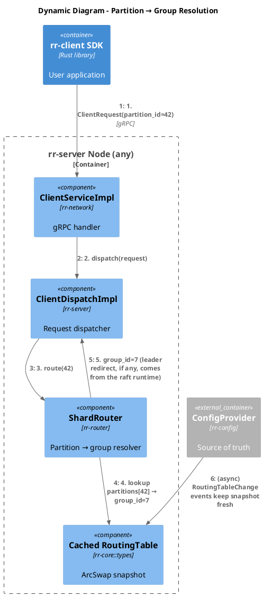
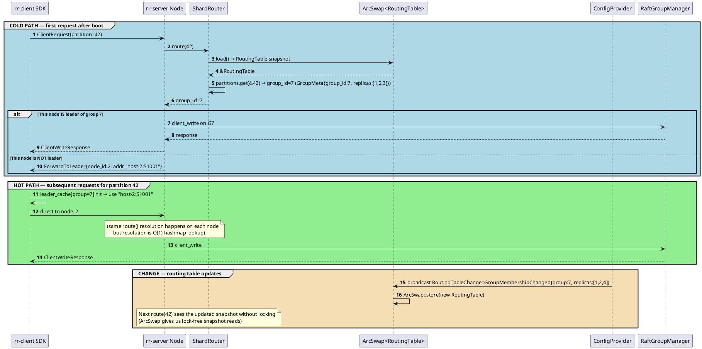

# Dynamic — Shard Routing (Partition → Group)

每个请求都携带一个 `partition_id`。rr 需要把它解析成**"该发给哪个节点的哪个 Raft group"**。本图展示完整的解析链路和缓存策略。

---

Every request carries a `partition_id`. rr must resolve it into **"which Raft group on which node should handle this"**. This diagram shows the full resolution path and caching strategy.

## 高层流程（C4 Dynamic）/ High-Level Flow (C4 Dynamic)



## 详细时序图 / Detailed Sequence



## 查询的两层 / The Two Layers

### 层 1: 服务端路由（ShardRouter）/ Layer 1: Server-side routing
每个 rr-server 都有 `ShardRouter`。它拿到一个 `partition_id`，返回所属的 `group_id`。路由表不携带 leader 信息——leader 发现全部交给客户端 redirect（见层 2）。

Every rr-server has a `ShardRouter`. Given a `partition_id`, it returns the owning `group_id`. The routing table carries no leader information — leader discovery is entirely client-side via redirects (see Layer 2).

**特性 / Characteristics**:
- **O(1) 查询**：一次 HashMap lookup（partition → group）
- **无锁读**：通过 `ArcSwap<RoutingTable>` 实现
- **最终一致**：路由表变更通过 `ConfigProvider::subscribe_changes` 异步传播
- **per-node**：每个节点独立缓存；热路径不跨节点通信

---

- **O(1) lookup**: a single HashMap lookup (partition → group)
- **Lock-free reads**: via `ArcSwap<RoutingTable>`
- **Eventually consistent**: routing table changes propagate asynchronously via `ConfigProvider::subscribe_changes`
- **Per-node**: each node caches independently; hot path has zero inter-node traffic

### 层 2: 客户端 leader 缓存 / Layer 2: Client-side leader cache
`RrClient` 额外维护自己的 `HashMap<GroupId, CachedLeader>`——避免每次请求都先打到 follower 再被重定向。

`RrClient` additionally maintains its own `HashMap<GroupId, CachedLeader>` — avoiding the follower-then-redirect roundtrip on every request.

**注意**：路由表从不携带 leader 信息——客户端的 leader cache 是系统里唯一的 leader 视图，由 `leader_info` 重定向刷新：

**Note**: the routing table never carries leader information — the client-side leader cache is the only leader view in the system, refreshed by `leader_info` redirects:

| 场景 / Scenario | Client-side cache | 结果 / Outcome |
| :--- | :--- | :--- |
| Leader changed | Stale | Client sends to old leader → gets a `leader_info` redirect (or a connection failure) → updates cache → retries |
| Partition added | Missing | Client gets ClusterInfo refresh → updates |

**设计原则 / Design principle**：
*宁可让客户端缓存短暂 stale，也不要把易变的 leader 运行时状态放进配置面路由表。*

*Allow the client cache to go briefly stale rather than putting volatile leader runtime state into the configuration-plane routing table.*

## 为什么 partition_id 来自客户端？/ Why Does partition_id Come From Client?

rr 把**分区键计算**的责任留给应用：

rr leaves **partition key computation** to the application:

```rust
// Application code:
let partition_id = my_hash(key) % NUM_PARTITIONS;
let resp = client.send_request(partition_id, payload).await?;
```

**为什么不让 rr 内部做？/ Why not have rr compute it internally?**

1. **语义 / Semantics**：分区策略是业务决策——按 user_id？按地理位置？按时间范围？框架无法猜测。
2. **稳定性 / Stability**：哈希函数变化会导致所有数据重新分片；应用控制比框架内置更灵活。
3. **调试 / Debugging**：应用层能打印 `partition_id`，方便故障排查。

**代价 / Tradeoff**：应用必须保持分区键计算的一致性——否则会出现"相同的 key 映射到不同 partition"的分裂数据。

---

1. **Semantics**: partition strategy is a business decision — by user_id? geography? time range? The framework can't guess.
2. **Stability**: hash function changes reshard all data; app control is more flexible than framework-baked.
3. **Debugging**: app layer can log `partition_id` for troubleshooting.

**Cost**: the app must keep partition key computation consistent — otherwise "same key maps to different partitions" split-data scenarios occur.

## 路由表失效场景 / Routing Table Invalidation Scenarios

| 事件 / Event | How ShardRouter Finds Out |
| :--- | :--- |
| Membership change (add learner → promote) | `RoutingTableChange::GroupMembershipChanged` |
| New partition created | `RoutingTableChange::PartitionAdded` |
| Node address changes | `RoutingTableChange::NodeAddrUpdated` |
| Node removed (decommission) | `RoutingTableChange::NodeRemoved` |

Leader 选举不会产生路由表事件——leader 是 raft 运行时状态，不进入配置面。客户端把请求发给任一节点；若该节点不是 leader，server 从 raft 运行时拿到真实 leader 并返回 `leader_info` 重定向（或旧 leader 已宕机时连接失败），客户端更新 leader cache 并重试，最终收敛到正确的 leader，代价是几次额外 RPC。

---

Leader elections never produce routing-table events — the leader is raft runtime state and stays out of the configuration plane. The client sends its request to any node; if that node is not the leader, the server learns the real leader from the raft runtime and returns a `leader_info` redirect (or the connection fails if the old leader is down); the client updates its leader cache and retries, converging on the real leader at the cost of a few extra RPCs.

## 相关 / Related

- ConfigProvider 与路由表变更：[dynamic-config-update.md](./dynamic-config-update.md)
- 客户端重定向：[dynamic-put-request.md](./dynamic-put-request.md)
- 路由组件细节：[components-router.md](./components-router.md)
