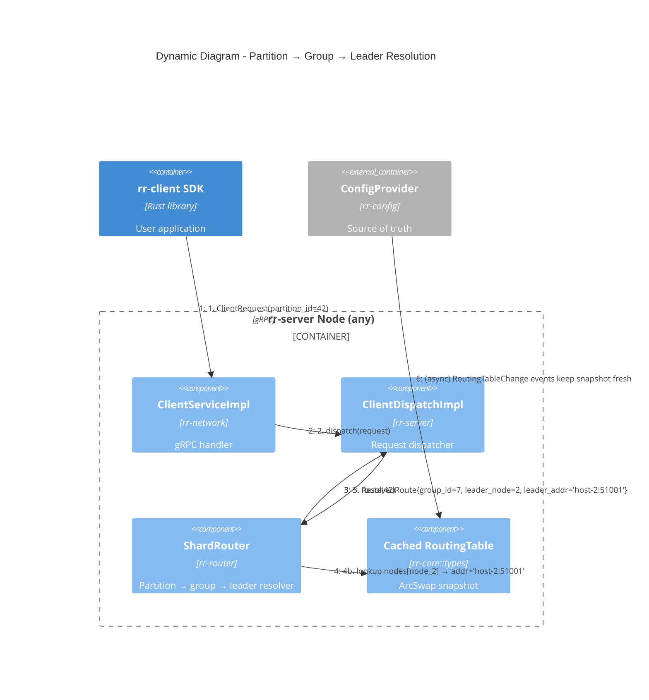
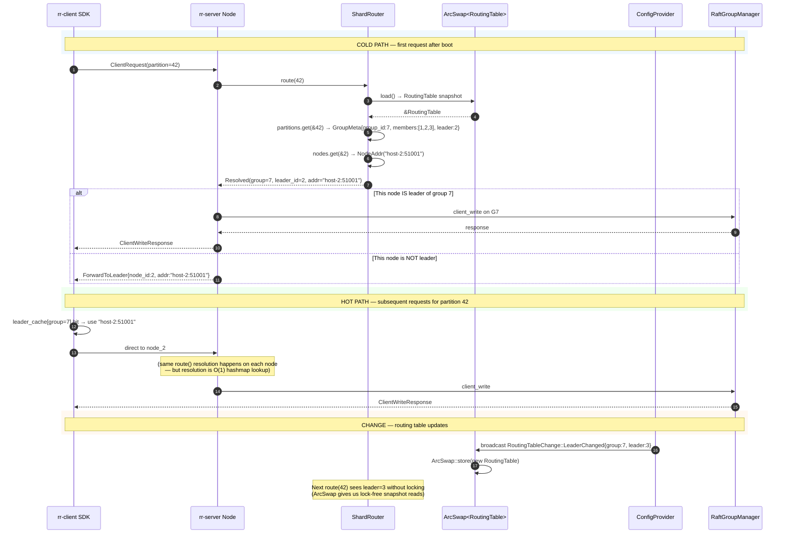

# Dynamic — Shard Routing (Partition → Group → Leader)

每个请求都携带一个 `partition_id`。rr 需要把它解析成**"该发给哪个节点的哪个 Raft group"**。本图展示完整的解析链路和缓存策略。

---

Every request carries a `partition_id`. rr must resolve it into **"which Raft group on which node should handle this"**. This diagram shows the full resolution path and caching strategy.

## 高层流程（C4 Dynamic）/ High-Level Flow (C4 Dynamic)



## 详细时序图 / Detailed Sequence



## 查询的两层 / The Two Layers

### 层 1: 服务端路由（ShardRouter）/ Layer 1: Server-side routing
每个 rr-server 都有 `ShardRouter`。它拿到一个 `partition_id`，返回 `(group_id, leader_addr)`。

Every rr-server has a `ShardRouter`. Given a `partition_id`, returns `(group_id, leader_addr)`.

**特性 / Characteristics**:
- **O(1) 查询**：两次 HashMap lookup（partition → group → node_addr）
- **无锁读**：通过 `ArcSwap<RoutingTable>` 实现
- **最终一致**：路由表变更通过 `ConfigProvider::subscribe_changes` 异步传播
- **per-node**：每个节点独立缓存；热路径不跨节点通信

---

- **O(1) lookup**: two HashMap lookups (partition → group → node_addr)
- **Lock-free reads**: via `ArcSwap<RoutingTable>`
- **Eventually consistent**: routing table changes propagate asynchronously via `ConfigProvider::subscribe_changes`
- **Per-node**: each node caches independently; hot path has zero inter-node traffic

### 层 2: 客户端 leader 缓存 / Layer 2: Client-side leader cache
`RrClient` 额外维护自己的 `HashMap<GroupId, CachedLeader>`——避免每次请求都先打到 follower 再被重定向。

`RrClient` additionally maintains its own `HashMap<GroupId, CachedLeader>` — avoiding the follower-then-redirect roundtrip on every request.

**注意这**两个缓存可能不同步**：**

**Note these two caches may drift**:

| 场景 / Scenario | Server-side | Client-side | 结果 / Outcome |
| :--- | :--- | :--- | :--- |
| Leader changed recently | Updated (got broadcast) | Stale | Client gets ForwardToLeader → updates |
| Leader changed very recently | Stale (not yet broadcast) | Stale | Client sends to old leader → old leader knows it stepped down → returns error → client retries, eventually hits new leader |
| Partition added | Updated | Missing | Client gets ClusterInfo refresh → updates |

**设计原则 / Design principle**：
*宁可让两层缓存短暂不一致，也不要在热路径上加锁。*

*Allow brief inconsistency between the two caches rather than locking the hot path.*

## 为什么 partition_id 来自客户端？/ Why Does partition_id Come From Client?

rr 把**分区键计算**的责任留给应用：

rr leaves **partition key computation** to the application:

```rust
// Application code:
let partition_id = my_hash(key) % NUM_PARTITIONS;
let resp = client.send_request(partition_id, payload).await?;
```

**为什么不让 rr 内部做？/ Why not have rr compute it internally?**

1. **语义 / Semantics**：分区策略是业务决策——按 user_id？按地理位置？按时间范围？框架无法猜测。
2. **稳定性 / Stability**：哈希函数变化会导致所有数据重新分片；应用控制比框架内置更灵活。
3. **调试 / Debugging**：应用层能打印 `partition_id`，方便故障排查。

**代价 / Tradeoff**：应用必须保持分区键计算的一致性——否则会出现"相同的 key 映射到不同 partition"的分裂数据。

---

1. **Semantics**: partition strategy is a business decision — by user_id? geography? time range? The framework can't guess.
2. **Stability**: hash function changes reshard all data; app control is more flexible than framework-baked.
3. **Debugging**: app layer can log `partition_id` for troubleshooting.

**Cost**: the app must keep partition key computation consistent — otherwise "same key maps to different partitions" split-data scenarios occur.

## 路由表失效场景 / Routing Table Invalidation Scenarios

| 事件 / Event | How ShardRouter Finds Out |
| :--- | :--- |
| Leader election completes | `RoutingTableChange::LeaderChanged` broadcast (if ConfigProvider wired to Raft events) |
| Membership change (add learner → promote) | `RoutingTableChange::GroupMembershipChanged` |
| New partition created | `RoutingTableChange::PartitionAdded` |
| Node address changes | `RoutingTableChange::NodeAddrUpdated` |
| Node removed (decommission) | `RoutingTableChange::NodeRemoved` |

如果 `ConfigProvider` 没有与 Raft 事件连接（例如 `MemConfigProvider` 默认不自动追踪 leader 变化），`ShardRouter` 可能返回**陈旧的 leader**。这种情况下：
- 客户端会收到 `ForwardToLeader`（老 leader 仍在本地——但不再是 leader），
- 或者老 leader 已 step down 并返回 `NotLeader` 错误，
- 最终自然收敛到正确的 leader，代价是几次额外 RPC。

---

If `ConfigProvider` isn't wired to Raft events (e.g., default `MemConfigProvider` does not auto-track leader changes), `ShardRouter` may return a **stale leader**. In that case:
- The client gets `ForwardToLeader` (the old leader locally — but not the real leader anymore),
- Or the former leader has stepped down and returns `NotLeader`,
- Eventually it converges on the real leader at the cost of a few extra RPCs.

## 相关 / Related

- ConfigProvider 与路由表变更：[dynamic-config-update.md](./dynamic-config-update.md)
- 客户端重定向：[dynamic-put-request.md](./dynamic-put-request.md)
- 路由组件细节：[components-router.md](./components-router.md)
