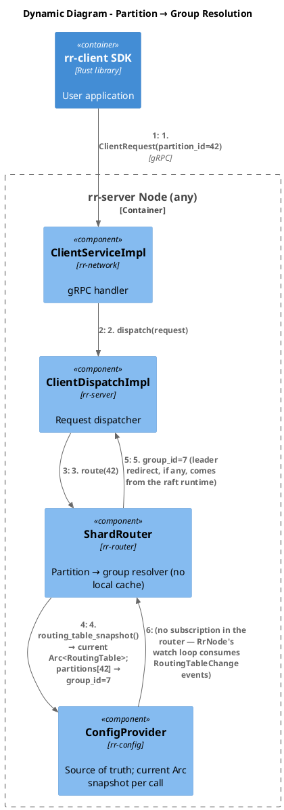
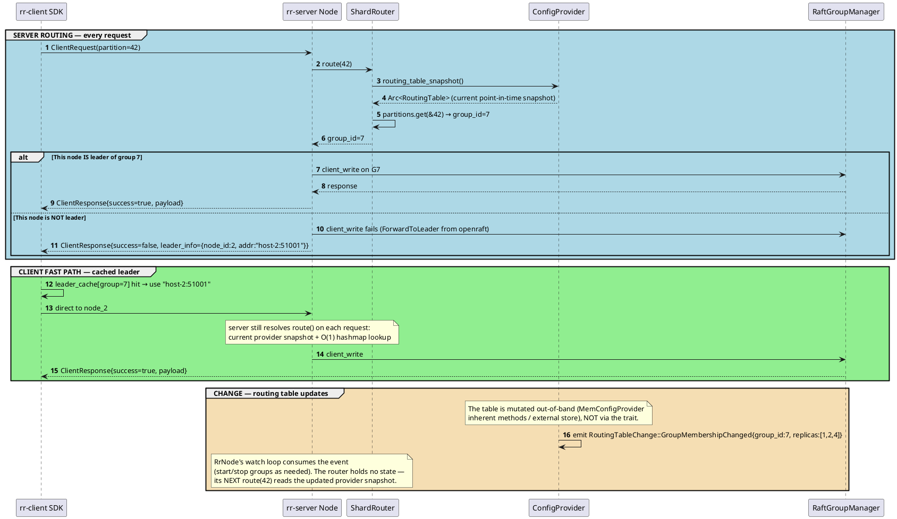

# 动态：分片路由 / Dynamic: Shard Routing

每个请求携带 `partition_id`。server 将它解析为 `group_id`，client 再缓存该 group 的当前 leader。

Every request carries a `partition_id`. The server resolves it to a `group_id`, and the client caches the group's
current leader.

## 高层流程 / High-level Flow



## 详细时序 / Detailed Sequence



## 两层路由 / Two Routing Layers

### 第 1 层：服务端分片路由 / Layer 1: Server-side Shard Routing

每个节点的 `ShardRouter` 只负责 `partition_id → group_id`。它每次读取 provider 当前快照，没有本地缓存；
内存 provider 返回 `Arc` 快照，因此不复制整表。跨节点是否一致取决于各节点 provider 的更新。

Each node's `ShardRouter` only resolves `partition_id → group_id`. It reads the provider's current snapshot on
every call and has no local cache; an in-memory provider returns an `Arc` snapshot without copying the table.
Cross-node consistency depends on each node's provider being updated.

`RrNode` 消费 `watch_changes()` 以启停 group；router 本身不订阅，热路径不跨节点通信。

`RrNode` consumes `watch_changes()` to start or stop groups; the router does not subscribe, and its hot path makes
no inter-node calls.

### 第 2 层：客户端 Leader 缓存 / Layer 2: Client-side Leader Cache

`RrClient` 维护无 TTL 的 `HashMap<GroupId, (NodeId, String)>`，避免每次先访问 follower。该缓存由
`leader_info` 重定向刷新；`GetClusterInfo` 虽能报告运行时拓扑，SDK 不用它轮询 leader。

`RrClient` maintains a `HashMap<GroupId, (NodeId, String)>` without TTL to avoid contacting a follower first.
`leader_info` redirects refresh this cache; although `GetClusterInfo` reports runtime topology, the SDK does not
poll it for leaders.

| 场景 / Scenario | 缓存 / Cache | 结果 / Outcome |
| :--- | :--- | :--- |
| Leader 变更 / Leader changed | 过期 / Stale | 请求旧 leader，收到重定向或连接失败，然后更新并重试 / Contact old leader, redirect or fail, then update and retry |
| 新分片或 group / New partition or group | 未命中 / Missing | 轮询 bootstrap；成功或重定向响应填充缓存 / Use bootstrap; success or redirect fills the cache |

## 由应用计算 Partition ID / Application-computed Partition IDs

分区策略属于应用语义，rr 不猜测按用户、地域还是时间分片。应用必须保持计算稳定，否则相同 key 可能映射
到不同 partition。

Partitioning is application semantics: rr does not choose between user, geography, time, or another key. The
application must keep the computation stable, or the same key can map to different partitions.

```rust
let partition_id = my_hash(key) % NUM_PARTITIONS;
let resp = client.send_request(partition_id, payload).await?;
```

## 路由表变更 / Routing-table Changes

`RoutingTableChange` 有 6 个变体。router 的下一次调用读取新快照；事件由 `RrNode` watch loop 消费。

`RoutingTableChange` has six variants. The router's next call reads the new snapshot; `RrNode`'s watch loop
consumes the events.

| 事件 / Event | Variant | RrNode 反应 / Reaction |
| :--- | :--- | :--- |
| 新分片 / Partition added | `PartitionAdded { partition_id, config, group_id }` | 本节点是副本时启动 group / Start group if local node is a replica |
| 删除分片 / Partition removed | `PartitionRemoved { partition_id }` | 记录日志 / Log only |
| 更新分片 / Partition updated | `PartitionUpdated { partition_id, config, group_id }` | 记录日志 / Log only |
| 新节点 / Node added | `NodeAdded { node_id, addr }` | 对本地 group 尝试 `add_learner` / Try `add_learner` on local groups |
| 删除节点 / Node removed | `NodeRemoved { node_id }` | 在 quorum guard 下移除成员 / Remove membership with quorum guard |
| 副本集变更 / Replicas changed | `GroupMembershipChanged { group_id, replicas }` | 按本地是否在副本集中启停 group / Start or stop local group |

leader 选举不产生路由表事件。客户端通过 `leader_info` 或连接失败发现变化，更新缓存后重试。

Leader elections produce no routing-table events. Clients detect changes through `leader_info` or connection
failure, update their cache, and retry.

## 相关 / Related

- [配置传播 / Config propagation](./dynamic-config-update.md)
- [客户端重定向 / Client redirects](./dynamic-put-request.md)
- [路由组件 / Router components](./components-router.md)
