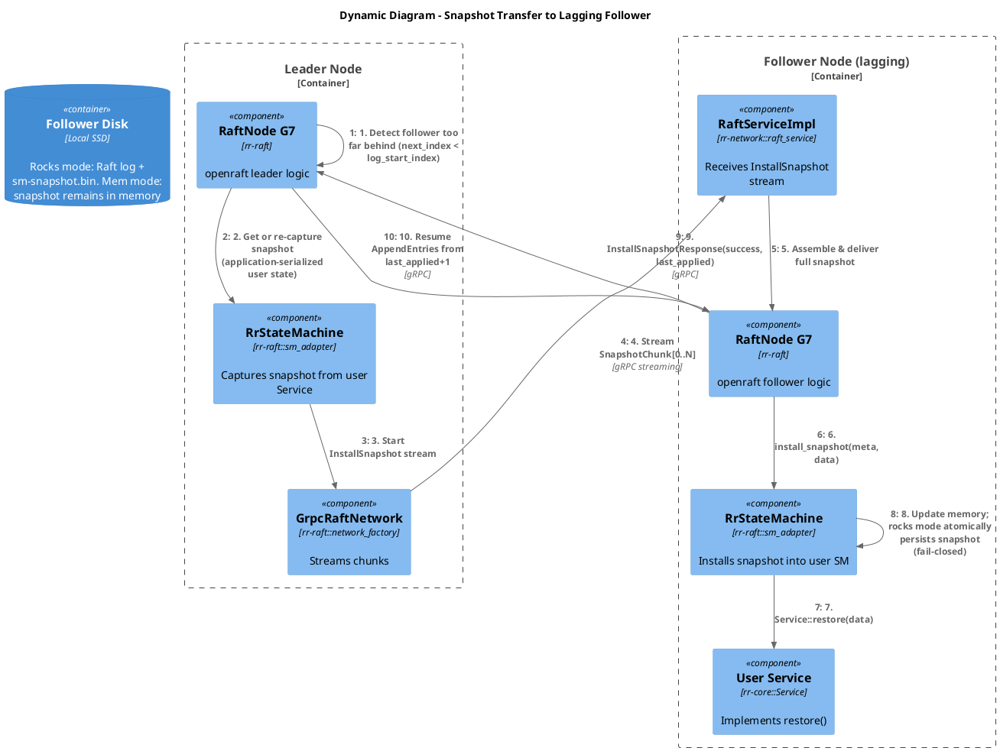
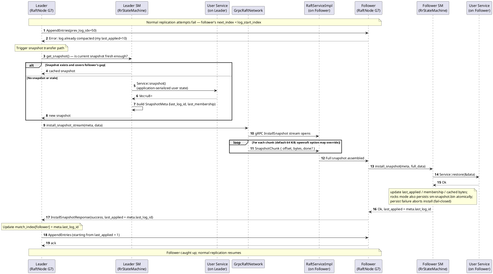

# 动态：快照传输 / Dynamic: Snapshot Transfer

当 follower 缺失的日志已被 leader 压缩时，leader 通过 gRPC 客户端流发送完整状态机快照。

When a follower's missing log entries have been compacted on the leader, the leader sends a full state-machine
snapshot over a gRPC client stream.

## 高层流程 / High-level Flow



## 详细时序 / Detailed Sequence



## 触发场景 / Triggers

- 新 learner 日志为空，且 leader 已压缩需要重放的日志。
  A new learner has an empty log and the leader has compacted entries needed for replay.
- 节点长时间下线后恢复，`last_applied` 落后太多。
  A node returns after long downtime with `last_applied` too far behind.
- 慢速或分区 follower 长期无法跟上，leader 最终截断其所需日志。
  A slow or partitioned follower falls behind until the leader truncates the entries it needs.

## 大小与传输 / Size and Transfer

下表只是按 1 Gbps 理想带宽估算，不含序列化、磁盘和协议开销。

These are idealized 1 Gbps estimates and exclude serialization, disk, and protocol overhead.

| 场景 / Scenario | 快照大小 / Snapshot Size | 理论传输时间 / Ideal Transfer Time |
| :--- | :--- | :--- |
| 100 万键，平均 100 B / 1M keys at 100 B | ~100 MB | ~1 s |
| 1000 万键，500 B 值 / 10M keys with 500 B values | ~5 GB | ~40 s |
| 更大状态 / Larger state | ~50+ GB | 数分钟 / Several minutes |

- 默认 chunk 为 64 KiB；openraft 提供 `snapshot_chunk_size` 时优先使用该值。`OnlineBackup` 同样使用
  64 KiB。
  Chunks default to 64 KiB; openraft's `snapshot_chunk_size` takes precedence when provided. `OnlineBackup` also
  uses 64 KiB.
- `SnapshotPolicy::LogsSinceLast(N)` 控制快照阈值；rr 默认 `N = 50_000`，可用
  `--snapshot-logs-since-last` 调整。
  `SnapshotPolicy::LogsSinceLast(N)` controls snapshot frequency; rr defaults to `N = 50_000`, tunable with
  `--snapshot-logs-since-last`.
- `GrpcRaftNetwork` 当前没有快照传输限流；大快照会与正常流量竞争资源。
  `GrpcRaftNetwork` currently has no snapshot-transfer throttling; large snapshots compete with normal traffic.

## 用户 Service 契约 / User Service Contract

应用负责生成一致、可恢复且版本兼容的快照字节。

The application owns consistent, restorable, and version-compatible snapshot bytes.

```rust
#[async_trait]
impl Service for MyService {
    async fn snapshot(&self) -> Result<Vec<u8>, RrError> {
        let guard = self.store.read().await;
        bincode::serde::encode_to_vec(&*guard, standard())
    }

    async fn restore(&mut self, data: &[u8]) -> Result<(), RrError> {
        let (restored, _) = bincode::serde::decode_from_slice(data, standard())?;
        *self.store.write().await = restored;
        Ok(())
    }
    // ...
}
```

1. `snapshot()` 必须捕获同一时间点的一致视图。
   `snapshot()` must capture a consistent point-in-time view.
2. `restore()` 必须替换现有状态，而不是合并，以免保留陈旧条目。
   `restore()` must replace existing state rather than merge it, so stale entries do not survive.
3. 应用必须处理序列化格式的版本兼容。
   The application must handle serialization compatibility across versions.
4. 应用捕获在 openraft 状态机任务中直接 `.await`，不会自动移入 `spawn_blocking`；实现不得长时间阻塞。
   Application capture is awaited directly on openraft's state-machine task, not automatically moved to
   `spawn_blocking`; implementations must not block for long.
5. rocks 模式将每个构建或安装的快照写入 `{base_path}/{group_id}/sm-snapshot.bin`。持久化 I/O 使用
   `spawn_blocking`，流程为临时文件 → fsync → rename → 目录 fsync。失败会中止构建或安装，阻止覆盖
   日志前缀被 purge；损坏、缺少 envelope 或未知版本在启动时 fail-closed。
   In rocks mode, every built or installed snapshot is written to `{base_path}/{group_id}/sm-snapshot.bin`.
   Persistence I/O uses `spawn_blocking` and follows temp file → fsync → rename → directory fsync. Failures abort
   the build or install before the covered log prefix can be purged; corrupt, unenveloped, or unknown-version files
   fail closed at startup.
6. mem 模式的快照和日志不跨重启保留，节点需要从 leader 重建。
   Mem-mode snapshots and logs do not survive restart; the node must rebuild from a leader.

## 相关 / Related

- [storage.md 的快照处理 / Snapshot handling in storage.md](../storage.md#快照处理--snapshot-handling)
- [rr-raft 组件 / rr-raft components](./components-raft.md)
