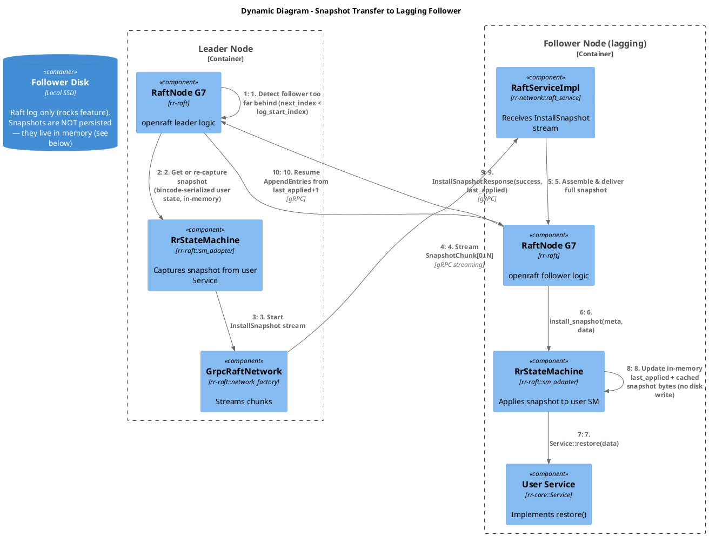

# Dynamic — Snapshot Transfer

当一个 follower 落后太多（缺失的日志条目已被 leader 压缩），leader 无法通过 `AppendEntries` 追赶它——必须发送**完整的状态机快照**。rr 使用 gRPC **流式 RPC** 传输大快照。本图展示这一过程。

---

When a follower falls too far behind (missing log entries have already been compacted on the leader), the leader cannot catch it up via `AppendEntries` — it must ship a **full state machine snapshot**. rr uses a gRPC **streaming RPC** for large snapshots. This diagram shows that process.

## 高层流程（C4 Dynamic）/ High-Level Flow (C4 Dynamic)



## 详细时序图 / Detailed Sequence


## 什么时候会触发快照传输？/ When Does Snapshot Transfer Trigger?

三种常见场景：

Three common triggers:

### 1. 新节点加入集群 / New Node Joins
`add_learner(group_id, new_node_id)` 后，学习节点的日志为空。如果 leader 的日志已压缩过，直接发送快照比重放全部日志更快。

After `add_learner(group_id, new_node_id)`, the learner's log is empty. If the leader's log has been compacted, sending a snapshot is faster than replaying the entire log.

### 2. 节点长时间下线后重启 / Node Restart After Long Downtime
节点恢复时，它的 `last_applied` 远小于当前 leader 的 `log_start_index`——中间缺失的条目已不存在。

When a node recovers, its `last_applied` is far behind the current leader's `log_start_index` — the missing entries no longer exist.

### 3. 网络慢速分区 / Slow Network Partition
follower 能接收心跳但带宽太低，无法及时拉取日志；随着时间推移 leader 的日志被截断。

Follower receives heartbeats but bandwidth is too low to fetch logs in time; eventually the leader's log is truncated.

## 快照大小与性能 / Snapshot Size and Performance

| Scenario | Snapshot Size | Transfer Time @ 1 Gbps | Impact |
| :--- | :--- | :--- | :--- |
| Small dataset (KV store, 1M keys avg 100B) | ~100 MB | ~1 second | Negligible |
| Medium (10M keys, 500B values) | ~5 GB | ~40 seconds | Brief disk + network spike |
| Large (100M keys, SSTables / columnar) | ~50+ GB | 5+ minutes | Significant — throttling recommended |

**调优建议 / Tuning tips**:

- **Chunk size**: 固定 64 KiB（`CHUNK_SIZE = 65_536`，`rr-raft/src/network_factory.rs`；`AdminService.OnlineBackup` 也是 64 KiB）。太小→太多 RPC 开销；太大→GC/内存压力。
- **snapshot_policy**: openraft 的 `SnapshotPolicy::LogsSinceLast(N)` 控制触发快照的日志阈值，rr 默认 `N = 50_000`（`rr_raft::DEFAULT_SNAPSHOT_LOGS_SINCE_LAST`，可用 `--snapshot-logs-since-last` 调整）。设得太高→快照不及时；太低→频繁快照占用 CPU。
- **rate-limit on transfer**: 在 `GrpcRaftNetwork` 中为大快照传输限流，避免影响正常客户端流量。rr 目前**不内置**限流——这是生产强化时需要添加的。

---

- **Chunk size**: fixed at 64 KiB (`CHUNK_SIZE = 65_536`, `rr-raft/src/network_factory.rs`; `AdminService.OnlineBackup` also uses 64 KiB). Too small → RPC overhead; too large → GC / memory pressure.
- **snapshot_policy**: openraft's `SnapshotPolicy::LogsSinceLast(N)` triggers snapshot creation; rr defaults to `N = 50_000` (`rr_raft::DEFAULT_SNAPSHOT_LOGS_SINCE_LAST`, tunable via `--snapshot-logs-since-last`). Too high → snapshots too infrequent; too low → frequent snapshot CPU cost.
- **Rate limit on transfer**: throttle large snapshot transfers in `GrpcRaftNetwork` so client traffic isn't starved. rr does **not** currently implement rate limiting — a production hardening item.

## 快照与用户 Service 的契约 / Snapshot Contract with User Service

用户实现 `Service` trait 时必须提供：

When implementing `Service` trait, users must provide:

```rust
#[async_trait]
impl Service for MyService {
    async fn snapshot(&self) -> Result<Vec<u8>, RrError> {
        // Capture a point-in-time view of all state.
        // Must be self-contained and deserializable.
        let guard = self.store.read().await;
        bincode::serde::encode_to_vec(&*guard, standard())
    }

    async fn restore(&mut self, data: &[u8]) -> Result<(), RrError> {
        // Replace current state entirely with snapshot contents.
        let (restored, _) = bincode::serde::decode_from_slice(data, standard())?;
        *self.store.write().await = restored;
        Ok(())
    }
    // ...
}
```

**契约要点 / Contract points**:

1. **`snapshot()` 必须一致** —— 不能混合多个时间点的状态。通常用 `RwLock::read()` 快照化整个状态。
2. **`restore()` 必须清空现有状态** —— 否则会把 leader 已丢弃的陈旧条目留下。
3. **序列化格式稳定** —— 版本升级时需要处理旧格式兼容（字段添加/删除）。推荐使用 `bincode` + `#[serde(default)]`。
4. **不阻塞 Raft 任务** —— `snapshot()` 对大状态可能很慢。rr **不会**把它放进 `spawn_blocking`：捕获在 openraft 的状态机任务里直接 `.await`（见 `sm_adapter.rs` 的 `snapshot_builder_inner`），所以实现应自身保持高效。
5. **快照持久化（rocks 模式）** —— rocks 路径下每个快照都经 `snapshot_store::SnapshotStore` 原子落盘到 `{base_path}/{group_id}/sm-snapshot.bin`；重启时 openraft 用它恢复 SM 再重放日志尾部。mem 模式快照仍只在内存，重启即丢，只能靠重新加入集群从 leader 同步。

---

1. **`snapshot()` must be consistent** — must not mix state from multiple points in time. Typically use `RwLock::read()` to snapshot the whole state.
2. **`restore()` must replace existing state** — otherwise you leak stale entries the leader already discarded.
3. **Stable serialization format** — version upgrades need backward-compat handling (field add/remove). `bincode` + `#[serde(default)]` recommended.
4. **Do not block the Raft task** — `snapshot()` can be slow for large state. rr does **not** run it in `spawn_blocking`: capture is `.await`ed directly in openraft's state machine task (see `snapshot_builder_inner` in `sm_adapter.rs`), so implementations should be efficient on their own.
5. **Snapshots are persisted (rocks mode)** — on the rocks path every snapshot is written atomically to `{base_path}/{group_id}/sm-snapshot.bin` via `snapshot_store::SnapshotStore`; on restart openraft restores the SM from it, then replays the log tail. Mem-mode snapshots stay in-memory only and are lost on restart — the node can only re-sync from the leader by rejoining.

## 相关 / Related

- 存储层细节：[../storage.md](../storage.md#快照处理--snapshot-handling)
- rr-raft 组件：[components-raft.md](./components-raft.md)
