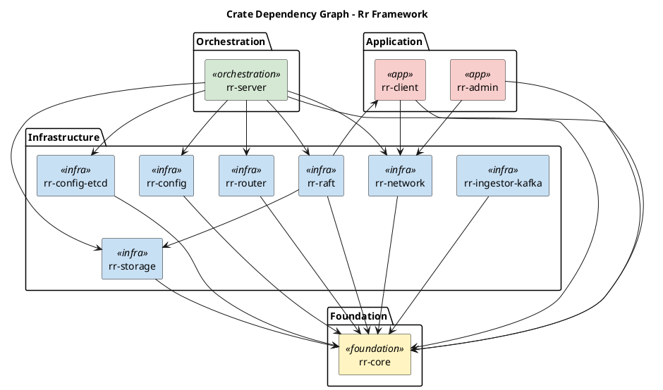

# Crate 依赖图 / Crate Dependency Map

:::info C4 对应视图 / C4 Counterparts
本页描述编译时 crate 依赖；可部署单元见 [**C4 Container 图**](./c4/containers.md)，crate 内部结构见：

This page describes compile-time crate dependencies. For deployable units, see the [**C4 Container diagram**](./c4/containers.md); for crate internals, see:

- rr-server → [c4/components-server.md](./c4/components-server.md)
- rr-raft → [c4/components-raft.md](./c4/components-raft.md)
- rr-router + rr-config → [c4/components-router.md](./c4/components-router.md)
- rr-network → [c4/components-network.md](./c4/components-network.md)
:::

## 依赖关系 / Dependency Graph

依赖按层划分，图中无循环依赖。

Dependencies are layered, with no cycles in this graph.

## Crate 说明 / Crate Details

| Crate | 层级 / Layer | 用途与关键类型 / Purpose and Key Types |
| :--- | :--- | :--- |
| `rr-core` | 基础 Foundation | 错误、核心 trait 和公共类型：`RrError`, `NodeId`, `GroupId`, `Service`, `StateMachine`, `StorageEngine`, `ConfigProvider`。 Errors, core traits, and shared types: `RrError`, `NodeId`, `GroupId`, `Service`, `StateMachine`, `StorageEngine`, `ConfigProvider`. |
| `rr-config` | 基础设施 Infrastructure | 内存配置提供者：`MemConfigProvider`。 In-memory configuration provider: `MemConfigProvider`. |
| `rr-config-etcd` | 基础设施 Infrastructure | 只读 etcd 配置、路由读取与 watch：`EtcdConfigProvider`。 Read-only etcd configuration, routing reads, and watches: `EtcdConfigProvider`. |
| `rr-storage` | 基础设施 Infrastructure | 内存与 RocksDB 后端：`MemStorage`、`RocksStorage`（`rocks` feature）。 Memory and RocksDB backends: `MemStorage` and `RocksStorage` (`rocks` feature). |
| `rr-raft` | 基础设施 Infrastructure | 基于 openraft 的共识引擎：`RaftGroupManager`, `RaftNode`, `RrTypeConfig`。 openraft-based consensus: `RaftGroupManager`, `RaftNode`, `RrTypeConfig`. |
| `rr-network` | 基础设施 Infrastructure | gRPC 传输：`RaftServiceImpl`, `ClientServiceImpl`, `ChannelPool`, `BearerInterceptor`, `RateLimitInterceptor`。 gRPC transport: `RaftServiceImpl`, `ClientServiceImpl`, `ChannelPool`, `BearerInterceptor`, `RateLimitInterceptor`. |
| `rr-router` | 基础设施 Infrastructure | 分片路由：`ShardRouter`。 Shard routing: `ShardRouter`. |
| `rr-ingestor-kafka` | 基础设施 Infrastructure | Kafka `CommandIngestor` 后端；默认仅内存 mock，真实后端需 `rdkafka` feature：`KafkaIngestor`, `MockKafkaIngestor`, `KafkaIngestorConfig`。 Kafka `CommandIngestor` backend; memory mock by default, real backend requires the `rdkafka` feature: `KafkaIngestor`, `MockKafkaIngestor`, `KafkaIngestorConfig`. |
| `rr-client` | 应用 Application | 客户端 SDK：`RrClient`, `RetryConfig`。 Client SDK: `RrClient`, `RetryConfig`. |
| `rr-admin` | 应用 Application | `AdminService` 运维客户端，支持备份、下线与重置；二进制 crate，无库类型。 Operations client for `AdminService`, including backup, decommission, and reset; binary crate with no library types. |
| `rr-server` | 编排 Orchestration | 节点生命周期管理：`RrNode`, `NodeConfig`。 Node lifecycle management: `RrNode`, `NodeConfig`. |

## 特性标志 / Feature Flags

- **`rocks`**：在 `rr-storage`、`rr-raft` 和 `rr-server` 中可用；`rr-server/rocks` 同时启用 `rr-storage/rocks` 与 `rr-raft/rocks`，提供 RocksDB 后端和 `RocksLogStorage`。 Available in `rr-storage`, `rr-raft`, and `rr-server`; `rr-server/rocks` forwards to `rr-storage/rocks` and `rr-raft/rocks`, enabling the RocksDB backend and `RocksLogStorage`.
- **`defensive`**：在 `rr-raft` 中可用，为日志存储增加一致性校验；也可在运行时设置 `RR_STORE_DEFENSIVE=on`，无需重新编译。 The `defensive` feature is available in `rr-raft` to add log-storage consistency checks; it can also be enabled at runtime with `RR_STORE_DEFENSIVE=on` without recompiling.

## 分层职责 / Layer Responsibilities

1. **基础层 / Foundation**：定义公共类型和 trait 契约。 Defines shared types and trait contracts.
2. **基础设施 / Infrastructure**：实现网络、共识、存储、路由和配置。 Implements networking, consensus, storage, routing, and configuration.
3. **编排层 / Orchestration**：把组件组装为服务节点。 Assembles components into a server node.
4. **应用层 / Application**：提供客户端和运维入口。 Provides client and operations entry points.
