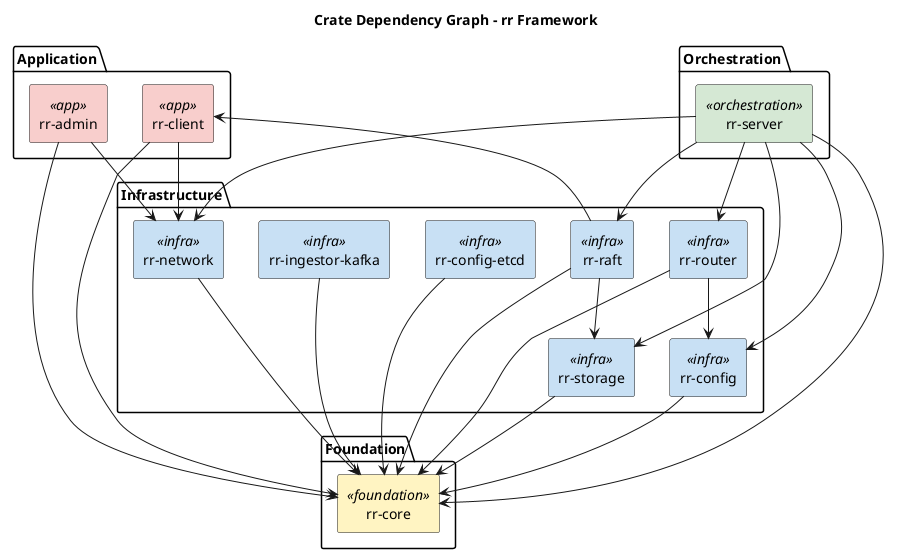

# Crate 依赖图 / Crate Dependency Map

:::info C4 对应视图 / C4 Counterparts
本页展示**编译时的 crate 依赖**（静态库依赖关系）。对应的**运行时部署视图**（哪些 crate 组成可部署单元）在 [**C4 Container 图**](./c4/containers.md) 中。每个 crate 的**内部组件结构**在 components-*.md 中：

This page shows **compile-time crate dependencies** (static library deps). The corresponding **runtime deployment view** (which crates form deployable units) lives in the [**C4 Container diagram**](./c4/containers.md). Each crate's **internal component structure** is in components-*.md:

- rr-server 内部 / internals → [c4/components-server.md](./c4/components-server.md)
- rr-raft 多组引擎 / multi-Raft engine → [c4/components-raft.md](./c4/components-raft.md)
- rr-router + rr-config → [c4/components-router.md](./c4/components-router.md)
- rr-network gRPC 传输层 / gRPC transport → [c4/components-network.md](./c4/components-network.md)
:::

## 依赖关系 / Dependency Graph

rr 采用分层架构，各个组件之间职责清晰，不存在循环依赖。

---

rr uses a layered architecture where each component has distinct responsibilities, and no circular dependencies exist.

## Crate 详细说明 / Crate Details

| Crate | 层级 / Layer | 用途 / Purpose | 关键类型 / Key Types |
| :--- | :--- | :--- | :--- |
| **rr-core** | 基础层 / Foundation | 错误类型、核心 Trait 和公共类型。 | RrError, NodeId, GroupId, Service, StateMachine, StorageEngine, ConfigProvider |
| **rr-config** | 基础设施 / Infrastructure | 基于内存的配置提供者实现。 | MemConfigProvider |
| **rr-config-etcd** | 基础设施 / Infrastructure | 基于 etcd 的配置提供者（只读：路由表读取与变更 watch）。 | EtcdConfigProvider |
| **rr-storage** | 基础设施 / Infrastructure | 存储引擎实现（内存及 RocksDB）。 | MemStorage, RocksStorage (开启 `rocks` 特性时) |
| **rr-raft** | 基础设施 / Infrastructure | 基于 openraft 的共识引擎。 | RaftGroupManager, RaftNode, RrTypeConfig |
| **rr-network** | 基础设施 / Infrastructure | 基于 gRPC 的网络传输层。 | RaftServiceImpl, ClientServiceImpl, ChannelPool, BearerInterceptor, RateLimitInterceptor |
| **rr-router** | 基础设施 / Infrastructure | 处理分片到节点的路由逻辑。 | ShardRouter |
| **rr-ingestor-kafka** | 基础设施 / Infrastructure | Kafka 命令摄入（`CommandIngestor`）后端；默认仅含内存 mock，真实后端需开启 `rdkafka` 特性。 | KafkaIngestor, MockKafkaIngestor, KafkaIngestorConfig |
| **rr-client** | 应用层 / Application | 客户端 SDK。 | RrClient, RetryConfig |
| **rr-admin** | 应用层 / Application | 运维 CLI（AdminService 的 gRPC 客户端），支持备份、节点下线与重置等。 | 二进制 crate（无库类型） |
| **rr-server** | 编排层 / Orchestration | 顶层节点的生命周期管理。 | RrNode, NodeConfig |

## 特性标志 / Feature Flags

rr 提供了灵活的特性标志（Feature Flags）来控制依赖：

- **`rocks` 特性**: 在 `rr-storage`、`rr-raft` 和 `rr-server` 中可用（`rr-server` 的 `rocks` 等价于同时开启 `rr-storage/rocks` 与 `rr-raft/rocks`）。启用后，支持使用 RocksDB 作为持久化存储后端，并提供 RocksDB 驱动的 Raft 日志存储（`RocksLogStorage`）。
- **`defensive` 特性**: 在 `rr-raft` 中可用。启用后为日志存储增加防御性一致性校验；不重新编译也可以在运行时通过环境变量 `RR_STORE_DEFENSIVE=on` 开启。

---

rr provides flexible feature flags to control dependencies:

- **`rocks` feature**: Available in `rr-storage`, `rr-raft`, and `rr-server` (rr-server's `rocks` simply forwards to `rr-storage/rocks` and `rr-raft/rocks`). When enabled, it allows using RocksDB as a persistent storage backend and provides RocksDB-backed Raft log storage (`RocksLogStorage`).
- **`defensive` feature**: Available in `rr-raft`. Adds defensive consistency checks to log storage; it can also be turned on at runtime via the `RR_STORE_DEFENSIVE=on` environment variable without recompiling.

## 分层架构描述 / Layering Description

1. **基础层 (Foundation)**: 提供整个框架的“语言”，定义了所有组件必须遵循的契约（Trait）。
2. **基础设施 (Infrastructure)**: 实现了具体的底层服务，如网络传输、共识协议和存储引擎。
3. **编排层 (Orchestration)**: 将各个基础设施组件组装在一起，形成一个完整的服务节点。
4. **应用层 (Application)**: 为外部使用者提供简洁的 API 接口，用于与分布式集群交互。

---

1. **Foundation**: Provides the "language" of the framework, defining contracts (Traits) that all components must follow.
2. **Infrastructure**: Implements specific low-level services such as network transport, consensus protocol, and storage engine.
3. **Orchestration**: Assembles infrastructure components into a complete service node.
4. **Application**: Provides clean API interfaces for external users to interact with the distributed cluster.
