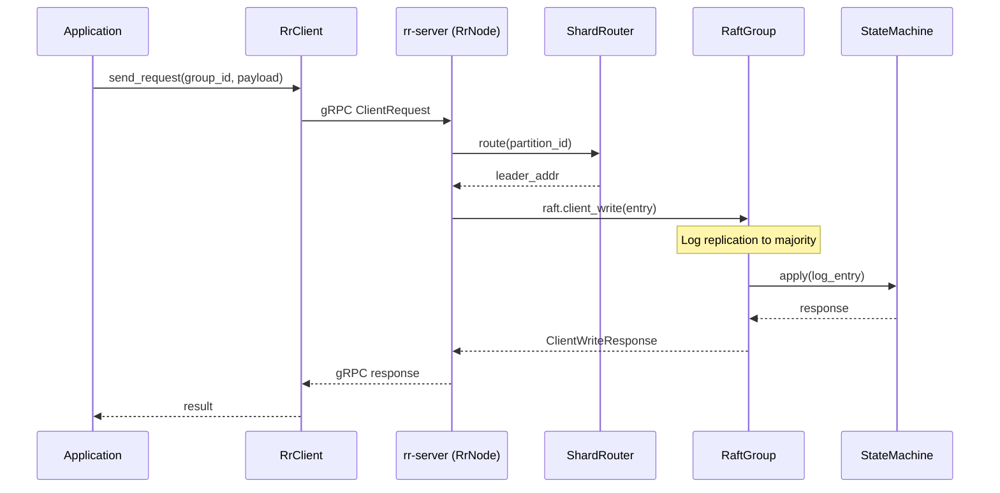
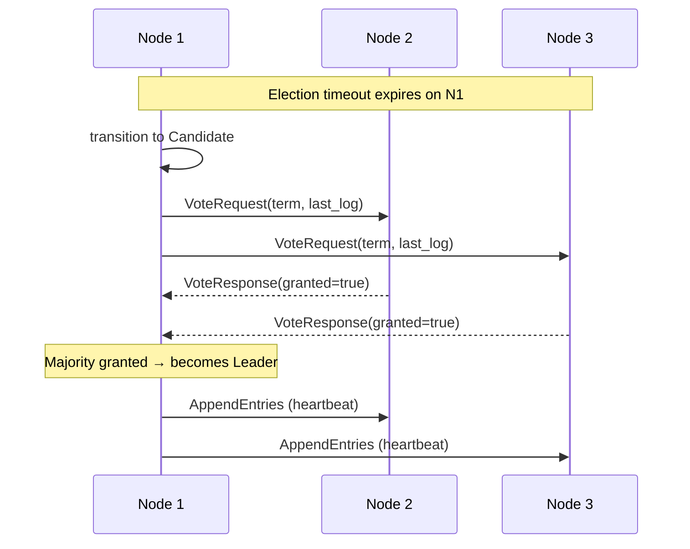
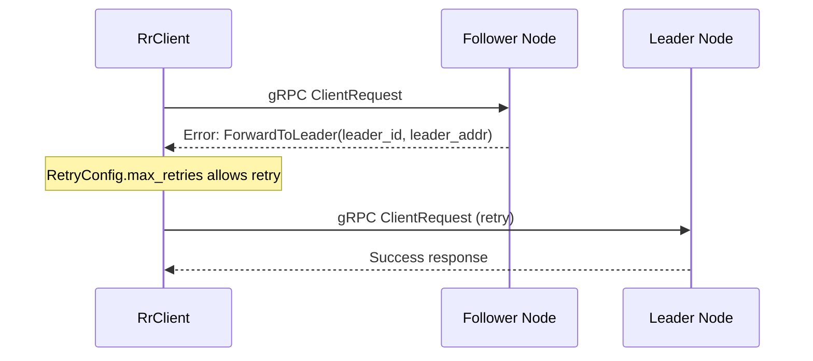

# 数据流 / Data Flow

本页详细介绍了 `rr` 框架中的核心数据流，包括写请求的生命周期、领导者选举流程以及错误处理机制。

This page details the core data flows within the `rr` framework, including the write request lifecycle, leader election process, and error handling mechanisms.

## 写请求生命周期 / Write Request Lifecycle

`rr` 中的写请求遵循从客户端到 Raft 组再到状态机的完整路径。客户端 SDK 负责初始路由和重试，而服务端节点负责将请求分发到正确的 Raft 实例。

Write requests in `rr` follow a complete path from the client to the Raft group and finally to the state machine. The client SDK handles initial routing and retries, while the server node dispatches requests to the correct Raft instance.

### 核心步骤 / Core Steps

1.  **客户端发起 / Client Initiation**: 应用程序调用 `RrClient::send_request`。
2.  **gRPC 传输 / gRPC Transport**: 请求通过 gRPC 发送到 `rr-server` 的 `ClientServiceImpl`。
3.  **路由分发 / Routing & Dispatch**: `ClientDispatchImpl` 使用 `ShardRouter` 根据分区 ID 确定目标 Raft 组。
4.  **Raft 写入 / Raft Write**: 请求被提交到 `openraft` 实例进行日志复制。
5.  **状态机应用 / State Machine Apply**: 一旦日志在多数节点上达成共识，`RrStateMachine` 就会调用用户定义的 `StateMachine::apply`。

---

1.  **Client Initiation**: The application calls `RrClient::send_request`.
2.  **gRPC Transport**: The request is sent via gRPC to `ClientServiceImpl` on an `rr-server`.
3.  **Routing & Dispatch**: `ClientDispatchImpl` uses `ShardRouter` to determine the target Raft group based on the partition ID.
4.  **Raft Write**: The request is submitted to the `openraft` instance for log replication.
5.  **State Machine Apply**: Once the log reaches consensus on a majority of nodes, `RrStateMachine` calls the user-defined `StateMachine::apply`.

## 领导者选举流程 / Leader Election Flow

`rr` 依靠底层 Raft 协议进行自动领导者选举。当现有领导者失效或任期超时时，集群会自动选出新的领导者以确保高可用性。

`rr` relies on the underlying Raft protocol for automatic leader election. When an existing leader fails or a term timeouts, the cluster automatically elects a new leader to ensure high availability.

### 选举机制 / Election Mechanism

*   **触发 / Trigger**: 节点在预定义的选举超时内未收到心跳。
*   **投票 / Voting**: 候选者向集群成员发起 `VoteRequest`。
*   **获胜 / Winning**: 获得多数票的候选者成为新的领导者，并开始发送心跳。

---

*   **Trigger**: A node does not receive heartbeats within a predefined election timeout.
*   **Voting**: The candidate issues a `VoteRequest` to cluster members.
*   **Winning**: The candidate that receives a majority of votes becomes the new leader and starts sending heartbeats.

## 领导者转发机制 / ForwardToLeader Error Handling

当客户端向非领导者节点发送写请求时，`rr` 使用重定向机制。服务端会返回当前已知的领导者信息，客户端 SDK 负责自动更新缓存并重试。

`rr` uses a redirection mechanism when a client sends a write request to a non-leader node. The server returns information about the currently known leader, and the client SDK automatically updates its cache and retries.

### 处理流程 / Handling Process

1.  **非领导者接收 / Non-leader Receipt**: 跟随者节点收到写请求。
2.  **返回重定向 / Return Redirect**: `openraft` 返回 `ForwardToLeader` 错误，包含领导者 ID 和地址。
3.  **客户端重试 / Client Retry**: `RrClient` 捕获该响应，更新本地领导者缓存，并向正确的地址重新发起请求。

---

1.  **Non-leader Receipt**: A follower node receives a write request.
2.  **Return Redirect**: `openraft` returns a `ForwardToLeader` error containing the leader ID and address.
3.  **Client Retry**: `RrClient` catches this response, updates its local leader cache, and re-issues the request to the correct address.

## 读请求路径 / Read Request Path

在 `rr` 框架中，读请求通常也通过领导者节点。通过 Raft 协议，我们可以实现线性化读取（Linearizable Reads），确保读取到的是最新的提交数据。虽然某些配置下可以支持从跟随者节点进行本地读取，但这可能会导致读取到旧数据（Stale Reads）。

In the `rr` framework, read requests typically also go through the leader node. Through the Raft protocol, we can achieve Linearizable Reads, ensuring that the latest committed data is read. While some configurations may support local reads from follower nodes, this can lead to Stale Reads.
