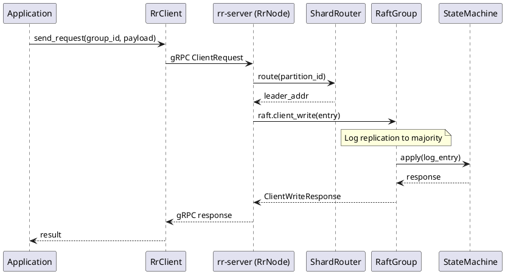
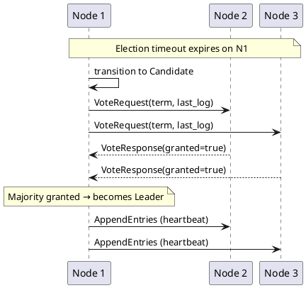
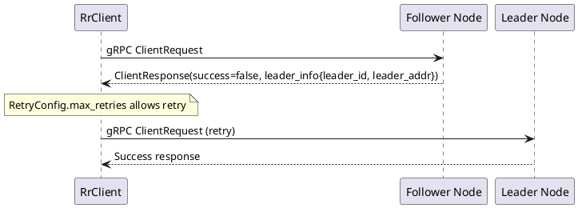
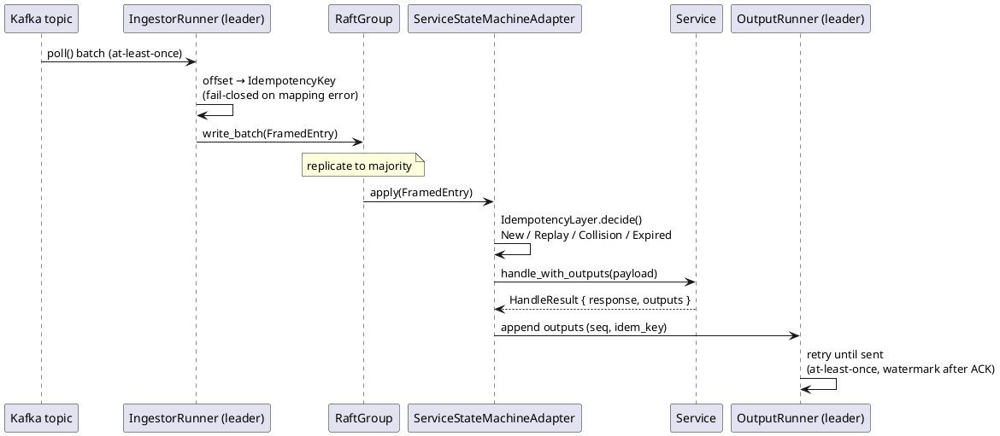

# 数据流 / Data Flow

:::tip C4 动态图 / C4 Dynamic Diagrams
本页给出核心时序；错误路径、幂等和多组并发等细节见：

This page shows the core sequences. For error paths, idempotency, and multi-group concurrency, see:

- [客户端 PUT + leader 重定向 / Client PUT with leader redirect](./c4/dynamic-put-request.md)
- [Raft 领导者选举 / Raft leader election](./c4/dynamic-leader-election.md)
- [快照传输 / Snapshot transfer](./c4/dynamic-snapshot-transfer.md)
- [分片路由解析 / Shard routing resolution](./c4/dynamic-shard-routing.md)
- [动态配置更新 / Dynamic config update](./c4/dynamic-config-update.md)
:::

## 写请求生命周期 / Write Request Lifecycle

客户端 SDK 负责发送和重试，服务端按分片路由到目标 Raft 组，提交日志后由状态机应用。

The client SDK sends requests and retries; the server routes each partition to its Raft group, replicates the log, and applies it to the state machine.

### 核心步骤 / Core Steps

1. **客户端 / Client**：应用调用 `RrClient::send_request`。 The application calls `RrClient::send_request`.
2. **传输 / Transport**：请求经 gRPC 到达 `ClientServiceImpl`。 The request reaches `ClientServiceImpl` over gRPC.
3. **路由 / Routing**：`ClientDispatchImpl` 通过 `ShardRouter` 按 partition ID 找到目标组。 `ClientDispatchImpl` uses `ShardRouter` to resolve the target group from the partition ID.
4. **复制 / Replication**：请求提交给 openraft 并复制到多数派。 The request is submitted to openraft and replicated to a majority.
5. **应用 / Apply**：日志提交后，`RrStateMachine` 调用用户状态机。 After commit, `RrStateMachine` invokes the user state machine.

## 领导者选举流程 / Leader Election Flow

leader 失效或选举超时时，Raft 自动选出新 leader。

Raft elects a new leader automatically when the current leader fails or an election timeout expires.

### 选举机制 / Election Mechanism

- **触发 / Trigger**：节点在选举超时内未收到心跳。 A node receives no heartbeat before its election timeout.
- **投票 / Voting**：candidate 向成员发送 `VoteRequest`。 The candidate sends `VoteRequest` to cluster members.
- **当选 / Election**：获得多数票的 candidate 成为 leader 并开始发送心跳。 A candidate with a majority becomes leader and starts heartbeats.

## 领导者重定向 / Leader Redirect

客户端向非 leader 写入时，服务端返回当前已知的 leader；SDK 更新缓存并重试。

When a client writes to a non-leader, the server returns the currently known leader; the SDK updates its cache and retries.

### 处理流程 / Handling Process

1. **接收 / Receipt**：follower 收到写请求。 A follower receives the write.
2. **重定向 / Redirect**：openraft 的 `client_write` 返回 `ForwardToLeader`；`ClientDispatchImpl` 将其转为正常 gRPC OK 响应，`ClientResponse.success=false`，并由 `leader_info{node_id, addr}` 携带 leader 信息。 Openraft's `client_write` returns `ForwardToLeader`; `ClientDispatchImpl` converts it to a normal gRPC OK response with `ClientResponse.success=false` and leader details in `leader_info{node_id, addr}`.
3. **重试 / Retry**：`RrClient` 更新 leader 缓存并向该地址重发请求。 `RrClient` updates its leader cache and retries against that address.

## 读请求路径 / Read Request Path

`ClientService` 提供两个读 RPC，SDK 接口分别为 `RrClient::read` 和 `RrClient::read_linearizable`。写入使用 `Request`；`GetClusterInfo` 返回运行时拓扑，但 leader 发现实际依赖重定向。

`ClientService` provides two read RPCs, exposed as `RrClient::read` and `RrClient::read_linearizable`. Writes use `Request`; `GetClusterInfo` returns runtime topology, but leader discovery relies on redirects.

- **ReadLocal / 本地读**：任意节点都可通过可选的 `StateMachineReader`（`StateMachine::read_handle`）读取本地副本。该路径绕过 Raft、延迟最低，但可能返回旧数据，且不做 leader 重定向。 Any node can read its local replica through the optional `StateMachineReader` (`StateMachine::read_handle`). This bypasses Raft and has the lowest latency, but can return stale data and does not redirect to a leader.
- **ReadLinearizable / 线性一致读**：服务端通过 ReadIndex 确认已提交位置，等待本地状态机追平后读取。非 leader 收到 `ForwardToLeader`，服务端将其展开为正常响应中的 `ReadLocalResponse.leader_info`，SDK 再向 leader 重试。 The server uses ReadIndex to confirm the committed position, waits for the local state machine to catch up, then reads. On a non-leader, `ForwardToLeader` is flattened into `ReadLocalResponse.leader_info` in a normal response, and the SDK retries against the leader.

## 幂等与摄入/输出流水线 / Idempotency and Ingest/Output Pipelines

除客户端写路径外，框架提供可选的幂等去重、Kafka 摄入和 output outbox。`FramedEntry` 贯穿日志条目，`FramedSnapshot` 贯穿快照；后者见 [durability.md](./durability.md)。使用说明见 [idempotency.md](../guide/idempotency.md) 和 [kafka-input.md](../guide/kafka-input.md)。

Beyond client writes, the framework offers opt-in idempotency, Kafka ingest, and an output outbox. `FramedEntry` wraps log entries and `FramedSnapshot` wraps snapshots; see [durability.md](./durability.md) for the latter. Usage is covered in [idempotency.md](../guide/idempotency.md) and [kafka-input.md](../guide/kafka-input.md).

### FramedEntry 信封 / FramedEntry Envelope

用户 payload 可包为 `FramedEntry { version, offset, idem_key, payload }`（`crates/rr-core/src/framed_entry.rs:43-55`），格式为 8 字节 magic `\0rrENT01` + bincode body。

A user payload can be wrapped as `FramedEntry { version, offset, idem_key, payload }` (`crates/rr-core/src/framed_entry.rs:43-55`), using an 8-byte `\0rrENT01` magic prefix plus a bincode body.

- **包裹 / Wrapping**：客户端携带 `IdempotencyKey` 时，`ClientDispatchImpl::submit_write` 编码 FramedEntry；未带 key 的请求原样透传，保留旧线格式（`crates/rr-server/src/dispatch.rs:64-75`）。ingestor runner 填写 `offset` 和派生的 `idem_key`。 When a client supplies `IdempotencyKey`, `ClientDispatchImpl::submit_write` encodes a FramedEntry; unkeyed requests pass through unchanged for wire compatibility (`crates/rr-server/src/dispatch.rs:64-75`). The ingestor runner supplies `offset` and a derived `idem_key`.
- **解包 / Unwrapping**：状态机适配器在 apply 时解包；无 magic 的条目按旧版裸 payload 处理。 The state-machine adapter unwraps during apply; entries without the magic prefix are treated as legacy raw payloads.
- **响应 / Response**：带 key 请求返回 `ApplyOutcome`；分发层解码并将 `IdempotencyExpired` 展平到 `ClientWriteResult.idem_error`（`dispatch.rs:79-103`）。 Keyed requests return `ApplyOutcome`; dispatch decodes it and flattens `IdempotencyExpired` into `ClientWriteResult.idem_error` (`dispatch.rs:79-103`).

### 幂等层 / Idempotency Layer

`ServiceStateMachineAdapter` 内的 `IdempotencyLayer` 按 `(request_type, request_id)` 去重（`crates/rr-raft/src/idempotency.rs:1-49`）。每个 request type 维护单调 watermark 和有界 LRU 响应缓存，判定为 New / Replay / Collision / Expired。缓存命中直接返回已存响应；id 不高于 watermark 且已被逐出时返回 Expired。

The `IdempotencyLayer` in `ServiceStateMachineAdapter` deduplicates by `(request_type, request_id)` (`crates/rr-raft/src/idempotency.rs:1-49`). Each request type has a monotonic watermark and bounded LRU response cache, producing New / Replay / Collision / Expired. A cache hit returns the stored response; an ID at or below the watermark after eviction returns Expired.

客户端使用 `RrClient::send_request_idempotent`（`crates/rr-client/src/lib.rs:475`）。Expired 映射为 `RrError::IdempotencyExpired { request_type, request_id, watermark }`（`lib.rs:572-584`），调用方须用更大的 `request_id` 重试。缓存默认 10_000 条，可通过 `ServiceStateMachineAdapter::with_idempotency_capacity` 调整（`crates/rr-raft/src/service_adapter.rs:199`）。

Clients call `RrClient::send_request_idempotent` (`crates/rr-client/src/lib.rs:475`). Expired becomes `RrError::IdempotencyExpired { request_type, request_id, watermark }` (`lib.rs:572-584`), and the caller must retry with a larger `request_id`. The cache defaults to 10_000 entries and is tunable through `ServiceStateMachineAdapter::with_idempotency_capacity` (`crates/rr-raft/src/service_adapter.rs:199`).

### Kafka 摄入 / Kafka Ingest

实现 `CommandIngestor`（`crates/rr-core/src/ingestor.rs:66`：`poll` / `seek` / `commit_applied`，offset 经 bincode 类型擦除）即可接入命令流；`rr-ingestor-kafka` 是参考实现。runner 监听 openraft metrics，仅在本节点为 leader 时 poll，下台即停；follower 通过日志复制获得数据（`crates/rr-raft/src/ingestor_runner.rs`）。

Implement `CommandIngestor` (`crates/rr-core/src/ingestor.rs:66`: `poll` / `seek` / `commit_applied`, with bincode-erased offsets) to connect a command stream; `rr-ingestor-kafka` is the reference implementation. The runner watches openraft metrics and polls only while the local node is leader; followers receive data through log replication (`crates/rr-raft/src/ingestor_runner.rs`).

通过 `RaftGroupManager::attach_ingestor_with_auto_idempotency`（`crates/rr-raft/src/group_manager.rs:561`）接入时，`offset_to_request_id` 将消息 offset 映射为幂等键：Kafka at-least-once + 框架去重 = exactly-once apply（ADR A-0001）。映射失败时 fail-closed：不 propose、不提交 offset，supervisor 退出（ADR A-0011 C7）。

When attached through `RaftGroupManager::attach_ingestor_with_auto_idempotency` (`crates/rr-raft/src/group_manager.rs:561`), `offset_to_request_id` maps each message offset to an idempotency key: Kafka at-least-once plus framework dedup yields exactly-once apply (ADR A-0001). Mapping failure is fail-closed: no proposal, no offset commit, and the supervisor exits (ADR A-0011 C7).

### 输出 Outbox / Output Outbox

`Service::handle_with_outputs`（`crates/rr-core/src/service.rs:152`）让 apply 同时返回响应和 `Output` 列表；目标可为另一 rr 组的 `RaftWrite` 或 Kafka 的 `KafkaPublish`。框架为每个 output 分配单调 `seq` 和幂等键。leader-only output runner（`crates/rr-raft/src/output_runner.rs`）负责投递，失败按指数退避无限重试，不静默丢弃；`sent_watermark` 仅在确认发送后推进。outbox 随快照复制，新 leader 从 watermark 续发。

`Service::handle_with_outputs` (`crates/rr-core/src/service.rs:152`) lets apply return both a response and `Output`s targeting another rr group (`RaftWrite`) or Kafka (`KafkaPublish`). The framework assigns each output a monotonic `seq` and idempotency key. A leader-only output runner (`crates/rr-raft/src/output_runner.rs`) retries failures forever with exponential backoff and never silently drops them; `sent_watermark` advances only after confirmed delivery. The outbox replicates in snapshots, so a new leader resumes from the watermark.

