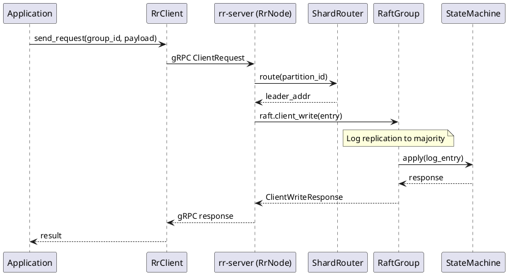
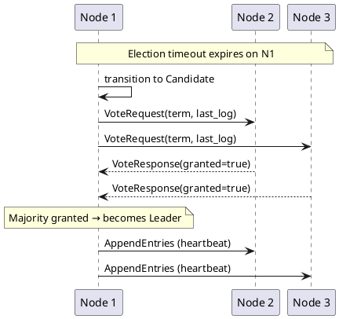
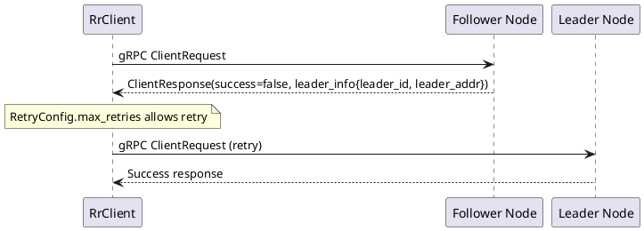
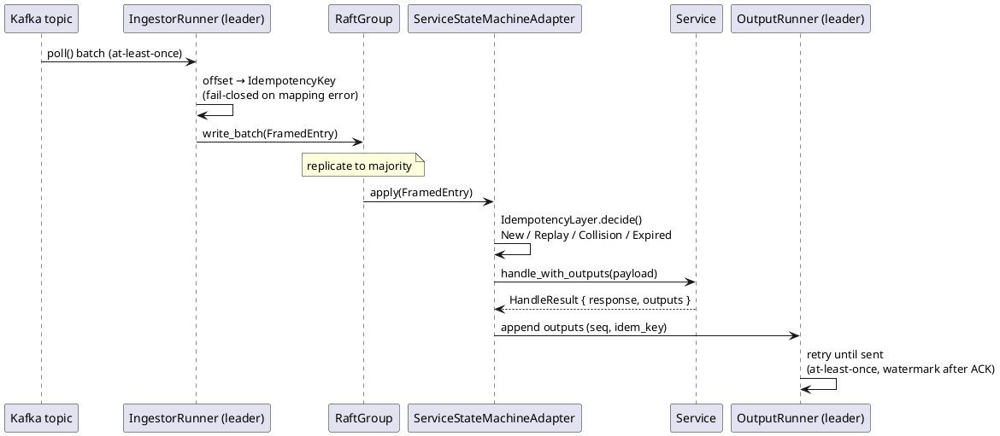

# 数据流 / Data Flow

:::tip 更详细的 C4 动态图 / Detailed C4 Dynamic Diagrams
本页以时序图形式介绍核心数据流。若需要更完整的流程分析（包括错误路径、幂等性、多组并发等），请查看 C4 Dynamic 图：

This page introduces core data flows via sequence diagrams. For more thorough analyses (error paths, idempotency, multi-group concurrency), see the C4 Dynamic diagrams:

- 客户端 PUT + leader 重定向 / Client PUT with leader redirect → [c4/dynamic-put-request.md](./c4/dynamic-put-request.md)
- Raft 领导者选举 / Raft leader election → [c4/dynamic-leader-election.md](./c4/dynamic-leader-election.md)
- 快照传输 / Snapshot transfer → [c4/dynamic-snapshot-transfer.md](./c4/dynamic-snapshot-transfer.md)
- 分片路由解析 / Shard routing resolution → [c4/dynamic-shard-routing.md](./c4/dynamic-shard-routing.md)
- 动态配置更新 / Dynamic config update → [c4/dynamic-config-update.md](./c4/dynamic-config-update.md)
:::

本页详细介绍了 `rr` 框架中的核心数据流，包括写请求的生命周期、领导者选举流程以及错误处理机制。

This page details the core data flows within the `rr` framework, including the write request lifecycle, leader election process, and error handling mechanisms.

## 写请求生命周期 / Write Request Lifecycle

`rr` 中的写请求遵循从客户端到 Raft 组再到状态机的完整路径。客户端 SDK 负责初始路由和重试，而服务端节点负责将请求分发到正确的 Raft 实例。

Write requests in `rr` follow a complete path from the client to the Raft group and finally to the state machine. The client SDK handles initial routing and retries, while the server node dispatches requests to the correct Raft instance.

### 核心步骤 / Core Steps

1.  **客户端发起 / Client Initiation**: 应用程序调用 `RrClient::send_request`。
2.  **gRPC 传输 / gRPC Transport**: 请求通过 gRPC 发送到 `rr-server` 的 `ClientServiceImpl`。
3.  **路由分发 / Routing & Dispatch**: `ClientDispatchImpl` 使用 `ShardRouter` 根据分区 ID 确定目标 Raft 组。
4.  **Raft 写入 / Raft Write**: 请求被提交到 `openraft` 实例进行日志复制。
5.  **状态机应用 / State Machine Apply**: 一旦日志在多数节点上达成共识，`RrStateMachine` 就会调用用户定义的 `StateMachine::apply`。

---

1.  **Client Initiation**: The application calls `RrClient::send_request`.
2.  **gRPC Transport**: The request is sent via gRPC to `ClientServiceImpl` on an `rr-server`.
3.  **Routing & Dispatch**: `ClientDispatchImpl` uses `ShardRouter` to determine the target Raft group based on the partition ID.
4.  **Raft Write**: The request is submitted to the `openraft` instance for log replication.
5.  **State Machine Apply**: Once the log reaches consensus on a majority of nodes, `RrStateMachine` calls the user-defined `StateMachine::apply`.

## 领导者选举流程 / Leader Election Flow

`rr` 依靠底层 Raft 协议进行自动领导者选举。当现有领导者失效或任期超时时，集群会自动选出新的领导者以确保高可用性。

`rr` relies on the underlying Raft protocol for automatic leader election. When an existing leader fails or a term timeouts, the cluster automatically elects a new leader to ensure high availability.

### 选举机制 / Election Mechanism

*   **触发 / Trigger**: 节点在预定义的选举超时内未收到心跳。
*   **投票 / Voting**: 候选者向集群成员发起 `VoteRequest`。
*   **获胜 / Winning**: 获得多数票的候选者成为新的领导者，并开始发送心跳。

---

*   **Trigger**: A node does not receive heartbeats within a predefined election timeout.
*   **Voting**: The candidate issues a `VoteRequest` to cluster members.
*   **Winning**: The candidate that receives a majority of votes becomes the new leader and starts sending heartbeats.

## 领导者重定向机制 / Leader Redirect Mechanism

当客户端向非领导者节点发送写请求时，`rr` 使用重定向机制。服务端会返回当前已知的领导者信息，客户端 SDK 负责自动更新缓存并重试。

`rr` uses a redirection mechanism when a client sends a write request to a non-leader node. The server returns information about the currently known leader, and the client SDK automatically updates its cache and retries.

### 处理流程 / Handling Process

1.  **非领导者接收 / Non-leader Receipt**: 跟随者节点收到写请求。
2.  **返回重定向 / Return Redirect**: openraft 的 `client_write` 在内部返回 `ForwardToLeader` 错误；分发层（`ClientDispatchImpl`）将其转换为**正常响应**——gRPC 状态仍为 OK，`ClientResponse` 中 `success=false`，并由 `leader_info{node_id, addr}` 字段携带领导者 ID 和地址。
3.  **客户端重试 / Client Retry**: `RrClient` 捕获该响应，更新本地领导者缓存，并向正确的地址重新发起请求。

---

1.  **Non-leader Receipt**: A follower node receives a write request.
2.  **Return Redirect**: openraft's `client_write` internally returns a `ForwardToLeader` error; the dispatch layer (`ClientDispatchImpl`) converts it into a **normal response** — the gRPC status stays OK, and the `ClientResponse` carries `success=false` with the leader's ID and address in the `leader_info{node_id, addr}` field.
3.  **Client Retry**: `RrClient` catches this response, updates its local leader cache, and re-issues the request to the correct address.

## 读请求路径 / Read Request Path

`ClientService` 提供两个专门的读 RPC（写请求走 `Request`；另有 `GetClusterInfo` 返回集群拓扑——group/leader/副本均来自 raft 运行时，客户端实际通过重定向发现领导者），客户端 SDK 侧对应 `RrClient::read` 和 `RrClient::read_linearizable`：

- **ReadLocal（本地读）**：任何节点都可以直接用自己的本地状态机副本服务读取——状态机通过可选的 `StateMachineReader` 读句柄（`StateMachine::read_handle`）暴露读取能力。该路径完全绕过 Raft 共识，延迟最低，但可能读到旧数据（Stale Reads），且不做领导者重定向。
- **ReadLinearizable（线性化读）**：服务端通过 openraft 的 ReadIndex 确认领导者已提交的位置，等待本地状态机 apply 到该位置后再执行读取，保证读到最新提交的数据。若收到请求的节点不是领导者，openraft 返回 `ForwardToLeader`，服务端将其展开为正常响应中的 `ReadLocalResponse.leader_info` 字段（与写路径相同的重定向方式），SDK 自动向领导者地址重试。

`ClientService` exposes two dedicated read RPCs (writes go through `Request`; `GetClusterInfo` returns cluster topology with group/leader/replica fields sourced from the raft runtime, though clients discover leaders via redirects), mapped to `RrClient::read` and `RrClient::read_linearizable` on the client SDK:

- **ReadLocal (local read)**: Any node can serve the read directly from its local state machine replica — the state machine exposes read capability via the optional `StateMachineReader` handle (`StateMachine::read_handle`). This path bypasses Raft consensus entirely, has the lowest latency, but may return stale data, and performs no leader redirect.
- **ReadLinearizable (linearizable read)**: The server confirms the leader's committed position via openraft's ReadIndex, waits until the local state machine has applied through that point, then serves the read — guaranteeing the latest committed data. If the contacted node is not the leader, openraft returns `ForwardToLeader`; the server flattens it into the `ReadLocalResponse.leader_info` field of a normal response (the same redirect mechanism as the write path), and the SDK automatically retries against the leader's address.

## 框架幂等与摄入/输出流水线 / Framework Idempotency & Ingest/Output Pipelines

除"客户端 → Raft 日志 → 状态机"的主写路径外，框架还有三条可选流水线：**幂等去重**、**Kafka 摄入**、**output outbox**。它们由两个信封格式贯穿——日志条目层的 `FramedEntry` 与快照层的 `FramedSnapshot`（后者见 [durability.md](./durability.md)）。使用层面的文档见 [../guide/idempotency.md](../guide/idempotency.md) 与 [../guide/kafka-input.md](../guide/kafka-input.md)。

---

Beyond the main "client → Raft log → state machine" write path, the framework has three opt-in pipelines: **idempotent dedup**, **Kafka ingest**, and the **output outbox**. Two envelope formats thread through them — `FramedEntry` at the log-entry layer and `FramedSnapshot` at the snapshot layer (the latter in [durability.md](./durability.md)). Usage-level docs: [../guide/idempotency.md](../guide/idempotency.md) and [../guide/kafka-input.md](../guide/kafka-input.md).

### FramedEntry 信封 / The FramedEntry envelope

提交给 openraft 的用户 payload 可选地包一层 `FramedEntry { version, offset, idem_key, payload }`（`crates/rr-core/src/framed_entry.rs:43-55`；8 字节 magic `\0rrENT01` + bincode body）：

- **包裹（wrap）**在分发层完成：`ClientDispatchImpl::submit_write` 在客户端携带 `IdempotencyKey` 时把 payload 编码为 FramedEntry；**未带 key 的请求原样透传**，保持旧版线格式兼容（`crates/rr-server/src/dispatch.rs:64-75`）。ingestor 路径由 runner 写入 `offset` 与自动派生的 `idem_key`。
- **解包（unwrap）**在状态机适配器的 apply 路径完成：无 magic 前缀的条目按遗留裸 payload 处理。
- **响应侧**：带 key 请求的 apply 结果包成 `ApplyOutcome` 信封，分发层解码后把 `IdempotencyExpired` 展平到 `ClientWriteResult.idem_error`（`dispatch.rs:79-103`）。

---

User payloads submitted to openraft are optionally wrapped in a `FramedEntry { version, offset, idem_key, payload }` (`crates/rr-core/src/framed_entry.rs:43-55`; an 8-byte magic `\0rrENT01` + bincode body):

- **Wrapping** happens at the dispatch layer: `ClientDispatchImpl::submit_write` encodes the payload as a FramedEntry when the client supplied an `IdempotencyKey`; **unkeyed requests pass through verbatim**, preserving the legacy wire format (`crates/rr-server/src/dispatch.rs:64-75`). On the ingestor path the runner fills in `offset` and an auto-derived `idem_key`.
- **Unwrapping** happens in the state-machine adapter's apply path: entries without the magic prefix are treated as legacy raw payloads.
- **Response side**: a keyed request's apply result is wrapped in an `ApplyOutcome` envelope; the dispatch layer decodes it and flattens `IdempotencyExpired` into `ClientWriteResult.idem_error` (`dispatch.rs:79-103`).

### 幂等层 / The idempotency layer

apply 时，`ServiceStateMachineAdapter` 内的 `IdempotencyLayer` 按 `(request_type, request_id)` 去重（`crates/rr-raft/src/idempotency.rs:1-49`）：每个 request_type 维护单调 watermark，配一个有界 LRU 响应缓存；四路判定 **New / Replay / Collision / Expired**——缓存命中直接返回已存响应（不重复调用用户 `Service`），id 低于 watermark 且已被逐出则判定 Expired。客户端入口是 `RrClient::send_request_idempotent`（`crates/rr-client/src/lib.rs:475`）；被判 Expired 时 SDK 返回 `RrError::IdempotencyExpired { request_type, request_id, watermark }`（`lib.rs:572-584`），调用方需换更大的 `request_id` 重试。缓存容量默认 10_000 条，可用 `ServiceStateMachineAdapter::with_idempotency_capacity` 调整（`crates/rr-raft/src/service_adapter.rs:199`）。

---

At apply time, the `IdempotencyLayer` inside `ServiceStateMachineAdapter` dedups on `(request_type, request_id)` (`crates/rr-raft/src/idempotency.rs:1-49`): a monotonic watermark per request_type plus a bounded LRU response cache drives a four-way decision — **New / Replay / Collision / Expired**. A cache hit returns the stored response without re-invoking the user `Service`; an id at or below the watermark that has been evicted is judged Expired. The client entry point is `RrClient::send_request_idempotent` (`crates/rr-client/src/lib.rs:475`); on Expired the SDK returns `RrError::IdempotencyExpired { request_type, request_id, watermark }` (`lib.rs:572-584`) and the caller must retry with a larger `request_id`. Cache capacity defaults to 10_000 entries, tunable via `ServiceStateMachineAdapter::with_idempotency_capacity` (`crates/rr-raft/src/service_adapter.rs:199`).

### Kafka 摄入（CommandIngestor）/ Kafka ingest (CommandIngestor)

用户实现 `CommandIngestor` trait（`crates/rr-core/src/ingestor.rs:66`：`poll` / `seek` / `commit_applied`，offset 类型经 bincode 类型擦除）即可把任意命令流接进 Raft 组；`rr-ingestor-kafka` 是参考实现。消费是 **leader 独占** 的：ingestor runner 监听 openraft metrics，当选 leader 才启动 poll 循环、下台即停（`crates/rr-raft/src/ingestor_runner.rs`），follower 全部经日志复制获得数据。通过 `RaftGroupManager::attach_ingestor_with_auto_idempotency`（`crates/rr-raft/src/group_manager.rs:561`）接入时，runner 用 `offset_to_request_id` 把每条消息的 offset 映射为幂等键——**Kafka at-least-once + 框架去重 = exactly-once apply**（ADR A-0001）；映射失败则 fail-closed：不 propose、不提交 offset、supervisor 退出（ADR A-0011 C7）。

---

Implementing the `CommandIngestor` trait (`crates/rr-core/src/ingestor.rs:66`: `poll` / `seek` / `commit_applied`, with the offset type erased via bincode) plugs any command stream into a Raft group; `rr-ingestor-kafka` is the reference implementation. Consumption is **leader-exclusive**: the ingestor runner watches openraft metrics, starting its poll loop only while this node is leader and stopping on step-down (`crates/rr-raft/src/ingestor_runner.rs`); followers receive everything via log replication. When attached via `RaftGroupManager::attach_ingestor_with_auto_idempotency` (`crates/rr-raft/src/group_manager.rs:561`), the runner maps each message's offset to an idempotency key via `offset_to_request_id` — **Kafka at-least-once + framework dedup = exactly-once apply** (ADR A-0001); mapping failures are fail-closed: no propose, no offset commit, supervisor exits (ADR A-0011 C7).

### Output outbox

`Service::handle_with_outputs`（`crates/rr-core/src/service.rs:152`）让一次 apply 除了响应字节还能产生 `Output` 列表（目标为 `RaftWrite`——写另一个 rr 组，或 `KafkaPublish`——发 Kafka topic）。框架为每个 output 填单调 `seq` 与幂等键；leader-only 的 output runner（`crates/rr-raft/src/output_runner.rs`）负责投递：失败按指数退避**无限重试、绝不静默丢弃**，`sent_watermark` 只在确认发送后推进；outbox 状态随快照复制，leader 切换后新 leader 从 watermark 续发。

---

`Service::handle_with_outputs` (`crates/rr-core/src/service.rs:152`) lets one apply produce a list of `Output`s alongside the response bytes (targets: `RaftWrite` — write to another rr group, or `KafkaPublish` — publish to a Kafka topic). The framework stamps each output with a monotonic `seq` and an idempotency key; the leader-only output runner (`crates/rr-raft/src/output_runner.rs`) handles delivery: failures retry with exponential backoff **forever and are never silently dropped**, and the `sent_watermark` advances only after confirmed sends; outbox state rides snapshots so a new leader resumes from the watermark.

