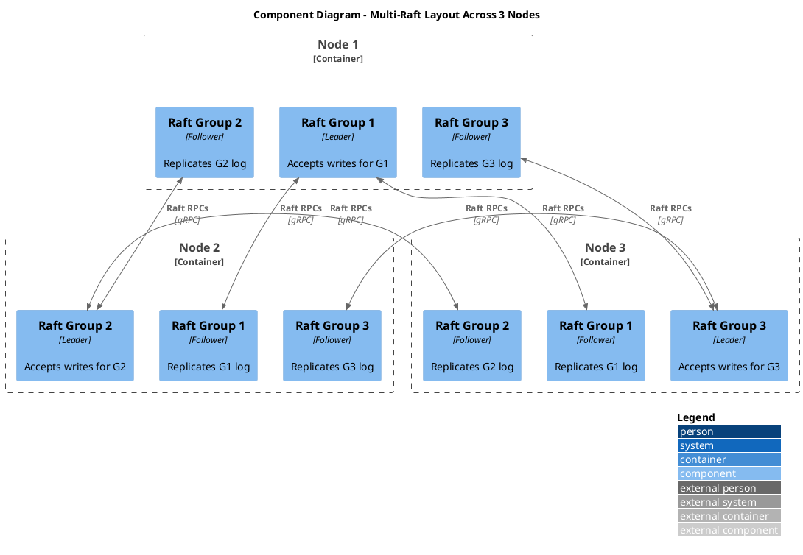

# 多 Raft 架构 / Multi-Raft Architecture

:::info C4 对应视图 / C4 Counterparts
- rr-raft 内部组件（RaftGroupManager、适配器层、LogStorage）/ rr-raft internals (RaftGroupManager, adapters, LogStorage) → [**c4/components-raft.md**](./c4/components-raft.md)
- 选举流程视觉化 / Election flow → [**c4/dynamic-leader-election.md**](./c4/dynamic-leader-election.md)
:::

## 什么是多 Raft / What is Multi-Raft

在 rr 框架中，Multi-Raft 是指在单个物理节点上同时运行多个独立的 Raft 共识组（RaftGroup）。每个 Raft 组负责管理集群中特定分片的数据。这种架构相比单 Raft 组具有更高的扩展性和并发处理能力。

每个 Raft 组都是完全独立的：
- **独立选举**：一个组的领导者选举不会影响其他组。
- **故障隔离**：如果某个 Raft 组因多数派不可用而停止工作，其他组仍能正常运行。
- **并行同步**：不同组的日志复制和状态机应用过程是并行的，能够充分利用多核 CPU。

---

In the rr framework, Multi-Raft refers to running multiple independent Raft consensus groups (RaftGroup) on a single physical node. Each group manages a specific partition of the cluster's data. Compared to a single Raft group, this architecture provides better scalability and higher concurrency.

Each Raft group is completely independent:
- **Independent Election**: Leader election in one group does not affect others.
- **Failure Isolation**: If one group stops working due to quorum loss, other groups continue to function normally.
- **Parallel Sync**: Log replication and state machine application for different groups are processed in parallel, making full use of multi-core CPUs.

## 多组架构 / Multi-Group Architecture

下面的图示展示了三个节点如何承载三个不同的 Raft 组。每个组在不同的节点上可能处于不同的角色（Leader 或 Follower）。

The diagram below shows how three nodes host three different Raft groups. Each group may have different roles (Leader or Follower) on different nodes.

## 共识组管理器 / RaftGroupManager

`RaftGroupManager` 是 rr 中管理本地所有 Raft 组生命周期的核心组件。它维护了 `GroupId` 到 `RaftNode` 的映射，并提供了一系列 API 来动态控制这些组。

主要方法包括：
- `start_group(group_id)`：为指定的组 ID 创建并启动一个新的 Raft 节点。
- `init_cluster(group_id, members)`：初始化一个多节点集群。
- `stop_group(group_id)`：优雅地关闭并移除指定的 Raft 组。
- `group_ids()`：获取当前节点上所有活跃组的 ID 列表。
- `get_raft(group_id)`：获取底层 `openraft::Raft` 实例的句柄，用于直接操作（如提交建议）。

---

`RaftGroupManager` is the core component in rr that manages the lifecycle of all local Raft groups. It maintains a mapping from `GroupId` to `RaftNode` and provides a set of APIs to control these groups dynamically.

Key methods include:
- `start_group(group_id)`: Creates and starts a new Raft node for the specified group ID.
- `init_cluster(group_id, members)`: Initializes a multi-node cluster.
- `stop_group(group_id)`: Gracefully shuts down and removes the specified Raft group.
- `group_ids()`: Returns a list of all active group IDs on the current node.
- `get_raft(group_id)`: Retrieves a handle to the underlying `openraft::Raft` instance for direct operations (like proposing entries).

## 分片到组的映射 / Partition-to-Group Mapping

rr 通过路由表实现数据分片（Partition）到共识组（Group）的灵活映射。这种设计允许用户根据数据量和负载情况，动态地调整分片的归属。

- **PartitionConfig**：定义分片的范围或 ID 规则。
- **GroupMeta**：包含共识组的配置面元数据（副本成员列表）；leader 是 raft 运行时状态，由客户端经 redirect 发现。
- **RoutingTable**：维护 `PartitionId` 到 `GroupId` 的映射，以及 `NodeId` 到网络地址的映射。
- **ConfigProvider**：配置提供者接口，可以支持内存、文件或外部存储（如 etcd）作为配置源。

---

rr implements flexible mapping from data partitions (Partition) to consensus groups (Group) via a routing table. This design allows users to dynamically adjust partition ownership based on data volume and load.

- **PartitionConfig**: Defines partition ranges or ID rules.
- **GroupMeta**: Contains configuration-plane metadata for a consensus group (the replica member list); the leader is raft runtime state, discovered by clients via redirects.
- **RoutingTable**: Maintains mappings from `PartitionId` to `GroupId`, and from `NodeId` to network addresses.
- **ConfigProvider**: An interface for configuration providers, supporting memory, files, or external stores (like etcd) as sources.

## 与 openraft 的集成 / openraft Integration

rr 内部集成了 [openraft](https://docs.rs/openraft)，并针对多组场景进行了适配。

- **RrTypeConfig**：通过 `declare_raft_types!` 宏定义，统一了 rr 内部使用的 NodeId (u64)、日志类型和状态机类型。
- **RaftNode**：包装了 `openraft::Raft<RrTypeConfig>`，并结合了 `RrLogStorage` 和 `RrStateMachine`。
- **适配器模式**：通过 `RrStateMachine` 适配器，将 rr 定义的业务状态机与 openraft 的存储接口连接起来。

更多关于 Raft 协议本身的细节，请参考 [Raft 论文](https://raft.github.io/raft.pdf)。

---

rr integrates [openraft](https://docs.rs/openraft) internally and adapts it for multi-group scenarios.

- **RrTypeConfig**: Defined via the `declare_raft_types!` macro, it unifies the NodeId (u64), log types, and state machine types used within rr.
- **RaftNode**: Wraps `openraft::Raft<RrTypeConfig>` and combines it with `RrLogStorage` and `RrStateMachine`.
- **Adapter Pattern**: Connects rr's business state machine with openraft's storage interface via the `RrStateMachine` adapter.

For more details about the Raft consensus algorithm itself, please refer to the [Raft paper](https://raft.github.io/raft.pdf).

## 动态成员变更 / Dynamic Membership

Multi-Raft 架构支持在不停止服务的情况下动态增删节点。

1. **添加 Learner**：使用 `add_learner(group_id, node_id, addr)` 将新节点加入组。Learner 节点会开始同步日志，但不参与投票，对读写吞吐量没有影响。
2. **变更成员**：使用 `change_membership(group_id, members)` 触发联合共识过程，将 Learner 提升为投票成员（Voter）或移除现有成员。

---

The Multi-Raft architecture supports dynamically adding or removing nodes without downtime.

1. **Add Learner**: Use `add_learner(group_id, node_id, addr)` to add a new node to the group. Learner nodes start replicating logs but do not participate in voting, thus having no impact on write throughput.
2. **Change Membership**: Use `change_membership(group_id, members)` to trigger a joint consensus process, promoting Learners to Voters or removing existing members.
