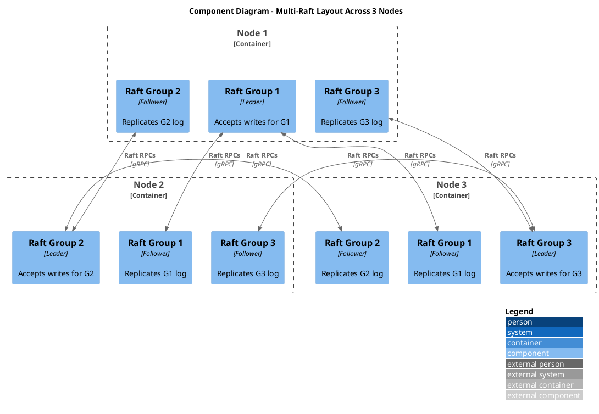

# 多 Raft 架构 / Multi-Raft Architecture

:::info C4 对应视图 / C4 Counterparts
- [**rr-raft 内部组件** / **rr-raft internals**](./c4/components-raft.md)
- [**选举流程** / **Election flow**](./c4/dynamic-leader-election.md)
:::

## 什么是多 Raft / What Multi-Raft Means

Multi-Raft 在单个节点上运行多个独立的 Raft 组，每个组负责特定分片。写吞吐通过跨组分片扩展；增加同一组的副本不会提高其写吞吐。

Multi-Raft runs multiple independent Raft groups on one node, with each group owning specific partitions. Write throughput scales by sharding across groups; adding replicas to one group does not increase its write throughput.

各组相互独立：

Groups are independent:

- **独立选举 / Independent elections**：一个组的选举不改变其他组的角色。 An election in one group does not change roles in another.
- **故障隔离 / Failure isolation**：一个组失去多数派时，其他组仍可服务。 Other groups can continue serving when one group loses quorum.
- **并行处理 / Parallel processing**：不同组并行复制日志和应用状态机，但仍共享节点 CPU、磁盘和网络资源。 Different groups replicate logs and apply state machines in parallel, while still sharing the node's CPU, disk, and network resources.

## 多组架构 / Multi-Group Architecture

三个节点可承载三个 Raft 组，同一组在不同节点上承担不同角色。

Three nodes can host three Raft groups, with each group assigning different roles to different nodes.

## 共识组管理器 / RaftGroupManager

`RaftGroupManager` 管理本节点的 Raft 组，维护 `GroupId` 到 `RaftNode` 的映射。

`RaftGroupManager` manages local Raft groups and maps each `GroupId` to a `RaftNode`.

- `start_group(group_id)`：创建并启动组。 `start_group(group_id)` creates and starts a group.
- `init_cluster(group_id, members)`：初始化多节点集群。 `init_cluster(group_id, members)` initializes a multi-node cluster.
- `stop_group(group_id)`：优雅关闭并移除组。 `stop_group(group_id)` gracefully stops and removes a group.
- `group_ids()`：列出本节点活跃组。 `group_ids()` lists active local groups.
- `get_raft(group_id)`：获取底层 `openraft::Raft` 句柄。 `get_raft(group_id)` gets the underlying `openraft::Raft` handle.

## 分片到组的映射 / Partition-to-Group Mapping

路由表定义分片归属；调整路由表可改变分片到组的映射。

The routing table defines partition ownership; updating it changes partition-to-group mappings.

- **`PartitionConfig`**：定义分片范围或 ID 规则。 `PartitionConfig` defines partition ranges or ID rules.
- **`GroupMeta`**：保存副本成员等配置面元数据；leader 是运行时状态，由客户端通过重定向发现。 `GroupMeta` stores configuration-plane metadata such as replicas; the leader is runtime state discovered through client redirects.
- **`RoutingTable`**：维护 `PartitionId → GroupId` 和 `NodeId → 网络地址` 映射。 `RoutingTable` maintains `PartitionId → GroupId` and `NodeId → network address` mappings.
- **`ConfigProvider`**：配置接口；内置 `MemConfigProvider` 和只读 `EtcdConfigProvider`。 `ConfigProvider` is the configuration interface, with `MemConfigProvider` and read-only `EtcdConfigProvider` implementations.

## 与 openraft 的集成 / openraft Integration

rr 使用 [openraft](https://docs.rs/openraft) 并为多组场景增加适配层。

rr uses [openraft](https://docs.rs/openraft) with adapters for multi-group operation.

- **`RrTypeConfig`**：通过 `declare_raft_types!` 绑定 `NodeId`（`u64`）、日志和状态机类型。 `RrTypeConfig` binds `NodeId` (`u64`), log, and state-machine types through `declare_raft_types!`.
- **`RaftNode`**：封装 `openraft::Raft<RrTypeConfig>`，组合 `RrLogStorage` 与 `RrStateMachine`。 `RaftNode` wraps `openraft::Raft<RrTypeConfig>` with `RrLogStorage` and `RrStateMachine`.
- **`RrStateMachine`**：把 rr 的业务状态机接入 openraft 的 apply、快照和恢复接口。 `RrStateMachine` connects rr's business state machine to openraft's apply, snapshot, and restore interfaces.

Raft 算法本身见 [Raft 论文](https://raft.github.io/raft.pdf)。 For the Raft algorithm itself, see the [Raft paper](https://raft.github.io/raft.pdf).

## 动态成员变更 / Dynamic Membership

组成员可在线变更：

Membership can change without stopping the group:

1. **添加 Learner / Add a learner**：`add_learner(group_id, node_id, addr)` 让新节点同步日志。Learner 不投票、不计入提交多数派，但复制仍消耗资源。 `add_learner(group_id, node_id, addr)` starts log replication. Learners neither vote nor count toward the commit quorum, but replication still consumes resources.
2. **变更成员 / Change membership**：`change_membership(group_id, members)` 通过联合共识提升 learner 或移除成员。缩容受 `MIN_VOTERS_AFTER_REMOVAL = 2` 守卫约束。 `change_membership(group_id, members)` uses joint consensus to promote learners or remove members. Shrinking is guarded by `MIN_VOTERS_AFTER_REMOVAL = 2`.
