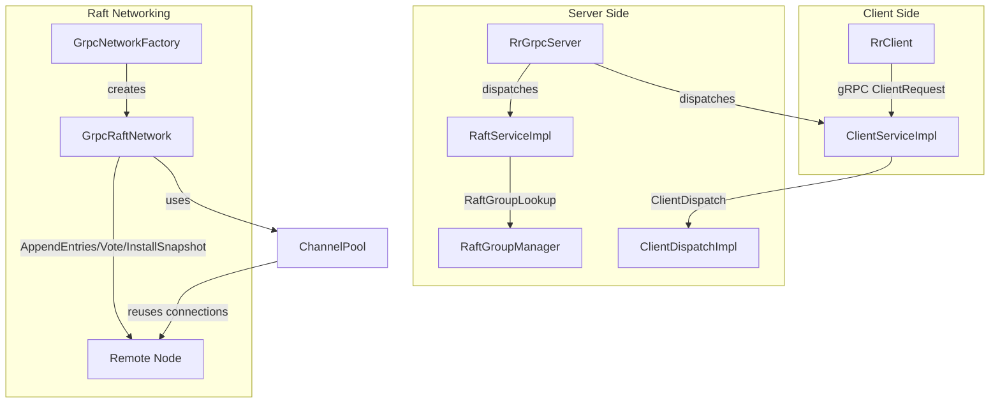

# 网络架构 / Networking

rr 框架的网络层基于 gRPC 构建，负责节点间的 Raft 共识通信以及客户端与服务器之间的请求交互。它采用了高效的连接池管理和清晰的服务抽象，以支持多 Raft 组的高性能通信。

---

The networking layer of the rr framework is built on gRPC, handling both inter-node Raft consensus communication and client-to-server request interactions. It employs efficient connection pooling and clear service abstractions to support high-performance communication for multi-Raft groups.

## gRPC 传输层 / gRPC Transport

rr 的网络通信建立在 `tonic` (Rust gRPC 框架) 和 `prost` (Protocol Buffers 生成工具) 之上。

- **双服务体系**：定义了两个核心 proto 服务：`RaftService`（用于内部 Raft RPC）和 `ClientService`（用于处理客户端请求）。
- **二进制负载**：为了解耦网络层与 Raft 核心逻辑，Raft 消息（如 `AppendEntries`）使用 `bincode` 序列化为二进制字节流，并封装在 proto 消息的 `bytes` 字段中。
- **服务端实现**：`RrGrpcServer` 统一封装了这两个服务，提供单一的网络入口。

---

rr's network communication is built on `tonic` (a Rust gRPC framework) and `prost` (a Protocol Buffers code generation tool).

- **Dual Service Architecture**: Two core proto services are defined: `RaftService` (for internal Raft RPCs) and `ClientService` (for handling client requests).
- **Binary Payloads**: To decouple the network layer from Raft core logic, Raft messages (e.g., `AppendEntries`) are serialized with `bincode` into binary byte streams and wrapped in the `bytes` fields of proto messages.
- **Server Implementation**: `RrGrpcServer` wraps both tonic services, providing a single network entry point.

## 架构图 / Architecture Diagram

## 连接池 / ChannelPool

为了避免每次 Raft RPC 通信时都重新建立 TCP 连接，rr 引入了 `ChannelPool`。

- **重用机制**：维护到远程节点的 gRPC 通道（Channel），实现连接复用。
- **并发安全**：内部使用 `DashMap<NodeId, Channel>`，支持无锁的并发访问。
- **延迟创建**：通道在第一次使用时按需创建，并在连接失败时自动移除。

---

To avoid the overhead of establishing a new TCP connection for every Raft RPC, rr introduces the `ChannelPool`.

- **Reuse Mechanism**: It maintains reusable gRPC channels to remote nodes, enabling connection persistence.
- **Concurrent Safety**: Uses `DashMap<NodeId, Channel>` internally for lock-free concurrent access.
- **Lazy Creation**: Channels are created on-demand during the first use and are automatically removed upon connection failure.

## Raft 服务 / Raft Service

`RaftServiceImpl` 是服务端处理内部共识请求的核心。

- **核心接口**：处理 `AppendEntries`、`Vote` 和 `InstallSnapshot` 请求。
- **多组路由**：每个 RPC 请求都包含 `group_id`，用于将请求路由到正确的 Raft 组。
- **解耦设计**：通过 `RaftGroupLookup` trait 进行分发。在 `rr-server` 中，`RaftGroupLookupImpl` 负责将请求投递给对应的 `RaftGroupManager`。

---

`RaftServiceImpl` is the server-side core for handling internal consensus requests.

- **Core Interfaces**: It handles `AppendEntries`, `Vote`, and `InstallSnapshot` requests.
- **Multi-Group Routing**: Each RPC request includes a `group_id` field to route the request to the correct Raft group.
- **Decoupled Design**: Dispatches requests via the `RaftGroupLookup` trait. In `rr-server`, `RaftGroupLookupImpl` is responsible for delivering requests to the corresponding `RaftGroupManager`.

## 客户端服务 / Client Service

`ClientServiceImpl` 负责处理来自 SDK 的客户端请求。

- **请求类型**：主要处理 `ClientRequest`（读写操作）和 `GetClusterInfo`（获取集群拓扑）。
- **调度逻辑**：使用 `ClientDispatch` trait。`ClientDispatchImpl` 会通过 `ShardRouter` 确定分片所在的 Raft 组，然后执行 `client_write`。
- **领导者重定向**：如果当前节点不是该组的 Leader，它会返回 Leader 的地址信息，供客户端 SDK 进行透明重定向。

---

`ClientServiceImpl` is responsible for handling client requests from the SDK.

- **Request Types**: Primarily handles `ClientRequest` (read/write operations) and `GetClusterInfo` (fetching cluster topology).
- **Dispatch Logic**: Uses the `ClientDispatch` trait. `ClientDispatchImpl` determines the Raft group where the shard resides via `ShardRouter`, then executes `client_write`.
- **Leader Redirect**: If the current node is not the Leader of the group, it returns the Leader's address information, enabling transparent redirection by the client SDK.

## Raft 网络工厂 / GrpcNetworkFactory

`GrpcNetworkFactory` 是连接 `openraft` 库与 rr 网络实现的桥梁。

- **Trait 实现**：实现了 openraft 的 `RaftNetworkFactory` 接口，为每个远程节点创建 `GrpcRaftNetwork` 实例。
- **网络抽象**：`GrpcRaftNetwork` 负责将 openraft 的 RPC 调用转换为 gRPC 消息，并通过 `ChannelPool` 发送出去。
- **循环依赖处理**：为了打破 `rr-network` 与 `rr-raft` 之间的循环依赖，网络工厂在本地重新定义了兼容的 proto 消息结构。

---

`GrpcNetworkFactory` serves as the bridge between the `openraft` library and rr's network implementation.

- **Trait Implementation**: Implements openraft's `RaftNetworkFactory` interface, creating `GrpcRaftNetwork` instances for each remote node.
- **Network Abstraction**: `GrpcRaftNetwork` is responsible for converting openraft RPC calls into gRPC messages and sending them via the `ChannelPool`.
- **Cycle Handling**: To break the circular dependency between `rr-network` and `rr-raft`, the network factory redefines compatible proto message structures locally.
