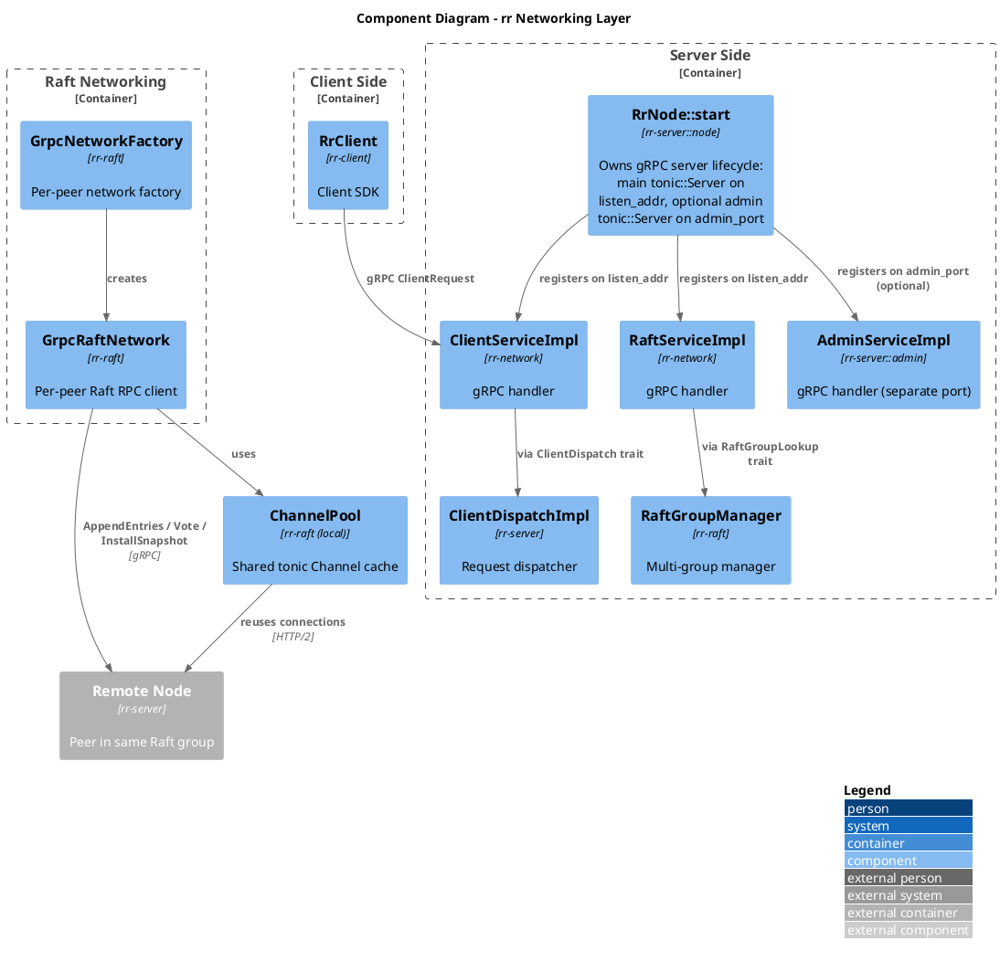

# 网络架构 / Networking

:::info C4 对应视图 / C4 Counterparts
- [**rr-network 组件图** / **rr-network component diagram**](./c4/components-network.md)
- [**容器级端口与流量** / **Container-level ports and traffic**](./c4/containers.md)
- [**生产部署端口** / **Production port layout**](./c4/deployment.md)
:::

rr 使用 gRPC 承载节点间 Raft 通信和客户端请求，并通过连接池复用通道。

rr uses gRPC for inter-node Raft traffic and client requests, with pooled channels reused across calls.

## gRPC 传输层 / gRPC Transport

网络层基于 `tonic` 和 `prost`。

The network layer is built on `tonic` and `prost`.

- **三个 proto 服务 / Three proto services**：`RaftService` 处理内部 Raft RPC，`ClientService` 处理客户端请求，`AdminService` 处理运维操作。 `RaftService` handles internal Raft RPCs, `ClientService` handles client requests, and `AdminService` handles operations.
- **二进制负载 / Binary payloads**：`AppendEntries` 等 Raft 消息用 `bincode` 序列化后放入 proto 的 `bytes` 字段。 Raft messages such as `AppendEntries` are serialized with `bincode` into proto `bytes` fields.
- **双 server 拓扑 / Dual-server topology**：`RrNode::start()` 在主 `listen_addr` 上注册 `RaftService`、`ClientService` 和 tonic-health；配置 `admin_port` 时，`AdminService` 使用独立的 `tonic::Server`。 `RrNode::start()` registers `RaftService`, `ClientService`, and tonic-health on the main `listen_addr`; when `admin_port` is configured, `AdminService` runs on a separate `tonic::Server`.
- **实验性 TCP / Experimental TCP**：`RaftTransport::Tcp` 用明文 `RRAF` 帧承载 `AppendEntries` 和 `Vote`，`InstallSnapshot` 始终使用 gRPC。TCP 无 TLS 和对端认证，仅限开发与基准测试；必须显式设置 `allow_insecure`，且绑定地址只能是 loopback。 `RaftTransport::Tcp` carries `AppendEntries` and `Vote` in plaintext `RRAF` frames; `InstallSnapshot` always uses gRPC. TCP has neither TLS nor peer authentication and is limited to development and benchmarks: it requires explicit `allow_insecure` and a loopback bind address.

## 架构图 / Architecture Diagram

## 连接池 / ChannelPool

`ChannelPool` 缓存到远程节点的 gRPC `Channel`，避免每次 RPC 重建连接。

`ChannelPool` caches gRPC `Channel`s to remote nodes instead of reconnecting for every RPC.

- **复用与并发 / Reuse and concurrency**：内部使用分片并发映射 `DashMap<NodeId, (String, Channel)>`，同时记录节点地址。 It uses the sharded concurrent map `DashMap<NodeId, (String, Channel)>`, retaining each node's address alongside its channel.
- **延迟创建 / Lazy creation**：首次使用时通过 `get_or_connect(node_id, addr)` 建连；地址变化会重拨。 The first call to `get_or_connect(node_id, addr)` connects lazily; an address change triggers a redial.
- **失效驱逐 / Eviction**：`remove(node_id)` 删除缓存通道；`GrpcRaftNetwork` 在 RPC 返回 `Code::Unavailable` 或超时时驱逐，下次调用重连。 `remove(node_id)` drops a cached channel; `GrpcRaftNetwork` evicts on `Code::Unavailable` or RPC timeout, so the next call reconnects.

## Raft 服务 / Raft Service

`RaftServiceImpl` 处理 `AppendEntries`、`Vote` 和 `InstallSnapshot`。每个请求携带 `group_id`，再通过 `RaftGroupLookup` 分发；在 `rr-server` 中由 `RaftGroupLookupImpl` 投递给对应的 `RaftGroupManager`。

`RaftServiceImpl` handles `AppendEntries`, `Vote`, and `InstallSnapshot`. Each request carries a `group_id` and is dispatched through `RaftGroupLookup`; in `rr-server`, `RaftGroupLookupImpl` forwards it to the corresponding `RaftGroupManager`.

## 客户端服务 / Client Service

`ClientServiceImpl` 提供四个 RPC：`Request` 处理写入；`ReadLocal` 读取本地副本，绕过共识且可能返回旧数据；`ReadLinearizable` 通过 ReadIndex 提供线性一致读；`GetClusterInfo` 返回运行时集群拓扑，选举期间 leader 可为 0。

`ClientServiceImpl` exposes four RPCs: `Request` for writes; `ReadLocal` for local replica reads that bypass consensus and may be stale; `ReadLinearizable` for ReadIndex-based linearizable reads; and `GetClusterInfo` for runtime cluster topology, where the leader can be 0 during an election.

`ClientDispatchImpl` 通过 `ClientDispatch` trait 接入，用 `ShardRouter` 找到目标组并执行 `client_write`。非 leader 返回 leader 地址，SDK 更新缓存并重试；客户端通过该重定向机制发现 leader。

`ClientDispatchImpl` plugs in through the `ClientDispatch` trait, uses `ShardRouter` to locate the group, and executes `client_write`. A non-leader returns the leader address; the SDK updates its cache and retries. Clients discover leaders through this redirect mechanism.

## Raft 网络工厂 / GrpcNetworkFactory

`GrpcNetworkFactory` 实现 openraft 的 `RaftNetworkFactory`，为每个远程节点创建 `GrpcRaftNetwork`。后者把 openraft RPC 转为 gRPC 消息，并通过本地 `ChannelPool` 发送。

`GrpcNetworkFactory` implements openraft's `RaftNetworkFactory` and creates a `GrpcRaftNetwork` per remote node. The latter converts openraft RPCs to gRPC messages and sends them through a local `ChannelPool`.

实际依赖方向为 `rr-raft` → `rr-client` → `rr-network`。为把 Raft RPC 客户端留在 `rr-raft` 且不反向依赖 `rr-network`，`rr-raft` 本地定义了与 `rr.raft.*` 线格式兼容的 prost 消息，并内嵌功能相同的 `ChannelPool`。

The dependency direction is `rr-raft` → `rr-client` → `rr-network`. To keep the Raft RPC client in `rr-raft` without a reverse dependency on `rr-network`, `rr-raft` defines local prost messages wire-compatible with `rr.raft.*` and embeds an equivalent `ChannelPool`.
