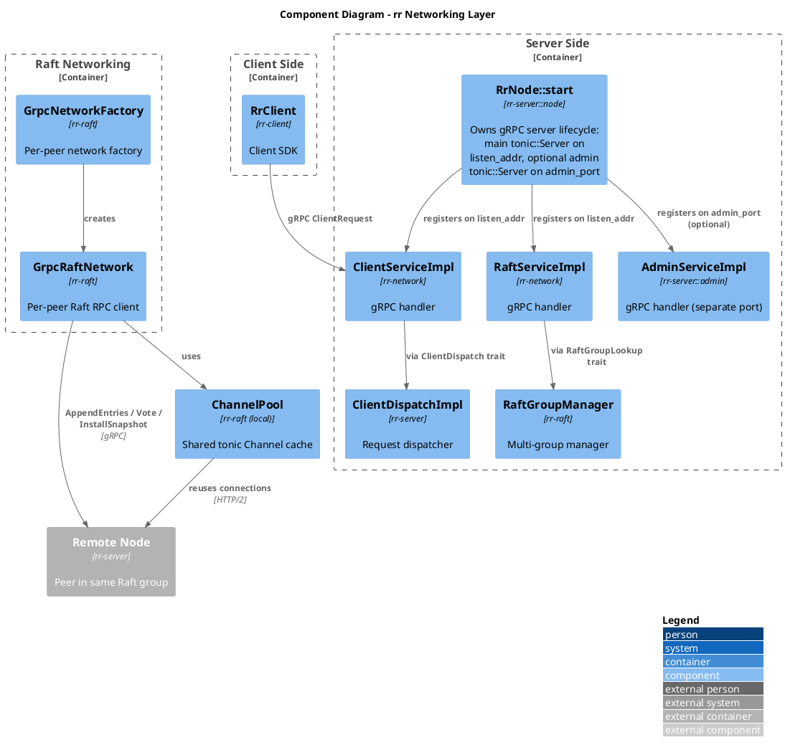

# 网络架构 / Networking

:::info C4 对应视图 / C4 Counterparts
- rr-network 组件图（RaftService / ClientService / AdminService / ChannelPool 细节）/ rr-network component diagram → [**c4/components-network.md**](./c4/components-network.md)
- 容器级端口 & 流量布局 / Port & traffic layout at container level → [**c4/containers.md**](./c4/containers.md)
- 生产部署端口方案 / Production port scheme → [**c4/deployment.md**](./c4/deployment.md)
:::

rr 框架的网络层基于 gRPC 构建，负责节点间的 Raft 共识通信以及客户端与服务器之间的请求交互。它采用了高效的连接池管理和清晰的服务抽象，以支持多 Raft 组的高性能通信。

---

The networking layer of the rr framework is built on gRPC, handling both inter-node Raft consensus communication and client-to-server request interactions. It employs efficient connection pooling and clear service abstractions to support high-performance communication for multi-Raft groups.

## gRPC 传输层 / gRPC Transport

rr 的网络通信建立在 `tonic` (Rust gRPC 框架) 和 `prost` (Protocol Buffers 生成工具) 之上。

- **三个 proto 服务**：`RaftService`（内部 Raft RPC）、`ClientService`（客户端请求）、`AdminService`（运维操作）。
- **二进制负载**：为了解耦网络层与 Raft 核心逻辑，Raft 消息（如 `AppendEntries`）使用 `bincode` 序列化为二进制字节流，并封装在 proto 消息的 `bytes` 字段中。
- **双 server 拓扑**：`RrNode::start()` 直接调用 `tonic::transport::Server::builder()`：`RaftService` + `ClientService` + tonic-health 注册到 `listen_addr` 上的主 server；`AdminService` 在配置 `admin_port` 时启动独立 `tonic::Server`，避免管理流量挤占共识带宽。
- **实验性 TCP 传输**：除 gRPC 外，`RaftTransport::Tcp` 提供实验性的明文 TCP 传输，用自定义 `RRAF` 二进制帧承载 `AppendEntries`/`Vote`；`InstallSnapshot` 始终回退到 gRPC。该帧协议无 TLS、无对端认证，仅限开发/基准测试场景——启用需显式设置 `allow_insecure`，且绑定地址被强制为 loopback。

---

rr's network communication is built on `tonic` (a Rust gRPC framework) and `prost` (a Protocol Buffers code generation tool).

- **Three proto services**: `RaftService` (internal Raft RPCs), `ClientService` (client requests), and `AdminService` (operator commands).
- **Binary Payloads**: To decouple the network layer from Raft core logic, Raft messages (e.g., `AppendEntries`) are serialized with `bincode` into binary byte streams and wrapped in the `bytes` fields of proto messages.
- **Dual-server topology**: `RrNode::start()` calls `tonic::transport::Server::builder()` directly. The main server (bound to `listen_addr`) hosts `RaftService` + `ClientService` + tonic-health. When `admin_port` is configured, a **separate** `tonic::Server` hosts `AdminService` so admin traffic cannot starve consensus bandwidth.
- **Experimental TCP transport**: Besides gRPC, `RaftTransport::Tcp` provides an experimental plaintext TCP transport that carries `AppendEntries`/`Vote` in a custom `RRAF` binary framing; `InstallSnapshot` always falls back to gRPC. The frame protocol has no TLS and no peer authentication, and is meant for development/benchmarking only — enabling it requires an explicit `allow_insecure` opt-in, and the bind address is forced to loopback.

## 架构图 / Architecture Diagram

## 连接池 / ChannelPool

为了避免每次 Raft RPC 通信时都重新建立 TCP 连接，rr 引入了 `ChannelPool`。

- **重用机制**：维护到远程节点的 gRPC 通道（Channel），实现连接复用。
- **并发安全**：内部使用 `DashMap<NodeId, Channel>`，支持无锁的并发访问。
- **延迟创建**：通道在第一次使用时通过 `get_or_connect(node_id, addr)` 按需创建；失效通道经 `remove(node_id)` 移除——`GrpcRaftNetwork` 仅在 RPC 返回 `Code::Unavailable` 时才驱逐通道。

---

To avoid the overhead of establishing a new TCP connection for every Raft RPC, rr introduces the `ChannelPool`.

- **Reuse Mechanism**: It maintains reusable gRPC channels to remote nodes, enabling connection persistence.
- **Concurrent Safety**: Uses `DashMap<NodeId, Channel>` internally for lock-free concurrent access.
- **Lazy Creation**: Channels are created on-demand via `get_or_connect(node_id, addr)` on first use; stale channels are dropped via `remove(node_id)` — `GrpcRaftNetwork` only evicts a channel when an RPC fails with `Code::Unavailable`.

## Raft 服务 / Raft Service

`RaftServiceImpl` 是服务端处理内部共识请求的核心。

- **核心接口**：处理 `AppendEntries`、`Vote` 和 `InstallSnapshot` 请求。
- **多组路由**：每个 RPC 请求都包含 `group_id`，用于将请求路由到正确的 Raft 组。
- **解耦设计**：通过 `RaftGroupLookup` trait 进行分发。在 `rr-server` 中，`RaftGroupLookupImpl` 负责将请求投递给对应的 `RaftGroupManager`。

---

`RaftServiceImpl` is the server-side core for handling internal consensus requests.

- **Core Interfaces**: It handles `AppendEntries`, `Vote`, and `InstallSnapshot` requests.
- **Multi-Group Routing**: Each RPC request includes a `group_id` field to route the request to the correct Raft group.
- **Decoupled Design**: Dispatches requests via the `RaftGroupLookup` trait. In `rr-server`, `RaftGroupLookupImpl` is responsible for delivering requests to the corresponding `RaftGroupManager`.

## 客户端服务 / Client Service

`ClientServiceImpl` 负责处理来自 SDK 的客户端请求。

- **请求类型**：共四个 RPC——`Request`（写请求）、`ReadLocal`（本地副本读，绕过共识，可能读到旧数据）、`ReadLinearizable`（基于 ReadIndex 的线性化读）和 `GetClusterInfo`（集群拓扑；group、leader、副本均来自 raft 运行时，选举中 leader 返回 0；客户端实际经重定向发现领导者）。
- **调度逻辑**：使用 `ClientDispatch` trait。`ClientDispatchImpl` 会通过 `ShardRouter` 确定分片所在的 Raft 组，然后执行 `client_write`。
- **领导者重定向**：如果当前节点不是该组的 Leader，它会返回 Leader 的地址信息，供客户端 SDK 进行透明重定向。

---

`ClientServiceImpl` is responsible for handling client requests from the SDK.

- **Request Types**: Four RPCs in total — `Request` (write requests), `ReadLocal` (local replica reads bypassing consensus, may return stale data), `ReadLinearizable` (linearizable reads via ReadIndex), and `GetClusterInfo` (cluster topology; group, leader, and replica fields all come from the raft runtime, with leader 0 mid-election; clients discover leaders via redirects).
- **Dispatch Logic**: Uses the `ClientDispatch` trait. `ClientDispatchImpl` determines the Raft group where the shard resides via `ShardRouter`, then executes `client_write`.
- **Leader Redirect**: If the current node is not the Leader of the group, it returns the Leader's address information, enabling transparent redirection by the client SDK.

## Raft 网络工厂 / GrpcNetworkFactory

`GrpcNetworkFactory` 是连接 `openraft` 库与 rr 网络实现的桥梁。

- **Trait 实现**：实现了 openraft 的 `RaftNetworkFactory` 接口，为每个远程节点创建 `GrpcRaftNetwork` 实例。
- **网络抽象**：`GrpcRaftNetwork` 负责将 openraft 的 RPC 调用转换为 gRPC 消息，并通过本地 `ChannelPool` 发送出去。
- **本地定义避免跨 crate 依赖**：`rr-network` 只依赖 `rr-core`（实际依赖方向为 `rr-raft` → `rr-client` → `rr-network`，不存在循环依赖）。为了让 Raft RPC 客户端留在 `rr-raft` 内部、无需依赖 `rr-network`，网络工厂在本地重新定义了与 `rr.raft.*` 线格式兼容（prost 注解一致）的 proto 消息结构，并内嵌一个本地 `ChannelPool`（与 `rr_network::ChannelPool` 功能相同）。

---

`GrpcNetworkFactory` serves as the bridge between the `openraft` library and rr's network implementation.

- **Trait Implementation**: Implements openraft's `RaftNetworkFactory` interface, creating `GrpcRaftNetwork` instances for each remote node.
- **Network Abstraction**: `GrpcRaftNetwork` is responsible for converting openraft RPC calls into gRPC messages and sending them via the local `ChannelPool`.
- **Local Definitions Avoid Cross-Crate Dependency**: `rr-network` depends only on `rr-core` (the actual dependency direction is `rr-raft` → `rr-client` → `rr-network`; no circular dependency exists). To keep the Raft RPC client inside `rr-raft` without depending on `rr-network`, the network factory redefines wire-compatible proto message structures locally (prost annotations matching `rr.raft.*`) and embeds a local `ChannelPool` (functionally identical to `rr_network::ChannelPool`).
