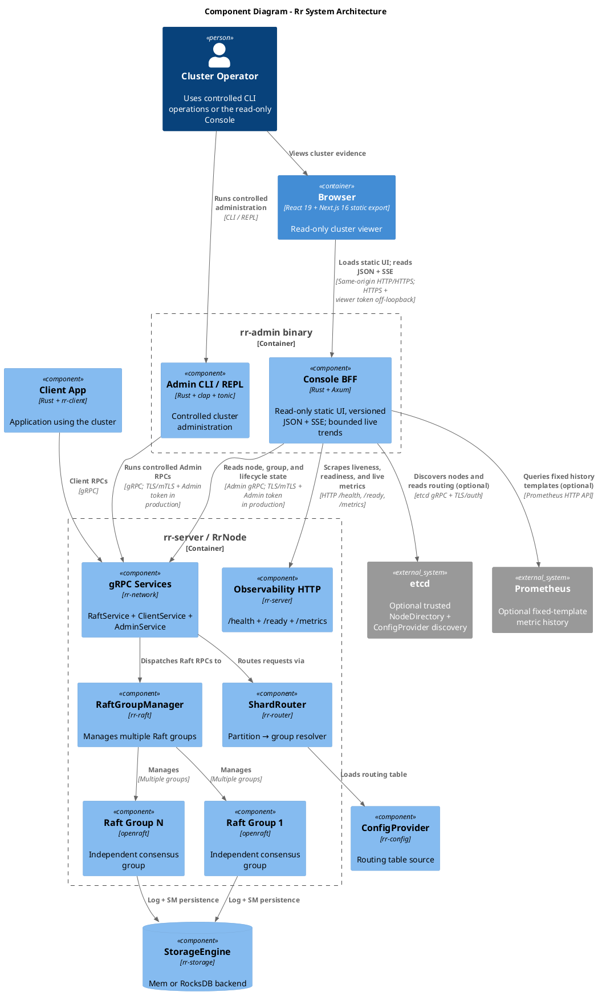

# 架构概览 / Architecture Overview

:::tip C4 架构图 / C4 Architecture Diagrams
本页给出高层说明；Context / Container / Component / Deployment / Dynamic 视图见 [**C4 架构图目录**](./c4/README.md)。

This page gives the high-level view. For Context / Container / Component / Deployment / Dynamic diagrams, see the [**C4 Architecture Diagrams index**](./c4/README.md).
- [系统级定位 / System-level framing](./c4/context.md)
- [部署单元 / Deployable units](./c4/containers.md)
:::

## Rr 是什么 / What Rr Is

Rr 是用 Rust 编写的分布式 Multi-Raft 共识框架。业务逻辑通过 `Service` 或 `StateMachine` 接口接入，框架负责共识、网络传输和成员变更。

Rr is a distributed Multi-Raft consensus framework written in Rust. Business logic plugs in through the `Service` or `StateMachine` traits; the framework handles consensus, networking, and membership changes.

一个节点可运行多个相互独立的 Raft 组。写吞吐通过跨组分片扩展，而不是通过增加单组副本扩展。

Each node can run multiple independent Raft groups. Write throughput scales by sharding across groups, not by adding replicas to one group.

## Rr 解决什么问题 / What Problem Rr Solves

[openraft](https://github.com/datafuselabs/openraft) 提供单个 Raft 组的引擎，日志存储、状态机和网络传输 trait 由使用方实现。分片系统还需要多组生命周期管理、`Partition → Group → Node` 路由、gRPC 与连接池、leader 发现与重定向、框架级幂等，以及成员编排、备份、限流和 TLS。Rr 集成这些组件并提供联测过的技术栈。

[openraft](https://github.com/datafuselabs/openraft) provides the engine for one Raft group; you implement its log-storage, state-machine, and network traits. A sharded system also needs multi-group lifecycle management, `Partition → Group → Node` routing, gRPC and connection pooling, leader discovery and redirects, framework-level idempotency, plus membership orchestration, backup, rate limiting, and TLS. Rr integrates these pieces into a jointly tested stack.

**非目标**：Rr 不是数据库，不提供 SQL、事务或二级索引；Raft 提供 CP 而非 AP 语义；单组写入不随副本数扩展；quorum 往返使跨地域写入存在延迟下限。如果单个 etcd、rqlite 或 consul 已满足需求，无需引入 Rr。详见 [与 openraft 的关系](./openraft-relationship.md) 和 [常见问题](../faq.md)。

**Non-goals**: Rr is not a database and provides no SQL, transactions, or secondary indexes. Raft is CP, not AP; one group's writes do not scale with replicas; quorum round-trips impose a latency floor on cross-region writes. If one etcd, rqlite, or consul deployment already meets your needs, Rr adds no value. See [Relationship with openraft](./openraft-relationship.md) and the [FAQ](../faq.md).

## 核心概念 / Key Concepts

| 概念 / Concept | 描述 / Description |
| :--- | :--- |
| **Node / 节点** | 运行 Rr 实例的物理机或虚拟机，由 `NodeId` 标识。 A physical or virtual machine running Rr, identified by `NodeId`. |
| **Group / 共识组** | 一个 Raft 共识实例，由 `GroupId` 标识。 One Raft consensus instance, identified by `GroupId`. |
| **Partition / 分片** | 数据路由的最小单位，映射到共识组，由 `PartitionId` 标识。 The smallest routing unit, mapped to a group and identified by `PartitionId`. |
| **Leader / Follower** | Raft 角色；只有 Leader 接受写请求。 Raft roles; only the Leader accepts writes. |
| **RoutingTable / 路由表** | 维护分片到组、节点到地址的映射。 Maps partitions to groups and nodes to addresses. |
| **ConfigProvider / 配置提供者** | 动态配置接口；内置可写内存实现 `MemConfigProvider` 和只读 etcd 实现 `EtcdConfigProvider`。 Dynamic-configuration interface, with writable in-memory `MemConfigProvider` and read-only etcd-backed `EtcdConfigProvider`. |

## 系统架构 / System Architecture

`rr-admin` 的 CLI/REPL 与 Console BFF 同属一个二进制，但承担不同路径：Admin CLI 执行受控管理写操作，Console
是只读 viewer，不是 Raft 控制面。浏览器使用 BFF 同源托管的 Next.js 静态导出，无需独立 Node.js 生产服务；
Console 故障不影响 Raft 节点。etcd 发现和 Prometheus 固定模板历史均为可选，实时趋势保存在有界内存中。详见
[集群管理控制台](../operations/cluster-admin-console.md)。

The `rr-admin` CLI/REPL and Console BFF share one binary but serve different paths: the Admin CLI performs controlled
administrative writes, while the Console is a read-only viewer, not a Raft control plane. The browser uses the Next.js
static export served by the BFF on the same origin, with no standalone Node.js production service; Console failure does
not affect Raft nodes. Both etcd discovery and Prometheus fixed-template history are optional, and live trends remain in
bounded memory. See [Cluster Admin Console](../operations/cluster-admin-console.md).

## 设计原则 / Design Principles

- **模块化 Crate / Modular crates**：按职责拆分 crate，以 trait 解耦。 Crates are split by responsibility and decoupled through traits.
- **可插拔后端 / Pluggable backends**：存储和配置提供者可替换。 Storage and configuration providers are replaceable.
- **显式路由 / Explicit routing**：请求路由由路由表决定。 Request routing is determined by the routing table.
- **业务接口 / Business interfaces**：业务代码实现 `Service` 或 `StateMachine`。 Business code implements `Service` or `StateMachine`.

## 与 openraft 的关系 / Relationship with openraft

Rr 使用 [openraft](https://github.com/datafuselabs/openraft) `v0.10.0-alpha.34` 的 Raft 实现，在其上增加多组管理、gRPC 网络、路由发现和统一生命周期管理。

Rr uses the Raft implementation from [openraft](https://github.com/datafuselabs/openraft) `v0.10.0-alpha.34`, adding multi-group management, gRPC networking, routing discovery, and unified lifecycle management.
