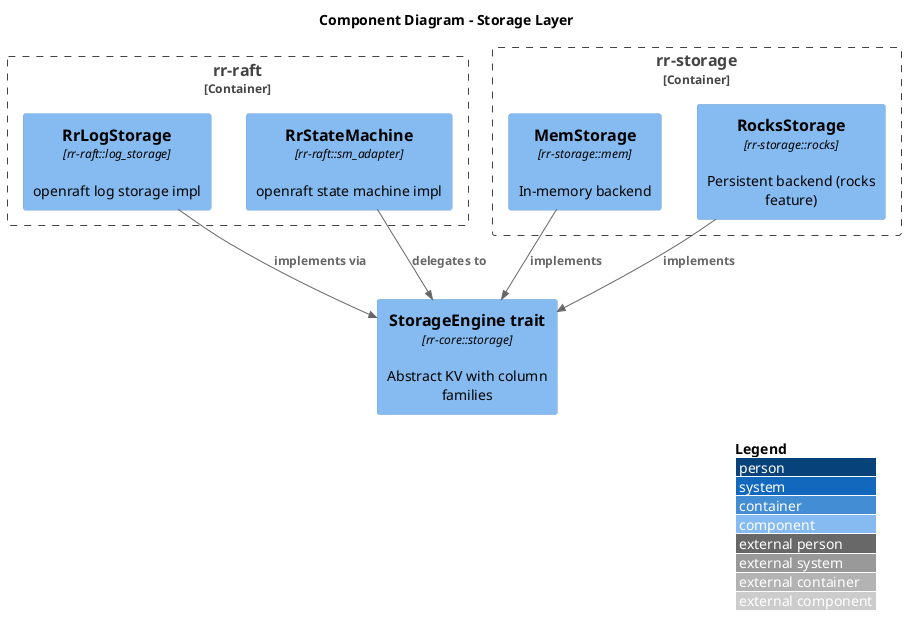

# 存储层 / Storage Layer

:::info C4 对应视图 / C4 Counterparts
- 存储在 rr-raft 内部的使用方式（RrLogStorage、sm_adapter）/ How rr-raft uses StorageEngine (RrLogStorage, sm_adapter) → [**c4/components-raft.md**](./c4/components-raft.md)
- 快照传输流程 / Snapshot transfer flow → [**c4/dynamic-snapshot-transfer.md**](./c4/dynamic-snapshot-transfer.md)
- 生产部署中的存储卷 / Storage volumes in production → [**c4/deployment.md**](./c4/deployment.md)
:::

rr 框架采用可插拔的存储架构，通过 `StorageEngine` trait 抽象了底层的数据存储。这使得框架可以根据运行环境和性能需求，在内存存储和持久化存储（如 RocksDB）之间灵活切换。

---

The rr framework employs a pluggable storage architecture, abstracting the underlying data storage via the `StorageEngine` trait. This allows the framework to flexibly switch between in-memory and persistent storage (such as RocksDB) based on the operating environment and performance requirements.

## 架构概览 / Architecture Overview

存储层连接了 Raft 日志、状态机以及底层的物理存储引擎。

---

The storage layer connects Raft logs, the state machine, and the underlying physical storage engines.

## StorageEngine 接口 / StorageEngine Trait

`StorageEngine` 是所有存储后端的通用接口，定义在 `rr-core` 中。它支持多列族（Column Family）操作，以隔离不同类型的数据。

---

`StorageEngine` is the common interface for all storage backends, defined in `rr-core`. It supports multi-column family operations to isolate different types of data.

主要的接口方法包括：

- `put(cf, key, value)`：向指定列族写入键值对。
- `get(cf, key)`：从指定列族读取值。
- `delete(cf, key)`：从指定列族删除键。
- `scan(cf, start, end)`：范围扫描，返回键值对列表。
- `write_batch(ops)`：原子性的批量写入操作。
- `flush()`：将数据刷新到持久化存储（内存后端为无操作）。
- `create_cf(name)`：创建新的列族。

---

Key interface methods include:

- `put(cf, key, value)`: Write a key-value pair to a specified column family.
- `get(cf, key)`: Read a value from a specified column family.
- `delete(cf, key)`: Delete a key from a specified column family.
- `scan(cf, start, end)`: Range scan, returning a list of key-value pairs.
- `write_batch(ops)`: Atomic batch write operation.
- `flush()`: Flush data to persistent storage (no-op for the memory backend).
- `create_cf(name)`: Create a new column family.

## 内存存储 / MemStorage

`MemStorage` 是框架的默认存储后端，适用于开发、测试以及不需要数据持久化的场景。

- **实现机制**：内部使用 `HashMap<String, BTreeMap<Vec<u8>, Vec<u8>>>`，每个列族对应一个 `BTreeMap`。
- **线程安全**：通过 `RwLock` 保证并发访问的安全。
- **数据特性**：数据完全存储在内存中，节点重启后数据会丢失。

---

`MemStorage` is the framework's default storage backend, suitable for development, testing, and scenarios where data persistence isn't required.

- **Implementation**: Internally uses `HashMap<String, BTreeMap<Vec<u8>, Vec<u8>>>`, with each column family corresponding to a `BTreeMap`.
- **Thread Safety**: Secured for concurrent access via `RwLock`.
- **Data Characteristics**: Data is stored entirely in memory and is lost upon node restart.

## RocksDB 存储 / RocksStorage

`RocksStorage` 提供生产级的持久化存储能力。

- **启用方式**：在 `Cargo.toml` 中开启 `rocks` feature。
- **配置选项**：通过 `RocksConfig` 调整 RocksDB 的性能参数，如 `block_cache_size_mb`、`write_buffer_size_mb`、`compression` 等。
- **键编码**：对于 Raft 日志索引等数字键，使用大端序（Big-Endian）编码，以确保 RocksDB 中的字节序与逻辑序一致，从而支持正确的范围扫描。
- **序列化**：使用 `bincode` v2 进行 Raft 类型和元数据的序列化。

---

`RocksStorage` provides production-grade persistent storage capabilities.

- **Enabling**: Enable the `rocks` feature in `Cargo.toml`.
- **Configuration Options**: Tune RocksDB performance parameters via `RocksConfig`, such as `block_cache_size_mb`, `write_buffer_size_mb`, `compression`, etc.
- **Key Encoding**: For numeric keys like Raft log indices, big-endian encoding is used to ensure byte order in RocksDB matches logical order, enabling correct range scans.
- **Serialization**: Raft types and metadata are serialized using `bincode` v2.

:::warning 当前接线状态 / Current wiring status
`rocks` 特性提供 RocksDB 后端与 `RocksLogStorage`。`rr-server --storage rocks` 现已把 **Raft 日志、vote 与 SM 快照**接入 RocksDB：`start_node` 为组管理器追加 `with_rocks_base_path("{data_dir}/raft-log")`（ADR A-0016），并经 `RaftNode::new_with_rocks_factory` 自动接上快照持久化（`sm-snapshot.bin`）。`--storage mem` 仍为全内存。注意：`NodeConfig.storage_engine` 字段仍是无消费者的遗留字段——持久化按组经 `with_rocks_base_path` / `--storage rocks` 后端开关驱动。

The `rocks` feature provides the RocksDB backend and `RocksLogStorage`. `rr-server --storage rocks` now wires the **Raft log, vote, and SM snapshot** into RocksDB: `start_node` adds `with_rocks_base_path("{data_dir}/raft-log")` to the group manager (ADR A-0016), and `RaftNode::new_with_rocks_factory` automatically attaches snapshot persistence (`sm-snapshot.bin`). `--storage mem` remains fully in-memory. Note: the `NodeConfig.storage_engine` field is still a vestigial field with no consumer — persistence is driven per-group via `with_rocks_base_path` / the `--storage rocks` backend flag.
:::

## 列族 / Column Families

rr 框架使用列族来隔离逻辑上的数据域，避免不同类型的数据相互干扰，并允许为不同类型的数据配置不同的存储策略。

- `raft_log`：存储 Raft 组的日志条目。
- `state_machine`：存储用户定义的业务状态机数据。
- `metadata`：存储 Raft 日志元数据，仅含两个键：`vote`（bincode 序列化的 Vote，任期与投票对象存储在一起）和 `last_purged`（最近一次日志清理的位置）。快照元数据不落盘（见下文"快照处理"）。

---

The rr framework uses column families to isolate logical data domains, preventing interference between different types of data and allowing different storage policies for each.

- `raft_log`: Stores log entries for Raft groups.
- `state_machine`: Stores user-defined business state machine data.
- `metadata`: Stores Raft log metadata with exactly two keys: `vote` (a bincode-serialized Vote, holding term and voted_for together) and `last_purged` (the position of the last log purge). Snapshot metadata is not persisted (see "Snapshot Handling" below).

## Raft 日志存储 / Raft Log Storage

框架提供了两种实现 openraft `RaftLogStorage` 接口的结构：

1. **RrLogStorage** (内存)：内部直接管理 BTreeMap，适用于开发环境。
2. **RocksLogStorage** (持久化)：通过 `StorageEngine` 接口调用 `RocksStorage` 存储日志。

两者都遵循 Raft 的一致性要求，确保日志的顺序写入和持久化。

---

The framework provides two implementations of the openraft `RaftLogStorage` interface:

1. **RrLogStorage** (In-memory): Manages a BTreeMap directly, suitable for development environments.
2. **RocksLogStorage** (Persistent): Invokes `RocksStorage` via the `StorageEngine` interface to store logs.

Both adhere to Raft's consistency requirements, ensuring sequential log writing and durability.

## 快照处理 / Snapshot Handling

`RrStateMachine` 封装了用户状态机的快照逻辑：

- **触发机制**：OpenRaft 根据快照策略 `SnapshotPolicy::LogsSinceLast(N)` 自动触发快照创建——每追加 N 条日志触发一次；N 默认为 50_000，可通过 `NodeConfig::snapshot_logs_since_last` 覆盖。
- **序列化**：快照数据通过 `bincode` v2 进行序列化。
- **安装快照**：当新节点加入或落后节点同步时，框架会通过网络传输快照，并调用状态机的 `restore` 方法进行恢复。

---

`RrStateMachine` wraps the snapshot logic for user state machines:

- **Triggering**: OpenRaft automatically triggers snapshot creation based on the configured `SnapshotPolicy::LogsSinceLast(N)` — one snapshot every N appended log entries; N defaults to 50_000 and can be overridden via `NodeConfig::snapshot_logs_since_last`.
- **Serialization**: Snapshot data is serialized via `bincode` v2.
- **Snapshot Installation**: When a new node joins or a lagging node synchronizes, the framework transfers snapshots over the network and invokes the state machine's `restore` method.
