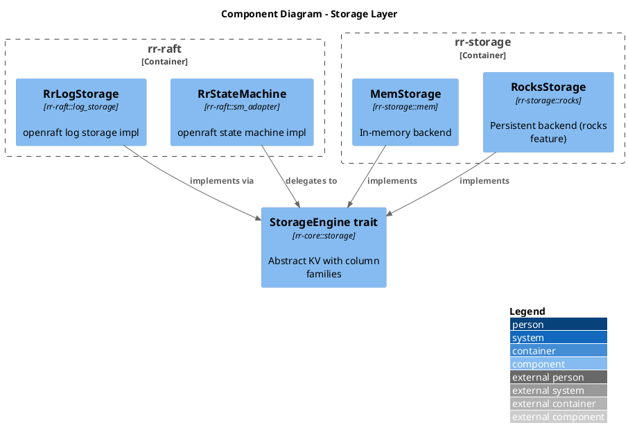

# 存储层 / Storage Layer

:::info C4 对应视图 / C4 Counterparts
- [**rr-raft 内部的存储使用** / **Storage use inside rr-raft**](./c4/components-raft.md)
- [**快照传输** / **Snapshot transfer**](./c4/dynamic-snapshot-transfer.md)
- [**生产存储卷** / **Production storage volumes**](./c4/deployment.md)
:::

`StorageEngine` trait 抽象键值存储和列族，后端可为内存或 RocksDB。Raft 日志是否持久化还取决于 `RaftGroupManager` 是否配置 `with_rocks_base_path`。

The `StorageEngine` trait abstracts key-value storage and column families over memory or RocksDB. Raft-log persistence separately depends on whether `RaftGroupManager` is configured with `with_rocks_base_path`.

## 架构概览 / Architecture Overview

存储层连接 Raft 日志、状态机和物理存储后端。

The storage layer connects Raft logs, state machines, and physical storage backends.

## StorageEngine 接口 / StorageEngine Trait

`StorageEngine` 定义在 `rr-core`，以列族隔离数据域。主要方法：

`StorageEngine` is defined in `rr-core` and uses column families to isolate data domains. Its main methods are:

| 方法 / Method | 行为 / Behavior |
| :--- | :--- |
| `put(cf, key, value)` | 写入键值对。 Write a key-value pair. |
| `get(cf, key)` | 读取值，不存在时返回 `None`。 Read a value, returning `None` when absent. |
| `delete(cf, key)` | 删除键。 Delete a key. |
| `scan(cf, start, end)` | 扫描 `[start, end)` 范围。 Scan the `[start, end)` range. |
| `write_batch(ops)` | 原子执行批量操作。 Apply a batch atomically. |
| `flush()` | 刷新列族写缓冲；内存后端为无操作。 Flush column-family write buffers; a no-op for memory. |
| `create_cf(name)` | 创建列族。 Create a column family. |

## 内存存储 / MemStorage

`MemStorage` 是默认后端，适用于开发、测试和无需持久化的负载。

`MemStorage` is the default backend for development, tests, and workloads that do not require persistence.

- **结构 / Layout**：`HashMap<String, BTreeMap<Vec<u8>, Vec<u8>>>`，每个列族对应一个 `BTreeMap`。 It uses `HashMap<String, BTreeMap<Vec<u8>, Vec<u8>>>`, with one `BTreeMap` per column family.
- **并发 / Concurrency**：由 `RwLock` 保护。 Access is guarded by `RwLock`.
- **持久性 / Durability**：数据只在内存中，重启即丢失。 Data is memory-only and lost on restart.

## RocksDB 存储 / RocksStorage

`RocksStorage` 提供持久化后端。

`RocksStorage` provides the persistent backend.

- **启用 / Enable**：在 `Cargo.toml` 中开启 `rocks` feature。 Enable the `rocks` feature in `Cargo.toml`.
- **配置 / Configuration**：`RocksConfig` 提供 `block_cache_size_mb`、`write_buffer_size_mb`、`compression` 等选项。 `RocksConfig` exposes options including `block_cache_size_mb`, `write_buffer_size_mb`, and `compression`.
- **键编码 / Key encoding**：Raft 日志索引等数字键使用大端序，使字节序与逻辑顺序一致。 Numeric keys such as Raft log indices use big-endian encoding so byte order matches logical order.
- **序列化 / Serialization**：Raft 类型和元数据使用 `bincode` v2。 Raft types and metadata use `bincode` v2.

:::warning 当前接线状态 / Current Wiring Status
`rocks` feature 提供 `RocksStorage` 和 `RocksLogStorage`。`rr-server --storage rocks` 通过 `with_rocks_base_path("{data_dir}/raft-log")` 为每组打开 RocksDB，并经 `RaftNode::new_with_rocks_factory` 持久化 Raft 日志、vote、SM 快照 `sm-snapshot.bin` 和 membership sidecar。`--storage mem` 保持全内存。`NodeConfig.storage_engine` 仍是节点共享引擎，并供 managed formation 使用；它不能替代 `with_rocks_base_path` 的日志与快照接线。

The `rocks` feature provides `RocksStorage` and `RocksLogStorage`. `rr-server --storage rocks` opens one RocksDB per group through `with_rocks_base_path("{data_dir}/raft-log")` and uses `RaftNode::new_with_rocks_factory` to persist the Raft log, vote, SM snapshot `sm-snapshot.bin`, and membership sidecar. `--storage mem` remains memory-only. `NodeConfig.storage_engine` is still the node's shared engine and is used by managed formation; it does not replace the `with_rocks_base_path` wiring for logs and snapshots.
:::

## 列族 / Column Families

列族隔离逻辑数据域，并允许按数据域配置存储选项。

Column families isolate logical data domains and allow domain-specific storage options.

- **`raft_log`**：Raft 日志条目。 `raft_log` contains Raft log entries.
- **`state_machine`**：用户业务状态机数据。 `state_machine` contains user state-machine data.
- **`metadata`**：仅含 `vote` 和 `last_purged` 两个键。`vote` 保存 bincode 序列化的任期与投票对象，`last_purged` 保存最近日志清理位置。 `metadata` contains exactly `vote` and `last_purged`: the bincode-serialized term/vote and the last log-purge position.

快照数据及重建所需元数据由 `SnapshotStore` 封装到 `sm-snapshot.bin`，不写入 `metadata` 列族。

Snapshot bytes and the metadata needed to rebuild them are enveloped by `SnapshotStore` in `sm-snapshot.bin`, not stored in the `metadata` column family.

## Raft 日志存储 / Raft Log Storage

rr 提供两种 openraft `RaftLogStorage` 实现：

rr provides two openraft `RaftLogStorage` implementations:

1. **`RrLogStorage`**：内存 `BTreeMap`，适用于开发；重启后日志丢失。 `RrLogStorage` uses an in-memory `BTreeMap` for development; its log is lost on restart.
2. **`RocksLogStorage`**：通过 `StorageEngine` 调用 `RocksStorage`，提供跨重启持久化。 `RocksLogStorage` uses `RocksStorage` through `StorageEngine` and persists logs across restarts.

两者实现相同的日志可见性与顺序契约，但只有 `RocksLogStorage` 提供持久化。

Both implement the same log-visibility and ordering contracts, but only `RocksLogStorage` is durable.

## 快照处理 / Snapshot Handling

`RrStateMachine` 封装用户状态机的快照与恢复。

`RrStateMachine` wraps snapshot and restore handling for user state machines.

- **触发 / Trigger**：openraft 按 `SnapshotPolicy::LogsSinceLast(N)` 触发；默认 `N = 50_000`，可由 `NodeConfig::snapshot_logs_since_last` 覆盖。 Openraft triggers snapshots with `SnapshotPolicy::LogsSinceLast(N)`; `N` defaults to `50_000` and can be overridden by `NodeConfig::snapshot_logs_since_last`.
- **序列化 / Serialization**：快照使用 `bincode` v2。 Snapshots use `bincode` v2.
- **安装 / Installation**：新节点或落后节点通过网络接收快照，再调用状态机 `restore` 全量替换状态。 New or lagging nodes receive snapshots over the network and call the state machine's `restore` to replace state wholesale.
- **持久化 / Persistence**：rocks 模式通过 `SnapshotStore` 原子写入 `sm-snapshot.bin`；mem 模式只保留内存快照。 In rocks mode, `SnapshotStore` atomically writes `sm-snapshot.bin`; mem mode keeps snapshots only in memory.
