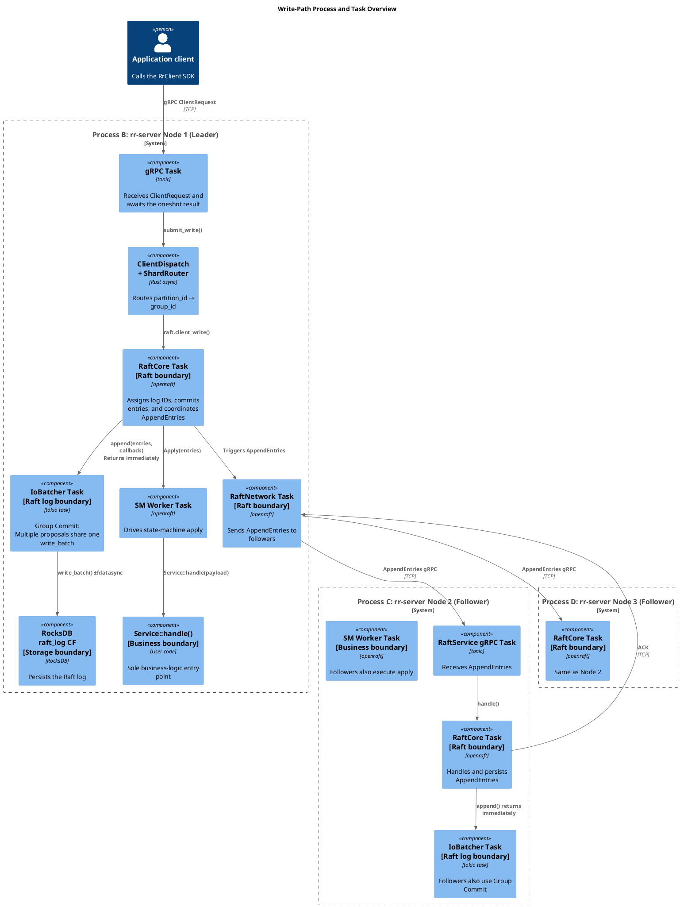
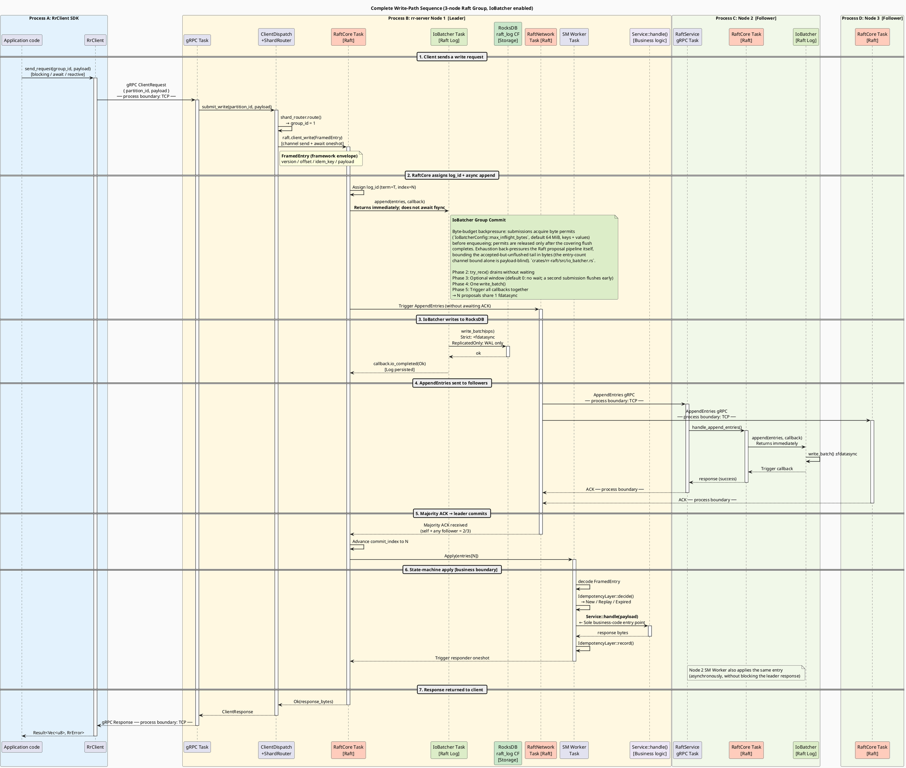

# 完整写入链路 / Complete Write Path

从 `send_request()` 到客户端响应，写入依次跨越进程、Tokio task、Raft、业务和存储边界。

From `send_request()` to the client response, a write crosses process, Tokio task, Raft, business-logic, and storage boundaries.

## 进程与 Task 总览 / Process and Task Overview

## 完整时序图 / Full Sequence

## 关键边界 / Key Boundaries

### 进程边界 / Process Boundary

图中是三个独立 OS 进程，仅通过 TCP gRPC 通信。进程崩溃不会直接破坏其他进程的内存，但该组失去多数派时仍无法提交写入。

The diagram shows three independent OS processes communicating only over TCP gRPC. A crash does not directly damage another process's memory, but the group still cannot commit writes after losing quorum.

### Raft 边界 / Raft Boundary

`RaftCore` 和 SM Worker 由 openraft 驱动；`IoBatcher` 是 rr-raft 的日志存储组件。应用业务代码不能注入这些协议路径。

Openraft drives `RaftCore` and the SM Worker; `IoBatcher` belongs to rr-raft's log storage. Application business code cannot inject logic into these protocol paths.

| 保证 / Guarantee | 条件与含义 / Condition and Meaning |
| :--- | :--- |
| 持久性 / Durability | `Strict` 下，`client_write()` 返回 `Ok` 前，条目已在多数派完成日志持久化。 Under `Strict`, `client_write()` returns `Ok` only after the entry's log persistence completes on a majority. |
| 顺序性 / Ordering | 各节点按相同 log index 顺序 apply。 Every node applies entries in the same log-index order. |
| Leader 唯一性 / Leader uniqueness | 同一 term 只有一个 leader 接受写入。 Only one leader accepts writes within a term. |

### 业务边界 / Business Boundary

`Service::handle(payload)` 是业务逻辑入口。

`Service::handle(payload)` is the business-logic entry point.

- SM Worker 会等待其完成；不要执行阻塞 IO，以免阻塞 apply pipeline。 The SM Worker awaits it; do not perform blocking IO and stall the apply pipeline.
- 接收者是 `&self`；内部可变状态需要自行同步，例如 `Arc<RwLock<HashMap>>`。 The receiver is `&self`; synchronize interior mutable state, for example with `Arc<RwLock<HashMap>>`.
- leader 和 follower 都按相同顺序执行，因此实现必须确定。 Leaders and followers execute it in the same order, so implementations must be deterministic.

### 存储边界 / Storage Boundary

| 存储 / Data | 位置 / Location | 策略与备注 / Policy and Notes |
| :--- | :--- | :--- |
| Raft 日志 / Raft log | `raft_log` CF | `Strict` 按批 fsync；`ReplicatedOnly` 只写 WAL。由 IoBatcher 写入，快照后可 purge。 `Strict` fsyncs per batch; `ReplicatedOnly` writes WAL without sync. IoBatcher writes entries; snapshots allow purging. |
| Raft 元数据 / Raft metadata | `metadata` CF | vote 写入直接 fsync；保存 vote 和 `last_purged`。 Vote writes fsync directly; stores vote and `last_purged`. |
| 业务快照 / State-machine snapshot | 内存缓存；rocks 模式写入 `sm-snapshot.bin`。 Memory-cached; rocks mode writes `sm-snapshot.bin`. | rocks 模式按 tmp → fsync → rename 原子落盘，用于 InstallSnapshot 和重启恢复；mem 模式仅内存。 Memory-cached; rocks mode atomically writes tmp → fsync → rename for InstallSnapshot and restart recovery, while mem mode is memory-only. |

### IoBatcher 组提交 / IoBatcher Group Commit

| 场景 / Scenario | 每次 fdatasync 覆盖的提案 / Proposals per fdatasync | 理想化 TPS 上限 / Idealized TPS Ceiling |
| :--- | :--- | :--- |
| 无组提交 / No group commit | 1 | ≈ 1 / fsync_latency |
| 组提交，并发 N / Group commit with concurrency N | N | ≈ N / fsync_latency |

该模型只描述 fsync 摊销，不包含 CPU、网络、锁或 RocksDB 其他开销，不代表实测吞吐保证。

This model describes only fsync amortization. It excludes CPU, network, locking, and other RocksDB costs and is not a measured-throughput guarantee.

## 线程与 Task / Threads and Tasks

| Task | 数量 / Count | 阻塞 OS 线程 / Blocks OS Thread | 职责 / Responsibility |
| :--- | :--- | :--- | :--- |
| gRPC accept loop | 1/server | 否 / No | 接受 HTTP/2 连接。 Accept HTTP/2 connections. |
| gRPC request task | 1/request | 否；等待 oneshot / No; awaits oneshot | 解码 ClientRequest 并等待 Raft 提交。 Decode ClientRequest and await Raft commit. |
| `RaftCore` task | 1/group | 否 / No | 分配 log_id、协调提交并触发 apply。 Assign log IDs, coordinate commit, and trigger apply. |
| `IoBatcher` task | 1/group | 否；RocksDB 写由 `RocksStorage` 的 `spawn_blocking` 执行 / No; RocksDB writes use `RocksStorage` `spawn_blocking` | 聚合提案并执行单次 `write_batch`。 Coalesce proposals into one `write_batch`. |
| RaftNetwork task | 1/follower/group | 否 / No | 向每个 follower 复制 AppendEntries。 Replicate AppendEntries to each follower. |
| SM Worker task | 1/group | 取决于 `Service::handle` / Depends on `Service::handle` | decode → 幂等判断 → `Service::handle`。 Decode → idempotency decision → `Service::handle`. |
| metrics ticker | 1/group | 否 / No | 每 5 秒发射 replication lag 指标。 Emit replication-lag metrics every 5 seconds. |
| config watch loop | 1/node | 否 / No | 监听 ConfigProvider 分区变化。 Watch ConfigProvider partition changes. |
| HTTP observability server | 1/node | 否 / No | 提供 `/health`、`/ready`、`/metrics`。 Serve `/health`, `/ready`, and `/metrics`. |
| admin gRPC server | 1/node | 否 / No | 提供 snapshot、membership、backup 等管理 RPC。 Serve snapshot, membership, backup, and other admin RPCs. |
