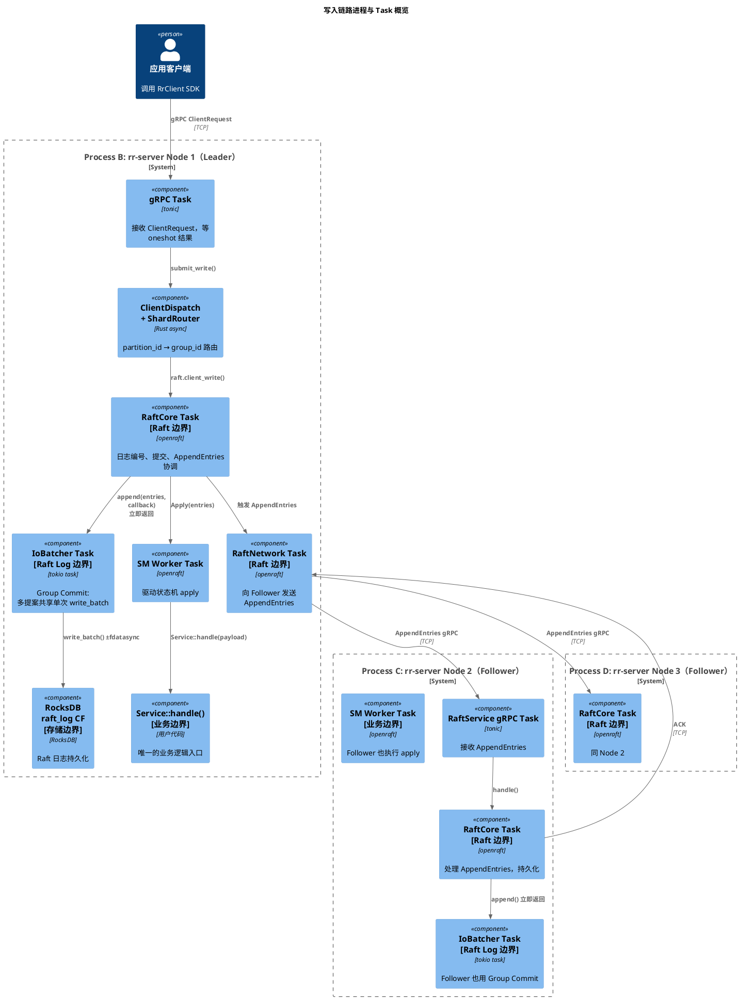
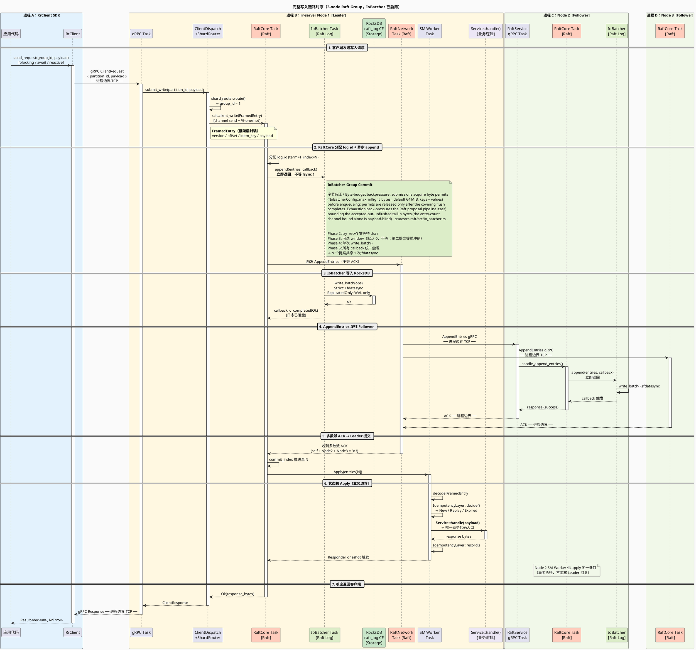

# 完整写入链路

从 `send_request()` 到客户端收到响应，完整追踪每一个**进程边界**、**线程/Task 边界**、
**Raft 边界**、**业务边界**和**存储边界**。

---

## 进程与 Task 总览

---

## 完整时序图

---

## 关键边界说明

### 进程边界

三个独立 OS 进程，内存完全隔离，仅通过 TCP gRPC 通信。一个进程崩溃不影响其他进程。

### Raft 边界

`RaftCore Task` 和 `IoBatcher Task` 由 openraft 管理，应用代码无法注入逻辑。
Raft 协议保证：

| 保证 | 说明 |
|---|---|
| 持久性 | `client_write()` 返回前，条目已写入多数派磁盘 |
| 顺序性 | 所有节点按相同 index 顺序 apply |
| Leader 唯一性 | 同 term 内只有一个 Leader 接受写入 |

### 业务边界

`Service::handle(payload)` 是**唯一**的业务逻辑入口：

- 由 SM Worker Task 同步调用——**不要在此做阻塞 IO**，否则会拖慢整个 apply pipeline
- `&self` 接收者，内部状态需自行并发保护（如 `Arc<RwLock<HashMap>>`）
- **Leader 和所有 Follower 都执行**，且严格按相同顺序——用户代码必须是确定性的

### 存储边界

| 存储 | CF | 持久化策略 | 备注 |
|---|---|---|---|
| Raft 日志 | `raft_log` | Strict: fsync/batch；ReplicatedOnly: WAL only | IoBatcher 写入；snapshot 后被 purge |
| Raft 元数据 | `metadata` | 每次写 fsync | vote / last_purged（写入频率极低）|
| 业务快照 | 内存缓存 + rocks 模式落盘 `sm-snapshot.bin` | rocks 模式原子落盘（tmp→fsync→rename） | openraft 管理；用于 InstallSnapshot + 重启恢复；mem 模式仅内存 |

### IoBatcher Group Commit 效果

| 场景 | 每次 fdatasync 覆盖提案数 | TPS 上限 |
|---|---|---|
| 无 IoBatcher（旧） | 1 | ≈ 1 / fsync_latency |
| IoBatcher + 并发 N | N | ≈ N / fsync_latency（随并发线性增长）|

---

## 线程 / Task 一览

| Task | 数量 | 阻塞 OS 线程？ | 职责 |
|---|---|---|---|
| gRPC accept loop | 1/server | 否 | 接受 HTTP/2 连接 |
| gRPC request task | 1/request | 否（await oneshot） | 解码 ClientRequest，等待 Raft 提交 |
| **RaftCore Task** | 1/group | 否 | Raft 核心：log_id 分配、提交协调、apply 触发 |
| **IoBatcher Task** | 1/group | 否（RocksDB 写由 `RocksStorage` 内的 spawn_blocking 执行）| Group commit：积累多提案，单次 write_batch |
| RaftNetwork Task | 1/follower/group | 否 | 向每个 Follower 流式发送 AppendEntries |
| **SM Worker Task** | 1/group | 取决于 Service::handle | decode → 幂等 → Service::handle |
| metrics ticker | 1/group | 否 | 每 5s 发射 replication lag 指标 |
| config watch loop | 1/node | 否 | 监听 ConfigProvider 分区变化 |
| HTTP 观测 server | 1/node | 否 | `/health` `/ready` `/metrics` |
| admin gRPC server | 1/node | 否 | snapshot / membership / backup 等管理 RPC |

## Changelog

| Date | Change |
|---|---|
| 2026-05-12 | 初始版本，基于 session 架构深度分析 |
| 2026-09-03 | 修正存储边界表：业务快照仅保存在内存（不落盘），重启后状态机经日志重放恢复 |
